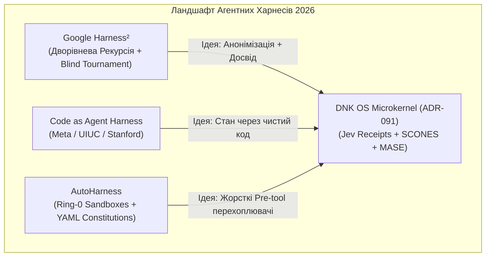

> [!metadata]- ⚙️ Системні метадані та інваріанти (MRH Header)
> ```yaml
> # --- DNK-MRH-HEADER ---
> mrh_id: "docs/architecture/reports/HARNESS2_SOTA_AUDIT_AND_ASSIMILATION_REPORT.md"
> purpose: "SOTA Agent Harness Audit (Harness2 by Google Research), Comparative Architecture Matrix, and DNK OS Microkernel Handoff."
> canonical_source: true
> alters_files: []
> triggers_tasks: []
> status: "Active"
> version: "2.0.0"
> updated_at: "2026-11-18"
> author: "DNK-e.com Maksym & Antigravity"
> # --- END DNK-MRH-HEADER ---
> ```

# 🏛️ SOTA Agent Execution Harnesses 2026: Аудит Harness² (Google Research), Порівняльний Аналіз та План Асиміляції в DNK OS Microkernel (ADR-091)


---

## 📌 1. Executive Summary & Контекст Передачі (Handoff)

Цей звіт фіксує результати комплексного архітектурного дослідження сучасних агентних харнесів (Agent Execution Harnesses) станом на кінець 2026 року з фокусом на репозиторій **[google-research/harness2](https://github.com/google-research/harness2)** та його зіставлення з мікроядром **DNK OS ([ADR-091](../DNK_HUB/docs/architecture/adr/ADR-091-DNK-OS-AGENTIC-MICROKERNEL-SPECIFICATION.md))**.

### Головна теза сесії
> **Сила та надійність автономного AI-агента у 2026 році визначається не стільки внутрішніми вагами LLM, скільки зовнішнім Execution Harness** — рантайм-оболонкою, що керує системними промптами, гардрейлами, викликами інструментів, контролем контексту, детермінованою верифікацією та рекурсивним самовдосконаленням (RSI).

---

## 🔬 2. Анатомія Google Harness² (`google-research/harness2`)

Проєкт Google Cloud AI Research та Northwestern University реалізує ідею: **«Harness the agent. Then harness its self-improvement»** (Самовдосконалення харнесу без перенавчання ваг моделі).

### 2.1. Архітектурне розділення на 3 осі (`harness2/core/spec.py`)
1. **Method**: Логіка рекурсії, евристики виправлення промптів, сліпа селекція та бібліотека уроків.
2. **Substrate**: Конкретний агентний рушій, який виконує роботу (OpenCode, Codex, Claude CLI).
3. **Benchmark / Task**: Адаптери задач (JobBench, LAB, WorkBuddy-Bench) із відокремленими метриками.

### 2.2. 8 компонентів поверхні мутацій (`SurfaceSpec` у `tree.py`)
Harness² формалізує файлове дерево харнесу, дозволяючи агенту модифікувати 8 дискретних зон:
- `c1: System Prompts` (контекст і роль);
- `c2: Guardrails` (жорсткі обмеження безпеки);
- `c3: Memory Structures` (формат збереження стану);
- `c4: Skills` (`SKILL.md` процедурні інструкції);
- `c5: Tool Guidance` (інструкції використання тулів);
- `c6: Scripts` (хелпери Python);
- `c7: Subagents` (конфігурація делегованих воркерів `sub_agents/*/AGENT.md`);
- `c8: Plugins / Middleware` (перехоплювачі подій та хуки).

> **Критична знахідка коду:** Інваріант відносних шляхів `normalize_rel()` у `tree.py` жорстко викидає `ValueError`, якщо шлях починається зі слеша або містить `..`. Це 100% збігається з інваріантом відносних шляхів DNK OS.

### 2.3. Дворівнева рекурсія (Dual-Level Recursion)
- **Task-Level Recursion (Propose–Probe–Compose)**:
  - Коли агент стикається з відкритою задачею (open-world), де немає готових юніт-тестів, редактор харнесу пропонує зміни (`proposer.py`), зондує їх вплив тестовими прогонами (`probe`), порівнює поведінку і зшиває підсумковий харнес (`composer`).
- **Harnessing-Level Recursion (Experience Reflection)**:
  - Після завершення задачі рефлектор аналізує відмінності між спробами, витягує узагальнений досвід (`<why>`, `<experience>`, `<edits>`) і оновлює покращений харнес для наступних тасок.

### 2.4. Сліпий арбітраж (`harness2/core/selection.py`)
- Вибір найкращого розв'язку відбувається **наосліп (Blind Tournament)**.
- Варіантам присвоюються анонімні ідентифікатори (`_anon_id: A, B, C...`) через seeded SHA-1 хеш, тому LLM-оцінювач не знає, де базове виконання, а де модифікований харнес. Це повністю усуває підлабузництво та галюцинації авторства (evaluator bias).

---

## ⚔️ 3. Три приховані ризики Harness² (3 Flaws Rule)

| Ризик / Вада | Механізм виникнення | Чому це небезпечно для продакшену | Рішення в DNK OS |
|---|---|---|---|
| **1. Експоненційний оверхед затримок і токенів** | Формула $4k$ агентних ролаутів і $3k$ стадій покращення харнесу. При $k=2$ запускається 8 повноцінних агентів і 6 LLM-редагувань. | Робить систему надто повільною (хвилини очікування) та дорогою для реальної розробки й вайбкодингу. | **MASE (≤ 25 дій)**, швидкий System 1 тріаж (<50ms) та ліміт викликів. |
| **2. Self-Referential Hallucination** | Відсутність детермінованого зовнішнього оракула у відкритих задачах. Агент сам оцінює зміни свого харнесу. | Зациклення у локальних оптимумах, суб'єктивне переписування правил під власні галюцинації. | **Jev Engine**: криптографічні чеки (SHA-256), `verify_all.sh` (AST-тести, лінтери, 0 exit code). |
| **3. Конфлікт із CoT сучасних моделей** | Динамічне накопичення жорстких інструкцій у промпт без урахування лімітів токенів. | Пригнічує нативні CoT/Thinking-токени нових моделей (Gemini 3.8 / Claude 3.7), викликаючи ентропію уваги. | **Zero-Bloat Invariant**: стоячий контекст ≤ 6,000 токенів на старті, JIT-підключення скілів. |

---

## 🗺️ 4. Ландшафт SOTA Харнесів 2026: Порівняльна Матриця



| Критерій | **Harness² (Google Research)** | **Code as Agent Harness (Meta/UIUC)** | **DNK OS Microkernel ([ADR-091](../DNK_HUB/docs/architecture/adr/ADR-091-DNK-OS-AGENTIC-MICROKERNEL-SPECIFICATION.md))** |
|---|---|---|---|
| **Архітектурна парадигма** | Дворівневий рекурсивний пошук (RSI) | Програмний субстрат (код замість промптів) | Агентне мікроядро (System 1 + System 2) |
| **Субстрат керування** | Файлове дерево (`c1..c8` Markdown + Python) | Чистий код (Python/TypeScript програми) | Pydantic SSOT контракти + AST-хуки + Markdown скіли |
| **Верифікація змін** | LLM-селектор (Blind Tournament) | Компільовані типи + exit codes | **Jev Engine (SHA-256)** + `verify_all.sh` |
| **Бюджет контексту** | Розростається при $4k$ ролаутах | Мінімальний (виконується локально) | **Суворий ліміт ≤ 6,000 токенів** на старті |
| **Самонавчання (RSI)** | **Harnessing-Level Memory Library** | Git branch versioning + PRs | **SCONES Memory** + `skills_curator.py` |
| **Швидкість реакції** | Повільно (хвилини через безліч ролаутів) | Миттєво (мілісекунди) | **Швидкий тріаж System 1 (<50ms)** + Swarm MASE |

---

## 🎯 5. Що асимілюємо в DNK OS (Конкретні Фічі для Hermes / Денчіка)

На основі аудиту визначено 3 конкретні технологічні запозичення:

### 1. Blind Anonymized Selection для Jev Engine / Adversarial Review
- **Що беремо:** Алгоритм сліпого хешування та рандомізації варіантів з `harness2/core/selection.py`.
- **Куди впроваджуємо:** `core/orchestrator/decision_draft.py` та модуль змагального аудиту (Builder vs Auditor).
- **Ефект:** Коли агенти пропонують 2 альтернативні реалізації, аудитор оцінює їх без підказки авторства чи моделі, що усуває упередження та галюцинації.

### 2. Формалізація `SurfaceSpec` у нашому Ring-0 хуку
- **Що беремо:** Контракт `SurfaceSpec` (ліміти `always_on_max` для системних інструкцій та валідацію шляхів за 8 категоріями).
- **Куди впроваджуємо:** `scripts/system/hermes_pre_tool_hook.py`.
- **Ефект:** Гарантія, що системні інструкції агента ніколи не перевищать 6,000 токенів, а генерація файлів не вийде за межі дозволених скілів/сервісів.

### 3. Паттерн структурованого досвіду `<experience>` у `skills_curator.py`
- **Що беремо:** Модель вилучення абстрагованого досвіду після виправлення збоїв (`<why>`, `<experience>`, `<edits>`).
- **Куди впроваджуємо:** `core/skills_curator.py`.
- **Ефект:** Автоматичне оновлення процедурних скілів після зафіксованих багів у форматі:
  ```json
  {
    "trigger": "liquid_syntax_error",
    "cause": "illegal_trailing_comma_in_schema",
    "rule_patch": "Ensure  JSON presets have zero trailing commas before commit."
  }
  ```

---

## ⚠️ Граничні Умови та Межі Відмови (Boundary Conditions)

- **Token Surface Ceiling**: Обмеження `always_on_max <= 6,000` токенів. При перевищенні ліміту хук блокує запуск агента з помилкою `SurfaceExceededError`.
- **Tournament Sample Floor**: Для валідності сліпого турніру необхідно мінімум 2 незалежні варіанти реалізації від різних підмоделей або промптів.

---

## 💡 Скептична Альтернатива (Skeptic Alternative)

- **Rule-Based Pre-Tool Hook**: Замість повної імплементації фреймворку Harness² використовувати існуючий легкозважений `scripts/system/hermes_pre_tool_hook.py` з жорсткими regex-перевірками розміру системного промпту та забороною абсолютних шляхів.

---

## 🚀 6. План Впровадження та Чекліст (Actionable Plan & Implementation Checklist)

Коли ви відкриваєте нову сесію або передаєте контекст іншому агенту, виконайте наступні кроки:

1. **Зчитати це рішення в [DECISION_REGISTRY_ADHD.md](docs/architecture/DECISION_REGISTRY_ADHD.md):**
   - Перевірити статус рішень `DEC-007` (Jev Engine), `DEC-012` (Zero-Framework Microkernel) та `ADR-091`.
2. **Перевірити локальний звіт:**
   - Канонічний файл: `docs/architecture/reports/HARNESS2_SOTA_AUDIT_AND_ASSIMILATION_REPORT.md`.
3. **Наступні завдання з реалізації (Черга дій):**
   - [x] **Етап 1**: Додати сліпий турнір (Blind Tournament Selector) у `core/orchestrator/decision_draft.py`.
   - [x] **Етап 2**: Інтегрувати обмеження `SurfaceSpec.always_on_max` у `scripts/system/hermes_pre_tool_hook.py`.
   - [x] **Етап 3**: Додати механізм вилучення `<experience>` у `core/skills_curator.py` для автоматичного лікування скілів.
