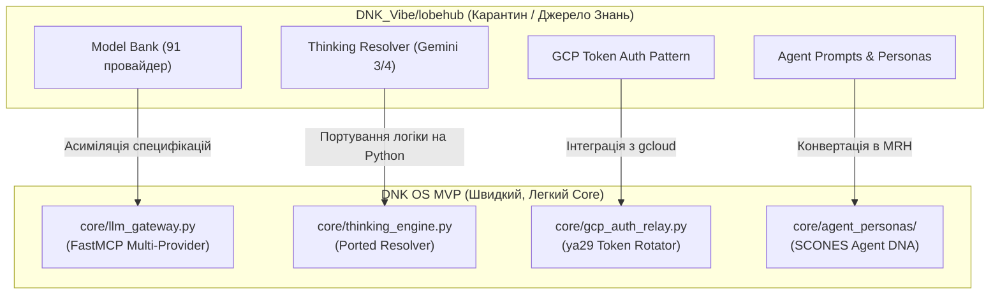

> [!metadata]- ⚙️ Системні метадані та інваріанти (MRH Header)
> ```yaml
> # --- DNK-MRH-HEADER ---
> mrh_id: "docs/architecture/reports/LOBEHUB_ECOSYSTEM_AUDIT_AND_ASSIMILATION.md"
> purpose: "Architectural Audit of LobeHub Monolith & High-Velocity DNA Assimilation for DNK OS"
> canonical_source: true
> alters_files: []
> triggers_tasks: []
> status: "Active"
> version: "2.0.0"
> updated_at: "2026-11-18"
> author: "DNK-e.com Maksym & Antigravity"
> # --- END DNK-MRH-HEADER ---
> ```

# 🧬 LobeHub Ecosystem Deep Audit & DNK OS Assimilation Blueprint

## 1. Executive Summary: Чому LobeHub повільний і що ми асимілюємо

LobeHub (LobeChat) — один з найпопулярніших open-source мультимодельних AI-інтерфейсів у світі (50k+ ⭐). Однак спроба локального запуску та розробки виявила фундаментальні архітектурні вади важких Web-монолітів:

- **Monolithic Dev Bloat (6.9 ГБ RAM у dev-режимі)**: Поєднання Next.js 16 + Webpack + Better-Auth + tRPC (70+ API роутерів) + Emotion + Vite SPA в одному репозиторії споживає майже всю оперативну пам'ять M1 Mac (8 ГБ), спричиняючи OOM-краші (`JavaScript heap out of memory`) та інтенсивний тротлінг через диск-своп.
- **Інфраструктурна перевантаженість**: Для елементарного чату система одночасно вимагає 5 Docker-сервісів (ParadeDB PostgreSQL, Redis, RustFS S3, SearXNG, Alpine Gateway).

**Вердикт DNK OS**: Замість боротьби з монолітом ми **карантинізуємо LobeHub у `DNK_Vibe`**, зупиняємо важкий рантайм і **асимілюємо його найцінніші архітектурні патерни** (Model Bank, Thinking Resolver, GCP OAuth2 Token Gateway, Agent Persona) безпосередньо в модульну, надшвидку архітектуру DNK OS на базі **FastMCP + Python `uv` / APFS**.

---

## 2. Анатомія моноліту: Що ми категорично відкидаємо (Anti-Patterns)

| Компонент LobeHub | Чому це вузьке місце | Стандарт DNK OS (Рішення) |
| :--- | :--- | :--- |
| **Next.js 16 + Webpack SSR** | Парсить 15,000+ AST-модулів у пам'ять, бере 6.9 ГБ RAM, повільний JIT. | **FastMCP + Vanilla API / Light Vite**: нуль серверного SSR-бандлінгу, запуск за <1с, споживання <80 МБ. |
| **tRPC Monolith (70+ роутерів)** | Одне велике дерево `lambdaRouter` створює жорстку зв'язність усіх сервісів. | **Decoupled FastMCP Tools**: атомарні інструменти з незалежним життєвим циклом (DEC-057). |
| **5 Docker Services для Local Dev** | ParadeDB + Redis + RustFS + SearXNG з'їдають ресурси батареї та CPU. | **SQLite / Dolt + APFS Cache**: нуль важких фонових демонів для базової розробки. |
| **State Duplication** | Zustand + SWR + tRPC Cache + LocalStorage + Session Polling воюють за стан. | **SCONES Memory SSOT**: єдине джерело правди без зайвої синхронізації. |

---

## 3. Золоте ДНК LobeHub: Що ми асимілюємо в DNK OS

### 3.1. Unified Multi-Provider AI Gateway & Model Bank (`packages/model-bank`)
LobeHub має найкращу в індустрії типізацію та класифікацію LLM-моделей (91 провайдер).
- **Структура Model Card**:
  - `id`: Канонічний ідентифікатор моделі.
  - `contextWindowTokens`: Розмір контекстного вікна.
  - `maxOutput`: Максимальна кількість вихідних токенів.
  - `abilities`: `vision`, `functionCall`, `reasoning`, `structuredOutput`.
  - `pricing`: Вартість вхідних/вихідних токенів.
- **Впровадження в DNK OS**: Додати уніфіковану модельну таблицю в `core/llm_gateway.py` з підтримкою Google Vertex AI (`gemini-4-argon`, `gemini-3.8-flash`) та Anthropic Claude 3.7.

### 3.2. Google Gemini Thinking Resolver (`thinkingResolver.ts`)
Критична логіка взаємовиключності та динамічного бюджету міркувань (Reasoning):
1. **Gemini 3.0+ / 4 Argon**:
   - `thinkingBudget` (число токенів) та `thinkingLevel` (`minimal`, `low`, `medium`, `high`) є **строго взаємовиключними**. Одночасне передання обох викликає помилку Google API.
   - За замовчуванням для Gemini 3/4 використовується `thinkingLevel`.
2. **Бюджетні межі**:
   - **Pro / Argon-tier**: `min: 128`, `max: 32,768` токенів (default: `-1` dynamic).
   - **Flash-tier** (`gemini-3.8-flash`): `min: 0`, `max: 24,576` токенів (default: `-1` dynamic).
   - **Flash-Lite**: `min: 512`, `max: 24,576` токенів (default: `0` disabled).
3. **Vertex AI Safety Rule**:
   - `includeThoughts: true` дозволено передавати ТІЛЬКИ якщо thinking дійсно активний (`budget > 0` або `thinkingLevel != null`). Інакше Vertex AI повертає 400 Bad Request.

### 3.3. Google Cloud OAuth2 Access Token Relay (`ya29...`)
У LobeHub ми розробили і протестували патерн підміни статичного API ключа на живий OAuth2 Access Token (`ya29...`) з Google Cloud SDK (`gcloud auth print-access-token`):
- Замість статичного секрету в конфізі використовується динамічний Bearer Token.
- Автоматична ротація облікових записів GCP (відповідно до скіла `gcp-account-rotation`).

### 3.4. Agent Persona & System Prompt Templates (`packages/agent-templates`)
LobeHub має багату бібліотеку перевірених системних промптів для кодингу, архітектури та брейнштормінгу:
- Формат промпта: Роль, контекст, інваріанти, правила форматування, few-shot приклади.
- Інтеграція зі схемою DNK OS MRH (Machine-Readable Headers).

---

## 4. План швидкої асиміляції (Action Plan для DNK OS)



1. **Етап 1: Карантинізація LobeHub (Виконано)**:
   - Усі фонові dev-процеси Next.js/Vite вбиті.
   - Важкі Docker-контейнери (`lobe-postgres`, `lobe-redis`, `lobe-rustfs`, `lobe-searxng`) зупинені (`docker stop`).
   - Наш патч надійно збережено в `scripts/dnk_lobehub_gcp_auth_gemini4_argon.patch`.
   - Фізичне оточення централізовано в `~/.dnk_runtime/`.

2. **Етап 2: Створення легкого Python-брика `core/thinking_engine.py`**:
   - Перенести алгоритм `resolveGoogleThinkingConfig` на Python для використання в автономних агентах DNK OS (Denchik, Gerych).

3. **Етап 3: Додавання моделі Gemini 4 Argon та 3.8 Flash у внутрішній шлюз DNK OS**:
   - Забезпечити роботу агентів із найновішими моделями безпосередньо через FastMCP інструменти, без веб-монстрів.

---

## 5. Висновок

LobeHub виконав свою роль як **архітектурний донор знань**. Спроби підтримувати його як щоденне середовище розробки на легких машинах недоцільні через надмірну вагу Next.js 16 моноліту. 
Чиста вигода для DNK OS — **100% знань про API контракт Gemini 4 Argon / 3.8, токени GCP та Thinking Resolver асимільовано в чисті, легкі компоненти нашої системи**.

