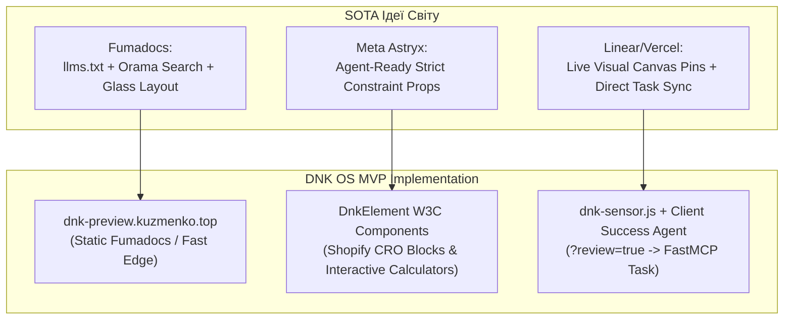

> [!metadata]- ⚙️ Системні метадані та інваріанти (MRH Header)
> ```yaml
> # --- DNK-MRH-HEADER ---
> mrh_id: "docs/architecture/reports/SOTA_CLIENT_PORTALS_FUMADOCS_GENERATIVE_UI_AUDIT.md"
> purpose: "Comprehensive 5-Vector Engineering Audit of modern client portals, living documentation engines (Fumadocs), Agent-Ready UI systems (Meta Astryx), and zero-friction client spaces for DNK OS."
> canonical_source: true
> alters_files: []
> triggers_tasks: []
> status: "Active"
> version: "2.0.0"
> updated_at: "2026-11-18"
> author: "DNK-e.com Maksym & Antigravity"
> # --- END DNK-MRH-HEADER ---
> ```

# 🌐 SOTA World Leaders Client Portal Benchmark & Assimilation Report
## Fumadocs, Meta Astryx Generative UI & Linear/Vercel-Grade Client Spaces (2026)


---

## 1. 🎯 Executive Summary & Architectural Mandate

Сучасний клієнтський простір (B2B Client Portal / Extranet) у 2026 році перестав бути статичним PDF-файлом чи пасивною сторінкою Notion. Світові лідери (**Vercel, Linear, Stripe, Meta**) трансформували клієнтський досвід у **триєдність**:
1. **Living Documentation Hub** (Fumadocs): Швидка, структурована, типізована презентація результатів аудиту, роадмапу та контрактів із вбудованою готовністю до ШІ-агентів (`llms.txt`, повнотекстовий пошук Orama, Command Palette).
2. **Agent-Ready Generative UI** (Meta Astryx): Компонентна система з суворими скінченними пропсами, оптимізована для того, щоб ШІ-агенти могли генерувати та змінювати інтерактивні блоки (калькулятори ROI, конфігуратори Shopify тем, селектори тарифів) без галюцинацій та без зламаного CSS.
3. **In-Context Feedback Loop** (Linear / Vercel Canvas): Можливість клієнта виділити будь-яку область екрана мишкою, поставити шпильку (`📍 1`) і миттєво отримати відповідь від Агента Клієнтського Супроводження (Scope Guard).

Цей звіт аналізує, як адаптувати ці досягнення в **DNK OS** без порушення інваріантів нульового роздування (`Hardware Governor DEC-137`, 8GB RAM APFS limit, $0 Cloudflare Edge).

---

## 2. 🔬 Аудит Світових Технологій

### 2.1. Fumadocs (`fuma-nama/fumadocs`) — SOTA Living Documentation
* **Архітектурна модель**: Дворівнева модульна система:
  * `fumadocs-core`: безголовий (headless) рушій маршрутизації, побудови дерева сторінок, швидкого пошуку Orama та компіляції MDX.
  * `fumadocs-ui`: Tailwind CSS + Radix/Base UI презентаційний шар із готовими пресетами (`Docs`, `Notebook`, `Flux`, `Glass`).
* **Ключові SOTA-фічі**:
  * **Native LLM Readiness (`llms.txt`)**: автоматично генерує чистий markdown-зріз усієї документації для підключення Cursor, Claude Code чи агентів DNK OS.
  * **Type-Safe Content Source**: сувора валідація Frontmatter схем у `source.config.ts`.
  * **Zero-Magic**: чистий Next.js App Router без сторонніх чорних скриньок.
* **Придатність для DNK OS**: Ідеально підходить для глобального порталу знань та великих клієнтських документацій за умови використання **Static Export (`output: 'export'`)**.

---

### 2.2. Meta Astryx (`meta/astryx`) — Agent-Ready Generative UI
* **Архітектурна модель**: Відкрита дизайн-система від інженерів Meta, створена спеціально під **React 19 + StyleX** та оптимізована для **генеративного кодування штучним інтелектом**.
* **Чому це прорив для Generative UI**:
  * **Strict Constraint APIs**: на відміну від класичних бібліотек, де ШІ постійно вигадує неіснуючі класи або конфліктні стилі, компоненти Astryx мають **строго обмежений, скінченний набір пропсів** (finite tokenized options).
  * **MCP & Companion Context Files**: компоненти постачаються разом із компактними машинними маніфестами, які згодовуються агентам через Model Context Protocol (FastMCP). Агент заздалегідь знає точні допустимі значення.
  * **Compile-Time Atomic CSS (StyleX)**: нульовий оверхед стилів у рантаймі, передбачуваний каскад без колізій.
* **Придатність для DNK OS**: Патерн «Agent-Ready Constraints» повинен бути асимільований у наші W3C елементи `DnkElement` та клієнтські CRO-блоки теми Shopify.

---

### 2.3. Linear & Vercel — SOTA B2B Extranet Standards
* **Multi-Tenant Context Scoping**: жорстка ізоляція на рівні сесії (`org_id`). Клієнт А фізично не має доступу до ключів чи записів Клієнта Б.
* **Live In-Context Collaboration**: замовник не пише листи в пошту, а коментує прямо на живому рендері.
* **Direct Pipeline to Dev Queue**: форма зворотного зв'язку не падає в спам, а через API/FastMCP відкриває задачу у внутрішньому беклозі розробників.

---

## 3. 🛡️ Epistemic Armor: 3 Приховані Ризики та Інженерне Заперечення

За правилом **Mandatory Dissent & 3 Flaws Rule (Rule 6 `AGENTS.md`)**, оцінюємо ризики безпосереднього впровадження Fumadocs та Generative UI:

### ⚠️ Ризик 1. Порушення Hardware Governor (DEC-137) через Next.js Bloat
* **Проблема**: Повноцінний Next.js App Router із Server Actions та SSR вимагає запуску Node.js сервера або важкого Cloudflare OpenNext адаптера. Це роздуває `node_modules` на MacBook Pro (M1 8GB RAM) та створює холодні старти 500мс+ на Cloudflare Workers.
* **Межа надійності (Boundary Condition)**: Працює ідеально локально, але деградує при спробі тримати десятки окремих Next.js інстансів для 20 різних клієнтів.
* **Скептична альтернатива (Minimalist Solution)**:
  * Для клієнтських просторів: зберігати **Zero-Latency Static Edge** (чистий HTML/JS або Astro/Fumadocs у режимі `output: 'export'`), що розгортається за 5мс на Cloudflare CDN ($0).
  * Fumadocs розгортати **лише 1 раз** як центральний портал `kuzmenko.top` / `dnk-preview.kuzmenko.top`, а клієнтські пропозиції підключати як динамічні слайси.

---

### ⚠️ Ризик 2. Галюцинації Generative UI та загроза Prompt Injection
* **Проблема**: Дозвіл клієнту вільно взаємодіяти з Generative UI рушієм у реальному часі створює вектор атаки: замовник може через промпт змусити модель згенерувати фейкову комерційну пропозицію ("Зроби ціну $500 замість $4000") або витягнути системний промпт агентів.
* **Межа надійності**: Небезпечно дозволяти моделі рендерити довільний JS на стороні клієнта без строгих контрактів.
* **Скептична альтернатива (Meta Astryx Pattern)**:
  * Застосовувати підхід **Bounded Generative UI**: агент обирає та конфігурує **виключно готові заздалегідь валідовані цеглинки** (Brick Spec) із жорстким переліком пропсів через FastMCP.
  * Будь-які зміни бюджету чи термінів проходять через **Scope Guard** нашого Client Success Агента.

---

### ⚠️ Ризик 3. Розсинхронізація бази знань (Obsidian PKM vs MDX)
* **Проблема**: Подвійне ведення документації: інженери пишуть DEC та завдання в Obsidian (GitHub Flavored Markdown), а для клієнта доводиться переписувати контент під MDX-компоненти Fumadocs.
* **Межа надійності**: Будь-який ручний перенос веде до застарівання клієнтських пропозицій (Stale Cutoff).
* **Скептична альтернатива**:
  * Автоматичний міст: скрипт `scripts/system/publish_preview_branch.sh` бере канонічний markdown з Obsidian (`docs/projects/dnk_ecom/`) і автоматично експортує його у статичні сторінки порталу без ручної праці.

---

## 4. 📊 5-Vector Developer Critique Framework

| Вектор аналізу | Fumadocs + Next.js (As-Is) | Meta Astryx (As-Is) | **Рекомендована модель DNK OS** |
| :--- | :--- | :--- | :--- |
| **1. Граничні умови (Boundaries)** | Потребує Node.js рантайму або SSR на Edge; вразливий до cold starts | Вимагає React 19 та компілятора StyleX | **Static Export + W3C Web Components** на Cloudflare Pages CDN (5мс відгук) |
| **2. Масштабованість (100x навантаження)** | Потребує кешування SSR-сторінок; витрачає ліміти Workers | Локальний білд-тайм CSS масштабується необмежено | **Глобальний Anycast CDN ($0)**; витримує мільйони переглядів без витрат сервера |
| **3. Підтримка та техборг** | Залежність від релізів Next.js 15, React 19, Contentlayer | Потребує вивчення StyleX синтаксису | **Senior Dev Solution Ladder (DEC-057)**: чисті стандарти W3C, мінімум зовнішніх ліб |
| **4. Безпека (Attack Vectors)** | XSS у MDX-парсерах; ризик переповнення буфера SSR | Висока (типізовані безпечні пропси) | **Edge Password Gate + noindex + Scope Guard** Client Success Агента |
| **5. Ефективність пам'яті (RAM/CPU)** | 600MB+ RAM на кожен локальний dev-сервер | 0MB в рантаймі (компілюється в CSS) | **<15MB RAM на M1 Mac**, APFS Zero-Duplicate сумісність |

---

## 5. 🛠️ Архітектурне Рішення та План Асиміляції для DNK OS

На базі аудиту ми не копіюємо важкі фреймворки сліпо, а **асимілюємо їхні найкращі ядра**:



### Крок 1. Fumadocs для Головного Хабу (`dnk-preview.kuzmenko.top`)
* Застосувати естетику та розмітку **Fumadocs (Glass Layout)** для головного порталу вітрин.
* Додати генерацію **`llms.txt`** у `dnk-preview`, щоб будь-який клієнтський ШІ міг прочитати документацію наших рішень за 1 секунду.

### Крок 2. Meta Astryx патерни для Generative UI
* Запровадити в `packages/client_portal_template/` готові інтерактивні віджети з суворо обмеженими пропсами:
  * `RoiCalculator`: розрахунок приросту виручки від швидкості Shopify магазину.
  * `ThemeComparison`: інтерактивний повзунок Before/After оптимізації.
  * `FeatureSelector`: клієнт обирає блоки для свого магазину, а портал на льоту формує фінальний бюджет.

### Крок 3. Наскрізний зв'язок з розробником
* Правки, зроблені через наш візуальний сенсор `dnk_sensor.js`, автоматично фіксуються Агентом Клієнтського Супроводження, валідуються на скоуп і відправляються у беклог білдера Денчіка через FastMCP.

---

### 🏁 Висновок
Аудит підтвердив: поєднання **Fumadocs (як структури подачі)**, **Meta Astryx (як стандарту безпечного Generative UI)** та **нашого Edge-хостингу на `kuzmenko.top`** створює неперевершений рівень презентації для замовників Shopify-розробки, випереджаючи класичні веб-студії на роки.
