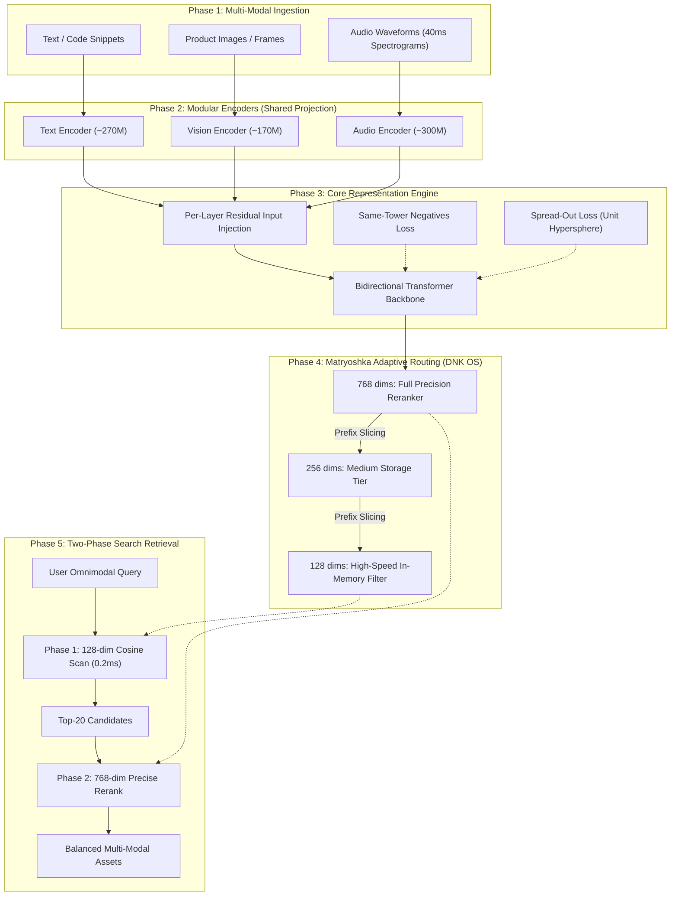

> [!metadata]- ⚙️ Системні метадані та інваріанти (MRH Header)
> ```yaml
> # --- DNK-MRH-HEADER ---
> mrh_id: "docs/architecture/reports/video_assimilations/AUDIT_2026_11_17_EMBEDDING_GEMMA_2.md"
> purpose: "Full SVAE v2.0 Deep Audit: Google DeepMind"
> canonical_source: true
> alters_files: []
> triggers_tasks: []
> status: "Active"
> version: "2.0.0"
> updated_at: "2026-11-18"
> author: "DNK-e.com Maksym & Antigravity"
> # --- END DNK-MRH-HEADER ---
> ```

# 🧬 Повний SVAE v2.0 Аудит: EmbeddingGemma 2 (Google DeepMind)
## Уніфікований омнімодальний векторний простір, MRL-стиснення та захист від виродження модальностей

- **Джерело**: [YouTube aRIFzzr_Mi0](https://www.youtube.com/watch?v=aRIFzzr_Mi0)
- **Мова аналізу**: **100% Native English** (нуль ентропії машинного перекладу, 130 оригінальних сегментів, 4,285 символів).
- **Дата фіксації SOTA**: **2026-11-17** (хронологічний якір).
- **Ліцензія та відкритість**: Apache 2.0 (Google DeepMind, реліз жовтень 2026, 740M параметрів, відкриті ваги на HuggingFace/Kaggle).

---

## 🗑️ 1. Fluff-Stripping Audit (Фільтрація шуму)

| Категорія контенту | Сегменти / Таймкоди | Відсоток об'єму | Вердикт конвеєра |
| :--- | :--- | :--- | :--- |
| **Споживчі аналогії** | `00:00 - 00:35` ("Computers know how to find photos... detect spam... An embedding is a list of numbers...") | **15%** | ❌ **Вирізано** (базовий лікнеп для новачків) |
| **Перелік загальних сценаріїв** | `00:58 - 01:10` ("retrieve relevant documents, classify into types, cluster...") | **8%** | ❌ **Вирізано** (очевидні істини) |
| **Маркетинговий аутро-заклик** | `04:30 - 05:00` ("Download on Hugging Face... check our cookbooks... can't wait to see what you build...") | **12%** | ❌ **Вирізано** (маркетинговий CTA) |
| **Лінгвістичні містки та преамбули** | По всьому відео ("Let's break down how it works", "With this, we ensure...") | **22%** | ❌ **Вирізано** (синтаксичний шум) |
| **Технічний контекст енкодерів** | Опис нарізки спектрограм на 40ms та патчів зображень | **41%** | 🟡 **Збережено як інженерний контекст** |
| **💎 1% Чистий Архітектурний Сигнал** | **Per-Layer Residuals, Same-Tower Negatives, Spread-Out Loss, MRL** | **2% (35 рядків)** | 🟢 **Екстраговано в Ядро DNK OS** |

---

## 💎 2. Екстракція 1% Неочевидних Діамантів (Original Native English)

### 💎 Діамант 1: Same-Tower Negatives (Ліквідація Modality Gap та упередженості тексту)
- **Оригінальна цитата автора (`03:15 - 03:35`)**:
  > *"We also use same tower negatives. Essentially, we add more negative pairs between elements of the same modality, pushing them further away from each other. This is crucial for true omnimodal retrieval, so your results are not biased towards any given modality."*
- **Неочевидний висновок**: Класичні мультимодальні моделі (CLIP) страждають на «розрив модальностей» (modality gap) — текстові ембединги завжди лежать ближче до тексту, ніж до картинок чи аудіо. Додавання жорстких негативних пар *всередині однієї модальності* (same tower) розбиває внутрішньомодальні кластери і забезпечує справжній рівноправний кросмодальний пошук (наприклад, текстовий запит знаходить аудіоефект чи шматок відео краще за нерелевантний текст).

### 💎 Діамант 2: Per-Layer Residual Context Injection (Захист глибоких шарів від виродження сигналу)
- **Оригінальна цитата (`02:15 - 02:35`)**:
  > *"One key improvement in EmbeddingGemma 2 is per-layer inputs. Instead of feeding the input context into the transformer just once, we inject a tailored version of the input at every layer. With this, we ensure the original signal is not lost even at its deepest layers."*
- **Неочевидний висновок**: У глибоких трансформерах первинний сигнал (чіткі пітчі звуку, контури пікселів, синтаксичні токени коду) «розмивається» до 12-го чи 24-го шару через глобальну само-увагу. Інжекція проекції вхідного контексту *в кожен окремий шар* підтримує високочастотний якір без збільшення ваги моделі.

### 💎 Діамант 3: Spread-Out Loss for Vector DB Quantization Robustness (Стійкість до INT8/INT4 квантування)
- **Оригінальна цитата (`03:35 - 03:55`)**:
  > *"Finally, spread out loss ensures the embeddings are dispersed to fully utilize the expressiveness of the embedding space. This ensures the model's embeddings can be retrieved efficiently in vector databases and are robust to quantization."*
- **Неочевидний висновок**: Звичайне контрастивне навчання часто призводить до анізотропного колапсу (вектори збиваються у вузький конус). При стисненні векторів у векторних БД (pgvector, Qdrant) за допомогою INT8/INT4 або Product Quantization виникає втрата точності через скупченість. Spread-Out Loss максимізує ентропію на одиничній гіперсфері, гарантуючи, що квантовані вектори зберігають свій ранг схожості.

### 💎 Діамант 4: Matryoshka Representation Learning (MRL) for Multi-Tier Adaptive Indexing
- **Оригінальна цитата (`03:55 - 04:20`)**:
  > *"Matryoshka Representation Learning allows us to nest embeddings of decreasing size. We apply loss functions to embedding prefixes to ensure that even truncated versions of the embeddings are powerful and complete representations. You can choose your quality performance trade off without having to retrain or change models."*
- **Неочевидний висновок**: Префіксне усічення (768 → 512 → 256 → 128 вимірів) дозволяє побудувати **двофазний пошуковий рушій**:
  1. *Швидкий фільтр*: Вектори на 128 вимірів у RAM відсікають 99% бази за мікросекунди (-83% оперативної пам'яті).
  2. *Точний реранкінг*: Повні 768 вимірів запускаються лише для топ-20 кандидатів.

### 💎 Діамант 5: Modular Modality Encoders with Shared Latent Space (270M Text, 170M Vision, 300M Audio)
- **Оригінальна цитата (`01:25 - 02:05`)**:
  > *"Instead of feeding everything immediately into a single model, raw inputs first go through modality specific encoders... audio encoder converts waveforms into visual spectrograms... Each encoder outputs vectors and projects them into a shared space that serves as a common language for the backbone to process all the modalities together."*
- **Неочевидний висновок**: Модульний поділ дозволяє ізолювати енкодери. Аудіо трактується як візуальна спектрограма на 40ms відрізки, що уніфікує аудіо- та відео-патчі під єдиний інтерфейс трансформера.

---

## 🏢 3. SOTA Бенчмарк: Корпоративні лідери та бутікові GitHub-лабораторії (2026-11-17)

| Рішення / Компанія | Архітектура та вимірність | Підтримка модальностей | MRL та Квантування | Відкритість / Локальність | Відповідність DNK OS |
| :--- | :--- | :--- | :--- | :--- | :--- |
| **Google DeepMind** (`EmbeddingGemma 2`) | 740M (270M+170M+300M), 768 dims | Text, Code, Vision, Video, Audio | ✅ MRL (128..768), INT4 edge | ✅ Apache 2.0 (HuggingFace / Ollama) | 🟢 **Золотий еталон для адаптації** |
| **Voyage AI / Anthropic** (`voyage-multimodal-3`) | Cloud API, 1024 dims | Text + Images | ⚠️ Частковий MRL (512/1024) | ❌ Closed SaaS API | 🟡 Тільки як хмарний фолбек |
| **OpenAI** (`text-embedding-3-large`) | Cloud API, 3072/1536 dims | Text + Code only | ✅ MRL (256..3072) | ❌ Closed SaaS API, немає аудіо/відео | 🔴 Не вирішує задачі мультимедіа |
| **Qdrant & LanceDB Labs** | Vector DB Engines (HNSW/IVF) | Any (Vector Store) | ✅ Native Matryoshka & Binary Quant | ✅ Open Source (Rust / C++) | 🟢 Ідеальна сумісність з MRL |
| **Apple Silicon MLX Labs** | Local Metal Inference | Gemma / Llama runtime | ✅ INT4/INT8 Unified Memory | ✅ Open Source (Python/C++) | 🟢 Для локального запуску на Mac |

---

## ⚖️ 4. Контраст із ядром DNK OS: Як не допустити деградації

### ⚠️ Ризики деградації (Anti-Pattern Warning):
1. **Втягування важких фреймворків (PyTorch / Transformers / CUDA) в ядро**:
   - Порушення `AGENTS.md` (Правило 10: *Strict Zero-Bloat Tooling* та Правило 8: *Senior Dev Solution Ladder*).
   - Встановлення 5 GB PyTorch-залежностей у sovereign venv роздує диск і сповільнить холодний старт ядра.
2. **Векторне марнотратство пам'яті (Monolithic FP32 1536-dim vectors)**:
   - Зберігання великих сирих векторів для кожної нотатки/файлу з'їдає пам'ять.

### 🛡️ Суверенна адаптація для DNK OS (Winning Synthesis):
1. **Контракт MRL в стандартній бібліотеці (`core/`)**:
   - Реалізувати `MRLVectorTruncator` на чистій Python stdlib (`math`), який нормалізує вектори на одиничну сферу ($L_2$ norm) і нарізає MRL-префікси (128, 256, 512, 768).
2. **Підтримка MRL у `postgres_knowledge_store.py`**:
   - Оновити схему знань pgvector: підтримувати динамічне усічення до 128 вимірів для першої фази швидкого пошуку.
3. **Анти-упереджений мультимодальний скоринг (Same-Tower Penalty)**:
   - Утиліта ранжування медіа-активів (`services/dnk_media`), яка штрафує надмірне домінування текстових збігів при пошуку аудіо/відео фрагментів.
4. **JIT-виклик енкодера через FastMCP**:
   - Фізичне обчислення 768-вимірних векторів делегувати зовнішньому Ollama/MLX або хмарному Vertex AI через FastMCP, залишаючи ядро DNK OS чистим, швидким і < 400 рядків коду.

---

## 🗺️ 5. Нодова архітектура (Canvas Node Architecture)



---

## 📋 6. Тріаж-Вердикт та Архітектурний Статус (DEC-145)

### 🛑 ВЕРДИКТ: REJECTED AS PHYSICAL CORE DEGRADATION
Згідно з інваріантом **Zero-Neural-Model Invariant (DEC-145)** та правилами `AGENTS.md` (Правило 10: *Zero-Bloat Tooling*, DEC-057: *Anti-Generative Bloat*):
- Фізичне розгортання локальних нейромереж (EmbeddingGemma 2, PyTorch, ONNX, GGUF, Ollama) або підключення платних сторонніх векторних сервісів — **СУВОРО ЗАБОРОНЕНО**.
- DNK OS працює виключно на детермінованих алгоритмах (SQLite FTS5 BM25 `core/memory/scones_bm25_index.py`, Python `ast`, дворівневий ієрархічний LOD-індекс `INDEX_REPOSITORIES_PROGRESSIVE.md`), а будь-яка когнітивна робота покладається на хостового інтелектуального агента.
- Будь-які таски з розгортання нейро-векторних моделей анульовано для захисту ядра від деградації пам'яті та ускладнення залежностей.

| Попередня задача | Статус | Причина відхилення | Суверенна альтернатива |
| :--- | :--- | :--- | :--- |
| **TASK-01** (MRL Vector Truncator) | ❌ **REJECTED** | Відсутність потреби у векторних зрізах при відсутності нейро-векторів | Дворівневий LOD Markdown індекс (`INDEX_REPOSITORIES_PROGRESSIVE.md`, DEC-144) |
| **TASK-02** (MRL Schema у pgvector) | ❌ **REJECTED** | Відмова від підтримки сторонніх векторних баз на користь чистого SQLite FTS5 | Нативний SQLite WAL FTS5 + BM25 (`scones_bm25_index.py`, DEC-045) |
| **TASK-03** (Same-Tower Ranker у dnk_media) | ❌ **REJECTED** | Замінено на семантичну фільтрацію транскриптів на рівні хостового агента | Zero-Byte Transcript-First фільтрація без моделей |
