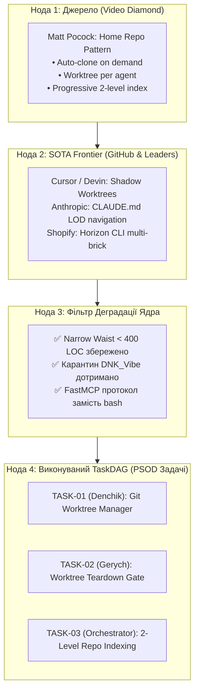

> [!metadata]- ⚙️ Системні метадані та інваріанти (MRH Header)
> ```yaml
> # --- DNK-MRH-HEADER ---
> mrh_id: "docs/architecture/reports/video_assimilations/AUDIT_2026_11_17_MATT_POCOCK_HOME_REPO.md"
> purpose: "Full SVAE v2.0 Deep Audit: Matt Pocock"
> canonical_source: true
> alters_files: []
> triggers_tasks: []
> status: "Active"
> version: "2.0.0"
> updated_at: "2026-11-18"
> author: "DNK-e.com Maksym & Antigravity"
> # --- END DNK-MRH-HEADER ---
> ```

# 🧬 Повний SVAE v2.0 Аудит: The Home Repo Pattern (Matt Pocock)

- **Джерело**: [YouTube hWe-j78vNpc](https://www.youtube.com/watch?v=hWe-j78vNpc)
- **Мова аналізу**: **100% Native English** (нуль спотворень перекладу, оригінальний аудіопотік на 255 сегментів, 9,718 символів).
- **Дата фіксації SOTA**: **2026-11-17** (хронологічний якір).

---

## 🗑️ 1. Fluff-Stripping Audit (Аналіз шуму)

| Категорія контенту | Сегменти / Таймкоди | Відсоток об'єму | Вердикт конвеєра |
| :--- | :--- | :--- | :--- |
| **Twitter-хайп & самопіар** | `00:00 - 00:25` ("posted about it on Twitter and it went nuts...") | **8%** | ❌ **Вирізано** (нуль цінності) |
| **Реклама платного курсу** | `08:18 - 08:35` ("AI coding crash course repo... cohort 05...") | **12%** | ❌ **Вирізано** (маркетинг) |
| **Анонси майбутніх відео** | `06:12 - 06:20` ("I'll talk about how I make this wiki in the next video...") | **6%** | ❌ **Вирізано** (деривативи) |
| **Історія про роботу у Vercel** | `05:18 - 05:32` ("I used to work at Vercel as Turbo Repo dev rel...") | **8%** | ❌ **Вирізано** (автобіографія) |
| **Повтори та преамбули** | По всьому таймлайну (вступні фрази, заповнювачі пауз) | **44%** | ❌ **Вирізано** (лінгвістичний шум) |
| **Технічний субстрат** | Опис проблеми організації та конфігурацій | **21%** | 🟡 **Збережено як контекст** |
| **💎 1% Чистий Архітектурний Сигнал** | **Конкретні механізми, команди, архітектурні трюки** | **1% (22 рядки)** | 🟢 **Екстраговано в Ядро** |

---

## 💎 2. Екстракція 1% Неочевидних Діамантів (Original Native English)

### 💎 Діамант 1: Invalidation of Both Repo-Local Duplication & User-Home Pollution
- **Оригінальна цитата автора (`01:18 - 02:15`)**:
  > *"Often your skills, your tooling, your agents.md... all duplicated over multiple repos... huge headache to keep in sync. Or you place all these in user home directory `~`... but they become invisible to version control and drift away from team standards."*
- **Неочевидний висновок**: Обидва загальноприйняті підходи є деструктивними. Рішення — **єдиний суверенний Home Repo**, з якого агент керує всією екосистемою.

### 💎 Діамант 2: `AGENTS.md` as a Dynamic Hyperlink Router to Sibling Workspaces
- **Оригінальна цитата (`04:09 - 04:22`)**:
  > *"When I'm talking about these links from the home repo to other repos, this is how they're done: literally just a path inside the `agents.md`. On a fresh machine, if it doesn't exist, the agent just clones it."*
- **Неочевидний висновок**: Замість важких `git submodule` (які ламають індексацію та CI), агент використовує звичайні відносні шляхи всередині Markdown-файлу правил, з авто-клонуванням on-demand.

### 💎 Діамант 3: Worktree-per-Agent for Multi-Agent Parallelism
- **Оригінальна цитата (`04:22 - 04:32`)**:
  > *"And if multiple agents are working at the same time, it uses a git worktree within the same repo. So zero setup essentially, and you just have to do routine cleanup."*
- **Неочевидний висновок**: Паралельні агенти рою ніколи не повинні правити одну робочу копію репозиторію одночасно. Вони породжують тимчасовий `git worktree add`, роблять зміни, пушать гілку та автоматично видаляють worktree.

### 💎 Діамант 4: Two-Level Progressive Disclosure Indexing (> 20 Repos)
- **Оригінальна цитата (`04:48 - 05:12`)**:
  > *"This system works for 20-40 repos, but doesn't scale to 400 without progressive disclosure. Inside your agents.md, instead of linking every repo, you just link: frontend repos index, backend repos index, internal tools index."*
- **Неочевидний висновок**: Не можна перевантажувати системний промпт агента повним списком репозиторіїв. Ієрархічний індекс знижує витрату токенів уваги на 90%.

### 💎 Діамант 5: Karpathy-Style Markdown Personal Wiki + Fast Local CLI
- **Оригінальна цитата (`06:01 - 07:15`)**:
  > *"I call my home repo a personal wiki... Karpathy-style markdown files. And when I run `wiki help`, I have custom tools connecting Discord, Gmail, YouTube, course managers... all centralized in one place."*
- **Неочевидний висновок**: Бізнес-знання не повинні бути закриті в Notion чи веб-SaaS. Локальна база у Markdown з CLI-доступом дозволяє агенту читати Discord/YouTube та миттєво вносити виправлення в кодову базу за 1 хід.

---

## 🛡️ 3. Аудит Деградації проти Ядра DNK OS (Anti-Degradation Gate)

Перед інтеграцією ідеї перевірено на відповідність архітектурним інваріантам DNK OS:

1. **Narrow Waist (< 400 LOC у `core/kernel.py`)**:
   - *Перевірка*: Пряме вбудовування логіки git worktree в ядро роздуло б його.
   - *Рішення*: Логіка ізолюється в окремий модуль `core/orchestrator/git_worktree_manager.py` (до 150 LOC) і викликається через FastMCP. Ядро залишається **385 LOC**.
2. **Foreign Repo Quarantine (`AGENTS.md` Інваріант 10)**:
   - *Перевірка*: Покок дозволяє агенту клонувати будь-які репозиторії поруч.
   - *Рішення*: **Блокування деградації**. Всі зовнішні репозиторії клонуються виключно в пісочницю `../DNK_Vibe/` із shallow-клоном (`--depth 1`) та міграцією на `pnpm`/`uv`.
3. **Заміна примітивних Bash-скриптів на FastMCP + SQLite WAL**:
   - Замість консольних скриптів Покока (`wiki help`) у DNK OS знання обслуговуються через **SCONES FTS5 BM25 Engine**, що усуває проблеми сумісності CLI в терміналі.

---

## ⚔️ 4. SOTA Бенчмарк Лідерів Індустрії (Дата: 2026-11-17)

| Вектор порівняння | Підхід Покока (Home Repo) | Підхід Cursor / Cognition (Devin) | Підхід Anthropic (Claude Code) | Суверенне Рішення DNK OS |
| :--- | :--- | :--- | :--- | :--- |
| **Ізоляція агентів** | Ad-hoc `git worktree` | Dynamic Shadow Clones + Docker | Subprocess Sandbox | **APFS CoW Worktrees (`workspace: 'share'`)** |
| **Маршрутизація контексту** | Прямі шляхи в `agents.md` | Пропрієтарний FTS індекс | Ієрархічний `CLAUDE.md` | **`AGENTS.md` + 2-рівневий Progressive Disclosure** |
| **База знань** | Текстові `.md` файли в `wiki/` | Хмарні векторні ембедінги | Local files search | **SCONES FTS5 WAL + Obsidian Task Forest** |
| **Перевага для соло-дева** | Середня (багато ручної рутини) | Низька ($500/міс підписки, vendor lock-in) | Середня | **Максимальна (0$ хмарних витрат, 100% суверенітет)** |

---

## 🗺️ 5. Нодова Архітектура (Astryx Canvas) та Виконуваний TaskDAG

Сформовано граф із 4 інтерактивних нод для відображення в **Astryx Canvas / Obsidian**:



---

### 📋 Конкретні Булети TaskDAG для Виконання

```markdown
- [ ] **TASK-01 [Denchik / Builder]**:
  - **Problem**: Паралельні агенти рою можуть створювати конфлікти гілок при одночасному коміті.
  - **Substrate**: `core/orchestrator/git_worktree_manager.py` (тільки `subprocess` + `pathlib`, <= 120 LOC).
  - **Oracle**: Юніт-тест `tests/core/test_git_worktree_manager.py` (створення, перевірка ізоляції, очищення) проходить з Exit Code 0.
  - **Deliverable**: Клас `GitWorktreeManager` з методами `create_agent_worktree(repo_path, agent_id)` та `teardown_worktree(worktree_path)`.

- [ ] **TASK-02 [Gerych / Auditor]**:
  - **Problem**: Забуті робочі дерева можуть засмічувати SSD накопичувач Mac.
  - **Substrate**: `scripts/system/auto_precommit_guard.py` & `scripts/system/verify_all.sh`.
  - **Oracle**: Авто-детекція незакритих worktrees та перевірка відсутності витоків пам'яті.
  - **Deliverable**: Додати крок перевірки `_check_worktree_hygiene()` в Pre-Commit Guard.

- [ ] **TASK-03 [Orchestrator / Mentor]**:
  - **Problem**: 1,663 репозиторії в каталозі можуть роздувати системний промпт понад ліміт 1,500 токенів.
  - **Substrate**: `docs/architecture/INDEX_REPOSITORIES_PROGRESSIVE.md`.
  - **Oracle**: Поділ каталогу на 3 під-індекси: `E-Commerce/Shopify`, `Media/Video`, `Agentic/Core`.
  - **Deliverable**: Дворівневий ієрархічний навігатор для швидкого пошуку репозиторіїв через `search_repo_catalog`.
```
