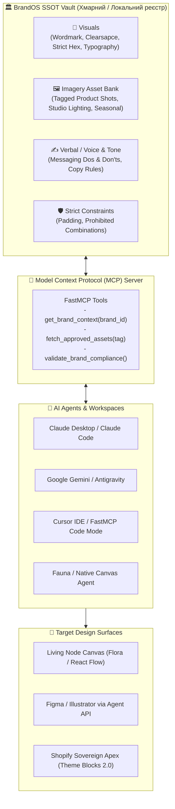

> [!metadata]- ⚙️ Системні метадані та інваріанти (MRH Header)
> ```yaml
> # --- DNK-MRH-HEADER ---
> mrh_id: "docs/architecture/reports/video_assimilations/AUDIT_2026_11_18_G_56Z18bTRM.md"
> purpose: "Exhaustive SVAE v2.0 Deep Audit: AIGA NY x Flora Lab #6 — MCP Workflows for Codifying Brand Guidelines & Generative Design Systems (BrandOS)"
> canonical_source: true
> alters_files: []
> triggers_tasks: []
> status: "Active"
> version: "2.0.0"
> updated_at: "2026-11-18"
> author: "DNK-e.com Maksym & Antigravity"
> # --- END DNK-MRH-HEADER ---
> ```

# 🧬 SVAE v2.0 Deep Audit: AIGA New York x Flora Lab #6
## MCP Workflows for Codifying Brand Guidelines & Generative Design Systems (BrandOS)

- **URL**: [https://www.youtube.com/watch?v=G_56Z18bTRM](https://www.youtube.com/watch?v=G_56Z18bTRM)
- **Host / Key Speakers**: Catherine (Cat) — Senior Designer at Flora (ex-Pentagram / Michael Bierut era), Olivia & Alec (Flora / AIGA New York)
- **Duration**: 108.6 хвилин (2,680 транскриптних сегментів)
- **Дата аналізу**: 18 листопада 2026 року
- **Triage Verdict**: **ADAPT & ENHANCE (P0 High-Leverage Strategic Asset)**

---

## 🎯 1. Головна проблема індустрії (The Problem Statement)

1. **Смерть статичних PDF-брендбуків ("v23_final_final.pdf")**:
   - Традиційні бренд-гайдлайни живуть у гігантських 50–100 сторінкових PDF-файлах. Щойно у бренді щось оновлюється (новий відтінок, коригування логотипу, правила відступів), версії між відділами дизайну, маркетингу та продажів миттєво розсинхронізуються.
2. **Промпт-колапс при роботі з AI (Claude / GPT / Midjourney)**:
   - Кожен сеанс генерації контенту починається з виснажливого та марнотратного завантаження PDF-файлів або ручного переліку гекс-кодів, шрифтів та правил: *"Ось наш брендбук, використовуй цей шрифт, ось гекс-коди #1A2B3C..."*.
   - Це призводить до роздування контекстного вікна (10–25k токенів мертвого вантажу на старті), сповільнення агентів та частих галюцинацій щодо візуальних інваріантів.
3. **Розрив між інструментами дизайну та агентами**:
   - Дизайнери змушені вручну бігати між Figma, Canvas, Photoshop та вікном чату AI, переносячи асети руками («Everything runs through the human»).

---

## 💎 2. Рішення переможця: BrandOS через протокол MCP (Model Context Protocol)

Flora у партнерстві з AIGA презентувала архітектуру **`BrandOS`**:



### Ключові принципи BrandOS:
1. **Single Source of Truth (SSOT)**: Бренд оновлюється командою в одному місці. Усі агенти всіх співробітників компанії миттєво підхоплюють оновлення без надсилання нових PDF.
2. **Zero-Token Prompting ("Stop calling out the basics")**: Промпт скорочується з 500 слів до одного речення:  
   `"Under the field 'Holiday Campaign', create 10 poster designs using the correct imagery and font system from the Rapid Cold Brew BrandOS."`  
   Агент через MCP сам звертається до сховища, отримує точні ліцензовані шрифти, офіційні SVG-логотипи та затверджені фотографії продукту.
3. **Teach Driving Before Flying Spaceships**:
   - *Car* = Інтерактивна топологічна канва (Canvas), де людина бачить геометрію нод і результат.
   - *Spaceship* = Агентський конвеєр MCP, який генерує десятки варіантів на канві за секунди.

---

## 🎨 3. Фреймворк генеративного дослідження: Матриця 3-х Рівнів (3-Tier Exploration Matrix)

Кетрін представила високоефективний авторський метод промптингу для генеративних дизайн-систем:

| Рівень (Tier) | Назва парадигми | Опис та ступінь свободи | Призначення |
| :--- | :--- | :--- | :--- |
| **Tier 1** | **Strict On-Brand Anchor** | 100% суворе дотримання брендбуку. Тільки затверджені кольори, шрифти, відступи, мінімалістична композиція. | Офіційні PDP магазину, карточки товарів, юридичні та корпоративні носії. |
| **Tier 2** | **Creative Seasonal Extension** | Легке розширення палітри та настрою під сезон/кампанію (наприклад, свята, літня колекція) при збереженні логотипу та базової типографіки. | Рекламні банери, Stories, Meta/TikTok Ads, розсилки Klaviyo. |
| **Tier 3** | **Avant-Garde Boundary Push** | Максимальний вихід за рамки: драматичне освітлення, несподівані текстури (оксамит, сніданок, неонове сяйво), кінематографічні сцени, при цьому **упаковка та силует продукту лишаються недоторканими**. | Hero-банери, вірусні креативи, фестивальні подачі, концептуальний брендинг. |

---

## 🛡️ 4. Суверенна адаптація для DNK OS (Sovereign Adaptation)

У нас у `DNK_OS` вже є:
- Мікроядро `core/kernel.py` та FastMCP сервер `core/kernel_mcp.py`
- Інструменти `compile_brand_design_tokens`, `lint_brand_design_tokens`, `extract_brand_design_tokens`
- Флагманська Shopify-тема «Зерно» (`services/dnk_shopify/DNK_Sovereign_Apex`) з токенами Astryx
- Медіа-воркхорс `services/dnk_media`

### Що нам необхідно додати до DNK OS для 100% паритету з BrandOS:
1. **Канонічний реєстр `core/brand/brand_os_vault.py`**:
   - Збереження структурованих брендів у JSON/YAML (`brands/<brand_id>/brand.yaml`):
     - `visual`: палітра, шрифти, масштаби заголовків, радіуси, тіні.
     - `assets`: локальні шляхи до SVG логотипів, прозорих PNG упаковок (packshots), фонів.
     - `tone`: правила тональності копірайтингу (наприклад, український лаконічний тон без канцеляризмів).
     - `rules`: перелік заборонених комбінацій (don'ts).
2. **FastMCP інструменти в `core/kernel_mcp.py`**:
   - `query_brand_os(brand_id: str, aspect: str = "all") -> str`: Повертає концентрований машиночитаний зріз бренду для агента (< 600 токенів).
   - `validate_brand_compliance(brand_id: str, diff_or_copy: str) -> str`: Автоматичний лінтинг коду Liquid/CSS або рекламного тексту на відповідність палітрі та тону BrandOS.
   - `generate_brand_tier_matrix(brand_id: str, campaign_goal: str) -> dict`: Формує готові промпт-матриці для Tier 1, Tier 2 та Tier 3 генерацій.
3. **Пряме живлення Shopify «Зерно» та Media Engine**:
   - При збірці PDP у `services/dnk_shopify` та генерації відео у `services/dnk_media` агент автоматично викликає `query_brand_os("zerno")` і отримує правильні кольори та слогани без необхідності ручного введення.

---

## ⚔️ 5. Епістемічна броня (Epistemic Armor): 3 приховані ризики та межі застосування

1. **Ризик 1: Ілюзія редагованості (Flat Image vs Editable UI)**:
   - У відео Кетрін відкрито визнає: генерації AI на канві — це здебільшого пласкі растрові зображення (Flat PNG). Вони візуально переконливо виглядають на прев'ю, але не є живим кодом чи векторними шарами Figma.
   - *Захист у DNK OS*: У нас фокус на **Design Tokens -> CSS/Liquid Theme Blocks 2.0**. Ми використовуємо BrandOS не для генерації нередагованих картинок з "запеченим" текстом, а для параметризації нативних компонентів (Web Components, CSS variables).
2. **Ризик 2: Затримка та тротлінг мульти-викликів MCP**:
   - У відео генерація 10 постерів через хмарний MCP займає кілька хвилин, змушуючи спікера заповнювати паузи ("with the joys of MCP, some things take a little while").
   - *Захист у DNK OS*: Наш FastMCP працює локально In-RAM на Apple Silicon без мережевих затримок (< 5 мс на запит).
3. **Ризик 3: Засмічення канви некерованими нодами**:
   - Якщо агенту не задати чіткі просторові координати поля, він хаотично розкидає десятки нод по всьому полотну.
   - *Захист у DNK OS*: Наш алгоритм **Topological Kahn Auto-Layout** у `MultiAgentSwarmCanvas.tsx` автоматично впорядковує ноди за графом залежностей $O(V+E)$.

---

## 📋 6. Actionable PSOD TaskDNA (TASK-DNK-BRANDOS-20261118-001)

- **Problem**: Розрізненість візуальних асетів, кольорів та тону між копірайтерами, Shopify-темою та відео-генератором; необхідність щоразу повторювати гекс-коди та шрифти в промптах.
- **Substrate**: `core/brand/`, `core/kernel_mcp.py`, `services/dnk_shopify/DNK_Sovereign_Apex`.
- **Oracle**: Юніт-тест `tests/core/test_brand_os.py` підтверджує < 5 мс відгук `query_brand_os("zerno")` та валідацію відповідності кольорів; `bash scripts/verify_all.sh` повертає exit code 0.
- **Deliverables**:
  1. `core/brand/brand_os_vault.py`: Легковажний локальний реєстр брендів (Zero-RAM, чистий Python).
  2. `core/brand/vault/zerno_brand.yaml`: Канонічний BrandOS для нашої флагманської теми «Зерно».
  3. `core/kernel_mcp.py`: FastMCP інструменти `query_brand_os` та `validate_brand_compliance`.
  4. `tests/core/test_brand_os.py`: Повне детерміноване тестове покриття.
