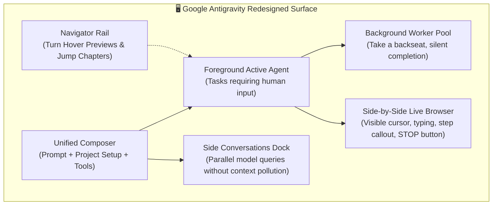

> [!metadata]- ⚙️ Системні метадані та інваріанти (MRH Header)
> ```yaml
> # --- DNK-MRH-HEADER ---
> mrh_id: "docs/architecture/reports/video_assimilations/AUDIT_2026_11_19_jYWQtG8BBSY.md"
> purpose: "Exhaustive SVAE v2.0 Deep Audit: Google Antigravity, Redesigned (Official DeepMind Architecture Launch)"
> canonical_source: true
> alters_files: []
> triggers_tasks: ["TASK-DNK-AGY-REDESIGN-20261119-001"]
> status: "Active"
> version: "1.0.0"
> updated_at: "2026-11-19"
> author: "DNK-e.com Maksym & Antigravity (SVAE v2.0 Deep Synthesis)"
> # --- END DNK-MRH-HEADER ---
> ```

# 🧬 SVAE v2.0 Deep Audit: Google Antigravity, Redesigned
## Official Architecture & UI Evolution by Google DeepMind / Google Antigravity Team

- **URL**: [https://www.youtube.com/watch?v=jYWQtG8BBSY](https://www.youtube.com/watch?v=jYWQtG8BBSY)
- **Канал / Автор**: Офіційний канал Google Antigravity (Google DeepMind)
- **Тривалість**: 4 хвилини 26 секунд
- **Дата релізу**: Листопад 2026 року
- **Triage Verdict**: **ADAPT & ALIGN (P0 Core Architectural Alignment)**

---

## 🧭 1. Архітектурна парадигма: Перехід від чат-ботів до диспетчерської мульти-агентів (Mission Control)

Офіційний реліз «Google Antigravity, Redesigned» документує фундаментальний зсув у світовій інженерії AI-розробки: **одиночні діалогові вікна (Single-Turn Chatbots) остаточно визнані застарілими для реальної інженерії**. 

Головна теза редизайну від команди Google DeepMind:
> *"Working with multiple agents at once pulls your attention in too many directions. You should not have to click through tabs to see what is running, what finished, or what is blocked on you. The interface should keep the work that needs you right in front, while background tasks take a backseat."*

Інтерфейс Antigravity повністю перебудовано з нуля як **поверхню для паралельної оркестрації множини автономних агентів**, де розробник виступає не автором кожного рядка коду, а директором системи (Human-in-the-Loop Orchestrator).



---

## ⚡ 2. Шість ключових інженерних піларів нового інтерфейсу

### 2.1. Оркестрація паралельних агентів без перемикання вкладок (Surface-Level Status)
- **Проблема**: При запуску 3–5 агентів одночасно розробник втрачає фокус, постійно клікаючи між табами й терміналами, щоб зрозуміти, хто заблокований, а хто завершив роботу.
- **Рішення**: Статус усіх агентів виведено безпосередньо на поверхню головного вікна. Задачі, які очікують на схвалення або дію людини, висуваються на передній план; фонові обчислення залишаються на другому плані без засмічення уваги.

### 2.2. Паралельні бічні треди (Side Conversations & Composer Forking)
- **Проблема**: Спроба задати уточнююче чи побічне питання агенту під час тривалого білду призводить до "забруднення" основної історії діалогу (Context Pollution) та ризику збивання фокусу моделі.
- **Рішення**: З'явилася можливість прямо з композера відкрити окрему бічну гілку (Side Conversation) на будь-якій доступній моделі. Цей тред живе в пристикованій бічній панелі, має повний доступ до контексту проєкту, але **не змінює і не перевантажує історію основного робочого конвеєра**.

### 2.3. Живий спліт-браузер з візуальним курсором та кнопкою перехоплення (Live Browser Takeover)
- **Проблема**: "Сліпе" виконання дій у браузері, коли агент тестує веб-сторінку або заповнює форму, а розробник лише здогадується, чи не застряг агент на капчі чи модалі.
- **Рішення**: Вбудований браузер відкривається поруч із чатом. Розробник у реальному часі бачить рух курсора агента, набір тексту та виклик кожного кліку. Внизу розташована кнопка **Stop / Takeover**, яка дозволяє людині миттєво перехопити ручне керування сторінкою.

### 2.4. Навігаційна рейка історії (Navigator Rail)
- **Проблема**: У довгих сесіях на 50–200 кроків скролити вгору в пошуках конкретного промпту або контрольної точки стає болісно.
- **Рішення**: Компактна рейка на краю екрана дозволяє ховером переглядати міні-прев'ю минулих промптів, стрибати між розділами за допомогою шорткатів клавіатури та моментально переміщатися по фазах задачі.

### 2.5. Повноекранний менеджер автоматизацій (Full-Page Automations Engine)
- **Проблема**: Налаштування періодичних задач раніше вимагало ручного написання cron-виразів (`*/15 * * * *`) у крихітних модальних вікнах.
- **Рішення**: Повноцінний інтерфейс з розкладом простою мовою ("Every Monday at 9 AM"), візуальним конфігуратором і клікабельним журналом кожного минулого запуску.

### 2.6. Контекстна рекомендація плагінів (In-Chat Plugin Spotlight)
- **Проблема**: Розробники не знають, які MCP-сервери або скіли доступні в маркетплейсі для їхньої задачі.
- **Рішення**: Агент сам аналізує контекст завдання і, якщо задачу ефективніше розв'язати плагіном, пропонує інтерактивну картку плагіна прямо у стрічці діалогу з можливістю встановлення в один клік.

---

## 📊 3. Порівняльний аналіз: Google Antigravity vs. DNK OS

| Архітектурний вектор | Реалізація в Google Antigravity Redesigned | Реалізація в нашому DNK OS | Синергія та взаємозбагачення |
| :--- | :--- | :--- | :--- |
| **Паралельні агенти** | Вбудована поверхня Antigravity IDE / App для перегляду паралельних воркерів. | **Ройовий конвеєр (Swarm Mesh)**: Antigravity (ментор) + Denchik (білдер) + Gerych (аудитор) + Goldfish EGM. | DNK OS повністю відповідає парадигмі Antigravity. Ми використовуємо нативні субагенти Antigravity без перевантаження контексту. |
| **Візуальна канва** | Спліт-чат + Side Panels + Navigator Rail. | **Living Node Canvas (`MultiAgentSwarmCanvas.tsx`)** на `@xyflow/react` + Kahn Auto-Layout. | Antigravity дає ідеальну лінійну навігацію рейкою, а наш Living Canvas — 2D топологію зв'язків. |
| **Браузерні дії** | Side-by-side Chrome DevTools браузер з курсором та кнопкою Stop. | **`scripts/system/dnk_browser.py` + `dnk_computer_use.py` (DEC-148)**. | Використовуємо нативний браузер Antigravity для візуальних UI перевірок, а легкий `dnk_browser` для фонового zero-RAM збору даних. |
| **Автоматизації** | Full-Page Automations з історією запусків. | **`Justfile` + `sota_continuous_scout.py` + `shopify_daily_pulse.py`**. | Команди `just daily-pulse` та `just audit-sota` легко мапляться в Antigravity Automations. |
| **Плагіни та інструменти** | Плагінна система маркетплейсу з картками рекомендацій. | **FastMCP Dynamic Host (`core/kernel_mcp.py`)** + скіли `core/skills/`. | Наші суверенні інструменти (Shopify Pulse, SCONES, BrandOS) підключаються напряму через FastMCP. |

---

## ⚔️ 4. Епістемічна броня: 3 приховані ризики та межі застосування

1. **Ризик 1: Дисперсія уваги при надмірній паралельності (Cognitive Overload)**:
   - Можливість легко запустити 10 паралельних агентів створює ілюзію надпродуктивності, але людина фізично не здатна верифікувати 10 гілок коду одночасно. Виникає ризик пропуску архітектурних дефектів.
   - *Захист у DNK OS*: Суворе правило **MASE ($\le 25$ дій на зріз)** та обмеження активного рою 3 основними ролями.
2. **Ризик 2: Токенна ентропія фонових агентів**:
   - Агенти, винесені на другий план, можуть споживати значні ліміти токенів у неконтрольованих циклах спроб.
   - *Захист у DNK OS*: Детермінований автоматичний запобіжник **Rollback Circuit Breaker** (`git_worktree_manager.rollback_worktree()`), який зупиняє агента після 3 невдалих тестів.
3. **Ризик 3: Залежність від пропрієтарного GUI**:
   - Інтерфейсні зручності можуть прив'язати команду до конкретного графічного клієнта.
   - *Захист у DNK OS*: Принцип **Headless-First** — будь-яка дія дублюється через CLI `Justfile` і запускається як у терміналі, так і в GUI.

---

## 📋 5. Actionable PSOD TaskDNA для DNK OS (TASK-DNK-AGY-REDESIGN-20261119-001)

- **Problem**: Потрібно синхронізувати наші скіли та правила розробки з найновішим стандартом Google Antigravity Redesigned, щоб ефективно використовувати паралельні треди, Navigator Rail і рекомендації плагінів.
- **Substrate**: `.agents/rules/AGENTS.md`, `scripts/system/auto_precommit_guard.py`, `core/kernel_mcp.py`.
- **Oracle**: `bash scripts/verify_all.sh` повертає exit code 0; усі 183+ тести проходять успішно.
- **Deliverables**:
  1. Оновити [AGENTS.md](../../../../AGENTS.md) з урахуванням парадигми паралельних тредів Antigravity.
  2. Зафіксувати архітектурний звіт [AUDIT_2026_11_19_jYWQtG8BBSY.md](./AUDIT_2026_11_19_jYWQtG8BBSY.md).
  3. Проіндексувати нові патерни інтерфейсу в SCONES FTS5 для миттєвого контекстного пошуку роєм.
