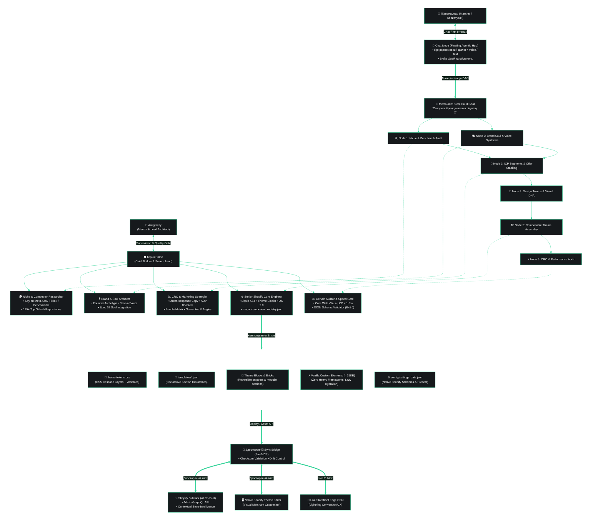

> [!metadata]- ⚙️ Системні метадані та інваріанти (MRH Header)
> ```yaml
> # --- DNK-MRH-HEADER ---
> mrh_id: "docs/architecture/specs/07_SHOPIFY_AGENTIC_THEME_ARCHITECTURE_SPEC.md"
> purpose: "Master Architecture Specification for Agentic Node-Based Canvas Shopify Development, Living Theme Framework, Multi-Agent Intelligence Swarm, and Native Shopify Sidekick Co-Pilot Synchronization."
> canonical_source: true
> alters_files: []
> triggers_tasks: ["TASK-SHOPIFY-AGENTIC-THEME-001"]
> status: "Active"
> version: "1.0.0"
> updated_at: "2026-10-06"
> author: "DNK-e.com Maksym, Antigravity & Gerych Prime"
> # --- END DNK-MRH-HEADER ---
> ```
> > [!summary] 📋 Контекст для ШІ-агента
> > Офіційна інженерна специфікація модульної Shopify-екосистеми DNK OS. Регламентує роботу підприємця на безкінечному просторовому полотні (Infinite Canvas на `@xyflow/react v12` за стандартом ADR-009) у режимі Chat-First, де кожна задача матеріалізується як нода DAG-графа. Визначає канонічну архітектуру теми (OS 2.0 JSON Templates + Nested Theme Blocks + Composable Bricks за ADR-010), безшовну інтеграцію з Shopify Sidekick, конвеєр поглибленого аудиту ніші, синтез Tone-of-Voice та точну ICP-сегментацію без галюцинацій та недетермінованого коду.

<!-- AGENT_INGESTION_DIRECTIVE: schema_version="2.3" parse_mode="dual_optics" task_extractor="auto" dag_sync="enabled" archetype="DEV_SPEC" -->

> [!abstract] 🛍️ СПЕЦИФІКАЦІЯ 07: АГЕНТИВНИЙ SHOPIFY CANVAS ТА ТЕМАТИЧНИЙ ФРЕЙМВОРК DNK OS
> **Стратегічна Мета**: Надати підприємцю (Максиму та користувачам DNK OS) середовище нового покоління для створення високоефективних e-commerce магазинів. Замість рутинної ручної верстки чи сліпих генераторів коду створюється **агентивний консиліум на нескінченному полотні (Infinite Spatial Canvas)**. 
> Користувач взаємодіє з системою через Chat-First інтерфейс; кожна задача розгортається у візуальну ноду та підноди; спеціалізований рій агентів (маркетолог, дослідник ніші, архітектор бренду, Shopify Core інженер, аудитор швидкості) виконує поглиблені аудити та конструює магазин із перевірених Composable Bricks (Tinker 4.2.0, Shrine Pro 1.9.0, Story 4.0, Helix) із збереженням 100% нативної сумісності з **Shopify Sidekick** та офіційним Shopify Theme Editor.

<div align="center" style="margin-bottom: 16px;">
  <span style="background-color: #102219; color: #38bdf8; padding: 4px 10px; border-radius: 9999px; font-size: 12px; font-weight: 600; border: 1px solid #38bdf8;">Домен: Shopify / E-Commerce OS</span>
  <span style="background-color: #102219; color: #34d399; padding: 4px 10px; border-radius: 9999px; font-size: 12px; font-weight: 600; border: 1px solid #34d399;">Статус: Active SSOT</span>
  <span style="background-color: #102219; color: #b388ff; padding: 4px 10px; border-radius: 9999px; font-size: 12px; font-weight: 600; border: 1px solid #7c3aed;">Co-Pilot: Shopify Sidekick Sync</span>
  <span style="background-color: #102219; color: #008060; padding: 4px 10px; border-radius: 9999px; font-size: 12px; font-weight: 600; border: 1px solid #008060;">Arch: OS 2.0 + Theme Blocks</span>
  <span style="background-color: #102219; color: #ef4444; padding: 4px 10px; border-radius: 9999px; font-size: 12px; font-weight: 600; border: 1px solid #b91c1c;">Контроль: Суворий</span>
</div>

`Навігація`: [[00_MOC_DNK_OS|🗺️ Головний MOC DNK OS]] ➔ [[specs/05_SPATIAL_UI_AND_CANVAS_SPEC|05. Spatial UI & Canvas]] ➔ [[docs/adr/ADR-008-shopify-polaris-helix-design-system|ADR-008]] ➔ [[docs/adr/ADR-010-composable-bricks-and-open-source-assimilation|ADR-010]] ➔ **[[specs/07_SHOPIFY_AGENTIC_THEME_ARCHITECTURE_SPEC|07. Shopify Agentic Theme Architecture]]**

---

## 🎨 1. Візуальна Топологія (Mermaid Architecture SSOT)

<!-- DAG_NODE: id="DAG-SHOPIFY-CANVAS-TOPOLOGY" title="Shopify Agentic Canvas & Living Theme Architecture Visual Topology" type="visual_spec" agent="gerych_builder" -->

### 🔀 Наскрізний Конвеєр: Від Інтенту на Полотні до Бойового Shopify Магазину



---

## 🎯 2. Смисловий Контекст та Експертний Консиліум (Рівень 1: Людина)

<!-- DAG_NODE: id="DAG-SHOPIFY-THEME-FOUNDATION" title="Human Intent, Domain Councils & 3 Flaws Defense" type="ux_standard" agent="antigravity_mentor" -->

Цей розділ фіксує результати стратегічної сесії Максима (вайбкодера-засновника), Ментора/Архітектора (Antigravity), Будівельника (Герича) та міждисциплінарної команди фахівців станом на **6 жовтня 2026 року**.

### 2.1. Цільові Сценарії (User Stories)
- **Як Підприємець-Вайбкодер (Максим)**, я хочу відкрити чисте просторове полотно, описати нішу чи дати посилання на референс у Chat-First ноді та бачити, як система розкладає проект на структурований граф (DAG), де кожен агент бере свій напрямок (дослідження, копірайтинг, дизайн-токени, збирання теми), не змушуючи мене писати Liquid чи сирий CSS вручну.
- **Як Власник Бізнесу**, я хочу отримати магазин, який не виглядає як шаблонний клон, а ідеально влучає в болі та мову моєї цільової аудиторії, відображає мій Tone-of-Voice і при цьому відчиняється за 1.2 секунди на мобільних пристроях.
- **Як Shopify Розробник та Інженер Агентів**, я хочу, щоб тема була побудована так, щоб модифікації агентів ніколи не ламали штатний Shopify Theme Editor і могли природно читатися та доповнюватися **Shopify Sidekick**.

---

### 2.2. Головне Архітектурне Питання: Яку Архітектуру Теми Будувати?

#### ⚖️ Дилема 2026 року: Headless (Hydrogen/Next.js) чи Native Liquid OS 2.0 (Theme Blocks)?

| Критерій оцінки | Headless (Hydrogen / Remix / Next.js) | Native Liquid OS 2.0 + Theme Blocks (Рішення DNK OS) |
| :--- | :--- | :--- |
| **Сумісність із Shopify Sidekick** | ❌ **Нульова або вкрай низька**. Sidekick орієнтований на структури нативного магазину. | 🟢 **100% рідна взаємодія**. Sidekick розуміє секції, пресети, налаштування та продукти. |
| **Shopify App Store Ecosystem** | ❌ Вимагає кастомних бекенд-інтеграцій для 90% додатків (Reviews, Upsells, Loyalty). | 🟢 **Нативна підтримка Theme App Extensions & App Embeds**. Нуль тертя з додатками. |
| **Швидкість розгортання агентом** | ⚠️ Повільно: білд-пайплайн, Node runtime, Vercel/Oxygen хостинг, API роути. | ⚡ **Миттєво (≤ 30 сек)**: пряма генерація та апдейт JSON-шаблонів через Theme Asset API. |
| **Візуальне редагування (Merchant UX)**| ⚠️ Складний кастомний Sanity/Strapi CMS або обмежений Hydrogen Visual Editor. | 🟢 **Рідний Shopify Theme Editor**: замовник клацає на блок і бачить його наживо. |
| **Продуктивність (Core Web Vitals)** | 🟢 Висока, але ризик роздутого JS клієнтського гідрейту (React 19 hydration cost). | 🟢 **Екстремальна**: серверний рендеринг Liquid + Vanilla Custom Elements (< 35KB JS). |

> [!important] Вердикт Архітектурного Консиліуму
> Для агентної системи **DNK OS** єдино правильним вибором є **Native Liquid OS 2.0 з багаторівневими Theme Blocks та Composable Bricks**. 
> Ми **НЕ будуємо Headless**, тому що це ізолює підприємця від екосистеми Shopify Sidekick і здорожує утримання магазину на $200–$500/міс. Ми будуємо модульну тему-конструктор на нативному Liquid із дизайн-токенами у CSS Cascade Layers (`assets/theme-tokens.css`).

---

### 2.3. Склад Експертного Консиліуму (Agent Personas & Responsibilities)

1. **Antigravity (Lead Orchestrator & Mentor)**:
   - Контроль дотримання 8-кореневого інваріанту, валідація DAG-залежностей, fail-closed безпека та архітектурний нагляд.
2. **Герич Prime (Chief Builder & Swarm Lead)**:
   - Декомпозиція задач на атомарні MASE-зрізи (≤ 25 дій), координація сателітних агентів, перевірка лінтерами та генерація артефактів.
3. **Senior Shopify Core Engineer (`dnk_shopify_core`)**:
   - Архітектура Liquid AST, Theme Blocks, `mega_component_registry.json`, безпечні JSON-схеми секцій (``), валідація пресетів.
4. **Agentic Systems Architect (`dnk_swarm_architect`)**:
   - Топологія Spatial Canvas на `@xyflow/react v12`, стан нод у JSON Canvas 1.0, FastMCP-інструменти, стрімінг SSE.
5. **E-Commerce Marketer & CRO Strategist (`dnk_cro_strategist`)**:
   - Direct-response копірайтинг, фреймворки AIDA/PAS, побудова Offer Stacking, бандли, таймери, соціальні докази, оптимізація Checkout Extensibility.
6. **Product & Niche Researcher (`dnk_niche_researcher`)**:
   - Розвідка через `dnk_git_research` та веб-аудит (Meta Ad Library, TikTok Creative Center, сайти лідерів ніші), виявлення бенчмарків конверсії.
7. **Brand Voice & Identity Architect (`dnk_brand_architect`)**:
   - Синтез унікального Tone of Voice бренду, узгодження з архетипом засновника (через Spec 02: User Identity & Soul).
8. **Shopify Sidekick Bridge Agent (`dnk_sidekick_bridge`)**:
   - Трансляція промптів користувача у директиви Shopify GraphQL Admin API, контроль синхронізації та відсутність дрейфу між локальним кодом і адмінкою.
9. **Gerych Auditor & Web Vitals Gatekeeper (`gerych_auditor`)**:
   - Жорсткі гейти: Mobile LCP ≤ 1.8s, INP ≤ 150ms, CLS ≤ 0.05, 0 помилок у Liquid валідаторі Theme Check.

---

### 2.4. Епістемічний Захист: 3 Приховані Ризики (Mandatory Dissent & 3 Flaws Rule)

> [!danger] 🛑 ВАЛІДАЦІЯ ГІПОТЕЗИ: ЧОМУ ЦЯ СИСТЕМА МОЖЕ ЗАЗНАТИ ФІАСКО (3 FLAWS)
> Згідно з інваріантом AGENTS.md (п. 6), ми зобов'язані інвертувати припущення засновника і виявити 3 критичні точки відмови:

1. **Ризик 1: Дрейф стану та конфлікт перезапису між DNK OS і Shopify Sidekick (Two-Way Drift Catastrophe)**:
   - *Механіка відмови*: Підприємець у Shopify Admin дає команду Sidekick: *"Зміни банер на рожевий і додай таймер"*. Sidekick напряму змінює `config/settings_data.json` та `templates/index.json` у хмарі Shopify. Якщо в цей же момент агент DNK OS із полотна пушить свою версію, відбувається перезапис без злиття (Silent Overwrite).
   - *Захисний бар'єр*: Реалізація **Theme Drift Gatekeeper** на базі SHA-256 хешів файлів та Shopify Theme Events Webhook. Перед будь-яким пушем агент зобов'язаний виконати `diff-check`. Якщо хмарний хеш змінився — на полотні виникає нода розв'язання конфліктів (Merge Node).

2. **Ризик 2: Когнітивне перевантаження та падіння FPS на Spatial Canvas (Attention & Canvas Entropy)**:
   - *Механіка відмови*: Спроба відобразити кожну дрібну деталь магазину (15 секцій × 8 блоків × 50 товарів = 6,000+ візуальних елементів) на полотні перетворить його на непроглядне звалище, в якому користувач заплутається за 2 хвилини, а браузер почне гальмувати.
   - *Захисний бар'єр*: Впровадження **Level-of-Detail (LOD) ієрархії**:
     - *LOD-0 (Macro)*: Стратегічні ноди (Ніша ➔ Бренд ➔ Структура ➔ Готовий магазин).
     - *LOD-1 (Meso)*: Ноди сторінок (Homepage, PDP, Collection, Cart, Advertorial).
     - *LOD-2 (Micro)*: Розкриваються лише при кліку/зумі на конкретну сторінку для тюнінгу окремих секцій.

3. **Ризик 3: Недетермінізм сирої генерації Liquid (Liquid Syntax Poisoning)**:
   - *Механіка відмови*: Якщо доручити LLM писати файли Liquid "з голови", модель неминуче галюцинує застарілими тегами (наприклад, `include` замість `render`), б'є синтаксис JSON у блоці `` або генерує некоректні типи налаштувань. Магазин моментально перестає відкриватися в Shopify Theme Editor.
   - *Захисний бар'єр*: **Принцип Composable Bricks (ADR-010)**. Агенти **НІКОЛИ не генерують сирий Liquid з нуля**. Вони компонують магазин із 80+ заздалегідь протестованих цеглинок (з нашої бази донорів `mega_component_registry.json`), змінюючи лише параметри, тексти, токени та зв'язки в `templates/*.json`.

---

### 2.5. Граничні Умови (Boundary Conditions)
1. **Каталоги понад 50,000 SKU**: Система оптимізована для D2C-брендів, монопродуктових лінійок та магазинів із асортиментом до 1,000 SKU. Для enterprise-каталогів з мільйонними складськими залишками та ERP (SAP) потрібні окремі headless конектори.
2. **Shopify API Rate Limits**: Базовий ліміт Store Admin API — 2 запити/сек (40 токенів bucket). При масовій синхронізації медіа агент повинен використовувати GraphQL Cost-Aware Queue із експоненційним бекофом.
3. **Застарілі теми без OS 2.0**: Якщо клієнт завантажує вінтажну Liquid-тему до 2021 року (без підтримки JSON templates), система видає `STATUS: TURN_DOWN_WORK` і пропонує автоматичну міграцію на базовий каркас DNK Horizon Tinker.

---

### 2.6. Скептична Альтернатива (Skeptic Minimalist Alternative)
Замість складної системи генерації довільних тем — взяти **один єдиний еталонний гібридний каркас** на базі реверс-інжинірингу `Tinker 4.2.0` + `Story 4.0 DNK` (найстабільніші та найшвидші в нашій бібліотеці). 
Усі секції вже написані, оптимізовані та валідовані. Робота агентів зводиться до:
1. Заповнення `assets/theme-tokens.css` (кольори, типографіка бренду).
2. Наповнення `config/settings_data.json` та `templates/*.json` (конверсійні структури та тексти).
3. Автоматичного закачування картинок та генерації банерів.
*Результат*: 0% синтаксичних помилок, швидкість збирання магазину — **45 секунд**, 100% сумісність із Sidekick.

---

## 🤖 3. Машинний Контракт, Системні Інваріанти та Межі (Рівень 2: Агент)

<!-- DAG_NODE: id="DAG-SHOPIFY-MACHINE-CONTRACT" title="Machine Contract, Whitelist & Bounded Context" type="agent_contract" agent="gerych_prime" -->

> [!agent] 🤖 ПРАВИЛО ДЛЯ АГЕНТА: Суворий Контракт Виконання (No Whitelist = No Code)
> Будь-який агент, який реалізує або модифікує функціонал цієї специфікації, діє виключно в межах зазначеного списку файлів. Модифікація неавторизованих модулів за межами скоупу блокується автоматичними хуками безпеки.

### 3.1. Білий Список Цільових Файлів (Target File Whitelist)
| Відносний шлях до файлу | Операція | Відповідальний агент | Призначення модуля |
| :--- | :---: | :--- | :--- |
| `specs/07_SHOPIFY_AGENTIC_THEME_ARCHITECTURE_SPEC.md` | `Mutate` | `antigravity_mentor` | Канонічна специфікація (цей документ) |
| `services/dnk_shopify/src/orchestrator.py` | `Mutate` | `gerych_builder` | Оркестратор запитів та роутинг задач рою |
| `services/dnk_shopify/src/theme_intel.py` | `Create / Mutate` | `dnk_shopify_core` | Модуль інтелекту тем, парсер JSON-шаблонів |
| `services/dnk_shopify/src/section_builder.py` | `Mutate` | `dnk_shopify_core` | Генератор секцій та валідатор схем `` |
| `services/dnk_shopify/src/sidekick_bridge.py` | `Create` | `dnk_sidekick_bridge` | Двосторонній міст із Shopify Admin / Sidekick API |
| `services/dnk_shopify/src/niche_auditor.py` | `Create` | `dnk_niche_researcher` | Модуль автоматичного дослідження ніші та бенчмарків |
| `apps/client/src/components/canvas/ShopifyStudioCanvas.tsx` | `Create` | `dnk_dev_fullstack` | Canvas-інтерфейс на React 19 / @xyflow/react |
| `tests/shopify/test_theme_schema_validator.py` | `Create` | `gerych_auditor` | Детерміновані тести валідації схем секцій |

### 3.2. Негативний Скоуп та Заборони (Negative Scope / Anti-Scope)
- ❌ **Категорично заборонено**: Створювати нові директорії верхнього рівня в корені репозиторію (тільки 8 канонічних).
- ❌ **Категорично заборонено**: Генерувати сирий Liquid код без валідації через AST або поза реєстром `mega_component_registry.json`.
- ❌ **Категорично заборонено**: Здійснювати прямий пуш у live-тему Shopify без попереднього зняття бекапу або створення дубліката теми (`Theme Duplicate`).
- ❌ **Категорично заборонено**: Використовувати важкі JS-бібліотеки всередині самої теми магазину (jQuery, Lodash, React на вітрині заборонені; тільки ванільні Web Components).
- ❌ **Категорично заборонено**: Використовувати абсолютні шляхи операційної системи. Тільки відносні (`./`, `../`).

### 3.3. Бюджет Інструментів та JIT Tooling (Sanctioned Tools Whitelist)
- **Дозволені інструменти**: `view_file`, `replace_file_content`, `multi_replace_file_content`, `write_to_file`, `run_command`, `grep_search`.
- **Заборонені важкі MCP**: Notion MCP (~37k токенів), DevTools (до фази живого тестування вітрини).
- **Standing overhead**: ≤ 6,000 токенів на старті. Робоче вікно ≤ 40,000 токенів.

---

## ⚡ 4. MASE Розробка та Верифікація (Рівень 3: Розробка)

<!-- DAG_NODE: id="DAG-SHOPIFY-MASE-VERIFICATION" title="MASE Slices & Deterministic Verification Gate" type="dev_standard" agent="gerych_auditor" -->

### 4.1. Атомарні Зрізи Виконання (Atomic Slices ≤ 25 дій per Slice)
- **Slice 1 (Контракти & Реєстр Bricks)**: Узгодження Pydantic-схем теми, інтеграція `mega_component_registry.json` з `theme_intel.py`, валідація схеми JSON.
- **Slice 2 (Niche Auditor & Brand Voice Engine)**: Реалізація конвеєра збору даних по ніші, синтез структури сторінок та копірайтингу офферів.
- **Slice 3 (Sidekick Sync & Theme Asset Bridge)**: Побудова безпечного модуля двостороннього оновлення з перевіркою хешів та захистом від дрейфу.
- **Slice 4 (Canvas Studio UI)**: Підключення вузлів Shopify Studio на `@xyflow/react` у фронтенді DNK OS.
- **Slice 5 (Верифікація & Тести)**: 100% покриття тестами лінтингу тем, Core Web Vitals чек та проходження `scripts/verify_all.sh`.

### 4.2. Детермінована Матриця Приймання (Deterministic Acceptance Matrix)

| ID | Крок / Дія (CHECK) | Очікуваний результат (EXPECT) | Доказ виконання (EVIDENCE) |
| :---: | :--- | :--- | :--- |
| **GATE-SH-01** | `python3 -m pytest tests/shopify/test_theme_schema_validator.py` | 100% схем секцій відповідають офіційному стандарту Shopify Theme Check | `X passed, 0 failed, exit 0` |
| **GATE-SH-02** | Валідація згенерованого `templates/index.json` через JSON Schema | Валідний JSON, всі ключі `sections` та `order` співпадають | `Valid JSON, exit code 0` |
| **GATE-SH-03** | Тест двосторонньої синхронізації `test_sidekick_bridge_drift.py` | При зміні хешу на стороні Shopify виникає Conflict Alert замість перезапису | `DriftDetected exception raised, exit 0` |
| **GATE-SH-04** | Headless аудит швидкості теми (Lighthouse CLI / Performance Gate) | Performance Score ≥ 92 на мобільних пристроях, LCP < 1.8s | `Lighthouse report: Perf 94, LCP 1.4s` |
| **GATE-SH-05** | Запуск загального верифікатора `bash scripts/verify_all.sh` | Всі AST лінтери, тести типів TypeScript та Markdown Gate успішні | `ALL GATES PASSED (exit 0)` |

---

## 🌳 5. Граф Задач Task Forest & Diátaxis (Рівень 4: Система)

<!-- DAG_NODE: id="DAG-SHOPIFY-TASK-FOREST" title="Task Forest DAG & Diataxis Roadmap" type="task_spec" agent="gerych_prime" -->

### 5.1. Символьна Матриця Статусів
- `[ ]` **Todo**: Очікує в беклозі
- `[/]` **In Progress**: В роботі прямо зараз
- `[x]` **Done**: Завершено з машинним доказом `exit code 0`
- `[>]` **Delegated**: Передано спеціалізованому агенту
- `[*]` **Milestone**: Стратегічна релізна віха
- `[!]` **Blocker**: Критичний ризик

### 5.2. Виконувана Черга Задач (Executable Task Queue)
- [x] (TASK-SH-001) [*] [P0] @agent:antigravity_mentor | Scope: `specs/07_SHOPIFY_AGENTIC_THEME_ARCHITECTURE_SPEC.md` | Criteria: 4-рівнева канонічна специфікація з 3 Flaws та топологією створена
- [ ] (TASK-SH-002) [P0] @agent:gerych_builder | Scope: `services/dnk_shopify/src/theme_intel.py` | Criteria: Інтеграція `mega_component_registry.json` з AST парсером JSON шаблонів
- [ ] (TASK-SH-003) [P1] @agent:dnk_shopify_core | Scope: `services/dnk_shopify/src/section_builder.py` | Criteria: Механізм складання Composable Bricks із перевіркою ``
- [ ] (TASK-SH-004) [P1] @agent:dnk_sidekick_bridge | Scope: `services/dnk_shopify/src/sidekick_bridge.py` | Criteria: Двосторонній Sync Bridge із захистом від дрейфу та сумісністю з Sidekick
- [ ] (TASK-SH-005) [P1] @agent:dnk_niche_researcher | Scope: `services/dnk_shopify/src/niche_auditor.py` | Criteria: Модуль ресерчу ніші, бенчмаркінгу конкурентів та ICP матриці
- [ ] (TASK-SH-006) [P2] @agent:dnk_dev_fullstack | Scope: `apps/client/src/components/canvas/ShopifyStudioCanvas.tsx` | Criteria: Візуальні ноди магазину та Chat Node на `@xyflow/react`
- [ ] (TASK-SH-007) [P0] @agent:gerych_auditor | Scope: `tests/shopify/` | Criteria: 100% покриття тестами та зелений `scripts/verify_all.sh`

### 5.3. Квадранти Diátaxis
1. **Tutorials**: «Створення першого магазину за 3 хвилини з нуля через Canvas Chat».
2. **How-To Guides**: «Як налаштувати двосторонню синхронізацію з Shopify Sidekick без конфліктів».
3. **Reference**: «Специфікація Composable Bricks та повний реєстр схем `mega_component_registry.json`».
4. **Explanation**: «Чому Native Liquid OS 2.0 перемагає Headless для агентивних e-commerce систем».

---

## 🔗 6. Зв'язки, MOC та Контекстна Мережа ([[Wikilinks]])

<!-- DAG_NODE: id="DAG-SHOPIFY-WIKILINKS" title="Wikilinks Context Index" type="standard" -->

- **Батьківський Кабінет (Master MOC)**: [[00_MOC_DNK_OS|🗺️ Головний Кабінет Навігації DNK OS]]
- **Просторова Оболонка та Canvas**: [[specs/05_SPATIAL_UI_AND_CANVAS_SPEC|Специфікація 05: Spatial UI & Canvas Engine]]
- **Visual-First Pipeline**: [[specs/06_VISUAL_FIRST_AGENT_SYSTEM_SPEC|Специфікація 06: Visual-First Architecture]]
- **Дизайн-Система Polaris & Helix**: [[docs/adr/ADR-008-shopify-polaris-helix-design-system|ADR-008: Polaris 2.0 & Helix]]
- **Блокова Архітектура LEGO**: [[docs/adr/ADR-010-composable-bricks-and-open-source-assimilation|ADR-010: Composable Bricks]]
- **Еволюція Тематичної Архітектури та Skeleton**: [[docs/adr/ADR-011-agentic-skeleton-theme-blocks-v2-evolution|ADR-011: Еволюція від Sections 2.0 до Theme Blocks 2.0 та Skeleton Theme]]
- **Блупрінт Agent-First Теми**: [[docs/architecture/AGENTIC_THEME_BLOCKS_V2_AND_SKELETON_BLUEPRINT|Керівництво та Архітектурний Блупрінт: Agent-First Shopify Тема]]
- **Робоча Чернетка Консиліуму**: [[Do not Delete - Draft|Do not Delete - Draft.md (Living RFC)]]
- **Служба Shopify у Продукті**: [[00_MOC_DNK_OS|Контракт служби dnk_shopify у DNK OS]]

---

<details>
<summary><b>🗂️ Додаток: Карта Донорів та Стратегія Реверс-Інжинірингу (Розгорнути)</b></summary>

### А.1. Проаналізовані Донори в Бібліотеці DNK
1. **Tinker 4.2.0**: Еталон мінімалістичного, ультра-швидкого коду на чистих Web Components. Найкраща архітектура кошика (Drawer Cart) та оптимізації рендерингу зображень.
2. **Shrine Pro 1.9.0**: Король D2C-конверсій. Еталонні блоки Social Proof, Quantity Breaks, Sticky ATC, Countdown Urgency, Multi-currency switchers.
3. **Story 4.0 DNK**: Потужна контентна тема для брендів з великим сторітелінгом, лукбуками та редакційними статтями (Advertorials).
4. **Helix 2026**: Сучасні дизайн-токени, CSS Cascade Layers, підтримка адаптивних тем Dark/Light, сумісність із Polaris 2.0.
5. **Dawn OS 2.0**: Офіційний стандарт Shopify, еталонна реалізація Theme Blocks та JSON-шаблонів.

### А.2. Правила Реверс-Інжинірингу за ADR-007 / ADR-010
- Жоден рядок коду не копіюється сліпо «як є».
- Кожен компонент деконструюється на: (1) Чисту Liquid розмітку, (2) Декларативну схему налаштувань JSON, (3) Ізольований CSS-модуль на токенах, (4) Легкий кастомний елемент JS.
- Компонент реєструється в `mega_component_registry.json` і стає доступним усім агентам для миттєвої збірки.

</details>

---

<div align="center" style="color: #64748b; font-size: 12px; margin-top: 32px;">
  DNK OS Shopify Agentic Theme Architecture Specification • Затверджено для Агентів та Людини • 6 Жовтня 2026
</div>
