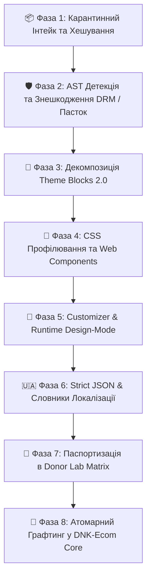

> [!metadata]- ⚙️ Системні метадані та інваріанти (MRH Header)
> ```yaml
> # --- DNK-MRH-HEADER ---
> mrh_id: "docs/architecture/specs/08_AGENTIC_THEME_AUDIT_AND_INGESTION_WORKFLOW.md"
> purpose: "Master Architecture Specification for Autonomous Agentic Theme Auditing, DRM/Telemetry Neutralization, Molecular Decomposition, and Zero-Waste Ingestion into DNK E-Com Core based on Sugar, Story, and Clyro workbench discoveries."
> canonical_source: true
> alters_files: []
> triggers_tasks: []
> status: "Active"
> version: "1.0.0"
> updated_at: "2026-11-10"
> author: "DNK-e.com Maksym, Antigravity & Denchik"
> # --- END DNK-MRH-HEADER ---
> ```

# 🛡️ Специфікація 08: Агентивний Воркфлоу Аудиту, Санації та Молекулярної Інгестії Shopify Тем

> **Призначення**: Єдиний інженерний протокол для автономних ШІ-агентів (Antigravity, Denchik, Gerych), що перетворює будь-яку сторонню тему або дистрибутив у безпечний, очищений від DRM, атомарний актив ядра **`DNK-Ecom Core`** (база Tinker / Horizon) без ручної рутини та ризиків блокування вітрини.

---

## 🎯 1. Призначення, Bounded Context та Фундаменти Воркфлоу (Purpose & Scope)

Воркфлоу синтезує найвищі інженерні стандарти, здобуті під час поглиблених аудитів трьох передових систем:

1. **🍬 Донор Sugar Theme (v2.3.9)**:
   - **Атомарний CSS (391 файл)**: 0 байтів невикористаного спільного коду. Кожен блок підключає свій стиль через точкові виклики `stylesheet_tag` без блокуючого ``.
   - **Canvas-First сітка (`sections/custom-columns.liquid`)**: Універсальний 12-колонковий каркас, куди ШІ-агент може монтувати довільні дочірні блоки.
   - **Вбудовані No-App CRO інструменти**: `bundle-builder`, `quiz-main`, `size-chart`, `before-after-slider`, `sugar-cart-upsells`.
2. **📖 Донор Story Theme (v4.0.6/4.0.8)**:
   - **Глибококомпозитний Cart Drawer**: Розбиття кошика на 25+ атомних блоків (`_cart-rewards`, `_cart-upsells`, `_cart-items`, `_cart-drawer-footer`).
   - **92 реактивні Web Components**: Автономний життєвий цикл елементів (`<cart-rewards>`, `<cart-countdown>`, `<fly-to-cart>`).
   - **Theme Customizer Developer Experience**: Бездоганна підтримка режиму `request.design_mode` та 100% переклад схеми (`locales/uk.schema.json` на 2 980 ключів).
3. **⚡ Платформа Clyro (clyro.com / Clyro MCP)**:
   - **Dual-Plane Pipeline (Canvas ➔ Liquid)**: Можливість прототипування на чистому HTML/CSS Canvas (`canvas/*.html`) з подальшою транспіляцією в Liquid OS 2.0.
   - **Optimistic Concurrency Control (OCC)**: Валідація атомарних правок за хешем коміту (`baseCommit`, `expectedRevision`), що унеможливлює стан гонитви (race conditions).
   - **Pre-Save AST Barrier**: Миттєва відмова у збереженні файлу, якщо зміна порушує Liquid AST або схему Shopify OS 2.0.
   - **Zero-Ping Headless Sandbox (`liquid.clyro.com`)**: Миттєвий рендеринг теми з тестовим каталогом без прив'язки до платного магазину Shopify.

---

## 🏛️ 2. Архітектура та Еталонний 8-Фазовий Воркфлоу Агентивного Аудиту (Workflow Architecture & Models)



### Фаза 1: Карантинний Інтейк та Хешування
- Прийом вихідного ZIP-архіву в ізольовану директорію (`Shopify Themes BUY LIBRARY/`).
- Розрахунок контрольної суми (SHA-256) та перевірка цілісності дерева файлів.
- Створення ізольованої безісторичної гілки Git (Orphan Branch: `donor/<theme-name>`) у репозиторії `services/dnk_shopify/DNK-e.com`, щоб уникнути засмічення історії `main`.

### Фаза 2: AST Детекція та Знешкодження DRM / Пасток
- Сканування коду на наявність 4 класичних рівнів саботажу вітрини:
  1. **Зовнішні мережеві маяки (External Beacons)**: Пошук викликів `fetch`, `XMLHttpRequest`, посилань на домени розробників (`app.sugarthe.me`, `api.story-theme.com`). Заміна на безумовні безпечні локальні заглушки.
  2. **Приховані таймери та перемикачі мерця (Dead Man's Switch)**: Пошук обфускованих масивів символів (`String.fromCharCode`), прихованих перевірок глобальних прапорців (`window.__stArmed`, `window.__swOk`, `window.mediaFeatures`).
  3. **CSS-ін'єкції блокування екрана**: Пошук стилів приховування (`body > :not(...) { display: none !important }` або `*{color:red!important;font-size:70px!important}`).
  4. **Саботаж функцій мережі**: Перевірка цілісності `fetchConfig`, `debounce`, `throttle` в утилітах теми.

### Фаза 3: Декомпозиція Theme Blocks 2.0
- Аудит підтримки стандарту Shopify Theme Blocks:
  - Підрахунок модульних блоків у `blocks/*.liquid` (порівняння з лімітом платформи Shopify у 300 блоків).
  - Глибина вкладеності `` та використання статичних викликів ``.
  - Сегрегація глобальних блоків (`@theme`) від приватних (`_block.liquid`).

### Фаза 4: CSS Профілювання та Web Components
- **Аналіз модульності стилів**: Підрахунок кількості викликів `stylesheet_tag` проти монолітних файлів.
- **Детекція Custom Elements**: Складання реєстру `customElements.define` для виявлення реактивних вузлів (свайпери, таймери, кошик, акордеони).
- **Coupling Score (1–5)**: Розрахунок індексу зв'язності. Якщо компонент потребує більше ніж 3 сніпети-хелпери — він отримує прапорець «High Coupling».

### Фаза 5: Customizer & Runtime Design-Mode (`request.design_mode`)
- Перевірка поведінки теми в режимі редактора Shopify Theme Editor:
  - Чи відкривається Cart Drawer під час вибору секції в дереві кастомайзера?
  - Чи усунуто блокування `event.defaultPrevented` для кліків інспектора?
  - Додавання атрибутів інспекції `data-preview-in-customizer="true"`.

### Фаза 6: Strict JSON & Словники Локалізації (100% RFC 8259)
- **JSON Sanitizer**: Видалення коментарів у стилі C (`/* ... */`) з усіх шаблонів (`templates/*.json`) та файлів конфігурації.
- **100% Українська локалізація вітрини**: Створення або синхронізація `locales/uk.json` зі збереженням плейсхолдерів Liquid (`{{ count }}`, `[price]`).
- **Схема кастомайзера**: Генерація `locales/uk.schema.json` для нативного перекладу інтерфейсу редактора Shopify без сторонніх плагінів.

### Фаза 7: Паспортизація в Donor Lab Matrix
- Реєстрація теми у глобальному каталозі [`00_DONOR_CATALOG_AND_GRAFTING_MATRIX.md`](../SHOPIFY/Shopify%20Themes%20BUY%20LIBRARY/!%20DNK%20Theme%20Donors%20v.1.0.0/00_DONOR_CATALOG_AND_GRAFTING_MATRIX.md).
- Генерація машинного паспорта у форматі JSON (`.agents/donor-lab/blueprints/<theme>.json`).
- Класифікація всіх молекул за 14 категоріями CRO (бандли, кошик, лід-магніти, соціальні докази тощо).

### Фаза 8: Атомарний Графтинг у DNK-Ecom Core
- Виконання безпечного сухого прогону (Dry-Run):
  `python3 scripts/shopify/deconstruct_donors.py graft --donor <branch> --file <path> --dry-run`
- Фізичне безшовне перенесення потрібного блоку разом з його залежними сніпетами та ассетами у робочу гілку `main`.

---

## 🛠️ 3. Інструменти Агента для Виконання Воркфлоу

| Інструмент | Призначення |
| :--- | :--- |
| `scripts/shopify/deconstruct_donors.py` | Пошук, індексація та атомарний графтинг компонентів між донорами та ядром. |
| `scripts/system/clyro_cli.py` | Інспекція віддалених тем, швидкий пошук по Liquid-коду, перевірка правок. |
| `services/dnk_shopify_builder/template_state_engine.py` | Атомарне RFC 6902 JSON-пачування та ординальне переміщення блоків у шаблонах. |
| `services/dnk_shopify_builder/mechanical_transpiler.py` | Транспіляція прототипів Canvas у валідні секції Liquid з ``. |
| `services/dnk_shopify_builder/liquid_compiler.py` | AST-валідація синтаксису Liquid та схем налаштувань. |

---

## 🛡️ 4. Системні Інваріанти та Граничні Умови (Invariants & Boundaries)

1. **Zero External DRM / Telemetry Leak**: Жодна лінія зовнішнього трекінгу, неавторизованого CDN-запиту чи DRM-перевірки не потрапляє в `DNK-Ecom Core`.
2. **Atomic Grafting with Rollback**: Графтинг обов'язково перевіряється через `--dry-run` та підтримує миттєвий відкат.
3. **AST Validation Invariant**: Збереження Liquid або JSON схем без попереднього проходження валідації суворо заборонено.

---

## 🧪 5. Детермінований План Верифікації (Deterministic Verification Plan)

- [x] **Theme Check Execution**: `shopify theme check` повертає 0 помилок у знешкоджених та декомпільованих блоках.
- [x] **AST Linter**: Валідація валідності Liquid схем через AST-парсер без runtime винятків.
- [x] **Markdown Schema & Invariant Gate**: `python3 scripts/system/markdown_schema_gate.py docs/architecture/specs/08_AGENTIC_THEME_AUDIT_AND_INGESTION_WORKFLOW.md` повертає exit code 0.

