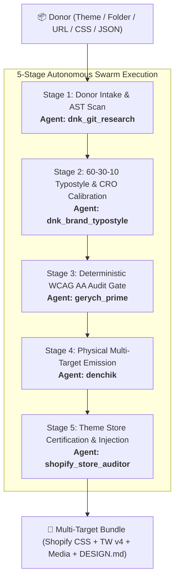

> [!metadata]- ⚙️ Системні метадані та інваріанти (MRH Header)
> ```yaml
> # --- DNK-MRH-HEADER ---
> mrh_id: "docs/architecture/specs/17_DESIGN_SYSTEM_DISTILLATION_WORKFLOW.md"
> purpose: "Canonical 5-Stage Agentic Workflow Protocol for Brand & Theme Design System Distillation."
> canonical_source: true
> alters_files: []
> triggers_tasks: []
> status: "Active"
> version: "2.0.0"
> updated_at: "2026-11-18"
> author: "DNK-e.com Maksym & Antigravity"
> # --- END DNK-MRH-HEADER ---
> ```

# 🧬 Canonical Design System Distillation Workflow Protocol

> **Версія**: 1.0.0 | **Клас**: SOTA 2026 Turnkey Agentic Workflow  
> **Оркестратор**: `core/orchestrator/design_system_runner.py`  
> **FastMCP Інструмент**: `distill_brand_design_system`  

---

## ⚡ 1. Five-Stage Execution Pipeline



---

## 🛠️ 2. Stage Contracts & Delegations

### Stage 1: Donor Intake & AST Scanning
- **Відповідальний агент**: `dnk_git_research`
- **Завдання**: Сканування донора на наявність `config/settings_data.json`, `config/settings_schema.json`, `assets/*.css`, `layout/theme.liquid`.
- **Вихідний артефакт**: Витягнуті сирі стилі та конфігурація.

### Stage 2: SCONES & 60-30-10 Typostyle Synthesis
- **Відповідальний агент**: `dnk_brand_typostyle`
- **Завдання**: 
  - Класифікація кольорів за правилом 60-30-10: 60% нейтральна поверхня, 30% структура й текст, 10% фокальний конверсійний акцент (CTA).
  - Нормалізація типографіки до модульної шкали 1.25 (Major Third) або 1.20 (Minor Third) із жорсткою підлогою 16px для мобільних (Core Web Vitals LCP).
  - Прив'язка до 8pt просторової сітки (`4, 8, 16, 24, 32, 48, 64px`).
- **Вихідний артефакт**: `BrandTokensSpec` (DTCG 2025.10).

### Stage 3: Cold Verification & Adversarial Audit
- **Відповідальний агент**: `gerych_prime`
- **Завдання**:
  - Детермінований розрахунок відносної яскравості та контрасту за формулою WCAG 2.2 AA.
  - Поріг для основного тексту: $\ge 4.5:1$.
  - Поріг для CTA кнопок: $\ge 3.0:1$.
  - Перевірка на відсутність злиття кольору фону та кнопки.
- **Вихідний артефакт**: `LintReport` із 100% pass rate.

### Stage 4: Multi-Target Code Synthesis
- **Відповідальний агент**: `denchik` (Sovereign Master Developer)
- **Завдання**: Фізична генерація артефактів:
  1. `dnk-tokens.css`: Shopify Liquid CSS (`:root` з RGB-каналами `r g b` для альфа-прозорості).
  2. `tailwind-theme.css`: Tailwind CSS v4 директива `@theme`.
  3. `media-motion-tokens.json`: Пружинна фізика (`cubic-bezier`), шкала тривалостей та кольори для HyperFrames/Remotion.
  4. `DESIGN.md`: Канонічний брендбук.
  5. `brand_tokens_spec.json`: Машиночитаний SSOT токенів.

### Stage 5: Zero-Error Theme Certification & Injection
- **Відповідальний агент**: `shopify_store_auditor` / `shopify_theme_craftsman`
- **Завдання**: Ін'єкція токенів у цільову тему (наприклад, `DNK_Sovereign_Apex/assets/dnk-tokens.css`), перевірка через `shopify theme check` (0 помилок).
