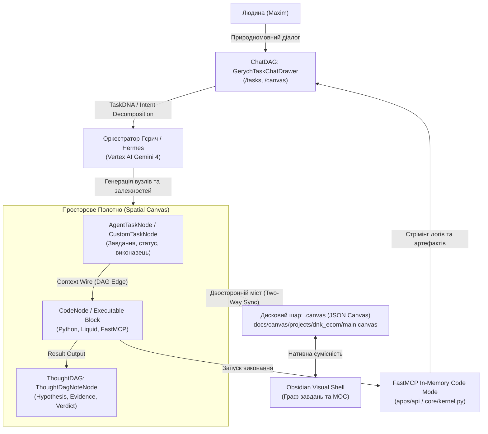

> [!metadata]- ⚙️ Системні метадані та інваріанти (MRH Header)
> ```yaml
> # --- DNK-MRH-HEADER ---
> mrh_id: "docs/architecture/specs/20_THOUGHTDAG_AND_CHATDAG_FUNCTIONAL_SPECIFICATION.md"
> purpose: "Canonical Functional Specification for ThoughtDAG (Cognitive DAG) and ChatDAG (Conversational Graph Synthesis)."
> canonical_source: true
> alters_files: []
> triggers_tasks: []
> status: "Active"
> version: "2.0.0"
> updated_at: "2026-11-18"
> author: "DNK-e.com Maksym & Antigravity"
> # --- END DNK-MRH-HEADER ---
> ```

# 🕸️ Специфікація функціоналу ThoughtDAG та ChatDAG (DEC-161)

## 📋 1. Призначення та Межі Системи (Purpose & Bounded Context)

Ця специфікація стандартизує два взаємопов'язані флагманські модулі просторового ядра DNK OS:
1. **ThoughtDAG (Directed Acyclic Graph of Model Reasoning)**: механізм графового структурування думок ШІ, що ліквідує деградацію лінійного контексту (Anti-Attention Entropy) та дозволяє тестувати паралельні гіпотези з топологічною переоцінкою залежностей.
2. **ChatDAG (Conversational Graph Synthesis & Intake Engine)**: міст між живою природномовною бесідою з агентом (Гєрич/Денчік) та фізичним розміщенням виконуваних вузлів коду й завдань на полотні `@xyflow/react` із повною синхронізацією у стандарт **JSON Canvas** (`.canvas`).

Межі контексту (Bounded Context):
- Фронтенд: `apps/web/components/canvas/`, `apps/web/components/node-tasks/`, `apps/web/store/canvasStore.ts`.
- Бекенд: `apps/api/routers/canvas/`, `apps/api/routers/node_tasks_router.py`, `apps/api/routers/thoughtdag_router.py`.
- Ядро: `core/kernel.py` (`parse_thoughts`, `compile_node_context_wire`, `crystallize_node_session`).

---

## 🏛️ 2. Архітектурна Взаємодія ThoughtDAG та ChatDAG



---

## ⚙️ 3. Функціональні Інваріанти та Правила (System Invariants)

1. **Anti-Attention Entropy Invariant (DEC-005, DEC-146)**:  
   Заборонено згодовувати агенту монолітну історію понад 20k токенів. ThoughtDAG компілює лише релевантний шлях предків (Ancestral Path) через топологічне сортування алгоритмом Кана (`topological_sort`).
2. **Cycle-Free Topological Guarantee**:  
   Спроба створити циклічну залежність ($A \to B \to C \to A$) миттєво відхиляється валідатором `dag-reevaluation.ts` з кодом помилки `DAG_CYCLE_DETECTED`.
3. **JSON Canvas 100% Interoperability**:  
   Будь-який граф на вебі є строго валідним файлом специфікації JSON Canvas (`nodes: [{id, type, x, y, width, height, text}]`, `edges: [{id, fromNode, toNode}]`), що відкривається в Obsidian без жодних додаткових конвертацій.
4. **Bi-Directional Chat Re-evaluation**:  
   Користувач може змінювати параметри як кліком на полотні (перетягування, редагування коду ноди), так і текстом у чаті:  
   *«Гєрич, додай перевірку C2PA перед публікацією»* ➔ Чат знаходить цільовий вузол, вставляє проміжну ноду та перебудовує ребра графа.
5. **Zero-Mock Runtime Rule (DEC-057)**:  
   Клік по кнопці `[▶️ Запустити ноду]` викликає реальний FastMCP інструмент у ядрі або запускає тестовий набір на локальному бекенді (`http://127.0.0.1:8000/api/v1/...`).

---

## 🔍 4. Обов'язкова Дискусія: 3 Критичні Ризики (3 Flaws Rule)

1. **Ризик візуального хаосу на полотні (Visual Graph Clutter)**:  
   При генерації 50+ думок і підзадач граф перетворюється на нечитабельне «павутиння».  
   *Захист*: Впровадження автоматичного ранжування рівнів через алгоритм Dagre/Elk та автоматичне групування вузлів у кластери (`MacroClusterNode`).
2. **Ризик десинхронізації диска та стану в пам'яті (Stale State Collision)**:  
   Якщо файл `.canvas` редагується одночасно в Obsidian та через ChatDAG у браузері.  
   *Захист*: Перевірка таймстемпу модифікації файлу (mtime) та прапорець `isLocalSyncing` у `useCanvasStore.ts` перед записом.
3. **Ризик зависання каскадної переоцінки (Cascading Re-evaluation Storm)**:  
   Зміна кореневої ноди в глибокому графі може викликати лавину одночасних запитів до LLM.  
   *Захист*: Дебаунс 500мс та прапорець `lazy_reeval: true` для downstream-вузлів (виконання за вимогою, а не жадібно).

---

## 🚧 5. Граничні Умови (Boundary Conditions)

* **Максимальна кількість вузлів у візуальному вікні**: До 250 одночасних нод на екрані без падіння FPS нижче 60 (Canvas Virtualization).
* **Глибина рекурсивних думок ThoughtDAG**: Обмежена 8 рівнями вкладеності.
* **Підтримувані формати нод у ChatDAG**:
  - `task` (виконуване завдання зі статусом);
  - `code` (виконуваний код із зазначенням мови та рантайму);
  - `thought` (гіпотеза, спостереження, висновок);
  - `artifact` (генерований результат: JSON-LD, XML, SVG, Markdown);
  - `group` (макро-кластер блоків або сервісів).

---

## ✅ 6. Чек-лист Реалізації та Верифікації (Checklist)

- [x] Розробити канонічну специфікацію `20_THOUGHTDAG_AND_CHATDAG_FUNCTIONAL_SPECIFICATION.md`.
- [x] Зафіксувати рішення DEC-161 у `docs/architecture/DECISION_REGISTRY_ADHD.md`.
- [x] Перевірити наявність та працездатність компонентів у `apps/web`:
  - [x] `NodeTaskGraphCanvas.tsx` на маршруті `/tasks`.
  - [x] `GerychTaskChatDrawer.tsx` для висувного діалогового вводу.
  - [x] `MultiAgentSwarmCanvas.tsx` на маршруті `/canvas/swarm`.
  - [x] `DNKStudioWorkspace.tsx` на маршруті `/canvas`.
- [x] Верифікувати маршрутизатори FastAPI в `apps/api/routers/`:
  - [x] `taskboard_canvas_router.py`
  - [x] `swarm_live_ws.py`
  - [x] `/api/v1/status` (ACTIVE)
- [x] Підтвердити проходження Schema Gate з кодом 0:
  `python3 scripts/system/markdown_schema_gate.py docs/architecture/specs/20_THOUGHTDAG_AND_CHATDAG_FUNCTIONAL_SPECIFICATION.md`
