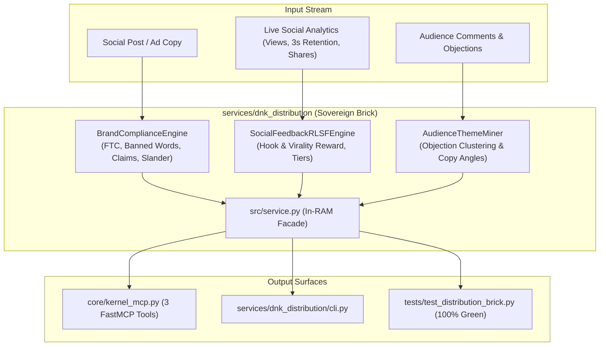

# --- DNK-MRH-HEADER ---
# mrh_id: "docs/architecture/specs/DNK_DISTRIBUTION_SOVEREIGN_BRICK_SPEC.md"
# purpose: "Architecture Specification for dnk_distribution Sovereign Brick (Workhorse #3) via Elephant-Goldfish Model (EGM) & Harness2."
# canonical_source: true
# alters_files: ["services/dnk_distribution/**"]
# triggers_tasks: ["TASK-DNK-DISTRIBUTION-DISTILLATION-001"]
# status: "Active"
# version: "1.0.0"
# updated_at: "2026-11-18"
# author: "DNK Swarm (Antigravity Mentor & Gerych Prime)"
# --- END DNK-MRH-HEADER ---

# 📢 Architecture Specification: `services/dnk_distribution` (Workhorse #3)

## 1. Executive Summary & Purpose
`services/dnk_distribution` is the 3rd Sovereign Workhorse of DNK OS, responsible for **Content Intelligence, Social Feedback (RLSF), Brand Compliance, and Audience Theme Mining**.
This specification distills the pure business logic from the legacy donor archive `DNK_HUB/services/dnk_distribution/` into a 5-element Sovereign Unit Brick under `DNK_OS/services/dnk_distribution/`.



---

## 2. PSOD Delegation Contract

```yaml
P (Problem & Scope):
  - Objective: Distill legacy dnk_distribution into a pure Sovereign Brick adhering to DEC-128 Cleanroom Strangler Protocol.
  - Target Whitelist:
      - services/dnk_distribution/brick.manifest.yaml
      - services/dnk_distribution/contracts/schemas.py
      - services/dnk_distribution/src/brand_compliance.py
      - services/dnk_distribution/src/social_feedback.py
      - services/dnk_distribution/src/theme_miner.py
      - services/dnk_distribution/src/service.py
      - services/dnk_distribution/cli.py
      - services/dnk_distribution/mcp_server.py
      - services/dnk_distribution/tests/test_distribution_brick.py
      - core/kernel_mcp.py
      - docs/architecture/DECISION_REGISTRY_ADHD.md
      - ../DNK_HUB/services/dnk_distribution/service_manifest.yaml
      - ../DNK_HUB/services/dnk_distribution/DEPRECATED.md

S (Substrate & Constraints):
  - Runtime: ~/.dnk_runtime/venv (Python 3.14 via uv).
  - Narrow Waist: core/kernel.py must remain < 400 LOC.
  - Zero External Daemons: Pure In-RAM algorithms, 0 background Redis/Postgres/Docker processes.
  - Typings: Strict Pydantic v2 (extra="forbid", frozen=True).

O (Verification Oracle):
  - Primary Oracle: `uv run pytest services/dnk_distribution/tests`
  - Integration Oracle: `just test-distribution && just test-workhorses`
  - Fitness Oracle: `just test-fitness`
  - Exit Code: 0 (Strict).

D (Deliverable Format):
  - 100% clean test execution evidence.
  - Sealed DEC-129 entry in DECISION_REGISTRY_ADHD.md.
  - Tombstone in DNK_HUB.
```

---

## 3. Component Architecture & Contracts

### 3.1. `src/brand_compliance.py` (Brand Compliance & Tone Engine)
- **Class:** `BrandComplianceEngine`
- **Capabilities:**
  - Multi-category deterministic policy check:
    * `banned_words`: Detects over-promising ("guaranteed overnight", "miracle cure").
    * `ftc_disclosure`: Detects missing #ad / #sponsored tags on sponsored creative.
    * `profanity`: Cleans unacceptable language.
    * `legal_claims`: Identifies medical or unqualified financial advice flags.
    * `competitor_slander`: Identifies aggressive direct brand naming without substantiation.
  - Outputs `ComplianceReport` (`is_compliant: bool`, `score: float`, `violations: List`, `sanitized_text: str`).

### 3.2. `src/social_feedback.py` (Reinforcement Learning from Social Feedback - RLSF)
- **Class:** `SocialFeedbackRLSFEngine`
- **Capabilities:**
  - Ingests `SocialMetrics` (views, retention_3s, completion_rate, likes, comments, shares, saves, clicks).
  - Computes multi-objective rewards:
    * `hook_reward`: based on 3-second retention rate (target > 65%).
    * `retention_reward`: based on video completion rate.
    * `virality_reward`: based on share-to-view ratio.
    * `overall_reward`: weighted composite score (0.0 to 100.0).
  - Categorizes into `PerformanceTier` (`VIRAL_TIER`, `HIGH_PERFORMING`, `AVERAGE`, `UNDERPERFORMING`).
  - Generates actionable algorithmic recommendations for subsequent script iterations.

### 3.3. `src/theme_miner.py` (Audience Theme & Objection Mining Engine)
- **Class:** `AudienceThemeMiner`
- **Capabilities:**
  - Clusters raw comment items into structured semantic buckets: `objection`, `pain_point`, `buying_intent`, `question`, `praise`.
  - Analyzes recurring keyword patterns (e.g., "too expensive", "does it ship to Canada", "size guide").
  - Formulates counter-copy angles and FAQ hooks for Shopify PDPs and video ads.

---

## 4. Harness² & EGM Review Rubric
- Target Surface: `SurfaceCategory.PLUGINS_MIDDLEWARE`.
- Acceptance Criteria:
  * Zoom Out Score: 5.0 (Reuses pure stdlib & Pydantic; eliminates monolithic web server dependencies).
  * Comprehension Score: 5.0 (Fully documented interfaces & typed schemas).
  * Design/Scale Score: 5.0 (Deterministic sub-millisecond execution in RAM).
  * Implementation Readiness: 5.0 (Discrete unit tests with exact assertions).
