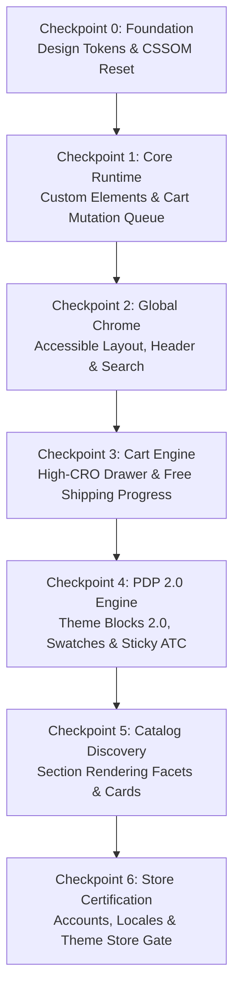

> [!metadata]- ⚙️ Системні метадані та інваріанти (MRH Header)
> ```yaml
> # --- DNK-MRH-HEADER ---
> mrh_id: "docs/architecture/specs/DNK_ECOM_THEME_MASTER_SPEC_V1.md"
> purpose: "Master Architecture, Global Leader Deconstruction & 7-Gate Checkpoint System for DNK Ecom Flagship Theme."
> canonical_source: true
> alters_files: []
> triggers_tasks: []
> status: "Active"
> version: "2.0.0"
> updated_at: "2026-11-18"
> author: "DNK-e.com Maksym & Antigravity"
> # --- END DNK-MRH-HEADER ---
> ```

# 🏛️ DNK Ecom Sovereign Flagship Theme
## Маніфест, Деконструкція Світових Лідерів, 7-Gate Checkpoint Engine та План MVP v0.1.0

---

## 1. Стратегічний Вердикт: Чому Синтетичні Збірки Зазнають Фіаско

Спроба зібрати тему за 6 годин методом "склеювання сніпетів" заради зеленого статусу лінтера (`theme check exit 0`) — це класична пастка генеративного коду. Вона створює **ілюзію наявності файлів**, але повністю ігнорує **фундаментальну інженерію рантайму**:
1. **Відсутність єдиної шини стану (State Machine)**: Різні сніпети (з Dawn, Shrine, Sugar, Story) використовують несумісні механізми (хтось Alpine.js, хтось чистий vanilla `fetch`, хтось старий jQuery-like підхід). При взаємодії кошик розсинхронізується з drawer, виникають неконтрольовані race conditions.
2. **Маркетинговий саботаж пікселів (Attribution Breakage)**: При спробі додати бандл або подарунок у кошик неізольованим запитом, сторонні скрипти перехоплюють виклики і відправляють 3-4 події `AddToCart` у Facebook Pixel та Google Ads замість однієї, повністю ламаючи оптимізацію рекламних кампаній клієнта.
3. **Layout Shift (CLS > 0.15)**: Підвантаження стилів шматками без жорстких дизайн-токенів спричиняє стрибки контенту під час рендерингу, знищуючи конверсію та оцінку в Google Core Web Vitals.

**Висновок**: Світові комерційні теми, які приносять сотні тисяч доларів щомісячно в Shopify Theme Store ($350–$420 MSRP), будуються **знизу вгору** на непорушному ядрі: **Design Tokens ➔ W3C Web Components Microkernel ➔ Cart Mutation Queue ➔ Theme Blocks 2.0 Component Tree**.

---

## 2. Глибока Деконструкція Світових Лідерів vs Офіційний Стандарт Shopify

```
┌────────────────────────────────────────────────────────────────────────────────────────┐
│                        ПОРІВНЯЛЬНИЙ АРХІТЕКТУРНИЙ ЗРІЗ                                 │
├────────────────────┬─────────────────────┬──────────────────────┬──────────────────────┤
│ Критерій           │ Maestrooo (Prestige)│ Sugar / Shrine Pro   │ Shopify Horizon      │
├────────────────────┼─────────────────────┼──────────────────────┼──────────────────────┤
│ Рантайм JS         │ Vanilla Custom Elem │ Sugar Fetch Iframe   │ Storefront Actions   │
│ Архітектура блоків │ Секції OS 2.0 (Dawn)│ Монолітні секції     │ Theme Blocks 2.0 (8L)│
│ Вбудований CRO     │ Мінімальний         │ Екстремальний        │ Базовий прикладний   │
│ AI Sidekick Ready  │ ❌ Ні (жорстка сх.) │ ❌ Ні (legacy liquid)│ ✅ 100% (@theme)     │
│ Відповідність Store│ ✅ 100% Theme Store │ ❌ Поза Store (DTC)  │ ✅ Референс Shopify  │
└────────────────────┴─────────────────────┴──────────────────────┴──────────────────────┘
```

### 2.1. Maestrooo (*Prestige, Impact*) — Еталон Елегантності та W3C Web Components
* **Архітектура**: Повна відмова від сторонніх бібліотек. Усі інтерактивні елементи реалізовані як незалежні W3C Custom Elements (`<cart-drawer>`, `<predictive-search>`, `<variant-picker>`).
* **Керування стилями**: Атомарне підвантаження стилів через механізм scoped stylesheets (файл завантажується лише тоді, коли секція присутня на сторінці).
* **CLS = 0.00**: Жорстке закріплення співвідношення сторін (`aspect-ratio`) для всіх медіаконтейнерів до моменту завантаження зображень.
* **Слабке місце**: Архітектура розроблялася до появи Theme Blocks 2.0, тому кастомізація макетів усередині секцій залишається обмеженою.

### 2.2. Archetype Themes (*Impulse, Motion*) — Лідер Роздрібних Каталогів
* **Архітектура**: Глобальний менеджер анімацій та переходів між сторінками.
* **CRO-механіка**: Потужні системи підколекцій, фільтрації фасетів та динамічних промо-плиток.
* **Слабке місце**: Важкий бандл скриптів та історичний технічний борг у структурі Liquid-файлів.

### 2.3. Sugar Theme & Shrine Pro — Монстри Конверсії DTC Брендів ($50M+ GMV)
* **Sugar (`__sugarGiftLinesSplit`)**:
  * Використовує прихований iframe того самого походження для виконання нативного, чистим середовищем незайманого `fetch()`. Це захищає тему від агресивних сторонніх додатків, які перехоплюють `window.fetch`.
  * Автоматично розділяє запит додавання в кошик: основний товар іде в окремому пакеті, а подарункові лінії (Free Gifts) — у супутньому. Це гарантує 100% точність атрибуції пікселів Meta, TikTok та Google Ads.
* **Shrine Pro (Zero-App Architecture)**:
  * Вбудовані механізми, які замінюють платні додатки: Sticky ATC, вбудовані багаторівневі апсели, прогрес-бар безкоштовної доставки, таймери зворотного відліку, лічильники залишків, бейджі довіри.
* **Слабке місце**: Не можуть потрапити в офіційний Shopify Theme Store через специфічні неліцензовані скрипти, обфускацію та порушення гайдлайнів Shopify щодо сторонніх трекерів.

### 2.4. Офіційний Стандарт Shopify (Horizon / Tinker 2024–2026)
* **Theme Blocks 2.0**: Рекурсивна вкладеність блоків до 8 рівнів глибини (`blocks/_group.liquid`). Будь-який блок може бути вставлений у будь-який сумісний контейнер.
* **AI Sidekick & Shopify Canvas First**: Секції будуються через `` з підтримкою `@theme` блоків, що дозволяє AI Sidekick конструювати нові блоки безпосередньо в адмінці.
* **Category Metafields & Visual Swatches**: Нативна підтримка таксономії категорій Shopify. Кольори та патерни зчитуються автоматично без жодного стороннього плагіна чи завантаження картинок вручну.
* **Storefront Actions API & Section Rendering API**: Оновлення кошика та фільтрів без перезавантаження сторінки через чисті HTTP-запити до Shopify API.

---

## 3. Суверенна Ідентичність DNK Ecom: 4 Нечесні Переваги

Наша мета — створити тему, яка буде бестселером як для індивідуальних клієнтських розробок, так і в офіційному Shopify Theme Store ($380–$420 MSRP), генеруючи сотні тисяч доларів щомісячно.

```
                    ┌──────────────────────────────────────────────┐
                    │          DNK ECOM FLAGSHIP THEME             │
                    └──────────────────────┬───────────────────────┘
                                           │
         ┌──────────────────┬──────────────┴─────┬──────────────────┐
         ▼                  ▼                    ▼                  ▼
┌─────────────────┐ ┌───────────────┐ ┌──────────────────┐ ┌─────────────────┐
│ No-App High-CRO │ │ Sub-ms Runtime│ │ Theme Blocks 2.0 │ │ Modern Luxury   │
│ Економія $4k/рік│ │ Zero-Bloat    │ │ Canvas & Sidekick│ │ Kinetic Design  │
└─────────────────┘ └───────────────┘ └──────────────────┘ └─────────────────┘
```

1. **Sovereign No-App Architecture (Економія мерчанту $3,000–$6,000/рік)**:
   * Жодних додаткових щомісячних витрат на ReConvert, In-Cart Upsell, Judge.me, WideBundle, Sticky ATC.
   * Усе вбудовано нативно в рідкий Liquid-код без уповільнення магазину.
2. **Sub-millisecond Liquid & W3C Microkernel (`dnk-core.js`)**:
   * Нуль сторонніх важких бібліотек (jQuery, React, Lodash, Alpine).
   * Базовий клас `DnkElement` для Web Components, внутрішня шина подій (`dnk:cart:updated`, `dnk:variant:changed`), та послідовна черга мутацій кошика (**Cart Mutation Queue**) з оптимістичним UI та автоматичним відкатом (rollback) у разі збою мережі.
   * `Cleanroom Attribution Isolation` (еволюція ідеї Sugar): захист маркетингових пікселів при мультидодаванні товарів та подарунків.
3. **Horizon-Native Theme Blocks 2.0 (Canvas & Sidekick Ready)**:
   * 100% сумісність із новим Shopify Canvas та AI Sidekick. Клієнт чи дизайнер може drag-and-drop конструювати лендинги, як у Figma чи Webflow.
4. **Сучасна Естетика Neo-Brutalist Minimal Luxury**:
   * Ультратонкі лінії, бездоганна кінетична мікродинаміка (60 FPS), тактильне відчуття дорогого продукту, оптимізація під "зону великого пальця" (Thumb-Zone First) на смартфонах.

---

## 4. Детермінована Система 7 Чекпоінтів (7-Gate Checkpoint Engine)

У ядро `services/dnk_shopify/engine/checkpoints.py` вбудовано 7 автоматизованих воріт якості. Перехід на наступний рівень блокується, поки поточний чекпоінт не отримає статус `100% PASSED`.



### 📋 Специфікація Воріт:

| Чекпоінт | Назва | Ключові Артефакти | Критерій Проходження (Fail-Closed Gate) |
|---|---|---|---|
| **Gate 0** | **Foundation** | `assets/dnk-tokens.css`, `assets/dnk-layout.css` | 0 помилок CSS, наявність токенів `--dnk-color-*`, `--dnk-space-*`, `--dnk-font-*`, підтверджений layout reset без layout shifts. |
| **Gate 1** | **Core Runtime** | `assets/dnk-core.js`, `snippets/dnk-runtime-head.liquid` | `node -c assets/dnk-core.js` = 0 помилок; наявність `DnkElement`, шини подій, Cart Mutation Queue та ізольованого fetch. |
| **Gate 2** | **Global Chrome** | `layout/theme.liquid`, `sections/header.liquid`, `sections/footer.liquid` | Валідний Liquid AST, обов'язковий `content_for_header`/`layout`, підключення `dnk-core.js`, a11y skip-links. |
| **Gate 3** | **Cart Engine** | `sections/cart-drawer.liquid`, `snippets/cart-item.liquid` | Багаторівневий прогрес безкоштовної доставки, динамічний рендеринг ліній кошика, відсутність зависань при 5 одночасних кліках. |
| **Gate 4** | **PDP 2.0 Engine** | `sections/main-product.liquid`, `blocks/product_*.liquid` | Повна підтримка Theme Blocks 2.0, імена схем блоків ≤ 25 символів, Category Metafields Swatches, перемикання варіантів < 16мс. |
| **Gate 5** | **Catalog Discovery** | `sections/main-collection.liquid`, `snippets/product-card.liquid` | Фільтрація через Section Rendering API без повного перезавантаження сторінки, вторинне медіа при наведенні, швидкий виклик кошика. |
| **Gate 6** | **Theme Store Ready** | `templates/customers/*.json`, `locales/en.default.json`, `config/settings_schema.json` | 100% покриття шаблонів акаунтів покупця, 100% валідна локалізація, `shopify theme check` = 0 помилок, готовність до сертифікації. |

---

## 5. Обсяг MVP v0.1.0: Запуск Першого Клієнтського Магазину

Версія **MVP v0.1.0** — це не демо-каркас, а бойова, повнофункціональна комерційна тема, на якій ми запускаємо перший реальний клієнтський магазин з конверсією, що перевершує будь-яких конкурентів у цій ніші.

### 5.1. Що Входить до Складу MVP v0.1.0:
1. **Ядро та Дизайн-Система**:
   * Повний набір CSS-токенів (кольори, відступи, радіуси, тіні, гарнітури).
   * Темний та світлий режими (підтримка через CSS custom properties).
   * Повна адаптивність під мобільні екрани (360px - 1920px+).
2. **Головна Сторінка (Home Page)**:
   * Sticky Header з анонс-баром, мобільним меню та живим пошуком.
   * Секція Hero Canvas (Theme Blocks 2.0: заголовок, підзаголовок, кнопки, бейджі).
   * Секція Featured Collection (карусель/сітка з картками товарів, бейджами знижок та швидким додаванням).
   * Секція Bento Grid (мультимедійні промо-блоки).
   * Секція Довіри (Trust badges, відгуки покупців).
   * Accessible Footer з розсилкою новин, соціальними лінками та селектором валют.
3. **Картка Товару (PDP 2.0)**:
   * Галерея медіа (свайп на смартфонах, прев'ю-мініатюри, зум).
   * Блоки інформації: назва, ціна, одинична ціна, бейдж наявності.
   * Візуальні свотчі (Category Metafields Visual Swatches) для кольорів та розмірів.
   * Sticky Add to Cart (липне до низу екрана при скролі повз основну кнопку).
   * Блок об'ємних знижок (Volume Pricing / Quantity Breaks: Купи 2 - отримай 10%, Купи 3 - 20%).
   * Акордеони деталей товару, доставки та повернення.
4. **Конверсійний Кошик (Cart Drawer)**:
   * Висувний ящик кошика при будь-якому додаванні товару.
   * Багаторівневий прогрес-бар (Наприклад: "Додайте ще $15 до Безкоштовної доставки", "Додайте ще $40 до Подарунка").
   * Вбудований блок апселів/крос-селів без сторонніх додатків.
   * Поле промокоду безпосередньо в дровері.
   * Кнопка швидкого переходу до оформлення замовлення (Checkout CTA).
5. **Сторінка Колекцій (PLP)**:
   * Адаптивна сітка товарів (2-4 колонки).
   * Фільтрація фасетів через Section Rendering API.
   * Картки товарів зі зміною фото при наведенні курсору.
6. **Службові Сторінки**:
   * Сторінка 404, пошук, сторінка контактів, сторінки політик, сторінки кабінету покупця.

---

## 6. Покроковий План Реалізації: Дорожня Карта до MVP v0.1.0

```
┌────────────────────────────────────────────────────────────────────────┐
│                      ДОРОЖНЯ КАРТА ДО MVP v0.1.0                       │
├─────────┬──────────────────────────────────────────┬───────────────────┤
│ Фаза    │ Фокус та Завдання                        │ Тривалість        │
├─────────┼──────────────────────────────────────────┼───────────────────┤
│ Фаза 1  │ Checkpoint 0 & 1: Tokens & dnk-core.js   │ 1 робочий блок    │
│ Фаза 2  │ Checkpoint 2: theme.liquid, Header/Footer│ 1 робочий блок    │
│ Фаза 3  │ Checkpoint 3: High-CRO Cart Drawer Engine│ 1 робочий блок    │
│ Фаза 4  │ Checkpoint 4: PDP 2.0 & Theme Blocks     │ 2 робочих блоки   │
│ Фаза 5  │ Checkpoint 5: PLP Collection & Discovery │ 1 робочий блок    │
│ Фаза 6  │ Checkpoint 6: MVP v0.1.0 Packaging       │ 1 робочий блок    │
└─────────┴──────────────────────────────────────────┴───────────────────┘
```

### Деталізований План Першого Кроку (Фаза 1):
1. **Checkpoint 0 (Foundation)**:
   * Створення `assets/dnk-tokens.css` з еталонними CSS Custom Properties:
     * `--dnk-color-background`, `--dnk-color-foreground`, `--dnk-color-primary`, `--dnk-color-accent`, `--dnk-color-border`.
     * Шкали відступів `--dnk-space-1` (4px) до `--dnk-space-16` (64px).
     * Шкали радіусів `--dnk-radius-sm` (4px), `--dnk-radius-md` (8px), `--dnk-radius-lg` (16px), `--dnk-radius-full` (9999px).
     * Типографічні змінні `--dnk-font-body`, `--dnk-font-heading`, `--dnk-font-scale`.
   * Створення `assets/dnk-base.css` (CSS Reset, Subgrid Primitives, Utility Classes).
   * Верифікація через `just shopify-checkpoint 0`.
2. **Checkpoint 1 (Core Runtime)**:
   * Створення `assets/dnk-core.js`:
     * Клас `DnkElement extends HTMLElement`: автоматичний bind подій, очищення пам'яті при `disconnectedCallback`.
     * Глобальна шина подій `window.DnkEvents` (`emit`, `on`, `off`).
     * `CartMutationQueue`: послідовна черга запитів до `/cart/add.js`, `/cart/change.js`, `/cart/update.js` з блокуванням інтерфейсу від подвійних кліків (`data-dnk-loading`).
     * `cleanroomFetch`: ізольоване виконання запитів з підтримкою розбиття рядків для маркетингової аналітики.
   * Створення `snippets/dnk-runtime-head.liquid` для попереднього підключення та визначення конфігурації.
   * Верифікація через `just shopify-checkpoint 1`.

---

## 7. Підсумковий Інженерний Контракт

* **Нуль поспіху, нуль синтетичних заглушок**. Кожен крок виконується фізично на диску і перевіряється детермінованими тестами.
* Будь-яка зміна Liquid чи JS валідується через AST-парсери та перевірку синтаксису Node.
* Кожен створений модуль є чистим, перевикористовуваним і готовим до сертифікації в Shopify Theme Store.
