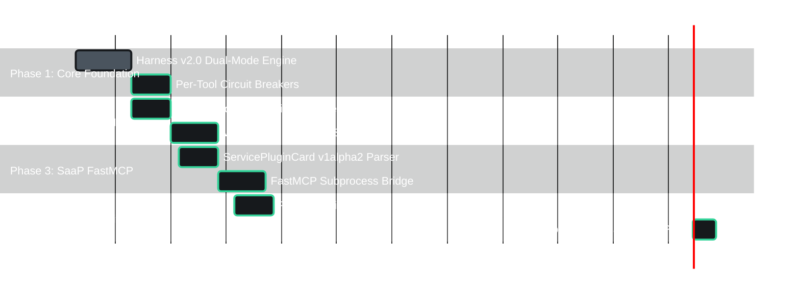

> [!metadata]- ⚙️ Системні метадані та інваріанти (MRH Header)
> ```yaml
> # --- DNK-MRH-HEADER ---
> mrh_id: "docs/architecture/specs/DNK_OS_AGENT_HARNESS_AND_SAAP_SPEC_v1.0.md"
> purpose: "SaaP Manifest v1alpha2 for Store Studio Liquid & Theme Service"
> canonical_source: true
> alters_files: []
> triggers_tasks: []
> status: "Active"
> version: "2.0.0"
> updated_at: "2026-11-18"
> author: "DNK-e.com Maksym & Antigravity"
> # --- END DNK-MRH-HEADER ---
> ```

# 🌐 DNK OS Agent Harness, Spatial Node Canvas & SaaP Specification v1.0

> **Standard:** DNK OS High-Velocity Architecture Standard (v2.5)  
> **Status:** Active / Formal Engineering Specification v1.0  
> **Target Release:** DNK OS Core Milestone v2.0  
> **Scope Identifier:** `SPEC-DNK-HARNESS-SAAP-v1.0`  
> **Authors:** Maksym Kuzmenko (Founder), Antigravity (Head of Orchestration), Gerych Prime (Chief Builder)  

---

## 1. Scope, Purpose & Architectural Invariants

### 1.1 Purpose
This document establishes the authoritative engineering specification for the next-generation **DNK OS Modular Triad**:
1. **Agent Harness (Microkernel Core)**: Lightweight, token-efficient, streaming-first execution runtime with deterministic circuit breakers.
2. **Spatial Node-Based Canvas (Visual Control Plane)**: Reactive visual DAG canvas with live reasoning HUD streaming and Human-In-The-Loop (HITL) approval gates.
3. **Service as a Plugin (SaaP)**: Decoupled, zero-core-pollution microservice ecosystem leveraging the **FastMCP** (Model Context Protocol) and declarative UI Node Descriptors.

### 1.2 Mandatory Architectural Invariants
All implementations, refactors, and extensions governed by this specification MUST strictly enforce:
1. **Canonical 8-Root Directory Invariant**:
   - The repository permits strictly 8 top-level directories: `apps/`, `core/`, `services/`, `packages/`, `infra/`, `docs/`, `tests/`, `scripts/`.
   - No temporary directories, runtime logs, or service packages may be created in the workspace root.
2. **Strict SaaP Isolation Boundary**:
   - Microservices and plugins reside **EXCLUSIVELY** in `services/dnk_*` or `packages/plugins/`.
   - **Zero Service Code in Core/Apps**: `core/` and `apps/` must contain ZERO domain-specific service logic, custom tables, or dedicated microservice routers.
3. **Universal Relative Path Invariant**:
   - Absolute filesystem paths (`/Users/...`, `C:\...`) are strictly prohibited in schemas, code, manifests, and tool payloads. All references use relative paths (`./`, `../`).
4. **Zero-Breaking-Change & Non-Regression Guarantee**:
   - All 16 existing production microservices and 208+ pytest contract suites must execute with 100% Green status without modifications to their core contract interfaces.
5. **FastMCP Protocol Uniformity**:
   - All tool disclosure and invocation between the Agent Harness and SaaP services occurs via the Model Context Protocol (FastMCP over stdio or HTTP/SSE).

---

## 2. Integrated Architecture Overview

```mermaid
%%{init: {
  'theme': 'base',
  'themeVariables': {
    'primaryColor': '#16191c',
    'primaryTextColor': '#ffffff',
    'primaryBorderColor': '#34d399',
    'lineColor': '#34d399',
    'secondaryColor': '#102219',
    'tertiaryColor': '#16191c',
    'tertiaryTextColor': '#ffffff',
    'titleColor': '#ffffff',
    'textColor': '#ffffff',
    'mainBkg': '#16191c',
    'nodeBorder': '#34d399',
    'clusterBkg': 'transparent',
    'clusterBorder': 'rgba(255, 255, 255, 0.16)',
    'edgeLabelBackground': '#102219',
    'fontSize': '13px'
  }
}}%%
flowchart TD
  subgraph Client_Plane ["1. Visual Control Plane (apps/web)"]
    direction LR
    XYFlowCanvas["XYFlow v11+ Visual DAG Canvas"]
    LiveHUDStream["Live Agent HUD (Reasoning & Stdout)"]
    HITLApproval["HITL Gate Modal (One-Click Guard)"]
  end

  subgraph Microkernel_Plane ["2. Agent Execution Harness (core/framework)"]
    direction LR
    AsyncLoop["CanonicalHarnessEngine v2.0 Loop"]
    ContextSliding["Head/Tail Context Packer"]
    PerToolBreaker["Per-Tool Circuit Breakers"]
    EventStreamer["WebSocket / SSE Event Bus"]
  end

  subgraph SaaP_Ecosystem_Plane ["3. SaaP Satellites (services/dnk_* & packages/plugins/)"]
    direction LR
    FastMCPAgent["FastMCP Server Adapter"]
    UINodeDesc["UI Node Descriptor (Sockets/Widgets)"]
    DomainEngine["Self-Contained Domain Logic"]
  end

  XYFlowCanvas <-->|WebSocket: /api/v1/canvas/events/stream| EventStreamer
  LiveHUDStream <---|W3C EventStream Broadcast| EventStreamer
  HITLApproval --->|HTTP POST /api/v1/canvas/approvals/:id| AsyncLoop
  AsyncLoop <-->|FastMCP RPC (stdio / IPC / HTTP)| FastMCPAgent
  FastMCPAgent --- DomainEngine
  UINodeDesc -.->|Metadata Discovery| XYFlowCanvas
  PerToolBreaker -.->|Trip / Fallback| AsyncLoop
```

---

## 3. Layer 1: Agent Harness Specification v2.0

### 3.1 Lifecycle State Machine
The Agent Harness operates as a strictly bounded, deterministic state machine:

```
[IDLE] ──▶ [PLANNING] ──▶ [PROGRESSIVE_TOOL_LOOKUP]
                               │
                               ▼
        ┌────────────────── [EXECUTING_TOOL] ◀────────────────┐
        │                      │                             │
        ▼                      ▼                             │
[AWAITING_HITL]        [OBSERVATION_COMPACTION]              │
        │                      │                             │
        ▼                      ▼                             │
 [RESUME / ABORT]       [CIRCUIT_BREAKER_CHECK] ──(Valid)────┘
                               │
                            (Tripped)
                               ▼
                       [FALLBACK_DISTILLATION]
                               │
                               ▼
                        [QUALITY_GATE_VERIFY]
                               │
                               ▼
                    [COMPLETED] or [FAILED]
```

### 3.2 State Definitions
| State | Description | Invariant Rules |
| :--- | :--- | :--- |
| `IDLE` | Harness initialized, awaiting task goal. | Resource usage is zero; no active event loops. |
| `PLANNING` | Decomposing goal into TaskDNA DAG slices. | Bound by max 2 planning turns; no state mutations. |
| `PROGRESSIVE_TOOL_LOOKUP` | Resolving FastMCP tools matching slice scope. | Only tools declared in target SaaP manifests are exposed. |
| `EXECUTING_TOOL` | Invoking tool via FastMCP transport. | Guarded by per-tool timeout (default 60s). |
| `AWAITING_HITL` | Execution paused pending human sign-off. | Session state serialized to checkpoint; WebSocket notifies HUD. |
| `OBSERVATION_COMPACTION` | Compacting stdout/stderr observations. | Output > 15,000 chars truncated to head (50 lines) + tail (50 lines). |
| `CIRCUIT_BREAKER_CHECK` | Inspecting consecutive failure count. | 3 consecutive failures trip breaker; triggers error distillation. |
| `QUALITY_GATE_VERIFY` | Running pre-commit test validation. | Must return 100% Green before transitioning to `COMPLETED`. |
| `COMPLETED` | Task slice completed and committed. | Git commit sealed; evidence emitted. |

### 3.3 Data Contracts (Pydantic Schema Definitions)

```python
from enum import Enum
from typing import Any, Dict, List, Optional
from pydantic import BaseModel, Field

class HarnessState(str, Enum):
    IDLE = "IDLE"
    PLANNING = "PLANNING"
    PROGRESSIVE_TOOL_LOOKUP = "PROGRESSIVE_TOOL_LOOKUP"
    EXECUTING_TOOL = "EXECUTING_TOOL"
    AWAITING_HITL = "AWAITING_HITL"
    OBSERVATION_COMPACTION = "OBSERVATION_COMPACTION"
    CIRCUIT_BREAKER_CHECK = "CIRCUIT_BREAKER_CHECK"
    QUALITY_GATE_VERIFY = "QUALITY_GATE_VERIFY"
    COMPLETED = "COMPLETED"
    FAILED = "FAILED"

class HarnessEventType(str, Enum):
    REASONING_DELTA = "REASONING_DELTA"
    TOOL_CALL_STARTED = "TOOL_CALL_STARTED"
    TOOL_CALL_FINISHED = "TOOL_CALL_FINISHED"
    OBSERVATION_STREAM = "OBSERVATION_STREAM"
    NODE_STATE_CHANGED = "NODE_STATE_CHANGED"
    HITL_GATE_OPENED = "HITL_GATE_OPENED"
    CIRCUIT_BREAKER_TRIPPED = "CIRCUIT_BREAKER_TRIPPED"
    SESSION_COMPLETED = "SESSION_COMPLETED"
    SESSION_FAILED = "SESSION_FAILED"

class HarnessEvent(BaseModel):
    session_id: str = Field(..., description="Unique execution session ID")
    event_id: str = Field(..., description="Monotonically increasing event ID")
    timestamp: str = Field(..., description="ISO-8601 UTC timestamp")
    event_type: HarnessEventType
    source_agent: str = Field("gerych_prime", description="Agent triggering the event")
    target_node_id: Optional[str] = None
    payload: Dict[str, Any] = Field(default_factory=dict)

class ToolCircuitBreakerConfig(BaseModel):
    failure_threshold: int = Field(3, description="Consecutive failures before trip")
    cooldown_seconds: float = Field(30.0, description="Cooldown interval before retry")
    execution_timeout_seconds: float = Field(60.0, description="Timeout per invocation")
    fallback_to_distiller: bool = Field(True, description="Query error distillation on trip")

class ContextPackerConfig(BaseModel):
    max_total_tokens: int = Field(48000, description="Max session token envelope")
    head_lines_preserve: int = Field(50, description="Lines preserved at beginning of output")
    tail_lines_preserve: int = Field(50, description="Lines preserved at end of output")
    spill_to_disk: bool = Field(True, description="Persist truncated output to local cache")
```

---

## 4. Layer 2: Spatial Node-Based Canvas & Live HUD Specification

### 4.1 Node Taxonomy & Data Model
The visual canvas extends the existing `core/canvas/` data model to support pluggable SaaP nodes and real-time execution states:

```python
class CanvasNodeType(str, Enum):
    TASK = "task"
    SERVICE_PLUGIN = "service_plugin"
    AGENT = "agent"
    HITL_APPROVAL = "hitl_approval"
    MEMORY = "memory"
    DOC = "doc"

class NodeExecutionState(str, Enum):
    QUEUED = "Queued"
    EXECUTING = "Executing"
    AWAITING_APPROVAL = "AwaitingApproval"
    DONE = "Done"
    BLOCKED = "Blocked"
    FAILED = "Failed"

class TypedSocket(BaseModel):
    socket_id: str
    label: str
    data_type: str = Field(..., description="e.g. STRING, JSON, IMAGE, METRICS, PROMPT")
    is_required: bool = True
    default_value: Optional[Any] = None

class CanvasNodeModel(BaseModel):
    id: str = Field(..., description="UUID or deterministic task/service identifier")
    type: CanvasNodeType
    label: str
    position: Dict[str, float] = Field(..., description="{'x': 100.0, 'y': 250.0}")
    state: NodeExecutionState = NodeExecutionState.QUEUED
    assigned_worker: Optional[str] = None
    inputs: List[TypedSocket] = Field(default_factory=list)
    outputs: List[TypedSocket] = Field(default_factory=list)
    metadata: Dict[str, Any] = Field(default_factory=dict)
    custom_widget_path: Optional[str] = None
```

### 4.2 WebSocket / SSE Protocol Specification
- **Endpoint**: `/api/v1/canvas/events/stream`
- **Transport**: Bi-directional WebSocket (`ws://` / `wss://`) with automatic fallback to Server-Sent Events (`GET /api/v1/canvas/events/sse`).
- **Heartbeat**: Ping/Pong frame every 15 seconds; disconnect on 3 missed pongs.

#### Message Payloads:
1. **Node State Transition Broadcast (`NODE_STATE_TRANSITION`)**:
   ```json
   {
     "type": "NODE_STATE_TRANSITION",
     "timestamp": "2026-09-14T18:00:00Z",
     "node_id": "node-saap-synthetic-customers-01",
     "previous_state": "Queued",
     "current_state": "Executing",
     "worker": "dnk_dev_fullstack",
     "token_usage": {
       "prompt_tokens": 1240,
       "completion_tokens": 310
     }
   }
   ```
2. **Live HUD Stream Broadcast (`HUD_TELEMETRY_STREAM`)**:
   ```json
   {
     "type": "HUD_TELEMETRY_STREAM",
     "session_id": "sess-arch-001",
     "stream_chunk": "Compiling customer personas for segment: Fashion Trendsetters...",
     "stream_type": "reasoning",
     "active_tool": "dnk_synthetic_customers__simulate_survey",
     "duration_ms": 342
   }
   ```
3. **HITL Gate Trigger (`HITL_APPROVAL_REQUIRED`)**:
   ```json
   {
     "type": "HITL_APPROVAL_REQUIRED",
     "gate_id": "gate-product-launch-cogs-verify",
     "node_id": "node-hitl-cfo-gate-02",
     "title": "CFO COGS Approval Required",
     "summary": "Target product cost $14.50 exceeds budget margin by $1.20.",
     "options": [
       {"action": "APPROVE", "label": "Accept Margin Impact", "style": "primary"},
       {"action": "REJECT", "label": "Abort Launch", "style": "danger"},
       {"action": "MODIFY", "label": "Adjust COGS Parameter", "style": "secondary"}
     ]
   }
   ```

---

## 5. Layer 3: Service as a Plugin (SaaP) & FastMCP Specification

### 5.1 SaaP Directory & Isolation Invariant
All SaaP plugins MUST be located in:
- `services/dnk_<service_name>/` (Core ecosystem services)
- `packages/plugins/<plugin_name>/` (Third-party and community plugins)

Placing plugin code inside `core/` or `apps/` is strictly prohibited and rejected by pre-commit hygiene checks.

### 5.2 ServicePluginCard Manifest Schema (`service_manifest.yaml` v1alpha2)
Each SaaP microservice must supply a compliant manifest at its root:

```yaml

apiVersion: dnk.os/v1alpha2
kind: ServicePluginCard
metadata:
  service_id: dnk_store_studio
  name: "Shopify Store Studio & Theme AST Engine"
  version: "1.2.0"
  domain: "ecommerce"
  author: "DNK Swarm"
  description: "Autonomous Liquid AST generation, Theme app extension validator and live preview engine."

spec:
  lifecycle: "Active"
  transport:
    protocol: "fastmcp"
    mode: "stdio" # Options: stdio | sse | http_proxy
    command: "python3"
    args: ["-m", "services.dnk_store_studio.mcp_server"]
    env_passthrough:
      - "SHOPIFY_API_KEY"
      - "SHOPIFY_API_SECRET"

  capabilities:
    - name: "validate_liquid_ast"
      description: "Performs strict AST validation and schema check on Liquid template code"
      input_schema:
        type: object
        properties:
          liquid_content: { type: string }
        required: ["liquid_content"]
    - name: "transpile_canvas_to_liquid"
      description: "Transpiles visual layout blocks into Shopify OS 2.0 section files"
      input_schema:
        type: object
        properties:
          layout_graph: { type: object }
        required: ["layout_graph"]

  canvas_widgets:
    - node_type: "ShopifyThemeNode"
      display_name: "Shopify Theme AST Generator"
      category: "ecommerce"
      icon: "shopping-bag"
      inputs:
        - socket_id: "layout_blocks"
          label: "Visual Blocks"
          data_type: "JSON"
      outputs:
        - socket_id: "theme_zip"
          label: "Shopify Theme Bundle"
          data_type: "BLOB"
        - socket_id: "validation_report"
          label: "AST Verification"
          data_type: "METRICS"
      component_path: "components/canvas/nodes/ShopifyThemeNode"

  governance:
    spend_guard:
      max_cost_per_invocation_usd: 0.05
      monthly_budget_usd: 50.00
    circuit_breaker:
      failure_threshold: 3
      timeout_seconds: 45
    health:
      health_check_endpoint: "/health"
      metrics_endpoint: "/metrics"
```

### 5.3 FastMCP Tool Registration & Invocation
1. **Dynamic Tool Catalog Resolution**:
   - The Agent Harness queries `ServiceRegistry.discover_mcp_tools()`.
   - `ServiceRegistry` parses all `service_manifest.yaml` files under `services/dnk_*` and `packages/plugins/`.
   - Tools are exposed to the Harness without requiring runtime Python imports in the host process, eliminating memory leakage and circular dependencies.
2. **Process Sandboxing**:
   - Each SaaP FastMCP server runs in an isolated subprocess.
   - Standard output is piped through the Harness context sliding window; memory is capped at 512MB per plugin instance.

---

## 6. Verification Matrix & Non-Destructive Quality Gate

### 6.1 Compatibility Guarantee
The implementation of this specification MUST NOT alter or break:
- `services/dnk_*` (all 16 existing services must execute unmodified under dual-mode adapters).
- 208+ existing pytest test suites in `tests/`.
- Pre-commit gates: `python3 scripts/system/auto_precommit_guard.py` (8/8 checks passed).
- Directory hygiene: `python3 scripts/system/root_hygiene_guard.py` (0 violations).

### 6.2 Testing & Quality Gates Matrix
| Test Suite / Gate | Target Scope | Pass Criteria | Command |
| :--- | :--- | :--- | :--- |
| **Harness Unit Suite** | `tests/framework/test_harness_engine.py` | 100% Green, 0 regressions | `pytest tests/framework/` |
| **Canvas OCC & Protocol** | `tests/canvas/test_canvas_*.py` | 100% Green, concurrency clean | `pytest tests/canvas/` |
| **Service Registry Gate** | `tests/registry/test_service_registry.py` | Dual-mode v1alpha1 & v1alpha2 | `pytest tests/registry/` |
| **Root Hygiene Check** | All root files & directories | Exactly 8 canonical directories | `python3 scripts/system/root_hygiene_guard.py` |
| **Master Quality Gate** | Monorepo entire test suite | 100% Green pass rate | `bash scripts/verify_all.sh` |

---

## 7. Migration Timeline & Architectural Acceptance



### Sign-off & Authority
- **Primary Architect**: Antigravity (Head of Orchestration)
- **Chief Executor**: Gerych Prime (Hermes Prime Swarm Manager)
- **Project Sponsor**: Maksym Kuzmenko (Founder, DNK OS)
- **Status**: Formally Approved for Implementation.
