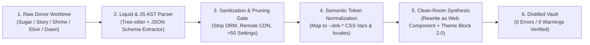
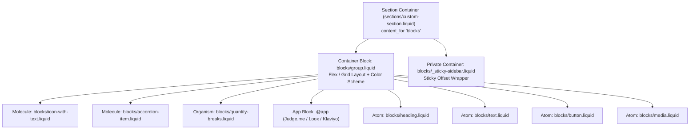
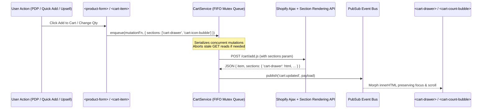
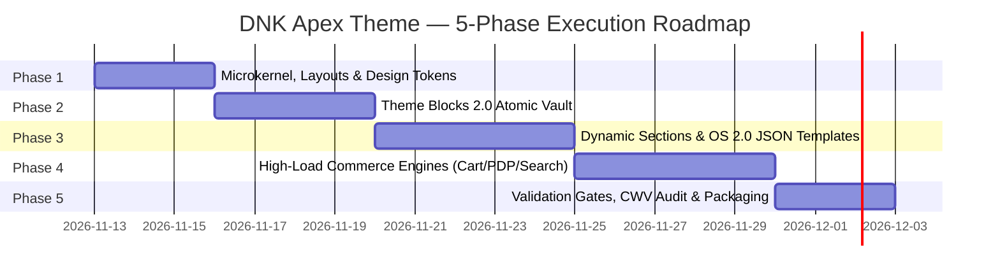

> [!metadata]- ⚙️ Системні метадані та інваріанти (MRH Header)
> ```yaml
> # --- DNK-MRH-HEADER ---
> mrh_id: "docs/architecture/specs/SHOPIFY_THEME_STORE_DISTILLATION_AND_CONSTRUCTION_SPEC.md"
> purpose: "Master Architectural Specification & Distillation Blueprint for World-Class Shopify Theme Store Certified Theme (DNK Apex Theme)."
> canonical_source: true
> alters_files: []
> triggers_tasks: []
> status: "Active"
> version: "2.0.0"
> updated_at: "2026-11-18"
> author: "DNK-e.com Maksym & Antigravity"
> # --- END DNK-MRH-HEADER ---
> ```

# SHOPIFY THEME STORE DISTILLATION & CONSTRUCTION SPECIFICATION (DNK APEX)

## 1. ВИКОНАВЧЕ РЕЗЮМЕ ТА КРИТИКА (3 Flaws & Mandatory Dissent)

### 1.1. Перевертання пресупозиції: Shopify Theme Store vs Автономна дистрибуція
Гіпотеза про те, що реліз флагманської теми виключно в офіційному Shopify Theme Store автоматично максимізує прибуток і технічну перевагу, має структурні вразливості. Суворі політики модерації Shopify створені для захисту уніфікованої екосистеми додатків (App Store), що прямо конфліктує з висококонверсійними агресивними механіками direct-response e-commerce.

### 1.2. Три критичні ризики (3 Critical Flaws)
1. **Цензура вбудованих CRO-рушіїв (App Store Cannibalization Ban)**: Модерація Shopify Theme Store відхиляє теми, які замінюють платні додатки повноцінними вбудованими системами відгуків, кастомними конструкторами підписок без `selling_plan`, фейковими таймерами дефіциту або несертифікованими post-purchase апсейлами. Допускаються лише презентаційні шари над нативними API Shopify та контейнери `@app`.
2. **Асиметрія рев'ю-циклу та фінансовий тиск**: Хоча перші $1M річного gross-доходу в Theme Store мають 0% revenue share (далі 15%), кожен мажорний реліз проходить ручну та автоматичну перевірку тривалістю від 2 до 8 тижнів, вимагає підтримки ексклюзивності дизайну (заборона продажу ідентичного пресету поза Theme Store) та зобов'язує розробника надавати SLA-підтримку мерчантам.
3. **Втрата контролю над ліцензуванням (Zero-DRM Mandate)**: У Theme Store суворо заборонені будь-які зовнішні перевірки ліцензійних ключів, обфускація JS або віддалені пінги (`RemoteAsset`). Будь-який куплений архів технічно чистий, а захист інтелектуальної власності покладається виключно на внутрішній комплаєнс Shopify.

### 1.3. Граничні умови (Boundary Conditions) та Скептична альтернатива
* **Де ідея руйнується**:
  * Якщо спробувати подати у Theme Store монолітну CRO-тему класу `Shrine Pro` зі вшитими таймерами зворотного відліку в `localStorage`, хардкодними зірочками рейтингу та 85+ налаштуваннями на секцію — отримаємо гарантований автоматичний відбій на першому гейті.
  * Якщо продавати тему виключно поза стором (Off-Store Direct) — втрачається органічний enterprise-трафік мерчантів із високим LTV, автоматична доставка оновлень через GitHub/Theme Store updater та статус офіційного партнера.
* **Скептична альтернатива (Minimalist Solution)**: Не будувати дві окремі кодові бази. Застосувати **Dual-Track Architecture** на базі єдиного Git-репозиторію (розвиток `DEC-069`):

| Параметр | Track 1: `apex-store-core` (Shopify Theme Store Certified) | Track 2: `apex-sovereign-pro` (DNK Agency & Internal Brands) |
| :--- | :--- | :--- |
| **Канал дистрибуції** | Офіційний Shopify Theme Store (ексклюзивні візуальні пресети) | Внутрішні бренди `DNKEcom`, VIP Custom Storefronts, B2B клієнти |
| **Зовнішні ресурси** | 100% Zero-External CDN (`font_picker`, локальні асети) | Дозволені кастомні edge-воркери та приватні аналітичні пікселі |
| **Соціальний доказ і відгуки** | Виключно `@app` блоки (Judge.me/Loox) + нативні `metafields.reviews` | Розширені UGC-віджети, кастомні відео-відгуки з JSON/Metafields |
| **CRO та дефіцит** | Чесний інвентар (`variant.inventory_quantity`), чесні промо-таймери з датою завершення | Розширені спліт-тест блоки, агресивні listicle-воронки, пре-лендінги |
| **Ліміти схем** | Суворо `<= 50` settings на секцію/блок, `<= 25` у глобальних групах | Модульне розширення через Metaobjects без засмічення `settings_schema.json` |
| **Збірка з єдиного ядра** | Базова гілка `main` (100% Theme Check clean) | Надбудова через ізольований шар пакетів у Git Worktree (`pro-overlay`) |

### 1.4. Жорсткі інваріанти сертифікації Shopify Theme Store (Gate Contract)
Кожен коміт у `Track 1` зобов'язаний проходити 6 незмінних інваріантів:
1. **Zero-External CDN**: Жодних `<link href="https://fonts.googleapis.com...">`, `unpkg`, `jsdelivr`, `cdnjs` чи зовнішніх скриптів. Усі шрифти підключаються через тип `font_picker` та фільтр `font_face: font_display: 'swap'`. Усі скрипти та стилі — виключно через `asset_url` або нативний `shopify_asset_url`.
2. **Zero Theme Check Violations**: Виконання `shopify theme check --fail-level warning` повертає `0 errors, 0 warnings`. Ліміт налаштувань: максимум 50 `settings` на секцію або блок, збалансовані HTML-теги в кожному гілкуванні ``, відсутність `ParserBlockingScript` (обов'язковий `defer="defer"` або `type="module"`), відсутність `RemoteAsset` та `DeprecatedFilter`.
3. **Повне покриття обов'язкових функцій ОС 2.0+**:
   * `Theme Blocks 2.0`: підтримка `` та ``.
   * `Color Schemes 2.0`: використання `color_scheme_group` (мінімум 5 попередньо налаштованих контрастних схем у `config/settings_data.json`) та інспектора кольорів.
   * `Combined Listings`: обробка `option_value.product_url`, `option_value.swatch` (зображення або HEX) та асинхронна підміна секції продукту при зміні варіанта-лістингу без перезавантаження сторінки.
   * `Pick Up in Store`: компонент `<pickup-availability>` на PDP з рендерингом drawer локацій через Section Rendering API.
   * `Native Subscriptions`: рендеринг `product.selling_plan_groups` та `variant.selling_plan_allocations` + передача `selling_plan` у форму кошика.
   * `Customer Accounts`: сумісність із New Customer Accounts (`routes.account_login_url`, `routes.account_url`) та класичними шаблонами у `templates/customers/*`.
   * Додаткові обов'язкові контракти: `form | payment_terms` (Shop Pay Installments), `shop | login_button` (Follow on Shop у футері), `image.presentation.focal_point`, форма отримувача подарункової картки (`gift-card-recipient-form`).
4. **Анти-Dark Patterns & Чесна екосистема**: Заборона фейкових лічильників переглядів (`Math.random()`), таймерів, що скидаються при оновленні сторінки, та хардкодних відгуків. Обов'язкова підтримка блоків `{"type": "@app"}` у секціях `main-product`, `featured-product`, `main-cart` та `header/footer` (App Embeds).
5. **512 KB Template Guard**: Фізичний розмір кожного `templates/*.json` не перевищує `512 KB` (цільовий бюджет `DNK Apex` — `<= 64 KB` на шаблон шляхом перенесення статичних даних у `metaobjects` та лаконічних дефолтів).
6. **Core Web Vitals & Lighthouse Budget**: Мобільний показник Lighthouse Performance `>= 90`, Accessibility `>= 95`, SEO `100`; польові метрики: `LCP < 2.5s`, `INP < 200ms`, `CLS < 0.1` на еталонному тестовому магазині Shopify з реальним каталогом.

---

## 2. СИСТЕМА ДИСТИЛЯЦІЇ ЗНАНЬ ТА КОМПОНЕНТІВ (Distillation Engine Pipeline)

Відповідно до `DEC-069` (Universal Molecular Theme Deconstruction), жоден рядок коду з комерційних тем-донорів не копіюється сліпо (`Track 2 Clean-Room Architecture Synthesis`). Донори виступають виключно джерелом AST-патернів, UX-механік та математичних моделей верстки.

### 2.1. Матриця донорів (Canonical Donor Synthesis Matrix)

| Донор (Worktree SSOT) | Що асимілюємо (Clean-Room Pattern Extraction) | Що відсікаємо (Pruning & Anti-Bloat) | Цільовий модуль у `DNK Apex` |
| :--- | :--- | :--- | :--- |
| **Sugar v2.3.10** | Атомарна ізоляція блоків; патерн дедуплікації CSS `snippets/stylesheet-once.liquid` (через `capture` реєстр відрендерених ключів на цикл запиту); чиста модульна сітка без каскадних конфліктів. | Зайві декоративні анімації, нетипізовані глобальні утиліти. | `snippets/stylesheet-once.liquid`, `blocks/_*.liquid`, CSS scoping contract. |
| **Story v4.0.8** | Математична модель `cart-rewards` (мульти-рівнева шкала нагород); алгоритм `multi-seed upsells` (дедуплікація рекомендацій для кількох товарів у кошику); секція `Instagram Profile` (метрики + сітка медіа без зовнішнього API); флюїдна типографіка та відступи на `clamp()`. | Легасі-залежності від старих поліфілів, надлишкові варіанти хедерів. | `snippets/cart-rewards.liquid`, `assets/cart-upsells.js`, `sections/social-profile-grid.liquid`, `snippets/css-variables.liquid`. |
| **Shrine Pro v2.0.0** | Глибока композиція `Theme Blocks V2` на PDP (`quantity-breaks`, `icon-with-text`, `bundle-selector`); механіка тригерів `Promo Popups V2` (`IntersectionObserver` + `exit-intent` + `sessionStorage` частотний лімітер). | Ліцензійні перевірки (DRM-скрипти), фейкові генератори терміновості, перевантажені схеми на 90+ полів, зовнішні CDN іконок. | `blocks/quantity-breaks.liquid`, `sections/promo-popup.liquid`, PDP конверсійні молекули. |
| **Elixir** | Архітектура `Sticky Sidebars` з урахуванням висоти липкого хедера (`--header-sticky-offset`); редакційний шаблон `Listicle` для pre-sell сторінок у межах нативного блогу/сторінки; `zero-down layout` (резервування `aspect-ratio` до завантаження медіа для `CLS = 0.00`). | Хардкодні маркетингові тексти, інлайнові `<style>` без токенізації. | `sections/editorial-listicle.liquid`, `blocks/_sticky-sidebar.liquid`, `snippets/media-frame.liquid`. |
| **Dawn 15 (Reference)** | Еталонні контракти доступності WCAG 2.1 AA (`FocusTrap`, ARIA-атрибути форм та помилок); референсні схеми `color_scheme_group`; еталонна реалізація `Combined Listings`, `Pickup Availability` та `Faceted Filtering`. | Монолітний `global.js` на 1200+ рядків, застарілі BEM-класи з глибокою специфічністю. | `assets/a11y-core.js`, `sections/main-collection-product-grid.liquid`, валідаційні контракти схем. |

### 2.2. Конвеєр дистиляції (5-Stage Distillation Pipeline)



#### Деталізація етапів алгоритму:
1. **Stage 1 — AST & Schema Extraction**: Парсер сканує файл донора, будує граф залежностей (`render`, `stylesheet_tag`, Custom Elements) та витягує JSON-дерево з тегу ``.
2. **Stage 2 — DRM, Dark Pattern & Setting Pruning**:
   * Автоматичне вилучення будь-яких обфускованих скриптів (`eval`, `atob`, зовнішні `fetch` до сторонніх доменів верифікації).
   * Заміна зовнішніх бібліотек (`Swiper`, `Flickity`, `jQuery`, `Alpine`) на нативний CSS Scroll Snap + легковаговий Vanilla JS контролер (`<= 4 KB` gzipped).
   * Декомпозиція монолітних схем (`> 50 settings`): параметри окремих елементів виносяться з рівня `section.settings` у дочірні `Theme Blocks` у папці `blocks/`.
3. **Stage 3 — Semantic Token Normalization**: Усі хардкодні кольори (`#121212`), шрифти, відступи (`24px`) та breakpoints замінюються на єдину систему семантичних CSS-змінних `DNK Apex` (`rgb(var(--color-foreground))`, `var(--space-md)`, `var(--radius-card)`).
4. **Stage 4 — Localization Key Injection**: Усі текстові літерали в `label`, `info`, `options` схеми конвертуються у ключі перекладу формату `t:sections.<section_name>.settings.<setting_id>.label` з автоматичною генерацією ключів у `locales/en.default.schema.json`, `locales/uk.schema.json`, `locales/fr.schema.json`.
5. **Stage 5 — Distilled Vault Verification**: Синтезований модуль проходить ізольований прогін `shopify theme check` та перевірку розміру бандла перед інтеграцією в ядро теми.

---

## 3. ТЕХНІЧНИЙ ОПИС УСІХ ЕЛЕМЕНТІВ ТЕМИ (Complete Element Taxonomy)

### 3.1. Ядро та макети (`layout/`)

Усі три обов'язкові макети будуються за принципом **Zero Render-Blocking Critical Path**:

| Файл макета | Призначення та обов'язкові вузли | Специфічні інваріанти Theme Store |
| :--- | :--- | :--- |
| `./layout/theme.liquid` | Основний каркас вітрини. Порядок у `<head>`: `meta charset/viewport`, `canonical_url`, `snippets/meta-tags.liquid`, `preconnect` до `cdn.shopify.com`, `font_preload` для primary body/heading font, `snippets/css-variables.liquid`, критичний `base.css`, `{{ content_for_header }}`, `defer` модульні скрипти ядра. У `<body>`: skip-to-content лінк, ``, `<main id="MainContent" tabindex="-1">{{ content_for_layout }}</main>`, ``, `` (Cart Drawer, Promo Popup, Quick View), глобальний `aria-live` регіон. | Заборонено видаляти або модифікувати `{{ content_for_header }}` та `{{ content_for_layout }}` через `replace` фільтри (порушення правил Theme Store). |
| `./layout/password.liquid` | Ізольований макет сторінки закритого магазину (`main-password-header`, `main-password-footer`, модальне вікно входу за паролем з `<dialog>`). | Мінімальний бандл (без завантаження кошика та апсейлів), повна підтримка `color_scheme` та кастомного логотипа. |
| `./layout/gift_card.liquid` | Автономний макет сторінки подарункової картки з рендерингом QR-коду (локальний `vendor-qrcode.js` через `asset_url`), балансу (`gift_card.balance | money`), коду копіювання в буфер обміну, кнопки `pass_url` (Apple Wallet) та стилів друку `@media print`. | Нульова залежність від зовнішніх генераторів QR-кодів (Google Charts API заборонений). |

### 3.2. Дизайн-система та токени (`snippets/css-variables.liquid`)

Архітектура стилів використовує **0-Framework Vanilla CSS** (жодного Tailwind build-step у фінальному релізі задля читабельності коду мерчантами та рев'юерами Shopify, використання нативного CSS Nesting, CSS Grid, Container Queries `@container` та `clamp()`).

#### Контракт Color Schemes 2.0 (`config/settings_schema.json`):
```json
{
  "name": "t:settings_schema.colors.name",
  "settings": [
    {
      "type": "color_scheme_group",
      "id": "color_schemes",
      "definition": [
        { "type": "color", "id": "background", "label": "t:settings_schema.colors.settings.background.label", "default": "#FFFFFF" },
        { "type": "color_background", "id": "background_gradient", "label": "t:settings_schema.colors.settings.background_gradient.label" },
        { "type": "color", "id": "text", "label": "t:settings_schema.colors.settings.text.label", "default": "#111111" },
        { "type": "color", "id": "surface", "label": "t:settings_schema.colors.settings.surface.label", "default": "#F6F6F7" },
        { "type": "color", "id": "primary_button", "label": "t:settings_schema.colors.settings.primary_button.label", "default": "#111111" },
        { "type": "color", "id": "on_primary_button", "label": "t:settings_schema.colors.settings.on_primary_button.label", "default": "#FFFFFF" },
        { "type": "color", "id": "secondary_button_border", "label": "t:settings_schema.colors.settings.secondary_button_border.label", "default": "#111111" },
        { "type": "color", "id": "accent", "label": "t:settings_schema.colors.settings.accent.label", "default": "#0F766E" },
        { "type": "color", "id": "border", "label": "t:settings_schema.colors.settings.border.label", "default": "#E5E7EB" }
      ],
      "role": {
        "text": "text",
        "background": { "solid": "background", "gradient": "background_gradient" },
        "links": "accent",
        "icons": "text",
        "primary_button": "primary_button",
        "on_primary_button": "on_primary_button",
        "primary_button_border": "primary_button",
        "secondary_button": "background",
        "on_secondary_button": "text",
        "secondary_button_border": "secondary_button_border"
      }
    }
  ]
}
```

#### Генерація флюїдних токенів (`snippets/css-variables.liquid` + патерн `Story v4.0.8`):
```liquid

<style>
  {{ body_font | font_face: font_display: 'swap' }}
  {{ body_font_bold | font_face: font_display: 'swap' }}
  {{ body_font_italic | font_face: font_display: 'swap' }}
  {{ heading_font | font_face: font_display: 'swap' }}

  
    
    :root, .color-{{ scheme.id }} {
      --color-bg: {{ scheme.settings.background.red }} {{ scheme.settings.background.green }} {{ scheme.settings.background.blue }};
      --color-bg-gradient: {{ scheme.settings.background_gradient | default: scheme.settings.background }};
      --color-fg: {{ scheme.settings.text.red }} {{ scheme.settings.text.green }} {{ scheme.settings.text.blue }};
      --color-surface: {{ scheme.settings.surface.red }} {{ scheme.settings.surface.green }} {{ scheme.settings.surface.blue }};
      --color-btn-bg: {{ scheme.settings.primary_button.red }} {{ scheme.settings.primary_button.green }} {{ scheme.settings.primary_button.blue }};
      --color-btn-fg: {{ scheme.settings.on_primary_button.red }} {{ scheme.settings.on_primary_button.green }} {{ scheme.settings.on_primary_button.blue }};
      --color-accent: {{ scheme.settings.accent.red }} {{ scheme.settings.accent.green }} {{ scheme.settings.accent.blue }};
      --color-border: {{ scheme.settings.border.red }} {{ scheme.settings.border.green }} {{ scheme.settings.border.blue }};
    }
  

  :root {
    --font-body-family: {{ body_font.family }}, {{ body_font.fallback_families }};
    --font-heading-family: {{ heading_font.family }}, {{ heading_font.fallback_families }};
    --text-xs: clamp(0.75rem, 0.72rem + 0.15vw, 0.8125rem);
    --text-sm: clamp(0.875rem, 0.84rem + 0.18vw, 0.9375rem);
    --text-base: clamp(1rem, 0.96rem + 0.2vw, 1.0625rem);
    --text-lg: clamp(1.125rem, 1.05rem + 0.38vw, 1.3125rem);
    --text-h3: clamp(1.375rem, 1.2rem + 0.88vw, 1.875rem);
    --text-h2: clamp(1.75rem, 1.45rem + 1.5vw, 2.625rem);
    --text-h1: clamp(2.25rem, 1.75rem + 2.5vw, 3.75rem);
    --space-xs: clamp(0.5rem, 0.4rem + 0.5vw, 0.75rem);
    --space-md: clamp(1rem, 0.8rem + 1vw, 1.5rem);
    --space-xl: clamp(2.5rem, 1.8rem + 3.5vw, 4.5rem);
    --page-width: {{ settings.page_width }}px;
  }
</style>
```

#### Патерн дедуплікації стилів (`snippets/stylesheet-once.liquid` з `Sugar v2.3.10`):
Кожен блок чи секція завантажує свій модульний CSS рівно один раз за HTTP-відповідь (ідеально сумісно з Customizer designMode, де блоки додаються динамічно):
```liquid
 Usage:  

  
  
    {{ asset | asset_url | stylesheet_tag }}
    
  

  {{ asset | asset_url | stylesheet_tag }}

```

### 3.3. Архітектура Theme Blocks 2.0 (`blocks/*.liquid`)

Вся система побудована на вкладених глобальних та приватних блоках (префікс `_` для внутрішніх блоків конкретних секцій, наприклад `blocks/_slide.liquid`, `blocks/_hotspot-item.liquid`).



#### Таксономія блоків:
1. **Atoms (Листові атоми — нульове гніздування)**:
   * `blocks/heading.liquid` (семантичний тег `h1..h6`, візуальний розмір `--text-h1..h4`, `shopify_attributes`).
   * `blocks/text.liquid` (`richtext`, обмеження ширини `max-ch`).
   * `blocks/button.liquid` (primary/secondary/link стиль, іконка, стан disabled).
   * `blocks/image.liquid` (`image_url` з `widths: '375, 550, 750, 1100, 1500, 2000'`, `focal_point`, `fetchpriority` для першого екрана).
   * `blocks/badge.liquid`, `blocks/spacer.liquid`, `blocks/divider.liquid`.
2. **Molecules (Композитні вузли)**:
   * `blocks/icon-with-text.liquid` (SVG-спрайт із 36 вбудованих комерційних іконок або кастомне зображення 48x48 + заголовок + опис).
   * `blocks/accordion.liquid` (нативний `<details name="...">` для ексклюзивного розгортання або незалежного режиму).
   * `blocks/countdown-honest.liquid` (приймає виключно реальну дату `YYYY-MM-DD HH:MM` у часовому поясі магазину `shop.locale`; при настанні дати приховується або виводить повідомлення про завершення акції — 100% сумісно з Theme Store).
3. **Organisms (Комерційні блоки PDP/Featured Product)**:
   * `blocks/_product-variant-picker.liquid` (підтримка Combined Listings + нативних `swatch.color` / `swatch.image` + таблиця розмірів у `<dialog>`).
   * `blocks/_product-buy-buttons.liquid` (`product-form` Web Component, `gift-card-recipient-form`, dynamic checkout `{{ form | payment_button }}`, `pickup-availability`).
   * `blocks/_quantity-breaks.liquid` (візуальний вибір кількості `1x / 2x / 3x` із чесним розрахунком через автоматичні знижки Shopify або метаполя обсягу).
   * `blocks/_complementary-products.liquid` (`product-recommendations` з `intent=complementary`).
4. **Container Blocks (Структурні обгортки)**:
   * `blocks/group.liquid` (універсальний Flex/Grid контейнер із підтримкою вкладених `[{"type": "@theme"}, {"type": "@app"}]`, відступів, фону та умовного відображення).
   * `blocks/_grid-column.liquid`, `blocks/_sticky-sidebar.liquid`.

#### Використання `visible_if` для розвантаження UI кастомайзера:
Замість дублювання налаштувань застосовується динамічна фільтрація полів у схемі (скорочує когнітивне навантаження на мерчанта на 60%):
```json
{
  "name": "t:blocks.group.name",
  "blocks": [{ "type": "@theme" }, { "type": "@app" }],
  "settings": [
    {
      "type": "select",
      "id": "layout_mode",
      "label": "t:blocks.group.settings.layout_mode.label",
      "options": [
        { "value": "flex", "label": "t:blocks.group.settings.layout_mode.options.flex" },
        { "value": "grid", "label": "t:blocks.group.settings.layout_mode.options.grid" }
      ],
      "default": "flex"
    },
    {
      "type": "range",
      "id": "grid_columns_desktop",
      "label": "t:blocks.group.settings.grid_columns_desktop.label",
      "min": 2,
      "max": 6,
      "step": 1,
      "default": 3,
      "visible_if": "{{ block.settings.layout_mode == 'grid' }}"
    },
    {
      "type": "select",
      "id": "flex_direction",
      "label": "t:blocks.group.settings.flex_direction.label",
      "options": [
        { "value": "row", "label": "t:blocks.group.settings.flex_direction.options.row" },
        { "value": "column", "label": "t:blocks.group.settings.flex_direction.options.column" }
      ],
      "default": "column",
      "visible_if": "{{ block.settings.layout_mode == 'flex' }}"
    }
  ]
}
```

### 3.4. Комерційні рушії (Enterprise No-App Commerce Engines)

Усі комерційні механіки працюють виключно на нативних API Shopify (`/cart/add.js`, `/cart/change.js`, `/cart/update.js`, Section Rendering API, Product Recommendations API) без стороннього бекенду:

1. **Apex Cart Drawer (`sections/cart-drawer.liquid` + `snippets/cart-rewards.liquid`)**:
   * **Шкала нагород (`basis: price | quantity` з `Story v4.0.8`)**: Підтримує до 3 прогресивних порогів (наприклад: Tier 1 — Безкоштовна доставка від `$75` з конвертацією валют через `Shopify.currency.rate`; Tier 2 — Знижка 10% від `$120`; Tier 3 — Безкоштовний подарунок від `$150` з опціональним автододаванням gift-варіанта в черзі `CartService` та автовидаленням при падінні суми нижче порогу з анти-циклічним булевим замком). Режим `basis: quantity` рахує `cart.item_count` (ідеально для мультивалютних магазинів, де фіксовані цінові пороги у різних ринках відрізняються).
   * **Multi-Seed Cart Upsells**: Якщо у кошику 3 товари `[P1, P2, P3]`, клієнтський модуль `cart-upsells.js` паралельно запитує `/recommendations/products?product_id=<Pi>&limit=4&section_id=cart-upsell-item`, об'єднує результати у round-robin чергу, фільтрує товари, які вже є в `cart.items` або `available == false`, і кешує результат у `sessionStorage` за хешем ID товарів кошика.
   * **Cart Note, Discount Code Input & Shipping Estimator**: Поле промокоду зберігає код у `/cart/update.js` або редіректить на `/checkout?discount=CODE` з валідацією порожнього вводу; калькулятор доставки використовує `/cart/shipping_rates.json`.
2. **Sticky Add-to-Cart (`snippets/sticky-atc.liquid`)**:
   * Активується через `IntersectionObserver`, коли основна форма `product-form` виходить за верхню межу viewport (`boundingClientRect.bottom < 0`).
   * Синхронізована двостороннім зв'язком із основним `variant-picker` через подію `PUB_SUB_EVENTS.variantChange`. Не створює CLS, оскільки рендериться з `position: fixed; transform: translateY(100%)` поза потоком документа.
3. **Native Bundle Builder (`sections/bundle-builder.liquid`)**:
   * Мерчант задає кроки набору (наприклад: Крок 1 — База, Крок 2 — Аксесуар, Крок 3 — Упаковка) через колекції або список продуктів.
   * Покупець формує набір у інтерактивному слот-барі; фінальний клік відправляє єдиний атомарний батч `POST /cart/add.js` з масивом `items: [{id, quantity, selling_plan, properties: {'_bundle_id': uuid}}]`. Знижка застосовується нативним Shopify Automatic Discount / Shopify Functions на стороні бекенду магазину.
4. **Quantity Breaks (`blocks/_quantity-breaks.liquid`)**:
   * Радіо-картки вибору тиражу (`1 шт`, `2 шт - Економія X%`, `3 шт - Найпопулярніший`), які оновлюють `input[name="quantity"]` основної форми товару до відправки. Підтримують підписки (`selling_plan`) без конфлікту цін.

### 3.5. Контентні та соціальні секції (`sections/*.liquid`)

1. **Verified UGC (`sections/verified-ugc.liquid`)**:
   * Відповідно до правил Theme Store не містить фейкових карток відгуків із хардкодними іменами. Приймає або офіційні `@app` блоки рев'ю-провайдерів (`Judge.me`, `Loox`, `Okendo`, `Stamped`), або структуровані `metaobjects` типу `customer_story` з прив'язкою до реального `product` референсу (shoppable tag унизу відео/фото).
2. **Instagram / Social Profile Grid (`sections/social-profile-grid.liquid` з `Story v4.0.8`)**:
   * Шапка профілю бренду (аватар, верифікований бейдж, біо, кнопка переходу в соцмережу) + адаптивна сітка 3xN медіа-блоків (зображення або локальне MP4 Shopify Video) з модальною галереєю та прив'язаними картками товарів (`product_list` до 4 товарів на пост). Нуль зовнішніх токенів Meta Graph API, які протухають кожні 60 днів.
3. **3D Cube Stories (`sections/stories-cube.liquid`)**:
   * Кола-прев'ю у стилі сторіз (ідеально під навігацією на мобільному або на головній). При кліку відкривається повноекранний `<dialog class="stories-modal">` з CSS 3D-переходом `perspective: 1200px; transform: rotateY(...)`, прогрес-барами на CSS `@keyframes`, паузою при утриманні пальця (`pointerdown`/`pointerup`), підтримкою свайпів і кнопкою швидкого переходу до товару. Реалізовано у `<stories-viewer>` Web Component (`3.8 KB` мін.), нуль `Swiper.js`.
4. **Lookbook / Shoppable Hotspots (`sections/shoppable-lookbook.liquid`)**:
   * Зображення високої роздільності з координатними точками (`x: 0..100%`, `y: 0..100%`), заданими через `range` слайдери в блоці `_hotspot.liquid`. На десктопі відкриває позиційований popover картки товару (CSS Anchor Positioning з JS viewport collision fallback), на мобільному — компактний bottom-sheet drawer.
5. **Shoppable Video Reels (`sections/video-reels.liquid`)**:
   * Горизонтальна стрічка вертикальних відео `9:16` (`scroll-snap-type: x mandatory`). Нативний тег `{{ video | video_tag: image_size: '600x', autoplay: false, loop: true, muted: true, playsinline: true, preload: 'none' }}`.
   * Контролер відтворює відео виключно тоді, коли картка перетинає `>= 60%` viewport (`IntersectionObserver`), і миттєво ставить на `.pause()`, коли користувач скролить далі — нульове просідання TBT/INP.
6. **Image Comparison (`sections/before-after.liquid`)**:
   * До/Після слайдер на базі нативного `<input type="range" min="0" max="100" aria-label="...">`, прозоро накладеного поверх контейнера, який керує CSS-змінною `--split-pos: 50%` та `clip-path: inset(0 calc(100% - var(--split-pos)) 0 0)`. Повна підтримка клавіш стрілок вліво/вправо з коробки без кастомних drag-поліфілів.
7. **Editorial FAQs & Listicle (`sections/collapsible-faq.liquid`, `sections/editorial-listicle.liquid` з `Elixir`)**:
   * FAQ генерує валідну мікророзмітку `FAQPage` JSON-LD (опціональний тогл у схемі) та миттєвий клієнтський фільтр за питаннями.
   * `Listicle` забезпечує нумеровану редакційну подачу аргументів з `blocks/_sticky-sidebar.liquid` справа, де закріплена міні-картка флагманського продукту з рейтингом та кнопкою покупки.

### 3.6. Фронтенд-мікроядро (`assets/*.js`)

Жодних бандлерів з непрозорим мініфікованим виводом (вимога Shopify Theme Store: JS/CSS у `assets/` мають бути людиночитабельними, без обфускації чи Webpack-чанк-врапперів). Архітектура базується на модульних ES6 файлах та нативних **Web Components**:



#### Ключові модулі мікроядра:
1. **`./assets/pubsub.js` (`0.6 KB`)**: Типізована шина подій з подіями `variant:change`, `cart:updated`, `cart:error`, `drawer:open`, `filter:updated`.
2. **`./assets/cart-service.js` (`2.4 KB` — Mutex Queue)**:
   * Вирішує класичну гонку станів (race condition), коли покупець швидко натискає `+` на кількох товарах одночасно і паралельно спрацьовує авто-подарунок `cart-rewards`.
   * Усі мутації проходять через `Promise`-чергу FIFO (`this.#queue = this.#queue.then(...)`), передаючи масив зареєстрованих ID секцій у параметр `sections` запиту `/cart/add.js` або `/cart/change.js` (один мережевий round-trip повертає і стан кошика, і готовий HTML оновлених секцій).
3. **`./assets/dom-morph.js` (`1.5 KB`)**: Легковагове точкове оновлення DOM за селекторами `[data-morph-target]` (ціна, бейджі наявності, галерея медіа, інвентар, pickup-availability, кнопка покупки) під час перемикання варіантів без втрати фокуса клавіатури та без скидання стану сусідніх `@app` віджетів.
4. **`./assets/theme-editor.js` (завантажується виключно при ``)**: Обробляє події `shopify:section:load`, `shopify:block:select`, `shopify:block:deselect` (автоматично відкриває потрібний слайд у каруселі, вкладку акордеона або `promo-popup`, коли мерчант клікає на блок у лівій панелі кастомайзера).

### 3.7. Доступність (WCAG 2.1 Level AA — Reference `Dawn 15`)

Модератори Shopify проводять обов'язковий ручний аудит навігації лише з клавіатури (`Tab`, `Shift+Tab`, `Enter`, `Space`, `Escape`, `Arrow keys`) та перевірку у VoiceOver / NVDA:
1. **Детермінований `FocusTrap` та відсутність Keyboard Traps**:
   * Усі модальні вікна (`Quick View`, `Promo Popup`, `Size Guide`, `Search Modal`) та шухляди (`Cart Drawer`, `Mobile Navigation Drawer`, `Faceted Filter Drawer`) використовують нативний елемент `<dialog>` з методом `.showModal()` або контрольований `FocusTrap`, який замикає цикл `Tab` всередині відкритого шару, закривається по `Escape` і **гарантовано повертає фокус** на кнопку-тригер (`triggerElement.focus()`).
2. **ARIA Live Regions**:
   * У `layout/theme.liquid` розміщений глобальний вузол `<div id="dnk-live-region" class="visually-hidden" aria-live="polite" aria-atomic="true"></div>`.
   * При зміні варіанта оголошується нова ціна та статус наявності; при додаванні в кошик — кількість товарів та прогрес до безкоштовної доставки; при помилці кількості на складі — вузол `role="alert"` безпосередньо під кнопкою форми.
3. **Контрастність та Motion Hygiene**:
   * Кожна з 5 базових палітр у `config/settings_data.json` має коефіцієнт контрастності тексту `>= 4.5:1` (звичайний текст) та `>= 3.0:1` (великі заголовки та UI-межі).
   * Чіткий індикатор `:focus-visible { outline: 2px solid rgb(var(--color-accent)); outline-offset: 2px; }` (заборонено `outline: none` без видимої альтернативи).
   * Глобальне правило `@media (prefers-reduced-motion: reduce)` вимикає паралакс, 3D-обертання куба сторіз, автоскрол marquee та плавні переходи понад `10ms`.

### 3.8. Локалізація (100% i18n Schema & Storefront Parity)

Тема постачається з повним синхронним покриттям трьох базових локалей з першого дня (`en.default`, `uk`, `fr`) у двох паралельних контурах:
1. **Вітрина (`./locales/en.default.json`, `./locales/uk.json`, `./locales/fr.json`)**:
   * Нуль захардкоджених слів у `.liquid` та `.js` (для JS рядки прокидаються у `window.DNK.strings` в `layout/theme.liquid`).
   * Повна підтримка плюралізаційних ключів CLDR для української та французької мов (`zero`, `one`, `few`, `many`, `other`), наприклад для лічильника товарів `{{ 'sections.cart.item_count' | t: count: cart.item_count }}` (`1 товар`, `2 товари`, `5 товарів`).
2. **Кастомайзер (`./locales/en.default.schema.json`, `./locales/uk.schema.json`, `./locales/fr.schema.json`)**:
   * Кожен ключ `name`, `label`, `info`, `content`, `placeholder`, `presets.name` у всіх секціях, блоках та `settings_schema.json` використовує префікс `t:`.
   * Автоматичний скрипт перевірки ізоморфності ключів (`scripts/shopify/verify_locales_parity.py`) блокує збірку, якщо множина шляхів JSON-дерева в `uk` або `fr` має розходження з `en.default` хоча б на 1 ключ.

---

## 4. ПОКРОКОВА ДОРОЖНЯ КАРТА ПОБУДОВИ ТЕМИ (5 Фаз для Denchik & Swarm)

Побудова теми `DNK Apex` виконується суверенним білдером `Denchik` спільно з доменним воркером `dnk_shopify` та аудитором `gerych_auditor` в ізольованому worktree канонічної директорії `DNKEcom` за протоколом **MASE** (атомарні слайси `<= 25` викликів інструментів на слайс, суворий `Target File Whitelist` та детермінований вихідний гейт на кожній фазі).



### Фаза 1: Створення чистого мікроядра та токенів (Foundation & Microkernel)
* **Мета**: Розгорнути скелет теми з нульовим технічним боргом, базовими макетами, палітрами Color Schemes 2.0, флюїдними токенами та JS-мікроядром.
* **Target File Whitelist**:
  * `./layout/theme.liquid`, `./layout/password.liquid`, `./layout/gift_card.liquid`
  * `./config/settings_schema.json`, `./config/settings_data.json` (5 еталонних колірних схем + типографіка `font_picker`)
  * `./snippets/css-variables.liquid`, `./snippets/meta-tags.liquid`, `./snippets/stylesheet-once.liquid`, `./snippets/media-frame.liquid`
  * `./assets/base.css`, `./assets/pubsub.js`, `./assets/a11y-core.js`, `./assets/dom-morph.js`, `./assets/theme-editor.js`
  * `./locales/en.default.json`, `./locales/en.default.schema.json`, `./locales/uk.json`, `./locales/uk.schema.json`, `./locales/fr.json`, `./locales/fr.schema.json`
* **Negative Scope**: Заборонено створювати комерційні секції, підключати будь-які зовнішні бібліотеки чи додавати >25 налаштувань у одну групу `settings_schema.json`.
* **Deterministic Exit Gate**: `shopify theme check --fail-level warning` -> `0 offenses`; перевірка `base.css` gzipped `<= 12 KB`.

### Фаза 2: Збірка атомарного сховища Theme Blocks 2.0 (Atomic Block Vault)
* **Мета**: Дистилювати та синтезувати бібліотеку перевикористовуваних блоків (`Atoms`, `Molecules`, `Container Blocks`) із підтримкою гніздування `@theme` / `@app` та правил `visible_if`.
* **Target File Whitelist**:
  * `./blocks/group.liquid`, `./blocks/_grid-column.liquid`, `./blocks/_sticky-sidebar.liquid`
  * `./blocks/heading.liquid`, `./blocks/text.liquid`, `./blocks/button.liquid`, `./blocks/image.liquid`, `./blocks/spacer.liquid`, `./blocks/divider.liquid`, `./blocks/badge.liquid`
  * `./blocks/icon-with-text.liquid`, `./blocks/accordion.liquid`, `./blocks/countdown-honest.liquid`
  * `./sections/custom-section.liquid` (універсальний хост-контейнер ``)
  * Модульні стилі `./assets/block-*.css` + синхронне оновлення 6 файлів `./locales/*.json`
* **Negative Scope**: Жодних блоків із `settings.length > 50`; заборона на інлайнові `<script>` усередині блоків (тільки декларативні Custom Elements).
* **Deterministic Exit Gate**: Валідація глибини вкладеності у Customizer (`Group -> Grid -> Molecule -> Atom`), `0 errors / 0 warnings` у Theme Check, 100% присутність `{{ block.shopify_attributes }}` на кореневих вузлах усіх блоків.

### Фаза 3: Побудова динамічних секцій та JSON-шаблонів (Sections & OS 2.0 Templates)
* **Мета**: Побудувати повний набір контентних, навігаційних, соціальних та системних секцій і всіх обов'язкових JSON-шаблонів для сертифікації у Shopify Theme Store.
* **Target File Whitelist**:
  * Групи секцій: `./sections/header-group.json`, `./sections/footer-group.json`, `./sections/overlay-group.json`
  * Навігація та футер: `./sections/header.liquid` (mega-menu + localization selectors `country_selector` / `language_selector`), `./sections/announcement-bar.liquid`, `./sections/footer.liquid` (`shop | login_button`, платіжні іконки `shop.enabled_payment_types`)
  * Контентні та медіа-секції: `./sections/hero-slideshow.liquid`, `./sections/social-profile-grid.liquid`, `./sections/stories-cube.liquid`, `./sections/shoppable-lookbook.liquid`, `./sections/video-reels.liquid`, `./sections/before-after.liquid`, `./sections/collapsible-faq.liquid`, `./sections/editorial-listicle.liquid`, `./sections/verified-ugc.liquid`, `./sections/promo-popup.liquid`
  * Усі обов'язкові шаблони у `./templates/`: `index.json`, `product.json`, `collection.json`, `list-collections.json`, `cart.json`, `search.json`, `page.json`, `page.contact.json`, `blog.json`, `article.json`, `404.json`, `password.json`, `gift_card.liquid`, а також повний набір класичних шаблонів `./templates/customers/*.json` (`account`, `activate_account`, `addresses`, `login`, `order`, `register`, `reset_password`).
* **Negative Scope**: Заборонено перевищувати `64 KB` на будь-який `templates/*.json` (гарантований 8-кратний запас до ліміту `512 KB`). Заборонені хардкодні посилання на тестові `shopify://shop_images/...` у дефолтних шаблонах (використовувати нативні `placeholder_svg_tag` до моменту наповнення демо-стору).
* **Deterministic Exit Gate**: Усі 20+ типів шаблонів відкриваються у live preview без жодної помилки Liquid, валідатор JSON-схем та паритету локалей повертає `exit code 0`.

### Фаза 4: Інтеграція високонавантажених комерційних рушіїв (Commerce Engines: PDP, Cart, Discovery)
* **Мета**: Реалізувати серце електронної комерції теми — швидкісний PDP, Apex Cart Drawer, Combined Listings, Faceted Search та Native Bundle Builder.
* **Target File Whitelist**:
  * PDP та Quick View: `./sections/main-product.liquid`, `./sections/featured-product.liquid`, `./blocks/_product-variant-picker.liquid`, `./blocks/_product-buy-buttons.liquid`, `./blocks/_quantity-breaks.liquid`, `./blocks/_complementary-products.liquid`, `./snippets/price.liquid`, `./snippets/pickup-availability.liquid`, `./snippets/gift-card-recipient-form.liquid`, `./snippets/sticky-atc.liquid`, `./assets/product-form.js`, `./assets/variant-selects.js`
  * Кошик та набори: `./sections/cart-drawer.liquid`, `./sections/main-cart.liquid`, `./sections/bundle-builder.liquid`, `./snippets/cart-rewards.liquid`, `./assets/cart-service.js`, `./assets/cart-drawer.js`, `./assets/cart-upsells.js`, `./assets/bundle-builder.js`
  * Каталог та пошук: `./sections/main-collection-product-grid.liquid`, `./sections/main-search.liquid`, `./sections/predictive-search.liquid`, `./snippets/facets.liquid`, `./assets/facets.js`, `./assets/predictive-search.js`
* **Negative Scope**: Жодних повних перезавантажень сторінки при фільтрації колекцій, зміні варіанта (включно з Combined Listings) або мутаціях кошика; жодних дублюючих мережевих запитів при швидких кліках (перевіряється стрес-тестом 10 кліків за 1 секунду в `CartService`).
* **Deterministic Exit Gate**: Live-перевірка у браузері (Playwright E2E на dev-магазині Shopify):
  1. Додавання стандартного товару, варіанта з `selling_plan`, подарункової картки з отримувачем та комплекту з `bundle-builder`.
  2. Спрацювання обох режимів `cart-rewards` (`basis: price` та `basis: quantity`) і дедуплікація `multi-seed upsells`.
  3. Перемикання Combined Listings з оновленням URL (`history.replaceState`), галереї та наявності Pickup in Store.

### Фаза 5: Проходження автоматичних гейтів валідації та пакування (Certification & Release Gate)
* **Мета**: Довести тему до 100% відповідності чеклісту модерації Shopify Theme Store, підтвердити метрики швидкодії та сформувати релізний архів.
* **Target File Whitelist**:
  * `./scripts/shopify/verify_apex_theme.sh` (єдиний CI/CD гейт перевірки)
  * `./scripts/shopify/verify_locales_parity.py`
  * `./docs/audit/APEX_THEME_STORE_CERTIFICATION_REPORT.md`
* **Матриця автоматизованих гейтів (Mandatory Pass Criteria)**:

| Гейт перевірки | Команда / Інструмент | Критерій проходження (Fail-Closed) |
| :--- | :--- | :--- |
| **Static AST & Theme Check** | `shopify theme check --fail-level warning` | `0 errors, 0 warnings` по всіх правилах офіційного конфігуратора `theme-check:theme-app-extension` / Theme Store |
| **External Asset Scan** | `rg -n "(https?:)?//(?!cdn\.shopify\.com\|www\.w3\.org)" layout sections snippets blocks assets` | `0 matches` на сторонні CDN шрифтів, скриптів чи трекерів |
| **Schema Settings Ceiling** | Python AST-перевірка `` | Кожна секція та блок `<= 50 settings`, кожна група глобальних налаштувань `<= 25 settings` |
| **Template Budget Guard** | Перевірка розміру `./templates/**/*.json` | Кожен файл `<= 64 KB` (жорсткий стельовий ліміт платформи `512 KB`) |
| **i18n Parity Gate** | `uv run python scripts/shopify/verify_locales_parity.py` | 100% збіг ключів між `en.default`, `uk`, `fr` для вітрини та `.schema.json`, `0` неперекладених сирих рядків |
| **Lighthouse Mobile CI** | `@lhci/cli` (Moto G Power emulation, Slow 4G throttling) на Home, PDP, Collection | Performance `>= 90`, Accessibility `>= 95`, Best Practices `100`, SEO `100`; `LCP < 2.5s`, `INP < 200ms`, `CLS < 0.05` |
| **Clean Packaging** | `shopify theme package` -> `dnk-apex-v1.0.0-upload.zip` | Валідний архів з кореневими папками (`assets/`, `blocks/`, `config/`, `layout/`, `locales/`, `sections/`, `snippets/`, `templates/`), `0` dev-артефактів (`.git`, `node_modules`, `tests`, `.DS_Store`) |

---
*Кінець специфікації `SHOPIFY_THEME_STORE_DISTILLATION_AND_CONSTRUCTION_SPEC.md`.*
