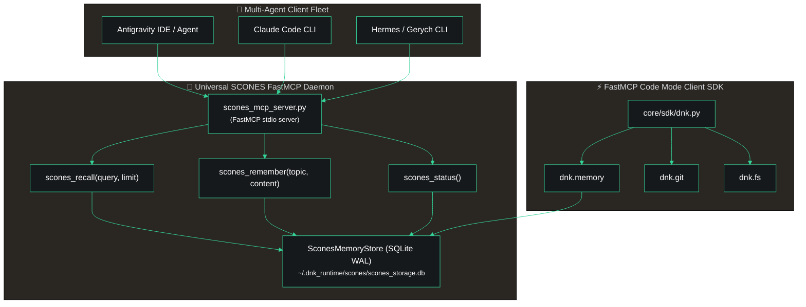

> [!metadata]- ⚙️ Системні метадані та інваріанти (MRH Header)
> ```yaml
> # --- DNK-MRH-HEADER ---
> mrh_id: "docs/architecture/specs/SPEC_UNIVERSAL_SCONES_MCP_AND_CODE_MODE.md"
> purpose: "Architecture Specification for Universal SCONES FastMCP Daemon & Code Mode SDK under EGM protocol."
> canonical_source: true
> alters_files: []
> triggers_tasks: []
> status: "Active"
> version: "2.0.0"
> updated_at: "2026-11-18"
> author: "DNK-e.com Maksym & Antigravity"
> # --- END DNK-MRH-HEADER ---
> ```

# 🐘🐟 Universal SCONES FastMCP Daemon & Code Mode SDK Spec (EGM Protocol)

## 📌 Section 1: Mermaid Architecture Topology



---

## 🎯 Section 2: Human Intent & Target Scenarios

1. **Scenario 1 (Universal Memory Access):**
   When Gerych or Hermes learns a new decision or fixes an error in the terminal, it persists to SCONES. Immediately in the same turn, Claude Code or Antigravity queries `scones_recall("topic")` via MCP and retrieves the insight without manual context copy-pasting.

2. **Scenario 2 (FastMCP Code Mode Execution):**
   When an agent needs to perform multi-step data processing or git/runtime operations, instead of sending 10 sequential JSON tool calls (consuming 4,000+ tokens), the agent writes a 5-line Python script using `from core.sdk import dnk` inside `CodeModeSandbox`. Total token cost: ~450 tokens.

---

## 📋 Section 3: Machine Contract & Invariants

### Target File Whitelist
* `core/memory/scones_mcp_server.py` (New file)
* `core/sdk/dnk.py` (New file)
* `~/.claude/settings.json` (Configuration addition for mcpServers.scones)

### Negative Scope (Strictly Prohibited)
* ❌ NEVER create or modify files outside `core/memory/`, `core/sdk/`, and `~/.claude/settings.json`.
* ❌ NEVER re-initialize or wipe existing `~/.dnk_runtime/scones/scones_storage.db`.
* ❌ NEVER hardcode API keys or credentials.
* ❌ NEVER introduce external dependencies beyond the standard library and pre-installed `mcp` in `~/.dnk_runtime/venv`.

### Tool Signatures (FastMCP Contract)
```python
@mcp.tool()
def scones_recall(query: str, limit: int = 5) -> str:
    """Query SCONES cognitive memory store for relevant facts, decisions, and calibrations."""

@mcp.tool()
def scones_remember(topic: str, content: str, importance: float = 1.0) -> str:
    """Persist an architectural decision, lesson learned, or invariant to SCONES memory."""

@mcp.tool()
def scones_status() -> str:
    """Return live telemetry, memory counts, and SQLite WAL database size."""
```

---

## 🚀 Section 4: MASE Implementation Slices (≤ 25 actions/slice)

1. **Slice 1:** Implement `core/memory/scones_mcp_server.py` integrating directly with `SconesMemoryStore` and SQLite WAL at `~/.dnk_runtime/scones/scones_storage.db`.
2. **Slice 2:** Test standalone execution of `scones_mcp_server.py` with mock recall and remember calls.
3. **Slice 3:** Implement `core/sdk/dnk.py` exposing minimal, high-velocity developer wrappers (`dnk.memory`, `dnk.git`, `dnk.fs`).
4. **Slice 4:** Register SCONES MCP in `~/.claude/settings.json` and sync via `sync_dotfiles.sh`.
5. **Slice 5:** Deterministic test pass (Python unit test verifying exit code 0).
