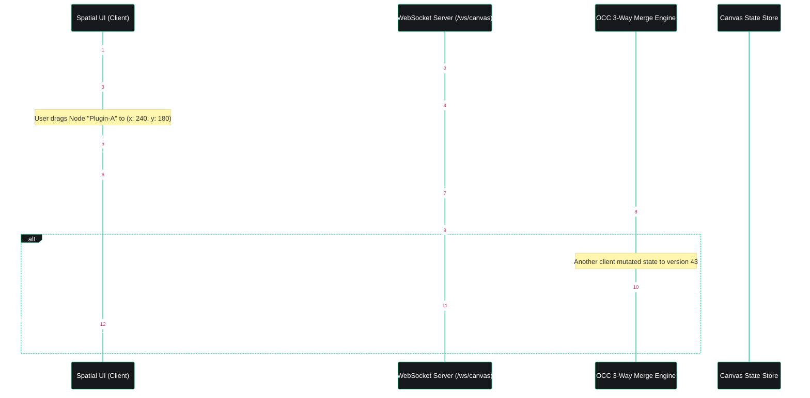

> [!metadata]- ⚙️ Системні метадані та інваріанти (MRH Header)
> ```yaml
> # --- DNK-MRH-HEADER ---
> mrh_id: "docs/architecture/ui/DNK_OS_SPATIAL_UI_SPEC_v1.0.md"
> purpose: "Canonical Specification for DNK OS MVR Spatial UI (Next.js + ReactFlow + Tailwind v4)"
> canonical_source: true
> alters_files: []
> triggers_tasks: []
> status: "Active"
> version: "2.0.0"
> updated_at: "2026-11-18"
> author: "DNK-e.com Maksym & Antigravity"
> # --- END DNK-MRH-HEADER ---
> ```

# 🌐 DNK OS Spatial UI Specification v1.0

> **System:** DNK OS MVP — Minimum Viable Runtime (MVR)  
> **Phase:** Phase 2 (MVR Spatial UI)  
> **Target Architecture:** Next.js 14/15 (App Router) + ReactFlow v11+ + Tailwind CSS v4  
> **Document Status:** Canonical Specification (Locked)  

---

## 1. Executive Summary

DNK OS Spatial UI is the primary visual command and operational plane of DNK OS. It translates complex, multi-agent orchestrations, plugin capability graphs, and distributed background execution runs into an intuitive 2D spatial canvas.

### Core Objectives:
1. **Spatial Topology Representation**: Visualize plugins, autonomous agents, and system services as interactive, drag-and-drop nodes connected by capability, dependency, and data-flow edges.
2. **Sub-100ms Real-Time Synchronization**: Full duplex synchronization with the backend Canvas Control Plane via WebSocket (with Server-Sent Events as an automatic fallback) powered by Optimistic Concurrency Control (OCC 3-way merge).
3. **Human-in-the-Loop (HITL) Interception**: First-class UI modal and drawer patterns intercepting risky or financial operations before execution, maintaining a strict fail-closed security boundary.
4. **Founder Operational Leverage**: Maximize cognitive clarity and eliminate information overload by aggregating telemetry, health metrics, and audit trails directly on the spatial surface.

---

## 2. Tech Stack

| Layer | Technology | Version / Spec | Justification & Architectural Role |
|---|---|---|---|
| **Framework** | Next.js | 14.x / 15.x (App Router) | Server Components (RSC) for metadata/registry; Client Components for interactive canvas; optimized routing. |
| **View Library** | React | 18.x / 19.x | Concurrent rendering, Suspense boundaries, transition hooks (`useTransition`). |
| **Spatial Canvas** | ReactFlow (XYFlow) | v11+ | Industry-standard DAG rendering, custom nodes/edges, virtualized viewport, mini-map, and controls. |
| **Design System** | Tailwind CSS v4 + shadcn/ui | v4.0 engine | High-performance CSS engine, token-driven theming (Dark Mode default), accessible Radix UI primitives. |
| **State Management**| Zustand / Jotai | Zustand v4+ | Lightweight atomic store decoupled from React render loops; seamless outside-React event integration. |
| **Real-time Engine**| WebSockets + SSE Fallback | W3C WebSocket API / EventSource | Sub-100ms bidirectional event streaming for updates, acks, and conflict warnings; HTTP SSE fallback. |
| **Icons & Visuals** | Lucide React | Latest | Consistent 24px/16px vector icon system for plugin kinds, health badges, and action triggers. |
| **Build & Tooling** | Turbopack & pnpm | pnpm v9+, Turbopack | Sub-second HMR, strict dependency isolation, and zero-waste monorepo workspace bundling. |

---

## 3. Canvas Component Specification

The Spatial UI canvas organizes the workspace into a cohesive hierarchy of visual components:

```
+---------------------------------------------------------------------------------------+
|  Top Navigation & Header (Tenant Selector, Health Indicator, Profile, Theme Toggle)   |
+---------------------------------------------------------------------------------------+
| Toolbar (Zoom, Fit, Grid, Filter, Add Node, Run DAG)                                  |
+---------------------------------------------------------+-----------------------------+
|                                                         |                             |
|  CanvasContainer (ReactFlow Engine)                     |  SidePanel / Inspector      |
|                                                         |                             |
|    +-----------------------+     Dependency Edge        |  • Node Properties          |
|    | CanvasNode: Plugin    |------------------------->  |  • Live Health Score        |
|    | [Kind: Ecom] [98%]    |                            |  • Capabilities In/Out      |
|    +-----------------------+                            |  • Execution Runs           |
|                |                                        |  • Append-Only Audit Log    |
|                | Dataflow Edge                          |                             |
|                v                                        |                             |
|    +-----------------------+                            |                             |
|    | CanvasNode: Agent     |                            |                             |
|    | [Gerych Builder]      |                            |                             |
|    +-----------------------+                            |                             |
|                                                         |                             |
+---------------------------------------------------------+-----------------------------+
| MiniMap (Bottom-Left)          Status Bar & Latency Monitor (<42ms)     [WebSocket: OK]|
+---------------------------------------------------------------------------------------+
```

### 3.1 `CanvasContainer`
- **Root Element**: Wraps `<ReactFlowProvider>` and `<ReactFlow>` viewport.
- **Viewport Properties**: Supports infinite panning, pinch-to-zoom (0.1x to 2.0x), box selection, multi-node dragging, and snapping to an 8px grid.
- **Background**: Dynamic SVG dotted grid (`variant="dots"`, gap 16, size 1) with theme-aware dot color (`#27272a` in dark mode).
- **Event Listeners**: Handles `onNodesChange`, `onEdgesChange`, `onConnect`, `onNodeClick`, `onPaneClick`, and `onDrop` for dragging plugins from the registry.

### 3.2 `CanvasNode` (Custom Node Architecture)
Custom ReactFlow node types represent heterogeneous DNK OS entities:
- **Entity Types**:
  - `plugin`: External and internal modular tools (Shopify, ERP, Scrapers).
  - `agent`: Autonomous swarm workers (`gerych_builder`, `gerych_researcher`, `gerych_auditor`).
  - `service`: Core OS microservices (TaskDNA, SCONES Memory, Audit Engine).
- **Node Anatomy**:
  1. **Header**: Entity Icon (Lucide), Display Name, Version string (`v1.2.0`), Drag Handle.
  2. **Status Indicator**:
     - `Active`: Solid Emerald badge with pulsing halo.
     - `Sandbox`: Amber badge with isolation icon.
     - `Deprecated`: Zinc/Muted gray badge with warning tooltip.
     - `Error / Failed`: Crimson badge with quick error inspector.
  3. **Health Badge**: Micro-radial gauge or pill displaying composite health score (0–100%).
  4. **Connection Handles**:
     - `Target Handle` (Top / Left): Capability requirements (`HandleType="target"`).
     - `Source Handle` (Bottom / Right): Provided capabilities (`HandleType="source"`).
  5. **Context Menu**: Triggered on right-click or triple-dot button:
     - `View Details`: Focuses SidePanel on this entity.
     - `Execute Node`: Triggers standalone execution run.
     - `Sandbox Test`: Initiates isolated dry-run in sandbox.
     - `Inspect Audit Log`: Filters audit panel to this entity ID.

### 3.3 `CanvasEdge` (Custom Edge Architecture)
- **Edge Kinds**:
  - `dependency`: Solid curved bezier line indicating static prerequisite dependency.
  - `dataflow`: Animated dashed stroke indicating active runtime data passing between nodes.
  - `capability`: Dotted line representing capability binding resolved by `CapabilityGraph`.
- **Edge Anatomy**:
  - Marker end: Styled SVG arrowhead (`MarkerType.ArrowClosed`).
  - Dynamic Label: Floating pill displaying throughput (e.g. `12 msg/s`) or latency (e.g. `14ms`).
  - Interactive Hover: Highlights linked upstream and downstream node pipelines.

### 3.4 `Toolbar`
- Positioned floating at top-center or top-left.
- Quick Actions: `Zoom In (+)`, `Zoom Out (-)`, `Fit View (⌘+0)`, `Toggle Grid`, `Auto-Layout (Dagre / ELK)`, `Clear Canvas`, and `Add Node`.
- Interactive Filter: Toggle visibility of node kinds (`Plugins`, `Agents`, `Services`).

### 3.5 `SidePanel`
- Right-side collapsible drawer (width: 380px desktop, expandable to 540px).
- Tabs:
  1. **Properties**: Configuration parameters, environment bindings, capability schema.
  2. **Health & Metrics**: P95 latency charts, error rate, memory/CPU consumption, uptime.
  3. **Execution History**: Chronological list of recent runs with status pills.
  4. **Audit Trail**: Real-time streaming log of signed audit events related to the active node.

---

## 4. Real-time Synchronization Specification

The Spatial UI state is synchronized with the backend `CanvasControlPlane` using an Optimistic Concurrency Control (OCC) model.



### 4.1 WebSocket Connection Protocol
- **Endpoint**: `wss://{host}/ws/canvas` (or `ws://localhost:8000/ws/canvas` in dev).
- **Authentication**: Bearer token passed via WebSocket subprotocol or connection query param (`?token=...`).
- **Heartbeat / Keepalive**: Client transmits ping every 30 seconds; server responds with pong. Unanswered ping triggers reconnect with exponential backoff (1s, 2s, 4s, max 16s).

### 4.2 Channels & Event Subscriptions
- `canvas.state.update`: Pushed when any remote user or backend agent updates node/edge layout.
- `canvas.node.*`: Fine-grained node events (`created`, `moved`, `status_changed`, `deleted`).
- `canvas.edge.*`: Edge topology alterations (`created`, `re-routed`, `removed`).
- `canvas.execution.*`: Live execution stream showing active pipeline steps directly on nodes.
- `canvas.approval.requested`: High-priority event triggering the Human-in-the-Loop modal.

### 4.3 SSE Fallback Mechanism
- If the WebSocket handshake fails (e.g. strict corporate proxy, network drop):
  1. The client automatically transitions to Server-Sent Events (`GET /sse/canvas?canvas_id=...`).
  2. Downstream state mutations are received as SSE event stream.
  3. Upstream client actions are transmitted via standard HTTP REST POST (`POST /api/v1/canvas/events`).

### 4.4 Optimistic Updates & Rollback Guarantee
- When the user drags a node or updates a property, the UI renders the mutation at 60 FPS without waiting for network turnaround.
- If the backend returns `canvas.conflict` or `canvas.error`:
  - A subtle notification toast surfaces: *"Canvas state was synchronized with upstream server"*.
  - The local store rolls back to the authoritative snapshot returned in `resolved_state` using a spring animation to prevent visual jarring.

---

## 5. Human-in-the-Loop (HITL) Approval UI Specification

The Approval UI is the security gate ensuring that high-consequence operations (financial transactions, data deletion, privileged sandbox escalations) require explicit human consent.

```
+-------------------------------------------------------------------------+
|  ⚠️ ACTION APPROVAL REQUIRED                                       [X]  |
+-------------------------------------------------------------------------+
|  Requester:  Agent "dnk_shopify" (TaskDNA: slice-prod-launch-04)         |
|  Timestamp:  2026-09-10 14:32:05 UTC                                    |
|  Risk Tier:  HIGH (Financial Mutation / Product Catalog Update)        |
+-------------------------------------------------------------------------+
|  Operation Details:                                                     |
|    Action:   shopify_update_product_price                               |
|    Target:   Store ID "store_uk_01" (SKU: DNK-HOODIE-BLK)               |
|    Payload:                                                             |
|      {                                                                  |
|        "old_price_gbp": 45.00,                                          |
|        "new_price_gbp": 38.50,                                          |
|        "discount_code": "AUTUMN15"                                      |
|      }                                                                  |
+-------------------------------------------------------------------------+
|  Rejection Reason (required only if rejecting):                         |
|  [                                                                   ]  |
+-------------------------------------------------------------------------+
|  [ Request More Info ]              [ Reject (Esc) ]   [ Approve (⏎) ]  |
+-------------------------------------------------------------------------+
```

### 5.1 `ApprovalRequest` Modal
- **Interception Triggers**: Automatically pops up upon receipt of `canvas.approval.requested` with priority level `CRITICAL` or `HIGH`.
- **Payload Inspector**: Structured JSON viewer with diff highlighting showing exactly what the agent intends to mutate.
- **Action Buttons**:
  - `Approve`: Emits signed cryptographic approval token to backend; resumes pipeline.
  - `Reject`: Requires rejection explanation in textarea; cancels agent task cleanly.
  - `Request More Info`: Suspends the task and dispatches an interactive prompt back to the requesting agent.
- **Keyboard Shortcuts**: `Enter` to approve, `Escape` to reject, `Tab` to navigate fields.

### 5.2 `ApprovalHistory` Panel
- Persistent view accessible from the main navigation or side panel.
- Shows historical log of all decisions: `Approved`, `Rejected`, `Timed Out`.
- Search & Filter: Filter by Date Range, Requester Agent, Risk Level, and Approver identity.

---

## 6. Plugin Registry UI Specification

The Plugin Registry UI allows searching, inspecting, and managing plugins in the DNK OS ecosystem.

### 6.1 `PluginList` Table View
- **Tabular Display**:
  - `Plugin ID`: Monospaced identifier (e.g. `dnk.plugin.shopify_connector`).
  - `Name & Description`: Human-readable title and short summary.
  - `Version`: Semantic version tag (`v1.4.2`).
  - `Kind`: Badge indicator (`Integration`, `Agent Block`, `Transform`, `Sink`).
  - `Lifecycle`: Visual status badge (`Draft`, `Sandbox`, `Certified`, `Active`, `Deprecated`).
  - `License`: Track indicator (`MIT` / `Apache-2.0` Track 1 vs `GPL-3.0` Track 2 Clean-Room).
  - `Health Score`: Radial progress gauge showing composite reliability percentage.
- **Filters & Sorting**:
  - Quick filters: `All`, `Certified Only`, `Active Slices`, `Needs Review`.
  - Multi-attribute search input with keyboard shortcut `/`.

### 6.2 `PluginDetail` View
- Dedicated full-page or overlay modal for comprehensive plugin inspection:
  - **Manifest & Capabilities**: Declared input/output schemas (JSON Schema viewer).
  - **Security Audit Status**: AST review results, forbidden syscall scan report, license audit.
  - **Dependency Topology**: Mini-ReactFlow graph showing downstream plugins that rely on this module.
  - **Telemetry**: P50/P95 latency, error distribution, invocations count over 7/30 days.

---

## 7. Execution UI Specification

The Execution UI visualizes live orchestration runs, TaskDNA DAG progressions, and step-level outputs.

### 7.1 `ExecutionPlanView`
- Renders the pre-computed topological execution plan before or during a run.
- **Phase Breakdown**: Displays parallel groups and sequential barriers.
- **Node State**:
  - `Pending`: Outlined dashed circle.
  - `Running`: Animated rotating border with elapsed execution timer.
  - `Completed`: Solid green checkmark with execution duration (e.g. `142ms`).
  - `Failed`: Red exclamation indicator with click-to-view traceback.

### 7.2 `ExecutionRunView`
- Live terminal and log inspector attached to active execution runs.
- **Features**:
  - Real-time stdout/stderr log streaming via WebSocket.
  - Log level filtering (`DEBUG`, `INFO`, `WARN`, `ERROR`).
  - Download raw execution artifact or replay execution sequence.

---

## 8. Accessibility & Performance Specifications

### 8.1 Accessibility (a11y)
- **WCAG Compliance**: Strict conformance with WCAG 2.1 Level AA standards.
- **Keyboard Navigation**: Full keyboard tab-order across canvas nodes, toolbar, modals, and tables.
- **Screen Reader Support**: Semantic ARIA tags (`aria-label`, `role="region"`, `role="dialog"`).
- **Color Contrast**: Minimum contrast ratio of 4.5:1 for standard text and 3:0:1 for graphical UI elements in both dark and light palettes.

### 8.2 Performance Budgets
- **Canvas Latency**: Sub-100ms end-to-end update latency from backend event dispatch to DOM repaint.
- **Framerate Guarantee**: Constant 60 FPS panning and zooming for graphs containing up to 200 nodes and 400 edges.
- **Large Graph Virtualization**: Offscreen nodes outside the active camera frustum are culled from layout calculations.
- **Table Virtualization**: `@tanstack/react-virtual` deployed on `PluginList` and `AuditHistory` to support 10,000+ rows with constant memory footprint.

---

## 9. Security & Governance

- **Authentication Layer**: NextAuth.js or JWT session cookie with HttpOnly, Secure, SameSite=Strict flags.
- **Role-Based Access Control (RBAC)**:
  - `Admin (Maksym)`: Unrestricted authority; full HITL approval capability; secret vault management.
  - `Builder / Agent (Gerych Prime)`: Automated pipeline creation; node layout manipulation; execution initiation.
  - `Viewer / Auditor`: Read-only access to canvas, telemetry, and audit logs.
- **Zero Secrets in Frontend**: API keys, vault secrets, and private credentials NEVER reach the browser client. All sensitive operations execute backend-side via tokenized handles.
- **Audit Logging**: Every user interaction (node move, parameter edit, approval, rejection) generates a cryptographically signed event in the append-only Audit Log.

---

## 10. Phase 2 Implementation Roadmap

| Sub-Phase | Title | Timeline | Core Deliverables |
|---|---|---|---|
| **Phase 2.1** | Canvas Base Engine | 2–3 тижні | Next.js 14/15 App Router setup, ReactFlow v11+ container, custom nodes (`plugin`, `agent`, `service`), custom edges, theme tokens. |
| **Phase 2.2** | Real-time Synchronization | 2 тижні | WebSocket connection manager, subscription handlers, OCC 3-way merge conflict toast, SSE fallback engine. |
| **Phase 2.3** | Approval UI & Modal Gate | 1–2 тижні | `ApprovalRequest` modal, payload diff viewer, rejection flow, keyboard shortcuts, `ApprovalHistory` panel. |
| **Phase 2.4** | Plugin Registry UI | 1–2 тижні | Virtualized `PluginList` table, search/filter bar, `PluginDetail` view, health radial charts, manifest viewer. |
| **Phase 2.5** | Execution & Telemetry UI | 1–2 тижні | `ExecutionPlanView` DAG visualizer, live step progress tracker, streaming logs viewer, end-to-end system testing. |
