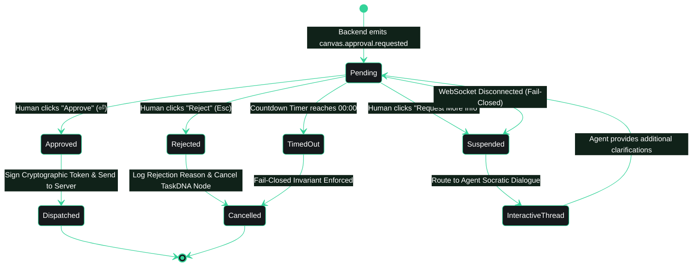

> [!metadata]- ⚙️ Системні метадані та інваріанти (MRH Header)
> ```yaml
> # --- DNK-MRH-HEADER ---
> mrh_id: "docs/architecture/ui/approval_ui_spec.md"
> purpose: "Technical Specification for Human-in-the-Loop (HITL) Approval UI and Policy Interceptor"
> canonical_source: true
> alters_files: []
> triggers_tasks: []
> status: "Active"
> version: "2.0.0"
> updated_at: "2026-11-18"
> author: "DNK-e.com Maksym & Antigravity"
> # --- END DNK-MRH-HEADER ---
> ```

# 🛡️ Human-in-the-Loop (HITL) Approval UI Specification

> **Parent Spec:** `docs/ui/DNK_OS_SPATIAL_UI_SPEC_v1.0.md`  
> **Security Protocol:** Fail-Closed Security Policy  
> **Scope:** Approval Modal, Diff Viewer, Rejection Feedback, Decision History & Cryptographic Token Dispatch  

---

## 1. Objective & Security Mandate

In autonomous agent systems, actions that carry financial implications, customer-facing mutations, or elevated system privileges must pass an inviolable **Human-in-the-Loop (HITL)** checkpoint. 

The DNK OS Approval UI enforces a **strict fail-closed invariant**:
- If the human rejects the request, the operation is aborted immediately.
- If the approval request times out (default: 300 seconds), the operation is aborted immediately.
- If the WebSocket connection drops during an in-flight approval request, the operation is suspended and fails closed.

---

## 2. Risk Classification Matrix

Operations are categorized into four distinct risk tiers, each dictating the visual styling and approval requirements:

| Risk Tier | Examples | Visual Indicator | Interception Behavior | Timeout Policy |
|---|---|---|---|---|
| **CRITICAL** | Production DB wipe, API secret rotation, root permission change | Deep Red (`#ef4444`) + pulsing border | Modal forces foreground lock, sound alert, prevents background interactions | 120s (Auto-Abort) |
| **HIGH** | Product price changes, order cancellations, refund dispatches | Vivid Amber (`#f59e0b`) | Modal popup, prominent diff preview, highlighted delta | 300s (Auto-Abort) |
| **MEDIUM** | Deployment to staging, mass email dispatch (>100 users) | Indigo (`#6366f1`) | Slide-over drawer or banner notification | 600s (Auto-Abort) |
| **LOW** | Cache invalidation, documentation regeneration, draft save | Emerald (`#10b981`) | Non-blocking inline toast or auto-approved with audit entry | Optional / Auto-Approve |

---

## 3. UI Component Architecture

```
apps/web/src/components/approval/
├── ApprovalModal.tsx         # Foreground interceptor dialog for CRITICAL & HIGH requests
├── ApprovalDrawer.tsx        # Slide-over panel for MEDIUM operations
├── ApprovalDiffViewer.tsx    # Syntax-highlighted JSON/YAML side-by-side delta inspector
├── RejectionReasonInput.tsx  # Contextual feedback input for agent learning
├── ApprovalHistoryTable.tsx  # Comprehensive audit history of past decisions
└── hooks/
    ├── useApprovalStream.ts  # Listens to canvas.approval.requested events
    └── useApprovalSubmit.ts  # Dispatches signed decision tokens
```

---

## 4. `ApprovalModal` Anatomy

```
+---------------------------------------------------------------------------------------+
|  ⚠️ ACTION APPROVAL REQUIRED — TIER: HIGH                                       [X]  |
+---------------------------------------------------------------------------------------+
|                                                                                       |
|  Requester Agent:  dnk_shopify (Task: #402 "Update Black Friday Catalog")            |
|  Timestamp:        2026-09-10 14:32:05 UTC (Expires in 04:42)                        |
|  Target Resource:  Shopify UK Store / SKU-DNK-092                                     |
|                                                                                       |
+---------------------------------------------------------------------------------------+
|  PROPOSED MUTATION DIFF                                                               |
+-------------------------------------------+-------------------------------------------+
|  Original State                           |  Proposed State                           |
+-------------------------------------------+-------------------------------------------+
|  "price_gbp": 45.00                       |  "price_gbp": 38.50  <DECREASE 14.4%>     |
|  "compare_at_price": null                 |  "compare_at_price": 45.00                |
|  "inventory_policy": "deny"               |  "inventory_policy": "continue"           |
+-------------------------------------------+-------------------------------------------+
|                                                                                       |
|  Rejection Rationale (required only when rejecting):                                  |
|  [ Discount exceeds authorized threshold for September margin rules...              ] |
|                                                                                       |
+---------------------------------------------------------------------------------------+
|  [ Request More Info ]              [ Reject (Esc) ]            [ Approve Action (⏎) ]|
+---------------------------------------------------------------------------------------+
```

### 4.1 Field Breakdown
1. **Header**: High-visibility risk badge, operation title, remaining countdown timer with visual progress bar.
2. **Metadata Grid**: Requesting agent name, parent TaskDNA ID, target external resource, and operation type.
3. **Diff Viewer**: Visual side-by-side diff highlighting modified, added, or deleted properties using standard green/red delta colors.
4. **Rejection Rationale**: Textarea automatically enabled when clicking "Reject" or using `Alt+R`. Explanations are fed back to the requesting agent's error distillation database.
5. **Action Buttons**:
   - `Approve`: Confirms the operation, signs a cryptographic approval token, and unblocks the execution engine.
   - `Reject`: Aborts the operation and passes the rejection reason to the agent.
   - `Request More Info`: Pauses the task and opens an interactive chat thread with the agent on the Canvas.

---

## 5. State Machine & Event Lifecycle



---

## 6. Security & Cryptographic Dispatch

When an approval is submitted:
1. **Client Signature**: The user session (verified via NextAuth/JWT) generates a cryptographically signed payload:
   ```json
   {
     "approval_id": "appr_789012",
     "request_id": "req_345678",
     "decision": "APPROVED",
     "approver_id": "maksym_dnk",
     "timestamp": "2026-09-10T14:32:10Z",
     "client_signature": "sha256:7e8b9a1..."
   }
   ```
2. **Audit Engine Logging**: The payload is immutably recorded into `docs/audit/` and the backend `AuditLogEngine`.
3. **Task Resumption**: The execution engine unpauses the worker thread only upon verifying the approval signature.

---

## 7. Accessibility (a11y) & Usability

- **Focus Trapping**: Modal employs Radix UI Dialog primitives, trapping focus inside the dialog until dismissed.
- **Keyboard Accelerators**:
  - `Enter` / `⌘ + Enter`: Triggers Approval immediately.
  - `Escape`: Closes modal or focuses Rejection Rationale input.
- **Screen Reader Announcements**: Screen readers read out *"High Risk Action Required by Agent dnk_shopify. Countdown timer 5 minutes."* upon modal mounting.
