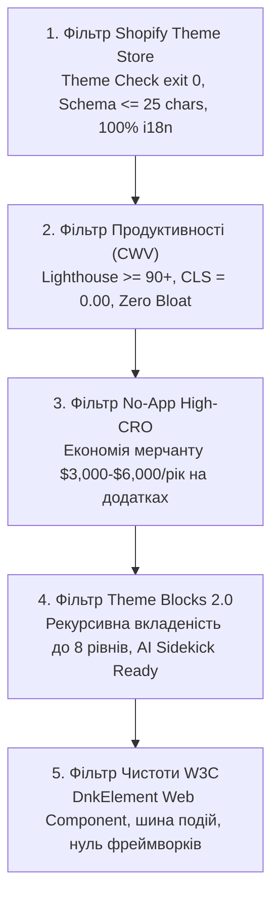

> [!metadata]- ⚙️ Системні метадані та інваріанти (MRH Header)
> ```yaml
> # --- DNK-MRH-HEADER ---
> mrh_id: "docs/projects/dnk_ecom/00_THEME_ARCHITECTURE_AND_DECISION_FRAMEWORK.md"
> purpose: "Канонічний фреймворк прийняття рішень, 5-рівнева драбина валідації та першочергова структура теми."
> canonical_source: true
> alters_files: []
> triggers_tasks: []
> status: "Active"
> version: "2.0.0"
> updated_at: "2026-11-18"
> author: "DNK-e.com Maksym & Antigravity"
> # --- END DNK-MRH-HEADER ---
> ```

# 🏛️ Методологія Прийняття Рішень, Анатомія Елементів та Першочергова Архітектура Теми DNK Ecom

> *«Нам достатньо один раз розібрати механіку, зрозуміти формули інтерполяції та структури даних і написати своє суверенне ядро в DNK_HUB.» — Максим Кузьменко*

---

## ⚡ 1. 5-Рівнева Драбина Прийняття Рішень (DNK Decision Ladder)

Щоб жодне рішення не приймалося "наосліп" або на основі суб'єктивних вражень, будь-який компонент теми обов'язково проходить через **5 послідовних фільтрів**:



### 📋 Критерії Кожного Рівня:

| Рівень | Назва Фільтра | Контрольне Питання | Умова Відхилення (Fail-Closed) |
|---|---|---|---|
| **L1** | **Theme Store Gate** | Чи пропустить це офіційний рецензент Shopify? | Наявність ``, ``, обфускації, захардкодженного тексту без `{{ '...' \| t }}` або імен схем > 25 символів. |
| **L2** | **Core Web Vitals** | Чи не викличе блок зсув макета (Layout Shift)? | Якщо картинка/відео не має фіксованого `aspect-ratio` до завантаження — **БЛОКУВАТИ**. |
| **L3** | **No-App High-CRO** | Чи дає це конверсійну цінність без сторонніх платних аппок? | Якщо фічу можна зробити нативним Liquid (Sticky ATC, Swatches, Volume Pricing) — не підключати сторонні API. |
| **L4** | **Theme Blocks 2.0** | Чи може мерчант вільно рухати блок і чи розуміє його Sidekick? | Монолітні секції з жорстко зашитими полями — **ЗАБОРОНЕНІ**. Тільки ``. |
| **L5** | **W3C Purity** | Чи ізольований JS-код блоку? | Жодного jQuery, Alpine чи прямих мутацій чужих DOM-вузлів. Тільки `DnkElement` та шина подій `window.DNK.events`. |

---

## 🧬 2. Анатомія Створення Кожного Елемента (The DNK 5-Part Element Contract)

Кожен файл у папці `blocks/*.liquid` та `sections/*.liquid` створюється за єдиним непорушним стандартом із 5 структурних шарів:

```liquid

  @name Product Sticky Add to Cart
  @description Плаваюча смужка швидкої покупки з вибором варіанта та Cleanroom fetch
  @param {string} position - Позиція на екрані ('top' | 'bottom')
  @param {boolean} show_quantity - Показувати селектор кількості


<!-- ШАР 1: Семантична HTML5 Розмітка -->
<dnk-sticky-atc 
  class="dnk-sticky-atc" 
  data-position="{{ block.settings.position | default: 'bottom' }}"
  {{ block.shopify_attributes }}>
  
  <div class="dnk-sticky-atc__container dnk-container">
    <div class="dnk-sticky-atc__product-info">
      <span class="dnk-sticky-atc__title">{{ product.title }}</span>
      <span class="dnk-sticky-atc__price">{{ product.selected_or_first_available_variant.price | money }}</span>
    </div>

    <!-- ШАР 2: Кнопка покупки з прямою інтеграцією в чергу CartMutationQueue -->
    <button 
      type="button" 
      class="dnk-button dnk-button--primary"
      data-action="add-to-cart"
      data-variant-id="{{ product.selected_or_first_available_variant.id }}"
      disabled>
      
        {{ 'products.product.add_to_cart' | t }}
      
        {{ 'products.product.sold_out' | t }}
      
    </button>
  </div>
</dnk-sticky-atc>

<!-- ШАР 3: Локальні CSS-токени (без важких глобальних класів) -->
<style>
  dnk-sticky-atc {
    position: fixed;
    left: 0;
    right: 0;
    z-index: var(--dnk-z-sticky);
    background: var(--dnk-color-surface);
    border-top: 1px solid var(--dnk-color-border);
    box-shadow: var(--dnk-shadow-lg);
    padding: var(--dnk-space-3) 0;
    transform: translateY(100%);
    transition: transform var(--dnk-transition-normal);
  }
  dnk-sticky-atc[data-visible="true"] {
    transform: translateY(0);
  }
</style>

<!-- ШАР 4: W3C Web Component (Реєструється в dnk-core.js) -->

  Логіка виноситься у відповідний assets/dnk-sticky-atc.js або підключається через базовий клас:
  class DnkStickyAtc extends window.DNK.DnkElement { ... }


<!-- ШАР 5: Валідна Shopify Schema (Ім'я <= 25 символів) -->

{
  "name": "t:blocks.sticky_atc",
  "target": "section",
  "settings": [
    {
      "type": "select",
      "id": "position",
      "label": "t:settings.position",
      "options": [
        { "value": "bottom", "label": "t:options.bottom" },
        { "value": "top", "label": "t:options.top" }
      ],
      "default": "bottom"
    }
  ]
}

```

---

## 📂 3. Першочергова Архітектурна Структура Теми MVP v0.1.0

Щоб не роздувати тему до 300 неконтрольованих файлів, першочергова версія **MVP v0.1.0** будується на рівно **32 файлах**, які формують 100% самодостатній комерційний магазин:

```
mvp/ (Target Branch)
├── layout/
│   └── theme.liquid                  # Еталонний глобальний лейаут (skip-link, tokens, dnk-core.js)
├── config/
│   ├── settings_schema.json          # Глобальні налаштування кольорів, гарнітур, бренду
│   └── settings_data.json            # Пресет "Minimal Luxury" за замовчуванням
├── locales/
│   ├── en.default.json               # 100% англійська локалізація (Theme Store Requirement)
│   └── uk.json                       # 100% українська локалізація (Рідний ринок клієнтів)
├── assets/
│   ├── dnk-tokens.css                # ✅ [Gate 0] Дизайн-токени W3C
│   ├── dnk-base.css                  # ✅ [Gate 0] CSSOM Reset, 12-col Subgrid, a11y focus rings
│   ├── dnk-core.js                   # ✅ [Gate 1] W3C мікроядро, Cart Mutation Queue, Iframe Fetch
│   ├── dnk-cart-drawer.css           # Стилі висувного кошика
│   ├── dnk-cart-drawer.js            # Інтерактивність кошика (<dnk-cart-drawer>)
│   ├── dnk-facets.js                 # Фільтрація каталогу через Section Rendering API
│   └── dnk-pdp.js                    # Галерея, перемикання варіантів та Sticky ATC
├── sections/
│   ├── header.liquid                 # [Gate 2] Липкий блоковий хедер (Row 1, Row 2)
│   ├── footer.liquid                 # [Gate 2] Семантичний футер із валютами та копірайтом
│   ├── cart-drawer.liquid            # [Gate 3] Конверсійний AJAX Cart Drawer
│   ├── main-product.liquid           # [Gate 4] PDP 2.0 холст для блоків
│   ├── main-collection.liquid        # [Gate 5] Сітка каталогу з Section Rendering API
│   ├── hero-banner.liquid            # Конверсійний Hero-банер на Theme Blocks
│   └── featured-collection.liquid    # Карусель/сітка хітів продажу
├── blocks/
│   ├── _group.liquid                 # 🧱 Рекурсивний контейнер (Auto-Layout Frame)
│   ├── _header-logo.liquid           # Приватний блок логотипа
│   ├── _header-menu.liquid           # Приватний блок навігації + мобільний drawer
│   ├── product_media-gallery.liquid  # Галерея PDP (0-CLS, touch-swipe)
│   ├── product_variant-picker.liquid # Візуальні свотчі (Category Metafields)
│   ├── product_buy-buttons.liquid    # Кнопки покупки з Cleanroom Attribution Fetch
│   ├── product_sticky-atc.liquid     # Липка смужка покупки
│   ├── product_quantity-breaks.liquid# Таблиця знижок від кількості
│   ├── cart_shipping-bar.liquid      # Багаторівневий прогрес-бар доставки
│   └── cart_upsell-item.liquid       # 1-click крос-сейл картка в кошику
├── snippets/
│   ├── product-card.liquid           # Швидка картка товару з hover-ефектом
│   ├── price.liquid                  # Форматування ціни, знижки та одиничної вартості
│   └── icon.liquid                   # Універсальний інлайн-рендерер SVG іконок
└── templates/
    ├── index.json                    # Головна сторінка
    ├── product.json                  # Сторінка товару
    ├── collection.json               # Сторінка колекції
    ├── cart.json                     # Запасна сторінка кошика (для no-js фолбеку)
    └── 404.json                      # Сторінка помилки
```

---

## 🔄 4. Зворотний Зв'язок та Еволюція Рішень

* Будь-яка зміна Liquid чи JS спочатку тестується через `just shopify-checkpoint <id>`.
* Якщо виникає сумнів або конфлікт із вимогами Theme Store — рішення фіксується у файлі `01_REVERSE_ENGINEERING_DECISION_LEDGER.md` перед зміною коду.
* Коли всі 7 воріт стають зеленими (`consecutive passed: 7/7`), гілка `mvp` проходить через `pre-release` для фінального аудиту Lighthouse 90+ та вливається у `main` як релізна комерційна версія.
