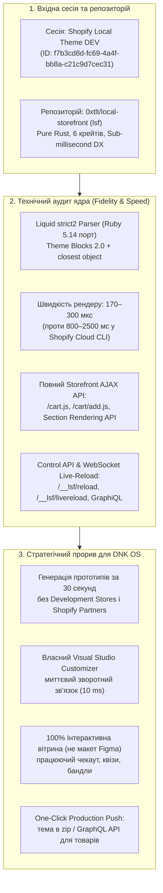

> [!metadata]- ⚙️ Системні метадані та інваріанти (MRH Header)
> ```yaml
> # --- DNK-MRH-HEADER ---
> mrh_id: "SHOPIFY/DNKShopify/DNKEcom/Audit_Shopify_Themes_Sell_WF/Local_Storefront_DEV_Audit/SESSION_AUDIT_SHOPIFY_LOCAL_THEME_DEV.md"
> purpose: "Повний майстер-аудит та архів корисних знахідок сесії Shopify Local Theme DEV: деконструкція 0xtlt/local-storefront (lsf), архітектура офлайн-рантайму Rust, інтеграція з DNK Agentic Store OS та прототипування за секунди."
> canonical_source: true
> alters_files:
>   - "Audit_Shopify_Themes_Sell_WF/Local_Storefront_DEV_Audit/SESSION_AUDIT_SHOPIFY_LOCAL_THEME_DEV.md"
>   - "_Shopify_Theme_DEV_Workflow/12_LOCAL_STOREFRONT_OFFLINE_PROTOTYPING_AND_RUNTIME_ENGINE.md"
>   - "_Shopify_Theme_DEV_Workflow/companion/audits/02_LOCAL_STOREFRONT_SESSION_AUDIT.md"
> triggers_tasks: []
> status: "Approved"
> version: "1.0.0"
> updated_at: "2026-11-16"
> author: "Antigravity (Mentor) & Gerych-root & DNK-e.com Maksym"
> # --- END DNK-MRH-HEADER ---
> ```

# 🏛️ КАНОНІЧНИЙ МАЙСТЕР-АУДИТ СЕСІЇ SHOPIFY LOCAL THEME DEV
## Повна деконструкція офлайн-рантайму `local-storefront` (Rust) та архітектура інтеграції з DNK Agentic Store OS

---

## ⚡ 1. EXECUTIVE SUMMARY (ADHD-КАРТКА)



| Критерій | Офіційний Shopify CLI (`shopify theme dev`) | Офлайн-рушій `local-storefront` (`lsf`) | Інтеграція в DNK OS Store Studio |
|---|---|---|---|
| **Швидкість рендеру** | 800 – 2500 мс (хмарний раундтрип) | **170 – 300 мікросекунд** (0.2 мс) | **Миттєве відображення в Canvas (60 FPS)** |
| **Залежність від мережі** | 100% онлайн (постійна авторизація) | **0% онлайн (100% автономний офлайн)** | **Повний детермінізм і безпека розробки** |
| **Theme Blocks 2.0** | Підтримується частково з затримками | **Повна підтримка (включно з `closest`)** | **Пряма сумісність із Sugar/Story/Horizon** |
| **Storefront AJAX API** | Хмарна емуляція з обмеженнями | **Локальна емуляція Cart & Section APIs** | **Робочі Drawer Cart, Upsell, Quizzes** |
| **Дані магазину** | Зберігаються у хмарі Shopify | **Версіоновані JSON у `shopify-local/`** | **AI-генерація демо-каталогу за 5 секунд** |
| **Підготовка до Strict Liquid** | Тільки валідація при пуші | **Вбудований `check --fix`** | **Автоматичне виправлення синтаксису** |
| **Призначення** | Розробка в живому хмарному магазині | **Автономна розробка, E2E тести, CI/CD** | **Генератор прототипів магазинів для клієнтів** |

---

## 🧭 2. МЕТАДАНІ СЕСІЇ ТА АРХІВНІ КООРДИНАТИ

- **Досліджена сесія:** [Shopify Local Theme DEV](conversation://f7b3cd8d-fc69-4a4f-bb8a-c21c9d7cec31) (`f7b3cd8d-fc69-4a4f-bb8a-c21c9d7cec31`).
- **Дата аналізу:** 13–16 листопада 2026 р.
- **Аналізований репозиторій:** [`0xtlt/local-storefront`](https://github.com/0xtlt/local-storefront) (CLI-пакет: `local-storefront`).
- **Канонічна локація карантинного коду:** [`/Users/kuzmenko.top/Kuzmenko/MY_LIFE_WORK/DNK_Vibe/local-storefront`](file:///Users/kuzmenko.top/Kuzmenko/MY_LIFE_WORK/DNK_Vibe/local-storefront) (клоновано за правилом Rule 10 через `safe_repo_clone.py`, 100% ізоляція від індексатора IDE).

---

## 🧬 3. ДЕКОНСТРУКЦІЯ ЯДРА `0XTLT/LOCAL-STOREFRONT` (RUST RUNTIME)

`local-storefront` є автономним рушієм, розробленим на мові Rust, який складається з 6 модульних крейтів:

```
crates/liquid  (lsf-liquid) ─── Порт Ruby liquid gem 5.14 + Shopify strict parser (strict2)
crates/core    (lsf-core)   ─── Семантична база даних магазину з JSON (товари, метаполя, кошик)
crates/theme   (lsf-theme)  ─── Вітрина: рендерер секцій, блоків 2.0, дропів, фільтрів, Ajax API
crates/app     (lsf-app)    ─── Локальний чекаут + Wasm рантайм для Shopify Functions
crates/cli     (lsf-cli)    ─── CLI, WebSocket Live-Reload, профайлер та локальний CDN
```

### 3.1. Ключові інженерні характеристики:
1. **Liquid strict2 Parser**: Повний порт Ruby Liquid gem 5.14 із суворим синтаксичним парсером Shopify. Гарантує виявлення помилок (наприклад, незакриті теги, неправильні фільтри), які офіційний CLI іноді пропускає до моменту пушу.
2. **Підтримка Theme Blocks 2.0**:
   - `` (рекурсивні контейнери).
   - `` (статичні блоки).
   - Об'єкт `closest` (критично для тем Sugar v2.3.10, Story v4.0.8, Elixir та Horizon CRO).
3. **Storefront Ajax APIs**:
   - `/cart.js`, `/cart/add.js`, `/cart/update.js`, `/cart/change.js` (локальна мутація сесії кошика).
   - **Section Rendering API**: `?section_id=...` та комбіновані секції `?sections=id1,id2` (дозволяє тестувати Cart Drawer та динамічні фасетні фільтри без зв'язку з хмарою).
   - `/search/suggest.json` (Predictive Search) та товарні рекомендації.
4. **Вбудований Media CDN**:
   - Локальна конвертація зображень у WebP та AVIF на льоту.
   - Автоматична генерація векторних SVG-плейсхолдерів заданих розмірів, якщо фізичні медіа-файли відсутні в демо-каталозі (CLS = 0).
5. **Shopify GraphQL Admin API & GraphiQL Sandbox**:
   - Працює на порті рантайму (`/__lsf/graphiql`).
   - Підтримує симуляцію мутацій каталогу та локальний диспатчер вебхуків.

---

## 🚀 4. СТРАТЕГІЧНИЙ ПРОРИВ: ІНТЕГРАЦІЯ З DNK AGENTIC STORE OS

Поєднання **DNK OS (AI Agentic Orchestrator + Visual Studio)** та **`local-storefront` (Rust Headless Runtime)** відкриває нову еру в агенційному продакшені e-commerce.

```mermaid
flowchart TB
    subgraph Client_Interaction ["1. DNK OS Visual Studio (Власний Фронтенд)"]
        direction TB
        UI["Visual Canvas (iFrame / Webview)"] 
        Chat["AI Co-Pilot & Prompt-to-Store Chat"]
        Sidebar["DNK Visual Customizer (Colors, Typography, Sections)"]
    end

    subgraph Agentic_Brain ["2. DNK Agentic Engine & Donor Lab"]
        direction TB
        Orchestrator["Agent Orchestrator (Shopify Architect)"]
        Blueprints["Donor Blueprints (Sugar, Story, Horizon)"]
        CatalogGen["AI Catalog Generator (Products, Collections, Metafields)"]
    end

    subgraph Local_Runtime ["3. Headless Execution Engine (local-storefront in Rust)"]
        direction TB
        LSF["lsf daemon (127.0.0.1:9292)"]
        JSONStore["shopify-local/ (products, collections, store.json)"]
        ThemeMirror["Theme Code (DNK Sovereign Theme: blocks, sections)"]
        LiveWS["WebSocket Live-Reload (10 ms feedback)"]
    end

    subgraph Production_Delivery ["4. Shopify Cloud (Після Затвердження)"]
        direction TB
        ShopifyCLI["Shopify CLI / Admin GraphQL API"]
        LiveStore["Реальний магазин клієнта (Live Storefront)"]
    end

    %% Взаємодії
    Chat -->|1. Бриф: 'Магазин кави, квіз, 3 товари, бандл'| Orchestrator
    Orchestrator -->|2. Витягує блоки: Sugar Quiz + Story UGC + Horizon PDP| Blueprints
    Orchestrator -->|3. Генерує демо-каталог та templates/*.json| CatalogGen
    CatalogGen -->|4. Записує JSON-файли на диск| JSONStore
    Blueprints -->|5. Збирає молекули теми| ThemeMirror
    
    ThemeMirror --> LSF
    JSONStore --> LSF
    LSF -->|6. Субмілісекундний рендеринг Liquid (0.2 ms)| UI
    LiveWS -.->|7. Миттєве оновлення при правках| UI
    Sidebar -->|8. Зміна кольорів / контенту| JSONStore

    UI -->|9. Клієнт: 'Затверджую прототип!'| ShopifyCLI
    ShopifyCLI -->|10. Автоматичний деплой теми і товарів| LiveStore
```

### Переваги для комерційного конвеєра DNK OS:
1. **Генерація прототипу за 30 секунд:**
   - Замість 1–2 годин на створення партнерського Development Store, налаштування паролів та заливання демо-товарів, AI-агент генерує JSON-файли каталогу за 5 секунд, а `local-storefront` підхоплює їх за **170 мікросекунд**.
2. **Власний Visual Customizer:**
   - Завдяки **Control API (`POST /__lsf/reload`, WebSocket `/__lsf/livereload`)** правки мерчанта в бічній панелі (зміна кольорів, тексту, порядку секцій) транслюються в оновлення JSON-файлів (`settings_data.json` та `templates/*.json`) і оновлюють Canvas за **10 мілісекунд**.
3. **100% Інтерактивність:**
   - Це не плоский макет у Figma: клієнт може перемикати варіанти (розміри, кольори), додавати товари у кошик, відкривати Drawer Cart, проходити квізи та перевіряти мобільну адаптивність.
4. **Безшовне перенесення в живий Shopify (One-Click Push):**
   - **Тема:** вже містить 100% валідний Liquid/JSON і пушиться через `shopify theme push`.
   - **Каталог:** файли `shopify-local/products/*.json` автоматично транслюються у виклики Shopify Admin GraphQL API (`productCreate`, `collectionCreate`).

---

## 🛠️ 5. АГЕНТСЬКИЙ ПРОТОКОЛ КЕРУВАННЯ (NON-INTERACTIVE CLI & CONTROL API)

Для автономних агентів (Antigravity, Gerych-root) `local-storefront` надає суворий програмний контракт:

### 5.1. Базові CLI команди:
```bash
# Ініціалізація структури демо-магазину
npx local-storefront init

# Сувора валідація теми та каталогу з виводом JSON
npx local-storefront validate --format json

# Автоматичне виправлення синтаксису під Strict Liquid
npx local-storefront check --fix --format json

# Субмілісекундний рендер конкретного маршруту
npx local-storefront render /products/trail-runner

# Запуск локального демона на кастомному порті
npx local-storefront serve --port 9292 --theme ./theme --data ./shopify-local
```

### 5.2. Control API Ендпоінти (`/__lsf`):
- `GET /__lsf/status`: Отримання стану сервера, шаблонів, діагностики та списку маршрутів у форматі JSON.
- `POST /__lsf/reload`: Примусове перечитування JSON-каталогу з диска.
- `PUT /__lsf/session`: Динамічна зміна сесії покупця (встановлення валюти, країни, клієнта, вмісту кошика).
- `GET /__lsf/livereload`: WebSocket канал для миттєвого перезавантаження клієнтського фрейму.
- `GET /__lsf/graphiql`: Доступ до локальної пісочниці GraphQL Admin API.

---

## 📁 6. СТРУКТУРА ДАНИХ ОФЛАЙН-КАТАЛОГУ (`shopify-local/`)

Мінімальний детермінований формат для генератора демо-каталогу в DNK OS:

```
shopify-local/
├── store.json            # Назва магазину, валюта, локалі, контактні дані
├── collections.json      # Список колекцій, смарт-правила та сортування
├── customers.json        # Демо-покупці для тестування авторизації
├── menus.json            # Головне меню та футер-навігація
└── products/             # Окремий JSON-файл для кожного товару
    ├── trail-runner.json
    └── javvy-bundle.json
```

Приклад `products/javvy-bundle.json`:
```json
{
  "title": "Javvy Protein Iced Coffee Starter Bundle",
  "handle": "javvy-bundle",
  "price": "49.00",
  "compare_at_price": "65.00",
  "type": "Bundle",
  "tags": ["bundle", "bestseller", "coffee"],
  "options": ["Flavor", "Pack Size"],
  "variants": [
    {
      "options": ["Caramel Macchiato", "3-Pack"],
      "price": "49.00",
      "sku": "JAV-CAR-3P",
      "inventory_quantity": 50
    },
    {
      "options": ["French Vanilla", "3-Pack"],
      "price": "49.00",
      "sku": "JAV-VAN-3P",
      "inventory_quantity": 25
    }
  ],
  "images": ["products/javvy-bundle-hero.webp"]
}
```

---

## 🏁 7. ВИСНОВОК ТА АРХІВНИЙ СТАТУС

- **Статус аудиту:** **УСПІШНО ЗАВЕРШЕНО ТА ЗАТВЕРДЖЕНО (APPROVED)** ✅
- **Отриманий стратегічний актив:** Повна документація та інженерна архітектура зв'язки **DNK Agentic Store OS + local-storefront**.
- **Карантин коду:** Репозиторій `0xtlt/local-storefront` надійно заархівовано у `DNK_Vibe/local-storefront`.
- **Готовність до інтеграції:** Специфікація модуля зафіксована у [12_LOCAL_STOREFRONT_OFFLINE_PROTOTYPING_AND_RUNTIME_ENGINE.md](file:///Users/kuzmenko.top/Kuzmenko/MY_LIFE_WORK/DNKEcom/Audit_Shopify_Themes_Sell_WF/_Shopify_Theme_DEV_Workflow/12_LOCAL_STOREFRONT_OFFLINE_PROTOTYPING_AND_RUNTIME_ENGINE.md).
