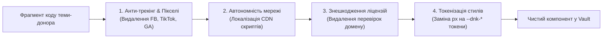

> [!metadata]- ⚙️ Системні метадані та інваріанти (MRH Header)
> ```yaml
> # --- DNK-MRH-HEADER ---
> mrh_id: "docs/projects/dnk_ecom/theme_dev_workflow/02_MOLECULAR_DISTILLATION_ENGINE.md"
> purpose: "Technical Engineering Specification for Theme Component Distillation and Cleanroom Sanitization"
> canonical_source: true
> alters_files: []
> triggers_tasks: []
> status: "Active"
> version: "2.0.0"
> updated_at: "2026-11-18"
> author: "DNK-e.com Maksym & Antigravity"
> # --- END DNK-MRH-HEADER ---
> ```

# 🧪 Двигун молекулярної дистиляції та Cleanroom-санації тем

Цей документ визначає стандарти **дистиляції** — вилучення, очищення та адаптації найкращих компонентів зі сторонніх тем-донорів у єдину бібліотеку компонентів **DNK Ecom**.

Дистиляція гарантує, що жоден шкідливий скрипт, авторський бекдор, трекінговий піксель чи захардкоджені стилі не потраплять у наше чисте виробниче середовище.

---

## 🛡️ Протокол Cleanroom-санації (Cleanroom Sanitization Protocol)

Перед тим як будь-який блок із теми-донора потрапляє у `distilled_vault/`, він проходить 4 бар'єри фільтрації:



### 1. Бар'єр видалення сторонніх трекерів
- Видаляються будь-які згадки `fbq()`, `gtag()`, `ttq()`, `klaviyo.push`, `hotjar` або несанкціоновані пікселі аналітики.
- Увесь аналітичний трекінг у DNK Ecom реалізується виключно через стандартні веб-пікселі Shopify (Customer Events / Web Pixels API), а не через брудний Liquid-код.

### 2. Бар'єр автономності від зовнішніх CDN
- Жоден скрипт або шрифт не може підвантажуватися з `cdn.jsdelivr.net`, `unpkg.com`, `cdnjs.cloudflare.com` або зовнішніх серверів.
- Необхідні утиліти (наприклад, Swiper або PhotoSwipe) упаковуються в локальні модулі `assets/*.js` або замінюються легкими нативними веб-компонентами.

### 3. Бар'єр ліквідації ліцензійних замків (DRM Removal)
- Видаляються обфусковані скрипти (рядки з `eval()`, `_0x...`, Base64 або Hex кодуванням).
- Видаляються виклики до віддалених серверів перевірки домену мерчанта (перевірка `Shopify.shop` на сторонніх бекендах).

### 4. Бар'єр токенізації CSS (Tokenization Gate)
- Жорсткі кольори замінюються на токени:
  - `#000000`, `#111827` ➔ `var(--dnk-text-main)`
  - `#ffffff` ➔ `var(--dnk-bg-page)` або `var(--dnk-bg-surface)`
  - Фірмові кольори кнопки ➔ `var(--dnk-accent-primary)`
- Фіксовані розміри шрифтів замінюються на динамічні шкали:
  - `font-size: 32px` ➔ `font-size: var(--dnk-fs-h2)`
- Відступи та заокруглення приводяться до модульної сітки:
  - `border-radius: 8px` ➔ `border-radius: var(--dnk-radius-md)`

---

## 🪓 Протокол розпилювання монолітної секції на Theme Blocks 2.0

Більшість тем-донорів містять монолітні секції старого типу (де розмітка зашита прямо в Liquid). Щоб перетворити таку секцію на сучасний компонент Theme Blocks 2.0, застосовується алгоритм декомпозиції:

1. **Створення каркасної секції**:
   Вся специфічна HTML-розмітка видаляється з `sections/name.liquid`. Натомість залишається тільки семантичний тег `<section>` та слот вкладеності:
   ```liquid
   <section class="dnk-section" id="dnk-section-{{ section.id }}">
     
   </section>
   
   
   {
     "name": "DNK Dynamic Section",
     "blocks": [{"type": "@theme"}, {"type": "@app"}]
   }
   
   ```
2. **Виділення дочірніх блоків у `blocks/`**:
   - Шапка секції (заголовок + підзаголовок) ➔ виноситься в `dnk-heading.liquid`.
   - Кнопка дії ➔ виноситься в `dnk-button.liquid`.
   - Вміст (картки або елементи списку) ➔ виноситься у відповідні блоки `dnk-card.liquid` або `dnk-grid.liquid`.

---

## 🏛️ Структура фізичного сховища `distilled_vault/`

Усі успішно дистильовані компоненти зберігаються за категоріями в папці `distilled_vault/`:

```
distilled_vault/
├── atoms/                     # Неподільні елементи (кнопки, бейджі, іконки, таймери)
│   ├── anvil-button.liquid
│   ├── luma-badge.liquid
│   └── sugar-timer.liquid
├── molecules/                 # Комбіновані функціональні блоки (селектори, картки, відгуки)
│   ├── lemoon-editorial-card.liquid
│   └── sugar-variant-picker.liquid
├── organisms/                 # Контейнери з підтримкою вкладеності ()
│   ├── freemorrow-split-grid.liquid
│   └── sugar-container.liquid
└── engines/                   # Конверсійні No-App двигуни (бандли, драбина цін, кошик)
    ├── sugar-bundle-builder.liquid
    ├── sugar-tiered-discount.liquid
    └── luma-slide-cart-upsell.liquid
```

