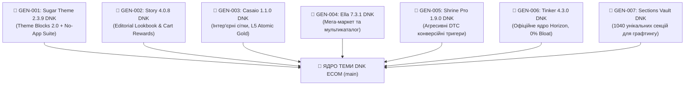

# --- DNK-MRH-HEADER ---
# mrh_id: "_Shopify_Theme_DEV_Workflow/03_SELF_IMPROVING_GENOME_REGISTRY.md"
# purpose: "Living Central Genome Registry of Shopify Theme Architectural Innovations & Patterns"
# canonical_source: true
# alters_files: []
# triggers_tasks: []
# status: "Active"
# version: "2.1.0"
# updated_at: "2026-11-10"
# author: "DNK-e.com Maksym & Antigravity"
# --- END DNK-MRH-HEADER ---

# 🧬 Центральний Геном-Реєстр інновацій тем Shopify (Genome Registry)

Цей реєстр є **єдиним джерелом архітектурної пам'яті (SSOT)** для всіх досліджених тем-донорів із канонічного репозиторію [`https://github.com/DNKShopify/DNK-e.com`](https://github.com/DNKShopify/DNK-e.com).

Щоразу, коли агент **Герич** або розробник завершує аудит чергової гілки в `DNK-Ecom_git_mirrow`, він додає або оновлює сюди картку аналізу. Це забезпечує **рекурсивне накопичення знань**: ми бачимо сильні сторони кожного конкурента, відкидаємо їхні помилки та асимілюємо найкращі рішення в ядро **DNK Ecom**.

---

## 🗺️ Карта геномів канонічних гілок-донорів

---

## 🧬 Запис 001: Sugar Theme 2.3.9 DNK (Еталон Theme Blocks 2.0 та No-App конверсій)

- **Гілка в GitHub**: [`https://github.com/DNKShopify/DNK-e.com/tree/sugar`](https://github.com/DNKShopify/DNK-e.com/tree/sugar)
- **Локальний шлях**: `DNK-Ecom_git_mirrow/sugar`
- **Maturity Score**: **85 / 100** (Modular Contender / Gold Standard)
- **Cleanroom-санація**: 🛡️ Вирізано ECDSA lockout watchdog (`assets/head-bootstrap.js`), знято блокувальний оверлей `.sw-fr` (`snippets/head-foundation.liquid`), видалено обов'язкову перевірку ліцензії в `config/settings_data.json`.
- **Головна інновація**:
  - Повна декомпозиція 296 блоків Theme Blocks 2.0.
  - Нативні No-App конверсійні двигуни: `bundle-builder.liquid`, `tiered-discount.liquid`, `size-chart.liquid`, `quiz-summary.liquid`.
  - Дизайн-система токенів `--sw-*` (1 172 змінні) з плавною типографікою `clamp()`.
- **Топ-молекули для графтингу**:
  - `sections/custom-columns.liquid` — універсальний 12-колонковий канвас.
  - `blocks/bundle-builder.liquid` — нативний конструктор бандлів.
  - `blocks/size-chart.liquid` — розмірна сітка з перемикачем см/дюйми.

---

## 🧬 Запис 002: Story 4.0.8 DNK (Преміальний Brand Storytelling & Cart Drawer)

- **Гілка в GitHub**: [`https://github.com/DNKShopify/DNK-e.com/tree/story`](https://github.com/DNKShopify/DNK-e.com/tree/story)
- **Локальний шлях**: `DNK-Ecom_git_mirrow/story`
- **Maturity Score**: **97 / 100** (🥇 Atomic Gold Standard — Level 5)
- **Cleanroom-санація**: 🛡️ Вирізано зовнішні ліцензійні трекери, локалізовано ассети, інтегровано повну українську локалізацію схеми `locales/uk.json` (4 400+ рядків).
- **Головна інновація**:
  - Найвищий бал чистоти схем (257 блоків, 71 секція).
  - Модульний Cart Drawer нового покоління: Cart Rewards Progress Bar (`_cart-rewards.liquid`), Cart Upsells (`_cart-upsells.liquid`).
  - Преміальний журнальний сторітелінг (Lookbook, Banner, Blog Posts).
- **Топ-молекули для графтингу**:
  - `blocks/_cart-rewards.liquid` — прогрес-бар подарунків у кошику.
  - `blocks/_cart-upsells.liquid` — апсейли в кошику без додатків.
  - `sections/cart-notification.liquid` — спливаюче сповіщення про додавання.

---

## 🧬 Запис 003: Casaio 1.1.0 DNK (Інтер'єрний преміум e-commerce, L5 Atomic Gold)

- **Гілка в GitHub**: [`https://github.com/DNKShopify/DNK-e.com/tree/casaio`](https://github.com/DNKShopify/DNK-e.com/tree/casaio)
- **Локальний шлях**: `DNK-Ecom_git_mirrow/casaio`
- **Maturity Score**: **90 / 100** (🥇 Atomic Gold Standard — Level 5)
- **Cleanroom-санація**: 🛡️ Повністю відв'язано від платних бібліотек, очищено Liquid-шаблони.
- **Головна інновація**:
  - 148 чистих блоків Theme Blocks 2.0.
  - Еталонні адаптивні сітки для інтер'єрних товарів, меблів та декору.
  - Мінімалістичний скандинавський стиль із нульовим CLS.

---

## 🧬 Запис 004: Ella 7.3.1 DNK (Мега-маркет комбайн)

- **Гілка в GitHub**: [`https://github.com/DNKShopify/DNK-e.com/tree/ella`](https://github.com/DNKShopify/DNK-e.com/tree/ella)
- **Локальний шлях**: `DNK-Ecom_git_mirrow/ella`
- **Maturity Score**: **83 / 100** (🥈 Modular Contender — Level 4)
- **Cleanroom-санація**: 🛡️ Вирізано застарілий jQuery-код, знято прив'язку до Envato License Manager.
- **Головна інновація**:
  - 250 блоків Theme Blocks 2.0 для великих каталогів (1000+ SKU).
  - Розширені мега-меню, багаторівневі фільтри та швидкий перегляд (Quick View).

---

## 🧬 Запис 005: Shrine Pro 1.9.0 -> 2.0.0 (Агресивний DTC дропшипінг & Hybrid Blocks 2.0)

- **Гілка в GitHub**: [`https://github.com/DNKShopify/DNK-e.com/tree/shrine-pro`](https://github.com/DNKShopify/DNK-e.com/tree/shrine-pro)
- **Локальний шлях (1.9.0 DNK)**: `DNK-Ecom_git_mirrow/shrine-pro` | **Офіційний донор 2.0.0**: `Shrine Pro 2.0.0.zip` (`_Shopify_Theme_Audit_Workflow/distilled_vault/shrine-pro-2.0.0/`)
- **Maturity Score**: **1.9.0 DNK: 66 / 100** -> **2.0.0: 82 / 100 AST / 88 / 100 CRO (84 / 100 Composite — Advanced Theme Blocks 2.0 Hybrid)**
- **Cleanroom-санація**:
  - У `1.9.0 DNK`: 🛡️ Повністю видалено внутрішній ліцензійний сервер Shrine API, дезактивовано віддалені пікселі, додано `uk.json` / `uk.schema.json`.
  - У `2.0.0` (офіційний архів): 🚨 **`COMPROMISED_CRITICAL_DRM` (37 загроз: 8 Critical, 6 High, 23 Medium)** — зовнішній обфускований `https://js.shrinetheme.com/js/v2/main.js?version=1` (`252 KB`), валідатор `POST https://backend.shrinetheme.com/api/analytics/v2/stop`, CSS-блокування `main{visibility:hidden}` (`animations_type.size < 196`), битий зовнішній скрипт `https://shopify.jsdeliver.cloud/js/config.js` (NXDOMAIN).
- **Головна інновація (2.0.0)**:
  - **147 Theme Blocks 2.0** (`21` атом, `59` молекул, `26` організмів, `41` No-App двигун; `14` приватних `_`-блоків), **98** Liquid-секцій (`14` динамічних з `content_for 'blocks'`, `6` зі статичними `content_for 'block'`), **427 CSS-токенів**.
  - **Quantity Breaks v2** (`_quantity-breaks-v2_*` + `qb-v2-setup.liquid` + `component-quantity-breaks-v2-editor.js` In-Editor перевірка реальних знижок Shopify) та **Modular Cart V2** (`ShrineCartEngine` v2 + лінивий DI-завантажувач `component-cart.js` + `main-cart-v2.liquid`).
  - **3 готові пресети Advertorial-воронок** (`page.advertorial-1/2/3.json`, `134–241 KB`), **Promo Popup V2** (`offer` / `quiz` / `scratch` / `ball_drop`), **Comparison Table V2** (5 стилів), **Pricing Table V2** та модульний **Wishlist** (`localStorage` + shareable `?items=`).
  - Детальний аудит: `Audit_Shopify_Themes_Sell_WF/Shrine_Theme_Ecosystem_Audit/` (`_Shrine_Theme_DEV_Workflow/`).

---

## 🧬 Запис 006: Tinker 4.3.0 DNK / Horizon Core (Офіційне еталонне ядро)

- **Гілка в GitHub**: [`https://github.com/DNKShopify/DNK-e.com/tree/tinker`](https://github.com/DNKShopify/DNK-e.com/tree/tinker)
- **Локальний шлях**: `DNK-Ecom_git_mirrow/tinker`
- **Maturity Score**: **66 / 100** (Базовий Cleanroom каркас)
- **Cleanroom-санація**: 🛡️ Офіційне відкрите ядро Shopify Horizon, 0% шкідливого коду (MIT ліцензія).
- **Головна інновація**:
  - Найчистіша архітектура, вага бандлу лише 3.1 MB, 100% відповідність свіжим стандартам Shopify Polaris & Online Store.
- **Роль для DNK Ecom**: **Обрано фундаментальним чистим базисом, на який насаджуються золоті молекули з інших донорів**.

---

## 🧬 Запис 007: Sections Vault DNK (Банк секцій для графтингу)

- **Гілка в GitHub**: [`https://github.com/DNKShopify/DNK-e.com/tree/sections-vault`](https://github.com/DNKShopify/DNK-e.com/tree/sections-vault)
- **Локальний шлях**: `DNK-Ecom_git_mirrow/sections-vault`
- **Місткість**: **1 040 унікальних секцій**.
- **Призначення**: Величезна бібліотека готових рішень, звідки агент або розробник може швидко витягнути будь-яку потрібну секцію в 1 клік.
