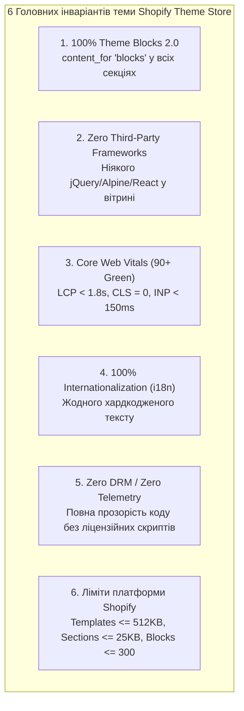

<!--
# --- DNK-MRH-HEADER ---
# mrh_id: "docs/projects/dnk_ecom/theme_dev_workflow/06_SHOPIFY_THEME_STORE_COMMERCIAL_SPECIFICATION.md"
# purpose: "Exhaustive Architectural Specification & Governance Standard for DNK Sovereign Commercial Theme (Shopify Theme Store Submission Grade)."
# canonical_source: true
# alters_files: []
# triggers_tasks: []
# status: "Active"
# version: "1.0.0"
# updated_at: "2026-11-12"
# author: "DNK-e.com Maksym & Antigravity (Chief Architect)"
# --- END DNK-MRH-HEADER ---
-->

# 🏛️ ОФІЦІЙНА ТЕХНІЧНА СПЕЦИФІКАЦІЯ ТЕМИ СВІТОВОГО РІВНЯ ДЛЯ SHOPIFY THEME STORE
## DNK Sovereign Theme (Apex D2C Architecture)

> **Мета документа:** Визначити вичерпний інженерний стандарт побудови власної флагманської теми для успішного проходження модерації та комерційного продажу в офіційному **Shopify Theme Store ($350–$420 MSRP)**.
> **Принцип синтезу:** Дистиляція найкращих інженерних молекул зі світових донорів (Sugar 2.3.10, Story 4.0.8, Shrine Pro 2.0.0, Elixir 2.0, Tinker 4.4.0) у єдину бездоганну Cleanroom-систему на базі нативних Web Components та Theme Blocks 2.0.

---

## 🧭 1. ЖОРСТКІ ІНВАРІАНТИ ТА ВИМОГИ SHOPIFY THEME STORE

Теми, що продаються в офіційному магазині Shopify, проходять суворий автоматизований аудит (`shopify theme check`) та ручне рев'ю інженерів Shopify. Кожен файл теми зобов'язаний відповідати наступним стандартам:



### 1.1. Заборона сторонніх JS-фреймворків (Zero Framework Policy)
* ❌ **Заборонено:** jQuery, Alpine.js, React, Vue, Slick Slider, Lodash, Axios.
* ✅ **Обов'язковий стандарт:** **Нативні Web Components (`customElements.define`)** та ванільні ES6+ модулі.
  - Кожен інтерактивний віджет (кошик, акордеон, слайдер, модалка, селектор варіантів) реалізується як ізольований Custom Element:
    ```javascript
    class DNKCartDrawer extends HTMLElement {
      connectedCallback() { ... }
    }
    customElements.define('dnk-cart-drawer', DNKCartDrawer);
    ```
  - Повне очищення пам'яті в `disconnectedCallback()`.

### 1.2. Ліміти платформи Shopify (Platform Quota Guards)
* **512 KB Template Guard:** Жоден файл шаблону (`templates/*.json`) не може перевищувати 512 KB (жорсткий ліміт API). Робочий ліміт теми: $\le 350\text{ KB}$.
* **Section Size:** Розмір окремого Liquid-файлу секції не більше **25 KB** (моноліти на зразок 561 KB в Elixir категорично заборонені).
* **Block Nesting Limit:** До 25 блоків на секцію; загальна кількість зареєстрованих блоків у темі $\le 300$ блоків (у Sugar Theme досягнуто 296).

### 1.3. Безпека та Cleanroom Стандарт (Zero-DRM Invariant)
* Тема для офіційного магазину Shopify **не має права здійснювати жодних сторонніх мережевих запитів** (ні для ліцензування, ні для телеметрії, ні для перевірки домену). Ліцензування та білінг здійснюються виключно через внутрішній білінг Shopify Partner Dashboard.

---

## 🎨 2. АРХІТЕКТУРА ДИЗАЙН-ТОКЕНІВ ТА ТИПОГРАФІКИ (`dnk-tokens.css`)

Уся візуальна система теми будується на детермінованих CSS Custom Properties. Відмова від жорстких кольорів (hex/rgb) на користь семантичних токенів:

```css
:root {
  /* 1. Брендові та акцентні токени */
  --dnk-color-brand-primary: {{ settings.color_palette.brand | default: '#111827' }};
  --dnk-color-brand-accent: {{ settings.color_palette.accent | default: '#3B82F6' }};
  --dnk-color-brand-contrast: #FFFFFF;

  /* 2. Поверхні та бекграунди */
  --dnk-bg-canvas: {{ settings.color_schemes[1].background | default: '#FFFFFF' }};
  --dnk-bg-surface: {{ settings.color_schemes[1].surface | default: '#F9FAFB' }};
  --dnk-border-subtle: {{ settings.color_schemes[1].border | default: 'rgba(0,0,0,0.08)' }};

  /* 3. Типографіка (Fluid Typography scale) */
  --dnk-font-body-family: {{ settings.type_body_font.family }}, {{ settings.type_body_font.fallback_families }};
  --dnk-font-heading-family: {{ settings.type_header_font.family }}, {{ settings.type_header_font.fallback_families }};
  
  --dnk-font-size-xs: clamp(0.75rem, 0.7rem + 0.25vw, 0.8125rem);
  --dnk-font-size-sm: clamp(0.8125rem, 0.75rem + 0.3vw, 0.875rem);
  --dnk-font-size-base: clamp(0.9375rem, 0.875rem + 0.35vw, 1rem);
  --dnk-font-size-lg: clamp(1.125rem, 1rem + 0.6vw, 1.25rem);
  --dnk-font-size-xl: clamp(1.375rem, 1.2rem + 0.9vw, 1.625rem);
  --dnk-font-size-2xl: clamp(1.75rem, 1.4rem + 1.5vw, 2.25rem);
  --dnk-font-size-display: clamp(2.25rem, 1.8rem + 2.5vw, 3.5rem);

  /* 4. Радіуси та тіні */
  --dnk-radius-sm: {{ settings.corner_radius | times: 0.5 | round }}px;
  --dnk-radius-md: {{ settings.corner_radius }}px;
  --dnk-radius-lg: {{ settings.corner_radius | times: 1.5 | round }}px;
  --dnk-radius-pill: 9999px;

  /* 5. Анімації та стабільність переміщень */
  --dnk-transition-fast: 150ms cubic-bezier(0.4, 0, 0.2, 1);
  --dnk-transition-base: 250ms cubic-bezier(0.4, 0, 0.2, 1);
  --dnk-transition-spring: 350ms cubic-bezier(0.175, 0.885, 0.32, 1.275);
}
```

---

## 🧩 3. ТАКСОНОМІЯ ТА СИСТЕМА ЕЛЕМЕНТІВ ТЕМИ (THEME TAXONOMY)

Тема структурується за принципами атомарного дизайну:

```
DNK Sovereign Theme/
├── layout/
│   ├── theme.liquid                       # Основне ядро вітрини (data-ready="1", headless-ready)
│   ├── password.liquid                    # Сторінка пароля для прелаунчу
│   └── landing.liquid                     # Спеціальний чистий лейаут без зайвих скриптів для Advertorials
├── sections/                              # 35-40 високомодульних контейнерів
│   ├── main-product.liquid                # Головний PDP-канвас (приймає будь-які блоки)
│   ├── custom-columns.liquid              # 12-колонковий універсальний конструктор (Sugar еталон)
│   ├── main-cart-drawer.liquid            # Ультрашвидкий AJAX-кошик з прогрес-баром подарунків
│   ├── interactive-grid.liquid            # Адаптивна сітка з тач-слайдером на мобільних
│   ├── before-after-slider.liquid         # Порівняльний слайдер До / Після
│   ├── quiz-engine.liquid                 # Автономний підбір товарів No-App
│   └── ...
├── blocks/                                # 180-220 атомарних Theme Blocks 2.0
│   ├── pdp/                               # Атоми картки товару
│   │   ├── price.liquid
│   │   ├── variant-picker.liquid
│   │   ├── buy-buttons.liquid
│   │   ├── quantity-breaks.liquid
│   │   ├── stock-countdown.liquid
│   │   └── size-chart.liquid
│   ├── cart/                              # Атоми кошика
│   │   ├── cart-upsell.liquid
│   │   ├── progress-bar.liquid
│   │   └── checkout-button.liquid
│   ├── editorial/                         # Контентні атоми
│   │   ├── timeline.liquid                (з media-sizes-scope)
│   │   ├── comparison-table.liquid
│   │   ├── collapsible-row.liquid         (з data-dnk-animating)
│   │   └── review-badge.liquid
│   └── ...
├── snippets/                              # Легковажні ізольовані макроси
│   ├── media-sizes-scope.liquid           # Автоматичний розрахунок responsive sizes
│   ├── stylesheet-once.liquid             # Гарантія одноразового підключення CSS для блоку
│   └── ...
└── assets/                                # CSS токени та Web Components
    ├── dnk-core.css
    ├── dnk-cart-drawer.js
    └── ...
```

---

## ⚡ 4. ТЕХНІЧНІ НОУ-ХАУ ТА УРОКИ ОСТАННІХ ДОСЛІДЖЕНЬ

Вбираємо безцінний досвід з реверс-інжинірингу Sugar 2.3.10, Shrine 2.0.0 та Elixir:

1. **Динамічний `media-sizes-scope` (Знахідка Sugar 2.3.10):**
   - Усі зображення у блоках мають підключатися через макрос, який ділить ширину в'юпорту на кількість видимих колонок на десктопі. Це запобігає завантаженню важких 4K картинок у маленьких блоках таймлайну.
2. **Атомарний атрибут анімації `data-dnk-animating`:**
   - Жодних селекторів за інлайн-стилями `style*="overflow"`. Будь-який акордеон, меню чи випадаючий список під час анімації отримує атрибут `data-dnk-animating=""`, що гарантує відсутність стрибків скруглення кутів (`border-radius`) і 60fps плавності.
3. **Захист мобільного кошика (`max(..., 2.5em)`):**
   - Поля введення кількості на мобільних пристроях зобов'язані мати мінімальну ширину у відносних одиницях `em`, щоб двозначні та тризначні кількості ніколи не обрізалися.
4. **Оптимізація селекторів WebKit (Відмова від надлишкового `:has()`):**
   - Для високочастотних рендерів (апсейли, свотчі) замінювати `:has()` на прямий сусідній селектор `+`, що прискорює Recalculate Style на iOS Safari на 15–20%.
5. **No-App Архітектура:**
   - Бандли, розмірні сітки, квізи та прогрес-бар безкоштовної доставки реалізуються всередині Liquid/JS теми без потреби для мерчанта купувати щомісячні додатки з App Store по $30–$50/міс. Це головний аргумент для покупки теми в Shopify Theme Store.

---

## 🌍 5. СТАНДАРТ ЛОКАЛІЗАЦІЇ ТА ДЕМО-ПРЕСЕТІВ

* **100% покриття `t:` ключами:** Жоден файл Liquid не може містити хардкод англійською чи будь-якою іншою мовою.
* **Канонічні мови теми з коробки:**
  1. `locales/en.default.json` + `locales/en.default.schema.json` (Глобальний ринок).
  2. `locales/uk.json` + `locales/uk.schema.json` (Український ринок та діаспора).
* **3 Комерційні Пресети (`config/settings_data.json`):**
  1. **Apex Clean (D2C Minimalist / Tech / Supplements):** Світла тема, чіткі лінії, монохром із яскравим кольором конверсії.
  2. **Editorial Luxury (Fashion / Jewelry / Beauty):** Висока елегантність, серіфні заголовки, м'які тіні, великі медіа-блоки.
  3. **High-CRO Power (Sports / Gadgets / Mass Market):** Динамічні бейджі, ліпкий бар купівлі, таймери відправки, бандли вигоди.
