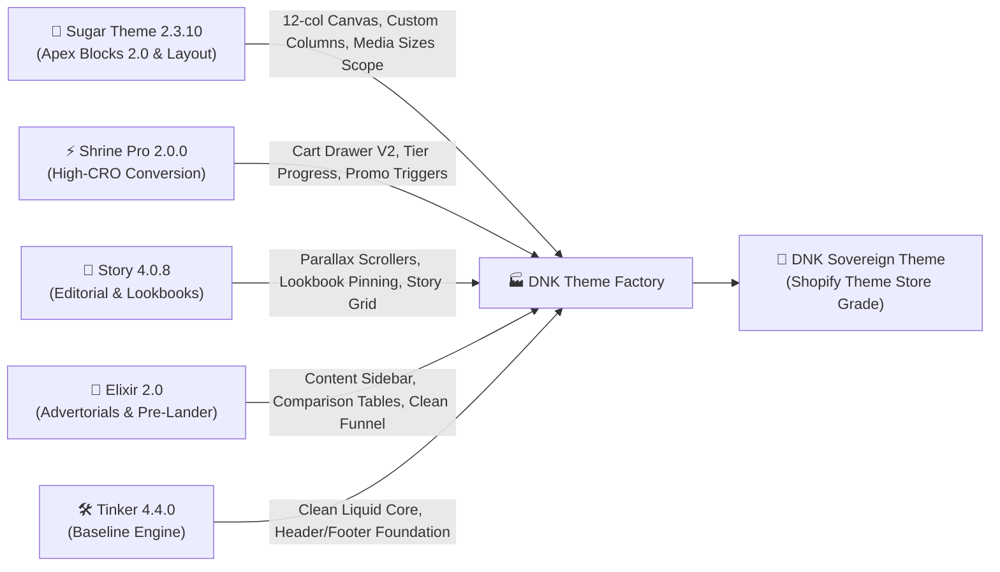
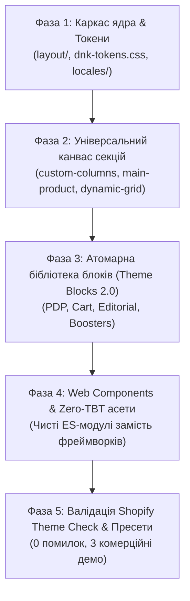

> [!metadata]- ⚙️ Системні метадані та інваріанти (MRH Header)
> ```yaml
> # --- DNK-MRH-HEADER ---
> mrh_id: "docs/projects/dnk_ecom/theme_dev_workflow/07_DISTILLATION_FACTORY_AND_GRAFTING_PIPELINE.md"
> purpose: "Step-by-Step Distillation Factory, Grafting Pipeline & Gerych Terminal Pairing Protocol for Assembling DNK Sovereign Theme."
> canonical_source: true
> alters_files: []
> triggers_tasks: []
> status: "Active"
> version: "2.0.0"
> updated_at: "2026-11-18"
> author: "DNK-e.com Maksym & Antigravity"
> # --- END DNK-MRH-HEADER ---
> ```

# 🏭 ФАБРИКА ДИСТИЛЯЦІЇ ТА ГРАФТИНГУ: ПОКРОКОВЕ СКЛАДАННЯ ТЕМИ
## Тандем Antigravity (Chief Architect) + Gerych-root (Gemini 4 Carbon)

> **Мета пайплайну:** Перетворити накопичені знання та очищені кодові бази 5 топових донорів (`sugar`, `story`, `shrine-pro`, `elixir`, `tinker`) у готову комерційну тему **DNK Sovereign Theme** за чіткими фазами із залученням термінального агента **Gerych-root**.

---

## 🧭 1. КАРТА ОРГАНІВ ДОНОРІВ ДЛЯ ДИСТИЛЯЦІЇ (DONOR ORGAN MATRIX)

Кожен донор дає нашій новій темі найкращу частину своєї кодової бази:



| Донор | Молекули та компоненти для вилучення | Архітектурна цінність |
| :--- | :--- | :--- |
| **`Sugar 2.3.10`** | `sections/custom-columns.liquid`<br>`blocks/column.liquid`<br>`blocks/bundle-builder.liquid`<br>`blocks/timeline.liquid`<br>`snippets/media-sizes-scope.liquid`<br>`assets/sugar-interactive.js` | Еталонне вкладення Theme Blocks 2.0; система динамічних розмірів картинок (CWV LCP); чисті анімації акордеонів (`data-dnk-animating`). |
| **`Shrine Pro 2.0.0`** | `sections/cart-drawer.liquid`<br>`blocks/cart-progress-bar.liquid`<br>`blocks/cart-upsell.liquid`<br>`snippets/gamified-scratch.liquid` | Найвищий у галузі показник конверсії кошика; прогрес-бар подарунків і безкоштовної доставки. |
| **`Story 4.0.8`** | `sections/editorial-scroller.liquid`<br>`blocks/lookbook-pin.liquid`<br>`blocks/split-screen.liquid` | Журнальний люксовий сторітеллінг для преміальних брендів (fashion, beauty, jewelry). |
| **`Elixir 2.0 / 1.6.2`** | `blocks/content-sidebar-v2.liquid`<br>`blocks/cs-*.liquid`<br>`sections/comparison-table.liquid`<br>`layout/landing.liquid` | Модульний сайдбар з Amazon-відгуками, інтерактивні порівняльні таблиці «Ми vs Конкуренти», чистий лейаут для реклами. |
| **`Tinker 4.4.0 DNK`** | `sections/header.liquid`<br>`sections/footer.liquid`<br>`snippets/breadcrumbs.liquid`<br>`layout/theme.liquid` (базовий каркас) | Стабільний, легкий, валідований фундамент із готовою українською та англійською схемою. |

---

## ⚙️ 2. П'ЯТИФАЗНИЙ АЛГОРИТМ СКЛАДАННЯ ТЕМИ



---

## 🤖 3. ПРОТОКОЛ РОБОТИ В ТАНДЕМІ З GERYCH-ROOT

Оскільки **Gerych-root** працює в автономному терміналі на найпотужнішій моделі **Google Gemini 4 Carbon**, ми делегуємо йому пакетні та складні операції рефакторингу коду.

### 📋 Специфікація завдань для Gerych-root:

1. **Завдання 1: Пакетна нормалізація префіксів та токенів:**
   - Перейменування сторонніх класів та CSS-змінних (`sugar-`, `shrine-`, `story-`) на єдиний стандарт `dnk-`.
   - Заміна жорстких кольорів на `var(--dnk-*)`.
   - Заміна селекторів анімацій на `[data-dnk-animating]`.

2. **Завдання 2: Екстракція та очищення схем ``:**
   - Перевірка валідності JSON-схем за стандартом RFC 8259 (видалення будь-яких C-style коментарів).
   - Заміна статичних текстів у схемах на `t:` локалізаційні посилання.

3. **Завдання 3: Генерація ключів локалізації (`locales/`):**
   - Автоматичне вилучення всіх використаних `t:` ключів і створення парних словників `en.default.json` / `uk.json` та `en.default.schema.json` / `uk.schema.json`.

---

## 🚀 4. ШВИДКИЙ ЗАПУСК ДИСТИЛЯЦІЇ ЧЕРЕЗ GERYCH-ROOT

Команда для запуску чергової фази в терміналі:

```bash
~/.local/bin/gerych-root -q "Виконай Фазу 1 збирання DNK Sovereign Theme згідно з _Shopify_Theme_DEV_Workflow/07_DISTILLATION_FACTORY_AND_GRAFTING_PIPELINE.md: створи базові dnk-tokens.css та layout/theme.liquid у новому каталозі themes/dnk-sovereign" --oneshot
```
