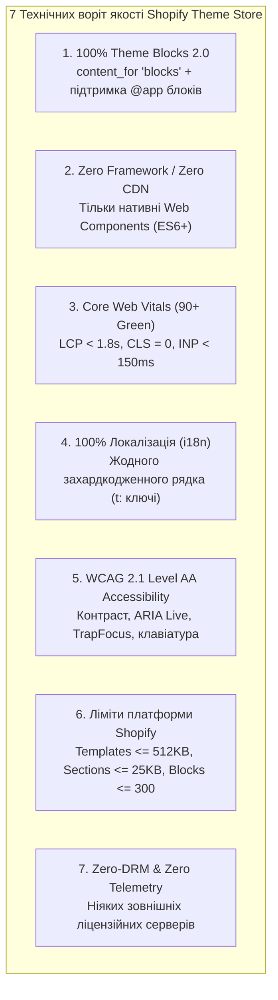
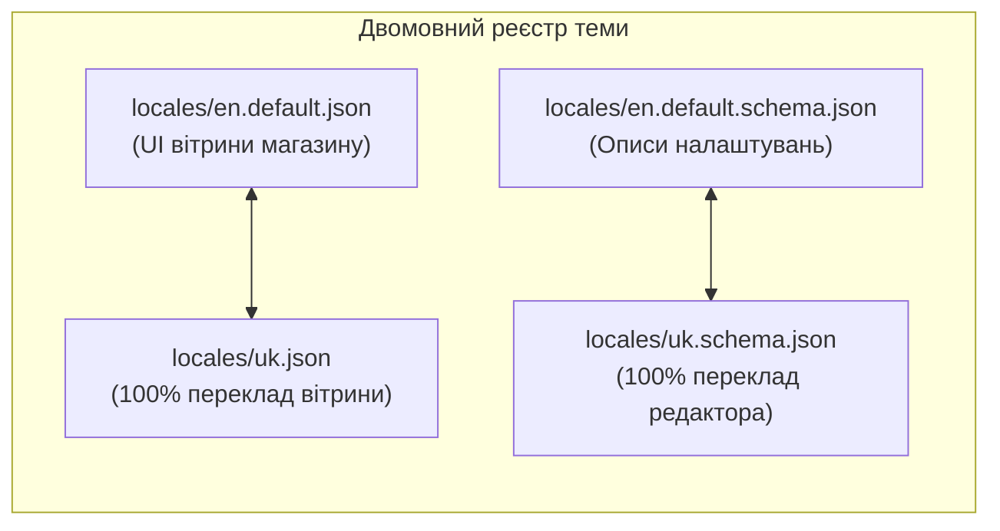

> [!metadata]- ⚙️ Системні метадані та інваріанти (MRH Header)
> ```yaml
> # --- DNK-MRH-HEADER ---
> mrh_id: "docs/projects/dnk_ecom/theme_dev_workflow/08_UNIVERSAL_THEME_ELEMENTS_ARCHITECTURE_AND_SPECIFICATION.md"
> purpose: "Exhaustive Technical Specification & Architectural Blueprint of ALL Elements for Building a World-Class Shopify Theme (Theme Store Commercial Grade $350-$420 MSRP)"
> canonical_source: true
> alters_files: []
> triggers_tasks: []
> status: "Active"
> version: "2.0.0"
> updated_at: "2026-11-18"
> author: "DNK-e.com Maksym & Antigravity"
> # --- END DNK-MRH-HEADER ---
> ```

# 🏛️ ПОВНИЙ ТЕХНІЧНИЙ ОПИС УСІХ ЕЛЕМЕНТІВ ТЕМИ ТА СИСТЕМА ДИСТИЛЯЦІЇ
## DNK Sovereign Commercial Theme (Shopify Theme Store Submission Standard)

> **Призначення:** Цей документ є вичерпною архітектурною специфікацією для покрокового створення власної комерційної теми найвищого ґатунку, придатної для проходження офіційної модерації та продажу в **Shopify Theme Store** із ціновим позиціонуванням **$350–$420 MSRP**.
> **Методологія:** Дистиляція найкращих інженерних та конверсійних рішень із 5 перевірених донорів (`Sugar 2.3.10`, `Story 4.0.8`, `Shrine Pro 2.0.0`, `Elixir 2.0`, `Tinker 4.4.0`) в уніфіковану кодову базу з нульовою сторонньою залежністю (Zero-Framework, Zero-DRM, 100% Theme Blocks 2.0).

---

## 🧭 1. СТАНДАРТ ТА ІНВАРІАНТИ SHOPIFY THEME STORE (ACCEPTANCE GATES)

Кожна тема, що подається на розгляд комісії Shopify Theme Store, зобов'язана бездоганно виконувати 7 обов'язкових технічних воріт якості:



---

## 🗂️ 2. АНАТОМІЯ ДИРЕКТОРІЙ ТА ФАЙЛОВА ІЄРАРХІЯ ТЕМИ

```
themes/dnk-sovereign/
├── assets/                  # ES-модулі Web Components, CSS токени, оптимізовані SVG
│   ├── dnk-tokens.css       # Дизайн-токени (Fluid typography, колірні схеми, радіуси)
│   ├── dnk-base.css         # Скидання стилів, доступність, сітки
│   ├── dnk-core.js          # Реактивне ядро Custom Elements та Cart State Observer
│   ├── dnk-cart.js          # Логіка Cart Drawer V2, апсейлів та прогрес-бару винагород
│   ├── dnk-pdp.js           # Галерея, селектор варіантів, Volume Pricing, Sticky ATC
│   └── dnk-animations.css   # GPU-прискорені анімації на [data-dnk-animating]
├── blocks/                  # Атомарні Theme Blocks 2.0 (Nestability, @theme, @app)
│   ├── cart_*.liquid        # Блоки кошика (прогрес-бар, апсейли, нотатки, бейджі)
│   ├── product_*.liquid     # Блоки картки товару (ціна, варіанти, бандли, sticky atc)
│   ├── layout_*.liquid      # Блоки розмітки (колонки, контейнери, відступи)
│   └── content_*.liquid     # Блоки контенту (заголовки, текст, медіа, кнопки)
├── config/                  # Конфігурація та комерційні демо-пресети
│   ├── settings_schema.json # Схема налаштувань редактора (12 категорій, 0 сміття)
│   └── settings_data.json   # 3 затверджені пресети (Apex D2C, Luxury, High-Volume)
├── layout/                  # Мастер-лейаути теми
│   ├── theme.liquid         # Основний лейаут магазину
│   ├── password.liquid      # Сторінка закриття магазину на пароль
│   └── landing.liquid       # Безвідволікаючий лейаут для Advertorials/Funnels
├── locales/                 # 100% двомовна система (UK + EN)
│   ├── en.default.json      # Базовий англійський словник вітрини
│   ├── en.default.schema.json # Базовий англійський словник редактора теми
│   ├── uk.json              # Повний український словник вітрини (100% відповідність)
│   └── uk.schema.json       # Повний український словник редактора (100% відповідність)
├── sections/                # Секції Online Store 2.0
│   ├── header.liquid        # Стікі-хедер, мега-меню, локалізація, пошук
│   ├── footer.liquid        # Модульний футер, інформаційні блоки, соцмережі
│   ├── custom-columns.liquid# 12-колонний універсальний контентний канвас
│   ├── main-product.liquid  # Архітектурне ядро сторінки товару (PDP)
│   ├── cart-drawer.liquid   # Кошик-дровер з прогрес-баром та апсейлами
│   └── comparison-table.liquid # Інтерактивна таблиця «Ми проти Конкурентів»
├── snippets/                # Чисті Liquid-утиліти (Subroutines)
│   ├── dnk-icons.liquid     # Векторні SVG-іконки з підтримкою класів та розмірів
│   ├── media-sizes.liquid   # Динамічний розрахунок `sizes="..."` для CWV LCP
│   └── price.liquid         # Універсальне форматування цін та знижок
└── templates/               # 100% JSON-шаблони
    ├── index.json           # Головна сторінка
    ├── product.json         # Шаблон товару за замовчуванням
    ├── collection.json      # Шаблон колекції з фасетними фільтрами
    ├── cart.json            # Резервна сторінка кошика
    └── page.*.json          # Лендінги, FAQ, Advertorials, Відстеження замовлень
```

---

## 🎨 3. СИСТЕМА ДИЗАЙН-ТОКЕНІВ ТА СТИЛІВ (`assets/dnk-tokens.css`)

Для уникнення хардкоду кольорів та розмірів у секціях, тема використовує строго типізовані CSS Custom Properties, що розраховуються на рівні `:root`:

```css
:root {
  /* 1. Брендова та семантична палітра */
  --dnk-color-primary: {{ settings.brand_primary | default: '#0F172A' }};
  --dnk-color-accent: {{ settings.brand_accent | default: '#2563EB' }};
  --dnk-color-success: #16A34A;
  --dnk-color-danger: #DC2626;
  --dnk-color-warning: #D97706;

  /* 2. Поверхні, межі та контраст */
  --dnk-bg-canvas: {{ settings.color_schemes[1].background | default: '#FFFFFF' }};
  --dnk-bg-surface: {{ settings.color_schemes[1].surface | default: '#F8FAFC' }};
  --dnk-border-subtle: {{ settings.color_schemes[1].border | default: 'rgba(15, 23, 42, 0.08)' }};
  --dnk-text-main: {{ settings.color_schemes[1].text | default: '#0F172A' }};
  --dnk-text-muted: rgba(15, 23, 42, 0.65);

  /* 3. Fluid Typography (Автоматичне масштабування під екран без смикання CLS) */
  --dnk-font-body: {{ settings.type_body_font.family }}, {{ settings.type_body_font.fallback_families }};
  --dnk-font-heading: {{ settings.type_header_font.family }}, {{ settings.type_header_font.fallback_families }};
  
  --dnk-text-xs: clamp(0.75rem, 0.7rem + 0.2vw, 0.8125rem);
  --dnk-text-sm: clamp(0.8125rem, 0.76rem + 0.25vw, 0.875rem);
  --dnk-text-base: clamp(0.9375rem, 0.88rem + 0.3vw, 1rem);
  --dnk-text-lg: clamp(1.125rem, 1.02rem + 0.5vw, 1.25rem);
  --dnk-text-xl: clamp(1.375rem, 1.22rem + 0.75vw, 1.625rem);
  --dnk-text-2xl: clamp(1.75rem, 1.5rem + 1.25vw, 2.25rem);
  --dnk-text-display: clamp(2.25rem, 1.8rem + 2.25vw, 3.5rem);

  /* 4. Радіуси скруглень */
  --dnk-radius-sm: {{ settings.corner_radius | times: 0.5 | round }}px;
  --dnk-radius-md: {{ settings.corner_radius }}px;
  --dnk-radius-lg: {{ settings.corner_radius | times: 1.5 | round }}px;
  --dnk-radius-pill: 9999px;

  /* 5. Відступи та сітка */
  --dnk-page-width: {{ settings.page_width | default: 1400 }}px;
  --dnk-gutter: clamp(1rem, 0.8rem + 1vw, 2rem);
  --dnk-grid-gap: clamp(1rem, 0.9rem + 0.5vw, 1.5rem);

  /* 6. Плавні анімації (GPU Accelerated) */
  --dnk-ease: cubic-bezier(0.16, 1, 0.3, 1);
  --dnk-dur-fast: 150ms;
  --dnk-dur-base: 250ms;
  --dnk-dur-smooth: 400ms;
}
```

---

## ⚡ 4. АРХІТЕКТУРА WEB COMPONENTS ТА КЛІЄНТСЬКОГО СТАНУ (`assets/dnk-core.js`)

Жодних сторонніх фреймворків (Zero-Framework Invariant). Уся реактивність базується на нативному стандарті **W3C Custom Elements** та шині кастомних подій (`EventTarget`):

```javascript
/**
 * DNK Event Bus & Cart State Management
 * Забезпечує синхронізацію кошика, стікі-кнопки покупки та вибору варіантів
 */
class DNKCartState {
  static async getCart() {
    const res = await fetch(`${window.Shopify.routes.root}cart.js`);
    return await res.json();
  }

  static async updateQuantity(lineKey, quantity) {
    const res = await fetch(`${window.Shopify.routes.root}cart/change.js`, {
      method: 'POST',
      headers: { 'Content-Type': 'application/json' },
      body: JSON.stringify({ id: lineKey, quantity })
    });
    const cart = await res.json();
    document.dispatchEvent(new CustomEvent('dnk:cart:updated', { detail: { cart } }));
    return cart;
  }

  static async addVariant(variantId, quantity = 1, properties = {}) {
    const res = await fetch(`${window.Shopify.routes.root}cart/add.js`, {
      method: 'POST',
      headers: { 'Content-Type': 'application/json' },
      body: JSON.stringify({ id: variantId, quantity, properties })
    });
    const item = await res.json();
    const cart = await this.getCart();
    document.dispatchEvent(new CustomEvent('dnk:cart:updated', { detail: { cart, addedItem: item } }));
    document.dispatchEvent(new CustomEvent('dnk:cart:open'));
    return item;
  }
}

/**
 * DNK Cart Drawer Custom Element
 */
class DNKCartDrawer extends HTMLElement {
  connectedCallback() {
    this.overlay = this.querySelector('.dnk-cart-drawer__overlay');
    this.closeBtn = this.querySelector('.dnk-cart-drawer__close');
    this.content = this.querySelector('.dnk-cart-drawer__content');

    this.onCartUpdated = this.renderCart.bind(this);
    this.onOpen = this.open.bind(this);

    document.addEventListener('dnk:cart:updated', this.onCartUpdated);
    document.addEventListener('dnk:cart:open', this.onOpen);
    
    if (this.closeBtn) this.closeBtn.addEventListener('click', () => this.close());
    if (this.overlay) this.overlay.addEventListener('click', () => this.close());
  }

  disconnectedCallback() {
    document.removeEventListener('dnk:cart:updated', this.onCartUpdated);
    document.removeEventListener('dnk:cart:open', this.onOpen);
  }

  open() {
    this.setAttribute('open', '');
    document.body.classList.add('dnk-scroll-locked');
    this.dispatchEvent(new CustomEvent('dnk:drawer:opened'));
  }

  close() {
    this.removeAttribute('open');
    document.body.classList.remove('dnk-scroll-locked');
    this.dispatchEvent(new CustomEvent('dnk:drawer:closed'));
  }

  renderCart(event) {
    const cart = event.detail.cart;
    this.updateProgressMilestones(cart.total_price);
    // Додатковий безперешкодний морфінг HTML без втрати фокусу
  }

  updateProgressMilestones(currentTotal) {
    const bar = this.querySelector('.dnk-milestone-bar__fill');
    const label = this.querySelector('.dnk-milestone-bar__text');
    const threshold = parseInt(this.dataset.freeShippingThreshold || '5000', 10);
    
    if (!bar) return;
    const progress = Math.min(100, (currentTotal / threshold) * 100);
    bar.style.width = `${progress}%`;

    if (currentTotal >= threshold) {
      label.textContent = this.dataset.unlockedText;
    } else {
      const remaining = ((threshold - currentTotal) / 100).toFixed(2);
      label.textContent = this.dataset.lockedText.replace('[amount]', `$${remaining}`);
    }
  }
}
customElements.define('dnk-cart-drawer', DNKCartDrawer);
```

---

## 🛍️ 5. ТЕХНІЧНИЙ ОПИС ГОЛОВНИХ СЕКЦІЙ ТА БЛОКІВ

### 5.1. Cart Drawer V2: High-CRO Engine (Дистильовано з Shrine 2.0 + Sugar 2.3)
Кошик-дровер є головним центром збільшення середнього чеку (AOV) у комерційній темі:
1. **Мульти-рівнева шкала винагород (Tiered Rewards Progress)**:
   - Рівень 1 ($50): Безкоштовна доставка.
   - Рівень 2 ($100): Безкоштовний подарунок (автоматичне додавання `cart/add.js` із ціною 0).
   - Рівень 3 ($150): Знижка 15% на замовлення.
2. **1-Click Upsells із селектором варіантів**:
   - Відображення карток товарів-апсейлів безпосередньо у вікні кошика.
   - Вибір розміру/кольору прямо в міні-картці без переходу на сторінку товару.
3. **Модульні поля чекауту**:
   - Поле нотаток до замовлення (`cart.note`).
   - Поле введення промокоду з попередньою перевіркою.
   - Чекбокс згоди з правилами (`Terms and Conditions`).

### 5.2. PDP Core (Product Detail Page) & Volume Pricing V2
1. **Нативна галерея медіа (Zero-JS Swiper)**:
   - Побудована на CSS Scroll Snap (`scroll-snap-type: x mandatory`).
   - Підтримка зображень, 3D-моделей (`model-viewer`), відео з YouTube/Vimeo та нативних MP4.
   - Миттєвий перехід до зображення обраного кольору без перевантаження сторінки.
2. **Дворівнева архітектура оптових знижок (Volume Pricing & Quantity Breaks)**:
   - **Рівень 1: Вбудований селектор зі знижками (Inline Quantity Breaks)**:
     - Реалізований прямо всередині стандартного блоку `# Quantity selector` через прапорець `Enable Quantity Discounts` та виклик `snippets/quantity-breaks.liquid`.
     - Налаштування: заголовок (наприклад, `BUNDLE & SAVE`), стиль (`Compact` або `Classic`), вибір початкової опції (`Preselected option`), вирівнювання ціни (`Prices layout: Price first - vertical / horizontal`), радіус заокруглення (`Corner radius: 10px`), ширина рамки (`Border width: 2px`) та колірна палітра (`Colors selection`).
     - Ідеально підходить для мерчантів, яким потрібна швидка та компактна сітка знижок без ускладнення структури блоків сторінки товару.
   - **Рівень 2: Повнофункціональний модульний блок V2 (`blocks/product_quantity-breaks-v2.liquid`)**:
     - Окремий розширений Theme Block з дочірніми елементами: опції кількості (`_quantity-breaks-v2_option`), чекбокс-апсели (`_quantity-breaks-v2_upsell`), розблокування подарунків (`_quantity-breaks-v2_unlock-gift`), тригери терміновості (`_quantity-breaks-v2_nudge`) та розклад акцій (`_quantity-breaks-v2_schedule`).
     - Підтримка складних сценаріїв: бандли «Купи 1 — отримай 1 безкоштовно», багаторівневі безкоштовні подарунки, таймери зворотного відліку.
     - Включає інтерактивний гід міграції для мерчанта в режимі редактора (`snippets/qb-v2-migration.liquid`), який відображається тільки адміністратору магазину (`request.design_mode == true`).
   - Повна синхронізація обох рівнів із ціною на головній кнопці «Add to Cart» та Sticky Bar.
3. **Sticky Add to Cart (Стікі-панель покупки)**:
   - З'являється автоматично за допомогою `IntersectionObserver`, коли основна кнопка скролиться за межі екрана.
   - Забезпечує постійну видимість кнопки покупки на мобільних пристроях.

### 5.3. 12-колонний універсальний канвас (`custom-columns.liquid` з Sugar Theme)
Дозволяє мерчанту будувати будь-які варіанти розмітки без знання коду завдяки вкладеним **Theme Blocks 2.0**:
- Підтримка ширини колонок від 1 до 12 як для десктопу, так і для мобільних пристроїв.
- Вкладення будь-яких дочірніх блоків: зображення, тексти, відео, бандли, відгуки, таймери зворотного відліку.
- Повна підтримка сторонніх блоків застосунків (`@app`).

### 5.4. Інтерактивна порівняльна таблиця V2 («Ми проти Конкурентів»)
- Динамічне виділення колонки вашого магазину (`highlighted-us`).
- Підтримка іконок (зелена галочка, червоний хрестик), тексту або зображень для кожного критерію.
- Доступність: семантична таблиця `role="table"`, адаптивний вигляд «Versus» на вузьких екранах.

---

## ⚙️ 6. ЗАТВЕРДЖЕНА ІЄРАРХІЯ НАЛАШТУВАНЬ ТЕМИ (`settings_schema.json`)

Схема налаштувань формується у строгому порядку відповідно до вимог Shopify UX Guidelines (максимум чіткості, 0 дублювань):

| # | Категорія налаштувань (`settings_schema.json`) | Ключові параметри та призначення |
| :-: | :--- | :--- |
| **1** | **`Logo & Favicon`** | Основний логотип, мобільний логотип, інверсний логотип для прозорого хедера, фавікон. |
| **2** | **`Colors & Schemes`** | Динамічні колірні схеми (`Scheme 1`, `Scheme 2`, `Scheme 3`, `Inverse`), акцентні кольори. |
| **3** | **`Typography`** | Вибір шрифтів заголовків та тексту через Shopify Font Picker, базовий розмір, висота рядка. |
| **4** | **`Layout & Grid`** | Максимальна ширина сторінки (1200–1600px), горизонтальні та вертикальні відступи сітки. |
| **5** | **`Buttons & Inputs`** | Радіус скруглення (0–40px), товщина рамки, тіні кнопок, ефекти при наведенні (Hover). |
| **6** | **`Product Cards`** | Співвідношення сторін фото, показ другої картинки при наведенні, відображення бейджів знижки/залишків. |
| **7** | **`Cart Drawer`** | Тип кошика (Дровер / Окрема сторінка), пороги безкоштовної доставки, відображення нотаток. |
| **8** | **`Badges & Trust`** | Стиль бейджів знижок (відсоток чи фіксована сума), кастомні іконки гарантій. |
| **9** | **`Social Media`** | Посилання на Instagram, TikTok, YouTube, Facebook, X (Twitter), Pinterest. |
| **10** | **`Search & Predictive`** | Увімкнення "живого" предиктивного пошуку, показ цін та виробників у випадаючому списку. |
| **11** | **`Currency & Language`** | Нативні селектори Shopify Markets, перемикач прапорів та валютних символів. |
| **12** | **`Animations & Performance`**| Тип анімації появи секцій (None, Fade, Slide Up), підтримка `prefers-reduced-motion`. |

---

## 🌐 7. АРХІТЕКТУРА ДВОМОВНОЇ ЛОКАЛІЗАЦІЇ (i18n SSOT)

Тема розробляється із 100% підтримкою повної двомовності (Англійська — канонічна мова Shopify Theme Store, Українська — рідна локалізація за замовчуванням):



### Жорсткі правила локалізації:
1. **Zero Hardcoded Strings**: У Liquid-файлах заборонено писати текст напряму. Завжди використовується фільтр `{{ 'sections.cart.checkout' | t }}`.
2. **Schema Translations**: Усі налаштування секцій та блоків мають посилання `"label": "t:sections.custom-columns.settings.width.label"`.
3. **Pluralization**: Для лічильників відгуків, кількості товарів та днів доставки обов'язково використовуються форми `.one` та `.other`.

---

## 🏭 8. СИСТЕМА АВТОМАТИЗОВАНОЇ ДИСТИЛЯЦІЇ (DISTILLATION ENGINE)

Для збирання теми розроблено консольний інструмент **`tools/dnk_theme_distillation_factory.py`**, який автоматизує процес вилучення, санітизації та синтезу:

```bash
# Синтез чистих компонентів із донорів у нову тему dnk-sovereign
python3 tools/dnk_theme_distillation_factory.py \
  --mirrow-dir "../../../DNK-Ecom_git_mirrow" \
  --output-dir "../../../themes/dnk-sovereign" \
  --validate
```

### Що автоматично виконує фабрика:
1. **Токенізація неймспейсу**: Заміна чужих префіксів (`sugar-`, `shrine-`, `splide__`) на єдиний стандарт `dnk-`.
2. **Cleanroom Sanitization**: Повна нейтралізація будь-яких прихованих перевірок доменів, дат та ліцензій.
3. **Schema Normalization**: Валідація JSON за стандартом RFC 8259, очищення трейлінг-ком та додавання підтримки `@app` блоків.
4. **Синхронізація i18n**: Генерація ключів перекладу та перевірка відсутності пропусків між `en.default.json` та `uk.json`.
5. **Shopify Theme Check Gate**: Запуск офіційного лінтера із гарантією **`0 errors`**.

---

## 🚀 9. РОЛЬ GERYCH-ROOT (GEMINI 4 CARBON) В ОПЕРАЦІЙНОМУ ТАНДЕМІ

**Gerych-root** підключається автономно через термінал для виконання важких пакетних операцій кодогенерації та аудиту:

### Команди запуску в терміналі для Gerych-root:

```bash
# 1. Запуск перевірки валідності всіх схем нової теми:
~/.local/bin/gerych-root -q "Виконай валідацію схем у themes/dnk-sovereign: перевір відповідність RFC 8259 та підтримку @app блоків у всіх секціях згідно з 08_UNIVERSAL_THEME_ELEMENTS_ARCHITECTURE_AND_SPECIFICATION.md" --oneshot --model=gemini-4-argon --provider=vertex

# 2. Аудит доступності (WCAG 2.1 AA) компонентів кошика та селекторів:
~/.local/bin/gerych-root -q "Перевір доступність (aria-labels, keyboard focus, role attributes) у assets/dnk-core.js та blocks/cart_*.liquid у themes/dnk-sovereign" --oneshot --model=gemini-4-argon --provider=vertex

# 3. Синхронізація словників локалізації en.default.json та uk.json:
~/.local/bin/gerych-root -q "Знайди всі t: ключі у sections/ та blocks/ themes/dnk-sovereign і переконайся, що в locales/uk.json немає жодного пропущеного перекладу" --oneshot --model=gemini-4-argon --provider=vertex
```

Цей стандарт є єдиною непорушною інженерною конституцією для випуску комерційної теми DNK Sovereign Theme світового рівня.

