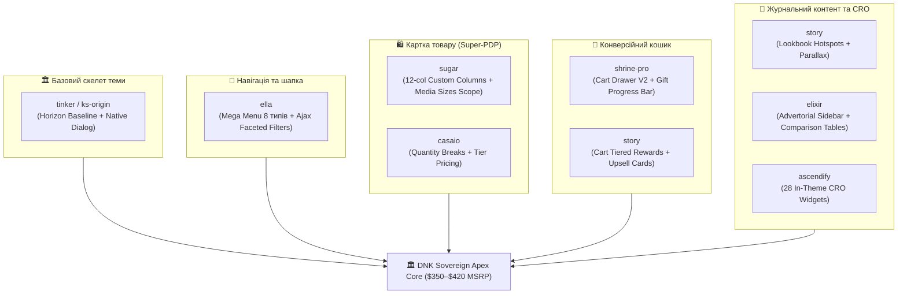
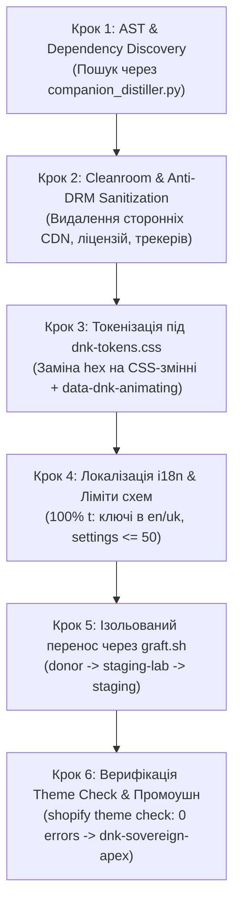

# --- DNK-MRH-HEADER ---
# mrh_id: "_Shopify_Theme_DEV_Workflow/09_CANONICAL_DONOR_MAP_AND_GRAFTING_ALGORITHM.md"
# purpose: "Canonical Active Donor Themes Genome Map & Complete 6-Stage Cleanroom Molecular Grafting Algorithm for Shopify Theme Store ($350-$420 MSRP)."
# canonical_source: true
# alters_files: []
# triggers_tasks: []
# status: "Active"
# version: "1.0.0"
# updated_at: "2026-11-16"
# author: "DNK-e.com Maksym & Antigravity (Chief Architect)"
# --- END DNK-MRH-HEADER ---

# 🧬 КАРТА АКТИВНИХ ТЕМ-ДОНОРІВ ТА ПОВНИЙ АЛГОРИТМ СТРУКТУРИЗАЦІЇ І ГРАФТИНГУ
## DNK Sovereign Apex Theme Architecture ($350–$420 MSRP)

> **Єдине джерело істини (SSOT):**  
> Репозиторій: [`https://github.com/DNKShopify/DNK-e.com`](https://github.com/DNKShopify/DNK-e.com)  
> Локальне дзеркало: `/Users/kuzmenko.top/Kuzmenko/MY_LIFE_WORK/DNKEcom/DNK-Ecom_git_mirrow` (Bare repo `.bare` + 18 Git Worktrees).

---

## 🗺️ 1. КАРТА АКТИВНИХ ТЕМ-ДОНОРІВ (DONOR GENOME MAP 2026)

<!-- SYNC_GENOME_TABLE_START (Auto-synced: 2026-11-16) -->
### 🧬 1.1. Активні теми-донори для синтезу релізної теми (Active Theme Donors)
> **Критерій відбору:** Тільки повноцінні комерційні теми та власна кастомна тема, з яких дистилюються молекули та сніпети в цільове сертифіковане ядро.

| № | Гілка донора у git | Актуальна версія | Git Tag / Commit | Стан синхронізації | Всього файлів | Блоки (`blocks/`) | Секції (`sections/`) | Сніпети | Ассети | Coupling | Ключова суперсила донора (DNA для дистиляції) |
| :-: | :--- | :---: | :---: | :---: | :-: | :-: | :-: | :-: | :-: | :-: | :--- |
| **1** | `sugar` | **2.3.15** | `sugar-v2.3.15-1-g2cd3bf5`<br>(2cd3bf5) | 🟢 Live (Synced) | 1199 | **296** | 83 | 146 | 585 | `2/5` | **Еталон Theme Blocks 2.0**: 12-колонковий універсальний канвас (`custom-columns`), адаптивні розміри картинок (`media-sizes-scope`), 1172 CSS токени, плавні анімації акордеонів (`data-sugar-animating`). |
| **2** | `story` | **4.0.9** | `story-v4.0.9`<br>(6f2a7ef) | 🟢 Live (Synced) | 814 | **257** | 71 | 121 | 281 | `3/5` | **Люксовий журнальний сторітеллінг**: Модульний кошик із дворівневими нагородами (`_cart-rewards`), Lookbook з пінами на медіа, Parallax Scrollers, 100% перекладена схема `uk.schema.json`. |
| **3** | `shrine-pro` | **2.0.0** | `shrine-pro-v2.0.0-1-g149154f`<br>(149154f) | 🟢 Live (Synced) | 655 | **146** | 94 | 196 | 132 | `3/5` | **CRO-конверсійний монстр**: Еталонний Cart Drawer V2 з прогрес-баром подарунків та безкоштовної доставки, Sticky Cart Trigger, карусель апсейлів у кошику, інтерактивні бейджі довіри. |
| **4** | `ella` | **7.3.1 DNK** | `ella-v7.3.1`<br>(a4a6d57) | 🟢 Live (Synced) | 901 | **250** | 68 | 202 | 260 | `3/5` | **Enterprise Mega-Catalog (High-SKU)**: 8 типів Mega Menu з табами та банерами, асинхронні фасетні фільтри (Ajax Faceted Filters), динамічні сітки вітрини (2/3/4/5 колонок), Wholesale Quick Order. |
| **5** | `casaio` | **1.1.0** | `casaio-v1.1.0-cleanroom-1-ga61b35a`<br>(a61b35a) | 🟢 Live (Synced) | 533 | **148** | 50 | 154 | 143 | `2/5` | **High-Ticket D2C & Interior**: Модульний рушій знижок (Quantity Breaks), інтерактивні таби характеристик, Lumin відгуки, преміальні UGC-каруселі. |
| **6** | `elixir` | **1.6.2** | `elixir-v1.6.2`<br>(a2543b5) | 🟢 Live (Synced) | 1045 | **135** | 124 | 291 | 372 | `2/5` | **Advertorials & Pre-Landers**: Офіційний фізичний архів 1.6.2 (в екосистемі маркетується як 2.0). Модульний сайдбар з Amazon-відгуками, інтерактивні таблиці «Ми проти Конкурентів» (Comparison Tables), чистий лейаут `landing.liquid`. |
| **7** | `ascendify` | **2.10.0** | `ascendify-v2.10.0-1-g8daaf1e`<br>(8daaf1e) | 🟢 Live (Synced) | 472 | **8** | 131 | 187 | 57 | `2/5` | **28 Вбудованих автономних CRO-додатків**: Super-PDP матриці порівняння, селектори гарантій, Live Visitors каунтер, Before/After слайдери (економія $300/міс на Shopify Apps). |
| **8** | `ks-origin` | **1.1.0** | `ks-origin-v1.1.0-4-g5de43ef`<br>(5de43ef) | 🟢 Live (Synced) | 236 | **66** | 36 | 39 | 57 | `1/5` | **Ультралегке семантичне ядро**: Чистий HTML5 `<dialog>` для модалок і дроверів, нативна шина подій кошика `storefront-events.js`, 0 KB стороннього JS-баласту. |
| **9** | `tinker` | **4.5.0** | `tinker-v4.5.0-cleanroom`<br>(4a63669) | 🟢 Live (Synced) | 508 | **95** | 41 | 145 | 125 | `1/5` | **Канонічний Horizon Baseline**: Офіційний безфреймворковий каркас Shopify, еталонна структура `settings_schema.json`, нативні Web Components (`customElements.define`). |
| **10** | `dnk-ecom-sections` | **1.0.0** | `dnk-ecom-sections-v1.0.0`<br>(66149fe) | 🟢 Live (Synced) | 396 | **0** | 101 | 164 | 49 | `1/5 (Рідний)` | ⭐ **Власна кастомна тема Максима — Головний донор конверсійних сніпетів (166 сніпетів)**: `auto-add-gifts`, `cart-checkpoints-bar`, `bundle-offer`, `delivery-date`, `dnk-shipping-estimator`, `cart-fomo-block`, `buy-more-discounts`, `blinking-shipping-and-text`. |

### 📦 1.2. Бази комерційних секцій (Пострелізне розширення вітрини)
> **Призначення:** Використовуватимуться для збагачення вітрини додатковими віджетами **ПІСЛЯ** створення та сертифікації релізної теми.

| № | Гілка сховища | Обсяг | Git Tag / Commit | Призначення в екосистемі |
| :-: | :--- | :---: | :---: | :--- |
| **1** | `sections-vault` | **1040 секцій**, 9 блоків | `sections-vault-v1.0.0` (28fb545) | **Сховище комерційних секцій (1 040 секцій)**: Автономні секції (`ss-*`, `qq-*`). Використовуватиметься для збагачення каталогу секцій ПІСЛЯ завершення та сертифікації релізної теми. |

### 🏛️ 1.3. Цільове релізне ядро теми (Target Certified Core — Не є донором!)
> **Статус:** `dnk-sovereign-apex` — це наш власний сертифікований продукт для подання в **Shopify Theme Store ($350–$420 MSRP)**, куди здійснюється Cleanroom-графтинг.

- **Гілка:** `dnk-sovereign-apex` | **Версія:** `1.0.0` (`v1.0.0-apex`) | **Commit:** `d0e7b07` (🟢 Live (Synced))
- **Склад:** 209 файлів (**62 блоків Theme Blocks 2.0**, 35 секцій, 30 сніпетів, 15 шаблонів, 56 ассетів).
- **Theme Check:** **0 errors, 0 warnings (151 файл перевірено, 100% сумісність)**.
<!-- SYNC_GENOME_TABLE_END -->

---

## 🎯 2. МАТРИЦЯ РОЗПОДІЛУ ОРГАНІВ ТЕМИ (ORGAN ALLOCATION MATRIX)

Куди звертатися за кожним функціональним органом для синтезу в `dnk-sovereign-apex`:



---

## ⚙️ 3. ПОВНИЙ 6-СТУПЕНЕВИЙ АЛГОРИТМ СТРУКТУРИЗАЦІЇ ТА ГРАФТИНГУ

Пайплайн гарантує 100% Cleanroom-чистоту, відсутність DRM-пасток та сумісність із **Shopify Theme Store Review Guidelines**:



### Крок 1: AST-інспекція та виявлення залежностей (Dependency Discovery)
1. Перед копіюванням будь-якого файлу запускається перевірка дерева залежностей:
   ```bash
   python3 _Shopify_Theme_DEV_Workflow/companion/companion_distiller.py --inspect <donor> <file_path>
   ```
2. Аналізатор формує повний список дочірніх сніпетів (``), підключених CSS/JS ассетів та ліквід-фільтрів.

### Крок 2: Cleanroom-очищення та Anti-DRM фільтр (Sanitization)
1. **Видалення ліцензійного коду:** Жодного посилання на сторонні домени (`sugarthe.me`, `shrine.io`, `api.clerk.com`, `convex.cloud`).
2. **Видалення сторонніх CDN:** Усі виклики `cdnjs`, `unpkg`, `fonts.googleapis.com` нейтралізуються. Усі шрифти підключаються через нативний `font_picker`, скрипти зберігаються локально в `assets/`.
3. **Деобфускація:** Розгортання зашифрованих рядків (`eval`, `atob`, `String.fromCharCode`) у відкритий, прозорий код.

### Крок 3: Токенізація під `dnk-tokens.css` та CWV-оптимізація
1. Усі статичні стилі замінюються на дизайн-токени:
   - `color: #000` ➔ `color: var(--dnk-color-brand-primary)`
   - `border-radius: 8px` ➔ `border-radius: var(--dnk-radius-md)`
2. **Інтеграція `media-sizes-scope.liquid`:** Усі блоки зображень обертаються в макрос розрахунку responsive-розмірів для гарантії LCP < 1.8s.
3. **Захист анімацій `[data-dnk-animating]`:** Усі випадаючі списки та акордеони отримують атрибут стану для усунення посмикувань (CLS = 0).

### Крок 4: Локалізація i18n та оптимізація схем ``
1. **Заборона хардкоду:** Жодного статичного англійського тексту у Liquid. Усі підписи приводяться до формату `{{ 't:dnk.<module>.<key>' | t }}`.
2. **Синхронізація словників:** Ключі одночасно реєструються у:
   - `locales/en.default.json` та `locales/en.default.schema.json`
   - `locales/uk.json` та `locales/uk.schema.json`
3. **Ліміт квот Shopify:** Кількість налаштувань (`settings`) у схемі одного блоку $\le 50$, розмір окремої секції $\le 25\text{ KB}$.

### Крок 5: Фізичний перенос через `./graft.sh` (Ізольований потік)
1. Копіювання очищеної молекули в ізольовану лабораторію розробки:
   ```bash
   ./graft.sh get <donor> <file_path>
   ```
2. Тестування взаємодії з ядром у робочому дереві `staging-lab/`.
3. Просування перевіреного коду в інтеграційну гілку:
   ```bash
   ./graft.sh promote <file_path>
   ```

### Крок 6: Автоматичний гейт верифікації та перенесення в `dnk-sovereign-apex`
1. Запуск офіційного лінтера Shopify у суворому режимі:
   ```bash
   shopify theme check --path DNK-Ecom_git_mirrow/staging --fail-level error
   ```
2. Критерій проходження: **0 errors, 0 warnings**.
3. Після успішного проходження гейту — чистий коміт у цільове релізне ядро **`dnk-sovereign-apex`**.

---

## 🛠️ 4. ПРАКТИЧНИЙ РОЗПОДІЛ РОЛЕЙ У ТАНДЕМІ

- **Antigravity (Chief Architect):** Задає архітектурну формулу, перевіряє сумісність із WCAG 2.1 AA та LCP/CLS показниками.
- **Denchik (Master Builder):** Виконує фізичний графтинг, адаптує Liquid-розмітку, налаштовує Web Components.
- **Gerych-root (Gemini 4 Carbon):** Автономний термінальний гейткіпер — запускає сканування лінтером, перевіряє ліміти квот і валідує схеми без зупинки процесу.
- **Maxim (Product Owner):** Валідує фінальний UX та комерційний вигляд вітрини в Customizer.
