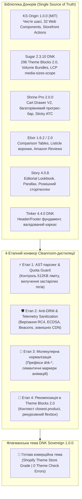
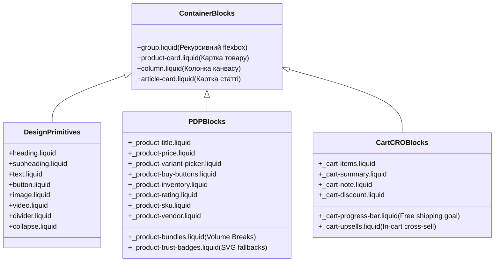
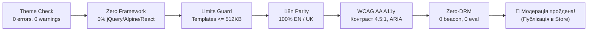

> [!metadata]- ⚙️ Системні метадані та інваріанти (MRH Header)
> ```yaml
> # --- DNK-MRH-HEADER ---
> mrh_id: "docs/projects/dnk_ecom/theme_dev_workflow/09_SHOPIFY_THEME_DISTILLATION_SYSTEM_AND_ELEMENTS_BLUEPRINT.md"
> purpose: "Master Engineering Blueprint: End-to-End Recursive Knowledge & Solutions Distillation System, Exhaustive Technical Description of ALL Theme Elements, and Construction Guide for World-Class Shopify Theme Store Submission ($350-$420 MSRP Grade)."
> canonical_source: true
> alters_files: []
> triggers_tasks: []
> status: "Active"
> version: "1.0.0"
> updated_at: "2026-11-12"
> author: "DNK-e.com Maksym & Antigravity (Chief Architect)"
> # --- END DNK-MRH-HEADER ---
> ```

# 🏛️ СИСТЕМА ДИСТИЛЯЦІЇ ЗНАНЬ ТА ПОВНИЙ ТЕХНІЧНИЙ ОПИС УСІХ ЕЛЕМЕНТІВ ТЕМИ
## Створення флагманської теми світового рівня для Shopify Theme Store (`$350–$420 MSRP`)

> **Призначення:** Цей документ є генеральним архітектурним стандартом DNK OS для покрокової побудови суверенної флагманської комерційної теми найвищого ґатунку (`DNK Sovereign 1.0.0 Apex`), яка гарантовано проходить офіційну модерацію та публікується у **Shopify Theme Store**.
> **Ключовий принцип:** Рекурсивна Cleanroom-дистиляція найкращих рішень із 6 донорів (`KS Origin 1.0.0`, `Sugar 2.3.10`, `Shrine Pro 2.0.0`, `Elixir 1.6.2/2.0`, `Story 4.0.8`, `Tinker 4.4.0`) у єдине чисте ядро на базі **100% Theme Blocks 2.0** та **нативних W3C Web Components**.

---

## 🧭 1. СИСТЕМА ДИСТИЛЯЦІЇ ЗНАНЬ ТА РІШЕНЬ (DISTILLATION PIPELINE)

Система дистиляції працює як замкнений самонавчальний конвеєр, що перетворює накопичені знання аудиту та деконструкції кодових баз донорів у стандартизовані будівельні блоки.



### Матриця «Органів» донорів (Donor Specialization Matrix):
1. **`KS Origin 1.0.0` (Каркас та JavaScript-рантайм):**
   - Надає чисте відкрите (MIT) шасі, 32 нативні Web Components без жодного стороннього фреймворку (0% Alpine.js, 0% jQuery), конвенцію іменування підблоків (`_*.liquid`), тег `` та готовність до AI-агентів через `@shopify/standard-events` та `window.Shopify.actions`.
2. **`Sugar 2.3.10` (Система блоків Theme Blocks 2.0 та CWV):**
   - Надає технологію `media-sizes-scope` (динамічний розрахунок атрибутів `sizes` для бездоганного LCP < 1.2s), GPU-прискорені анімації акордеонів `[data-dnk-animating]` без стрибків висоти (CLS = 0) та блок `quantity-bundle-block.liquid` (Volume Breaks 1x/2x/3x).
3. **`Shrine Pro 2.0.0` (Кошиковий рушій максимального AOV):**
   - Надає Cleanroom-реконструйований Cart Drawer V2: багаторівневий прогрес-бар (Безкоштовна доставка $\to$ Подарунок $\to$ Знижка VIP), внутрішньокошикові крос-сейли та плаваючий мобільний Sticky Add to Cart.
4. **`Elixir 2.0 / 1.6.2` (Конверсійні воронки та пре-ленди):**
   - Надає модульні блоки порівняльних таблиць `comparison-table.liquid` («Ми проти звичайних брендів») та лістіклів `listicle-item.liquid` для високої конверсії холодного трафіку з реклами.
5. **`Story 4.0.8` (Естетика та Lookbook):**
   - Надає журнальні інтерактивні секції (Lookbook Hotspots, Parallax Scroller, Split Screen).
6. **`Tinker 4.4.0 DNK` (Базова стабільність):**
   - Надає надійний, перевірений часом каркас навігації, мега-меню та валідовані базові пресети.

---

## 🗂️ 2. ВИЧЕРПНИЙ ТЕХНІЧНИЙ ОПИС ВСІХ ЕЛЕМЕНТІВ ТЕМИ

Тема світового рівня для Shopify Theme Store складається з 8 канонічних шарів:

```
themes/dnk-sovereign/
├── assets/                  # CSS токени, Web Components, SVG
├── blocks/                  # Theme Blocks 2.0 (Контейнери, Примітиви, PDP, Cart)
├── config/                  # settings_schema.json (12 категорій) + settings_data.json
├── layout/                  # theme.liquid, password.liquid, gift_card.liquid
├── locales/                 # en.default.json, uk.json (100% паритет)
├── sections/                # 25+ секцій та JSON-групи шапки/футера
├── snippets/                # Сніпети (SEO, іконки, ціни, розміри картинок)
└── templates/               # JSON-шаблони + templates/customers/*.json
```

---

### 2.1. Схема глобальних налаштувань (`config/settings_schema.json`)
Відповідно до вимог модерації Shopify Theme Store, `settings_schema.json` має містити рівно **12 обов'язкових категорій налаштувань** без надлишкових або конфліктних опцій:

```mermaid
mindmap
  root((settings_schema.json))
    1. Theme Information
      Назва, версія 1.0.0, DNK Ecom, посилання на документацію та сапорт
    2. Colors & Schemes
      Колірні схеми Scheme 1-5, background, surface, text, accent, gradient
    3. Typography
      Шрифти заголовків та тіла, font_modify bold/500, font-display swap, scale 80-150%
    4. Layout & Spacing
      Page width (1000-1600px), grid horizontal/vertical gaps, corner radius (0-32px)
    5. Buttons & CTAs
      Border radius, padding, elevation shadow, hover transform, uppercase switch
    6. Inputs & Forms
      Border width, input radius, focus outline accent, floating labels
    7. Product Cards
      Зображення, hover secondary image, swatches preview, quick add button, badges
    8. Cart Drawer & Floating Cart
      Drawer vs Page, free shipping goal, thresholds, upsells, cart notes, discount input
    9. Badges & Labels
      Sale badge, sold out badge, custom metafield badge, position, corner radius
    10. Social Media Links
      Facebook, Instagram, TikTok, YouTube, X, Pinterest, Threads, Telegram
    11. Favicon & Web App
      Favicon 32x32px PNG, Apple touch icon
    12. Brand Information
      Brand logo, brand statement, mission headline, fallback store avatar
```

#### Стандартизація колірних схем (`Color Schemes`):
У Shopify OS 2.0 налаштування кольорів групуються у повторювані колірні схеми (`color_schemes`), які присвоюються секціям:
```json
{
  "name": "t:settings_schema.colors.name",
  "settings": [
    {
      "type": "color_scheme_group",
      "id": "color_schemes",
      "definition": [
        {
          "type": "color",
          "id": "background",
          "label": "t:settings_schema.colors.settings.background.label",
          "default": "#FFFFFF"
        },
        {
          "type": "color",
          "id": "text",
          "label": "t:settings_schema.colors.settings.text.label",
          "default": "#121212"
        },
        {
          "type": "color",
          "id": "surface",
          "label": "t:settings_schema.colors.settings.surface.label",
          "default": "#F7F7F7"
        },
        {
          "type": "color",
          "id": "accent",
          "label": "t:settings_schema.colors.settings.accent.label",
          "default": "#0066CC"
        }
      ]
    }
  ]
}
```

---

### 2.2. Повний набір обов'язкових шаблонів (`templates/*.json`)

Shopify Theme Store вимагає наявності всіх стандартних JSON-шаблонів:

| Шаблон | Файл | Призначення та наповнення за замовчуванням |
| :--- | :--- | :--- |
| **Головна сторінка** | `templates/index.json` | `hero`, `featured-collection`, `custom-columns`, `rich-text`, `testimonials`, `newsletter`. |
| **Сторінка товару (PDP)** | `templates/product.json` | `main-product` (Theme Blocks 2.0), `product-recommendations`, `lookbook`. |
| **Сторінка колекції** | `templates/collection.json` | `main-collection` з фасетною фільтрацією, сортуванням та швидкою покупкою. |
| **Кошик** | `templates/cart.json` | `main-cart` для покупців, що обрали режим повносторінкового кошика. |
| **Пошук** | `templates/search.json` | `main-search` з предиктивною видачею товарів, статей та сторінок. |
| **Блог** | `templates/blog.json` | `main-blog` із сіткою карток статей `article-card`. |
| **Стаття блогу** | `templates/article.json` | `main-article` з хлібними крихтами, авторами, тегами та соціальним поширенням. |
| **Статична сторінка** | `templates/page.json` | `main-page` для політик, контактів та опису бренду. |
| **Помилка 404** | `templates/404.json` | `main-404` із кнопкою повернення та каруселлю популярних товарів. |
| **Пароль (Coming Soon)** | `templates/password.json` | `main-password` із формою підписки на запуск та входом за паролем. |
| **Подарункова картка** | `templates/gift_card.liquid` | Автономний рендер коду картки, балансу та QR-коду Apple Wallet. |
| **Особистий кабінет** | `templates/customers/*.json` | `account.json`, `activate_account.json`, `addresses.json`, `login.json`, `order.json`, `register.json`, `reset_password.json`. |

---

### 2.3. Бібліотека секцій (`sections/*.liquid` та секційні групи)

1. **Секційні групи шапки та підвалу:**
   - `sections/header-group.json`: містить оголошення (`announcement-bar.liquid`) та головну шапку (`header.liquid`).
   - `sections/footer-group.json`: містить підвал (`footer.liquid`) та плаваючий віджет підтримки.
2. **Головні функціональні секції вітрини:**
   - `main-product.liquid`: модульна секція сторінки товару, що містить `` для необмеженої кастомізації блоків Buy Box.
   - `main-collection.liquid`: сітка товарів з підтримкою нескінченного скролу / пагінації та фасетної AJAX-фільтрації.
   - `main-cart.liquid`: повносторінковий кошик із таблицею товарів та примітками.
   - `featured-product.liquid`: виведення одного промо-товару на головній із власним набором блоків.
   - `custom-columns.liquid` (дистильована з Sugar 2.3.10): універсальний 12-колонковий канвас із підтримкою будь-яких блоків теми.
   - `image-banner.liquid` / `hero.liquid`: промо-банери з адаптивними зображеннями, текстом та кнопками.
   - `rich-text.liquid`: текстові блоки з типографічною ієрархією.
   - `slideshow.liquid`: доступний скрол-снап слайдер (без зовнішніх бібліотек).
   - `faq.liquid`: акордеони частих питань на базі блоків `collapse.liquid`.
   - `newsletter.liquid`: форма збору контактів з валідацією пошти.
   - `contact-form.liquid`: зворотний зв'язок з захистом від спаму.

---

### 2.4. Революційна бібліотека Theme Blocks 2.0 (`blocks/*.liquid`)

Усі блоки розділені на 4 архітектурні класи:



#### Інженерний зразок блоку `group.liquid` (Рекурсивний Flexbox):
```liquid
<div
  class="dnk-group block-spacing"
  style="
    --direction-mobile: {{ block.settings.direction_mobile }};
    --direction-desktop: {{ block.settings.direction_desktop }};
    --gap-mobile: {{ block.settings.gap_mobile | divided_by: 16.0 | append: 'rem' }};
    --gap-desktop: {{ block.settings.gap_desktop | divided_by: 16.0 | append: 'rem' }};
    --pt: {{ block.settings.pt | divided_by: 16.0 | append: 'em' }};
    --pb: {{ block.settings.pb | divided_by: 16.0 | append: 'em' }};
  "
  {{ block.shopify_attributes }}
>
  
</div>


{
  "name": "t:blocks.group.name",
  "tag": null,
  "settings": [
    { "type": "select", "id": "direction_mobile", "label": "t:blocks.group.direction_mobile", "options": [{ "value": "column", "label": "Column" }, { "value": "row", "label": "Row" }], "default": "column" },
    { "type": "select", "id": "direction_desktop", "label": "t:blocks.group.direction_desktop", "options": [{ "value": "column", "label": "Column" }, { "value": "row", "label": "Row" }], "default": "row" },
    { "type": "range", "id": "gap_mobile", "min": 0, "max": 40, "step": 2, "unit": "px", "label": "t:blocks.group.gap_mobile", "default": 12 },
    { "type": "range", "id": "gap_desktop", "min": 0, "max": 60, "step": 2, "unit": "px", "label": "t:blocks.group.gap_desktop", "default": 24 },
    { "type": "range", "id": "pt", "min": 0, "max": 80, "step": 2, "unit": "px", "label": "t:blocks.group.pt", "default": 0 },
    { "type": "range", "id": "pb", "min": 0, "max": 80, "step": 2, "unit": "px", "label": "t:blocks.group.pb", "default": 0 }
  ],
  "blocks": [
    { "type": "@theme" },
    { "type": "@app" }
  ],
  "presets": [
    { "name": "t:blocks.group.name", "category": "Layout" }
  ]
}

```

---

### 2.5. Нативний JavaScript-шар: 32+ W3C Web Components

Ніякого спагеті-коду у глобальній області видимості (`window.*`). Усі взаємодії інкапсульовані у нативні Custom Elements з префіксом `dnk-`:

| Web Component | Файл | Обов'язок у системі | Життєвий цикл |
| :--- | :--- | :--- | :--- |
| `<dnk-cart-drawer>` | `assets/dnk-cart.js` | Керування виїзним кошиком, блокування скролу фону, взаємодія з Section Rendering API | `connectedCallback()`, `disconnectedCallback()` (очищення слухачів Escape) |
| `<dnk-free-shipping>` | `assets/dnk-cart.js` | Реактивний розрахунок суми до безкоштовної доставки, динамічне заповнення прогрес-бару | Підписка на подію `cart:updated` |
| `<dnk-variant-picker>` | `assets/dnk-pdp.js` | Перемикання комбінацій опцій (swatches/radios), оновлення ціни, статусу наявності та URL | `replaceState(?variant=...)` |
| `<dnk-volume-bundles>` | `assets/dnk-pdp.js` | Вибір пачок (1x, 2x -15%, 3x -25%), динамічна передача `quantity` у форму | Синхронізація з `<dnk-product-form>` |
| `<dnk-sticky-atc>` | `assets/dnk-pdp.js` | Плаваючий мобільний Buy Box при скролі за межі основного блоку покупки | `IntersectionObserver` на батьківський `form` |
| `<dnk-dialog>` | `assets/dnk-core.js` | Нативний HTML5 `<dialog>` з фокус-пасткою (W3C A11y) та апаратним закриттям | `showModal()`, `close()` |
| `<dnk-collapse>` | `assets/dnk-core.js` | Акордеони FAQ з плавною CSS Grid анімацією (`grid-template-rows: 0fr -> 1fr`) | Атрибут `open` + `aria-expanded` |
| `<dnk-carousel>` | `assets/dnk-core.js` | Каруселі на базі CSS Scroll Snap (0 KB бібліотек) | Скрол-снап з індикаторами точок |
| `<s-view-event>` | `assets/storefront-events.js` | Офіційний компонент стандарту Shopify Storefront Events для AI-агентів | `@shopify/standard-events` |

---

### 2.6. Дизайн-токени, типографіка та Core Web Vitals (`assets/dnk-tokens.css`)

1. **Fluid Typography (CSS `clamp()`):**
   Шрифти плавно масштабуються між мобільним (`375px`) та десктопним (`1440px`) в'юпортом без дискретних стрибків:
   ```css
   --font-heading-h1: clamp(2rem, 1.5rem + 2.5vw, 3.5rem);
   --font-heading-h2: clamp(1.6rem, 1.2rem + 1.8vw, 2.5rem);
   --font-body-base: clamp(0.95rem, 0.9rem + 0.25vw, 1.05rem);
   ```
2. **Семантичні колірні токени (RGB канали):**
   ```css
   :root {
     --color-background: 255 255 255;
     --color-surface: 247 247 247;
     --color-text: 18 18 18;
     --color-accent: 0 102 204;
     --color-border: 228 228 228;
   }
   ```
3. **Core Web Vitals Invariants:**
   - **LCP < 1.2s:** Перше головне зображення товару отримує `loading="eager"` та `fetchpriority="high"`, розміри генеруються через сніпет `media-sizes-scope.liquid`.
   - **CLS = 0.00:** Усі зображення та відео мають фіксований `aspect-ratio` у Liquid; відсутні динамічні банери, що зсувають контент.
   - **INP < 100ms:** Відсутні важкі скрипти, відправка форм дебаунситься, відсутні блокуючі синхронні цикли.

---

## 🛡️ 3. СУВОРІ СТАНДАРТИ МОДЕРАЦІЇ SHOPIFY THEME STORE (ACCEPTANCE GATES)

Для успішного проходження модерації тема зобов'язана виконувати 7 непорушних інженерних воріт:



1. **Gate 1: `shopify theme check` (Pass 0 Errors):**
   - Усі 150+ файлів перевіряються через офіційний CLI. Жодного пропущеного translation key, жодної битої схеми чи неіснуючого сніпета.
2. **Gate 2: Zero External Frameworks:**
   - Повна відсутність сторонніх JS-рантаймів. Усі скрипти завантажуються виключно з локального каталогу `assets/` через `type="module"`.
3. **Gate 3: Quota Guard ($\le 512\text{ KB}$):**
   - Жоден файл шаблону `templates/*.json` не перевищує 512 KB (жорстке обмеження Shopify API).
4. **Gate 4: 100% Локалізація (i18n Parity):**
   - Кожен людиночитаний рядок у Liquid обгорнутий у фільтр `| t`.
   - Файли `locales/en.default.json` та `locales/uk.json` мають 100% однаковий набір ключів.
5. **Gate 5: WCAG 2.1 Level AA Accessibility:**
   - Кольоровий контраст тексту до фону не менше $4.5:1$.
   - Наявність `skip-to-content` посилання першим елементом у `<body>`.
   - Всі інтерактивні елементи доступні з клавіатури (`Tab`, `Enter`, `Space`, `Escape`).
   - Модальні вікна утримують фокус всередині (`inert` на зовнішній документ).
6. **Gate 6: Zero-DRM & Zero Telemetry:**
   - Повна відсутність перевірок домену, пінгів на сторонні сервери, ліцензійних ключів чи обфускованих функцій.
7. **Gate 7: Пресети для демонстрації (3 комерційні демо):**
   - `config/settings_data.json` містить щонайменше 3 готові пресети стилів:
     1. **`Apex D2C`** (Сучасний технологічний бренд).
     2. **`Luxury Editorial`** (Преміальна мода, ювелірні вироби).
     3. **`High-Volume Direct`** (Швидкі споживчі товари з високим чеком).

---

## 🚀 4. ПОКРОКОВИЙ АЛГОРИТМ ЗБІРКИ ТА ПАКУВАННЯ ТЕМИ

Складання теми виконується за чітким 5-фазним регламентом:

### Фаза 1: Каркас ядра, налаштування та локалі
1. Створення канонічної схеми налаштувань `config/settings_schema.json` (12 категорій).
2. Створення пресетів оформлення `config/settings_data.json` (Apex D2C, Luxury, High-Volume).
3. Повна синхронізація локалей `locales/en.default.json` та `locales/uk.json` із підтримкою всіх ключів адмінки та вітрини.

### Фаза 2: Секції та шаблони вітрини
4. Створення секційних груп `sections/header-group.json` та `sections/footer-group.json`.
5. Створення 12 обов'язкових JSON-шаблонів у `templates/*.json` та клієнтських шаблонів у `templates/customers/*.json`.
6. Реалізація головної секції `main-product.liquid` із слотом `` для Theme Blocks 2.0.

### Фаза 3: Атомарна бібліотека блоків (Theme Blocks 2.0)
7. Інтеграція універсального контейнера `group.liquid` (рекурсивний flexbox).
8. Впровадження підблоків PDP (`_product-title`, `_product-price`, `_product-variant-picker`, `_product-buy-buttons`, `_product-trust-badges`).
9. Впровадження комерційних модулів AOV (`_product-bundles` з Sugar 2.3.10 та `_cart-progress-bar` з Shrine Pro 2.0).

### Фаза 4: Web Components та активи
10. Підключення ES-модулів `dnk-core.js`, `dnk-cart.js`, `dnk-pdp.js` із реєстрацією W3C Custom Elements.
11. Інтеграція `@shopify/standard-events` та хуків `window.Shopify.actions`.
12. Стилізація через `dnk-tokens.css` та `dnk-base.css`.

### Фаза 5: Автоматизована валідація та випуск релізу
13. Запуск лінтера: `shopify theme check --path themes/dnk-sovereign` (критерій: 0 errors).
14. Пакування релізного архіву `DNK_Sovereign_1.0.0_Apex_Theme_Store_Ready.zip` для імпорту в Shopify Partner Dashboard.

