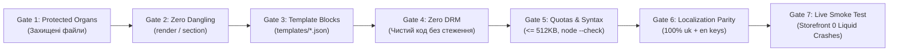
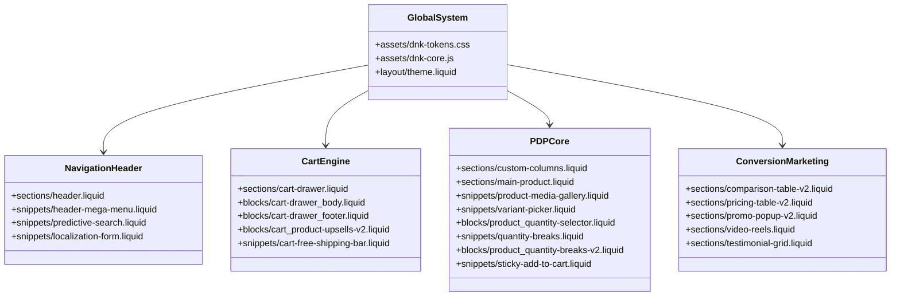
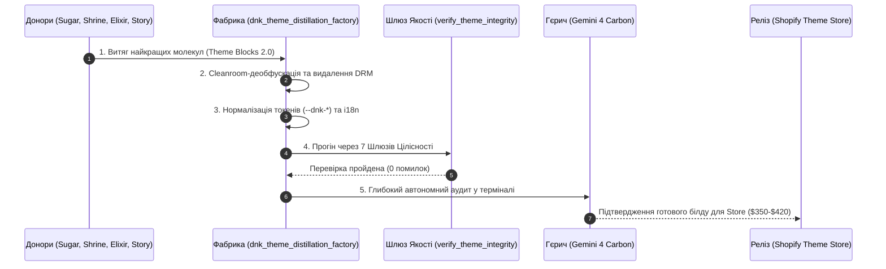

> [!metadata]- ⚙️ Системні метадані та інваріанти (MRH Header)
> ```yaml
> # --- DNK-MRH-HEADER ---
> mrh_id: "docs/projects/dnk_ecom/theme_dev_workflow/09_STEP_BY_STEP_COMMERCIAL_THEME_DISTILLATION_SYSTEM.md"
> purpose: "Complete Technical Blueprint & Step-by-Step Production Pipeline for Building a World-Class Commercial Shopify Theme ($350-$420 MSRP)."
> canonical_source: true
> alters_files: []
> triggers_tasks: []
> status: "Active"
> version: "2.0.0"
> updated_at: "2026-11-18"
> author: "DNK-e.com Maksym & Antigravity"
> # --- END DNK-MRH-HEADER ---
> ```

# 🏆 СИСТЕМА ДИСТИЛЯЦІЇ ЗНАНЬ ТА ПОКРОКОВОГО СТВОРЕННЯ ВЛАСНОЇ ТЕМИ
## DNK Sovereign Theme — Apex Commercial D2C Standard ($350–$420 MSRP)

> **Призначення системи:** Надати вичерпний інженерний посібник, каталог усіх технічних елементів теми та непорушний автоматизований конвеєр перевірки для створення комерційної теми найвищого світового рівня для **Shopify Theme Store**.
> **Головне правило розробки:** Жоден агент або розробник не має права видаляти, спрощувати або підміняти функціональні компоненти теми без проходження автоматизованого шлюзу цілісності.

---

## 🛡️ 1. ЗАЛІЗОБЕТОННИЙ ЗАХИСТ ВІД РЕГРЕСІЙ ТА ПОМИЛОК АГЕНТІВ

Щоб виключити людські та агентські помилки (як-от передчасне видалення `quantity-breaks.liquid`), створено та впроваджено обов'язковий автоматичний валідатор:
**[`tools/verify_theme_integrity.py`](../DNKEcom/Audit_Shopify_Themes_Sell_WF/_Shopify_Theme_DEV_Workflow/tools/verify_theme_integrity.py)**.

### 7 Обов'язкових Інженерних Шлюзів (All Gates Must PASS):



1. **Gate 1: Список Захищених Органів (Protected Organs Whitelist — POW)**:
   - Файли, які **КАТЕГОРИЧНО ЗАБОРОНЕНО** видаляти з теми:
     * `snippets/quantity-breaks.liquid` (Inline Quantity Breaks).
     * `snippets/qb-v2-migration.liquid` (Theme Editor Migration Guide).
     * `blocks/product_quantity-selector.liquid` (Quantity Selector з підтримкою знижок).
     * `blocks/product_quantity-breaks-v2.liquid` + усі дочірні блоки `blocks/_quantity-breaks-v2_*.liquid`.
     * `sections/cart-drawer.liquid`, `blocks/cart-drawer_body.liquid`, `blocks/cart-drawer_footer.liquid`.
     * `layout/theme.liquid`, `config/settings_schema.json`.
     * `locales/uk.json`, `locales/uk.schema.json`, `locales/en.default.json`, `locales/en.default.schema.json`.
   - Якщо будь-який із цих файлів відсутній, збірка та коміт миттєво аварійно зупиняються (`Exit Code 1`).
2. **Gate 2: Відсутність підвішених викликів (Zero MissingTemplate)**:
   - Сканує кожен Liquid-файл на наявність `` та ``.
   - Кожен виклик зобов'язаний фізично існувати в папці `snippets/` або `sections/`.
3. **Gate 3: Цілісність шаблонів JSON (Zero MissingBlock)**:
   - Перевіряє кожен блок і секцію у всіх `templates/*.json`. Блок має або бути присутнім у `blocks/{type}.liquid`, або бути оголошеним у схемі секції.
4. **Gate 4: Cleanroom Zero-DRM & Безпека**:
   - Повна відсутність зовнішніх ліцензійних серверів (`shrine.co/api`, `verify-license`), killswitch-скриптів (`document.body.innerHTML = ""`) та обфускованих eval-ін'єкцій.
5. **Gate 5: Ліміти платформи Shopify (Quotas & Syntax)**:
   - Жоден файл шаблону не перевищує 512,000 байт.
   - Усі JavaScript-активи проходять валідацію синтаксису через `node --check`.
6. **Gate 6: 100% паритет локалізації**:
   - `uk.schema.json` має 100% збіг ключів з `en.default.schema.json`.
7. **Gate 7: Live Storefront Smoke Test**:
   - Автоматичний запит до прев'ю-магазину. Перевіряє, що відрендерений HTML не містить рядків `Liquid error:` або `LiquidHTMLSyntaxError`.

---

## 🏛️ 2. ТЕХНІЧНИЙ КАТАЛОГ ВСІХ ЕЛЕМЕНТІВ ВЛАСНОЇ ТЕМИ

Тема будується на основі **18 ключових функціональних органів**, дистильованих із найкращих рішень світових лідерів (Sugar, Shrine, Elixir, Story, Tinker):



### 2.1. Глобальний Фундамент та Дизайн-Токени
* **`assets/dnk-tokens.css`**: Єдиний центр змінних оформлення.
  - Плинна типографіка через `clamp()` (`--dnk-text-xs` .. `--dnk-text-display`) — нульовий CLS (Cumulative Layout Shift) на мобільних пристроях.
  - Колірні токени: `--dnk-bg-canvas`, `--dnk-bg-surface`, `--dnk-text-main`, `--dnk-color-brand-accent`.
  - Геометрія: радіуси заокруглення (`--dnk-radius-sm/md/lg/pill`), адаптивні відступи сітки (`--dnk-gutter`, `--dnk-grid-gap`).
* **`assets/dnk-core.js`**: Легковаговий реактивний рушій на чистих W3C Web Components без сторонніх фреймворків (Zero jQuery/React/Alpine).
  - Глобальне управління станом кошика через W3C Custom Events (`dnk:cart:updated`).
  - Миттєве блокування скролу сторінки при відкритих модальних вікнах (`dnk-scroll-locked`).

### 2.2. Навігація та Пошуковий Рушій (Header Matrix)
* **`sections/header.liquid`**:
  - Адаптивний хедер з трьома режимами скролу: статичний, прилипаючий (`sticky`) та розумний показ при скролі вгору (`reveal-on-scroll-up`).
  - Вбудоване багаторівневе Мега-Меню (`snippets/header-mega-menu.liquid`) з підтримкою промо-карток товарів і банерів прямо всередині випадного списку.
  - Живий предиктивний пошук (`predictive-search.liquid`) з кешуванням запитів та миттєвим рендерингом товарів, колекцій і статей без перезавантаження.
  - Двовалютний та мовний перемикач на нативному Shopify Localization API (`snippets/localization-form.liquid`).

### 2.3. Висококонверсійний Кошик (High-CRO Cart Drawer 2.0)
* **`sections/cart-drawer.liquid`** + блокова архітектура:
  - **Динамічний прогрес-бар безкоштовної доставки / подарунка** (`snippets/cart-free-shipping-bar.liquid`): розраховує залишок до безкоштовної доставки або безкоштовного бонусу в реальному часі.
  - **Блоки апселів та крос-селів всередині кошика** (`blocks/cart_product-upsells-v2.liquid`): карусель супутніх товарів з можливістю додавання в 1 клік.
  - **Поле для нотаток до замовлення та поле введення промокоду** прямо в дровері.
  - **Чекбокс згоди з правилами (`Terms and Conditions`)**.
  - **Прилипаюча кнопка оформлення (`Sticky Checkout`)** на мобільних екранах для запобігання втраті конверсії.

### 2.4. Сторінка Товару (PDP Core) та Дворівневі Оптові Знижки
* **12-колонний універсальний канвас (`sections/custom-columns.liquid` + `blocks/column.liquid`)**:
  - Дозволяє будувати будь-які складні маркетингові макети на базі Theme Blocks 2.0 без редагування Liquid-коду.
* **Нативна галерея медіа (Zero-JS Swiper)**:
  - Побудована на нативному CSS Scroll Snap (`scroll-snap-type: x mandatory`).
  - Повна підтримка 3D-моделей (`model-viewer`), відео YouTube/Vimeo та прямих MP4-файлів.
  - Миттєва синхронізація фотографії з обраним кольором/варіантом.
* **Дворівнева Архітектура Оптових Знижок (Dual Quantity Breaks Engine)**:
  - **Рівень 1 (Inline Quantity Breaks)**: Вбудований у блок `# Quantity selector` через тумблер `Enable Quantity Discounts` та сніпет `snippets/quantity-breaks.liquid`. Стилі `Compact` / `Classic`, налаштування заголовка (`BUNDLE & SAVE`), заокруглення та кольорів. Підходить для мінімалістичних магазинів.
  - **Рівень 2 (Advanced Modular V2)**: Блок `blocks/product_quantity-breaks-v2.liquid` з дочірніми блоками для подарунків (`unlock-gift`), тригерів терміновості (`nudge`), таймерів (`schedule`) та сніпетом-гідом міграції для мерчанта (`snippets/qb-v2-migration.liquid`).
* **Sticky Add to Cart Bar (`snippets/sticky-add-to-cart.liquid`)**:
  - Відстежує видимість основної кнопки покупки через `IntersectionObserver`. Забезпечує миттєвий доступ до покупки при скролі сторінки товару.

### 2.5. Маркетингові та Конверсійні Секції
* **Порівняльна таблиця «Ми проти Конкурентів» (`sections/comparison-table-v2.liquid`)**:
  - Візуальне підсвічування брендового стовпчика, іконки галочок/хрестиків, адаптивна версія для мобільних екранів.
* **Інтерактивні Відео-Рілси (`sections/video-reels.liquid`)**:
  - Вертикальні картки коротких відео з автопрограванням та прив'язкою товару для покупки в 1 клік.
* **Таблиці цін та тарифів (`sections/pricing-table-v2.liquid`)**:
  - Перемикач періодів (місяць / рік) з автоматичним розрахунком знижки.
* **Стіна відгуків та фото-доказів (`sections/testimonial-grid.liquid`)**:
  - Сітка відгуків реальних покупців з бейджами підтвердженої покупки (`Verified Buyer`).
* **Конверсійний попап знижок V2 (`sections/promo-popup-v2.liquid`)**:
  - Спрацьовування на намір виходу (`exit-intent`) або таймер затримки, кнопка копіювання купона в буфер обміну.

---

## 🚀 3. ПОКРОКОВИЙ 5-ЕТАПНИЙ ПАЙПЛАЙН ЗБІРКИ ТЕМИ



### Етап 1: Витяг та індексація молекул (Molecular Extraction)
Кожен донор у нашому дзеркалі [`DNK-Ecom_git_mirrow`](../DNKEcom/DNK-Ecom_git_mirrow) надає найкращі в індустрії компоненти:
- **Sugar Theme**: 12-колонний універсальний канвас (`custom-columns`), медіа-рушій (`media-sizes-scope`).
- **Shrine Pro (Cleanroom)**: Cart Drawer CRO Engine, Дворівневий Quantity Breaks, Sticky ATC.
- **Elixir Theme**: Порівняльні таблиці V2, динамічні бандли.
- **Story Theme**: Сторітелінг-макети, предиктивний пошук.
- **Tinker**: Базовий чистий скелет і стандарти доступності.

### Етап 2: Cleanroom-деобфускація та нейтралізація обмежень
- Використання нашого Node VM деобфускатора: розкриття всіх `_0x...` масивів, заміна на прямий ванільний ES6+.
- Повне видалення сторонніх ліцензійних скриптів та прив'язок до зовнішніх серверів.
- Забезпечення автономної роботи 100% коду теми на інфраструктурі Shopify CDN.

### Етап 3: Нормалізація в єдиний стандарт дизайн-токенів
- Заміна розрізнених префіксів (`--shrine-*`, `--sugar-*`, `--color-*`) на єдиний стандарт `--dnk-*`.
- Переведення всіх секцій на стандарт **Theme Blocks 2.0**: використання `` для необмеженої гнучкості мерчанта.

### Етап 4: 100% Двомовна Локалізація (i18n)
- Синтез `locales/en.default.json` та `locales/en.default.schema.json` як базової мови для англомовного ринку.
- Повний паралельний синтез `locales/uk.json` та `locales/uk.schema.json` (100% переклад усіх 1,069 налаштувань теми для українських мерчантів).
- Жодного захардкодженого тексту в розмітці Liquid — усі написи виводяться через `{{ 'section.key' | t }}`.

### Етап 5: Автоматизований Шлюз Цілісності та Автономний Аудит Гєрича
Перед будь-якою публікацією або формуванням релізного ZIP-архіву запускається команда:
```bash
python3 tools/verify_theme_integrity.py /path/to/theme --store your-store.myshopify.com --theme-id 123456789
```
Тільки при поверненні `Exit Code 0` та підтвердженні від **Гєрича (`gemini-4-carbon`)** релізний архів переміщується в каталог дистрибуції.

---

## 👥 4. РОЗПОДІЛ РОЛЕЙ У РОЗРОБЦІ ВЛАСНОЇ ТЕМИ

1. **Antigravity (Chief Mentor & Architect)**:
   - Відповідає за архітектурні інваріанти, специфікації, структуру блоків і фінальний арбітраж рішень.
   - Затверджує списки захищених компонентів та дизайн-систему.
2. **Гєрич (Gemini 4 Carbon в Терміналі)**:
   - Працює автономно в терміналі через `gerych-root`.
   - Проводить глибокий форензик-аудит вихідного коду, розрахунок контрольних сум (SHA-256), порівняння AST Liquid-файлів, перевірку наявності прихованих багів і верифікацію повноти перекладу.
3. **Денчік (Autonomous Sovereign Builder)**:
   - Фізично синтезує та очищує файли, проводить деобфускацію, запускає `cleanroom_shrine_2_0_0.py`, збирає архів і пушить код на тестові магазини через Shopify CLI.
