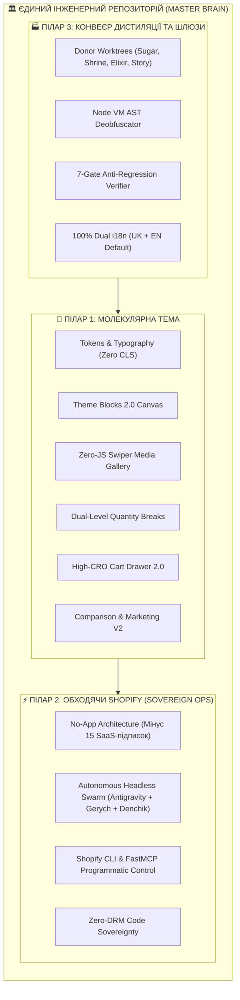
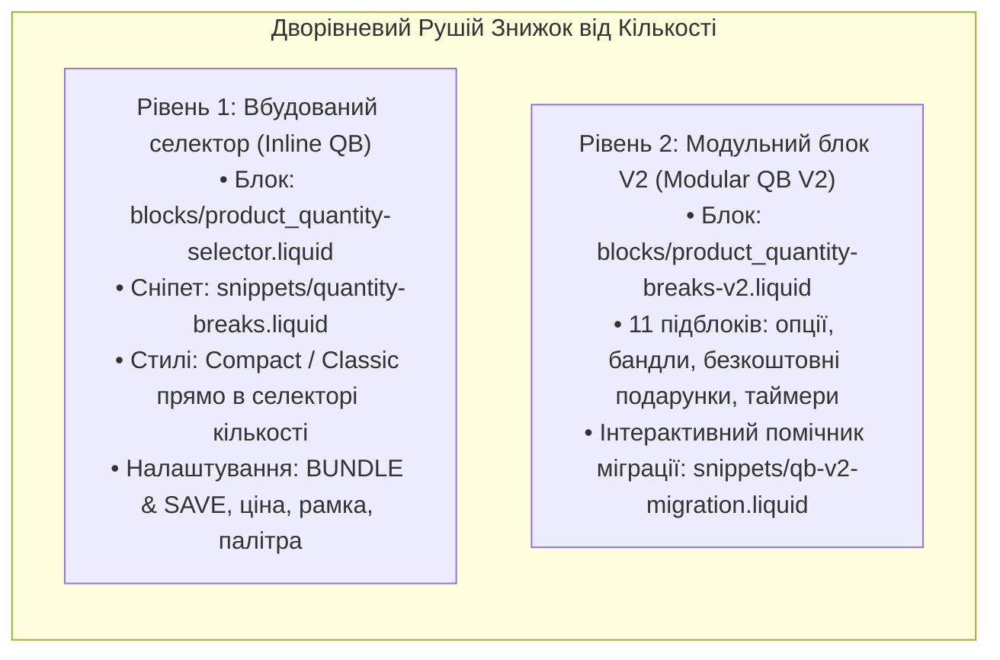
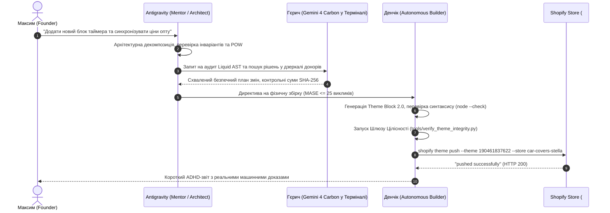

> [!metadata]- ⚙️ Системні метадані та інваріанти (MRH Header)
> ```yaml
> # --- DNK-MRH-HEADER ---
> mrh_id: "docs/projects/dnk_ecom/theme_dev_workflow/10_DNK_ECOM_THEME_AND_AGENTIC_OPERATING_SYSTEM_MASTER_BRAIN.md"
> purpose: "Unified Master Brain: Molecular Theme Architecture, Autonomous Agentic Store Operations (Bypassing Shopify), and Engineering Knowledge Core for DNK Ecom."
> canonical_source: true
> alters_files: []
> triggers_tasks: []
> status: "Active"
> version: "2.0.0"
> updated_at: "2026-11-18"
> author: "DNK-e.com Maksym & Antigravity"
> # --- END DNK-MRH-HEADER ---
> ```

# 🧠 DNK ECOM MASTER BRAIN: МОЛЕКУЛЯРНА АРХІТЕКТУРА ТЕМИ ТА АВТОНОМНА АГЕНТИВНА ЕКОСИСТЕМА (ОБХОДЯЧИ SHOPIFY)

> **Фундаментальна Місія:** Створити єдиний непорушний інженерний репозиторій-мозок, який об'єднує:
> 1. **Молекулярну архітектуру комерційної теми світового рівня ($350–$420 MSRP)** на базі чистих W3C Web Components та Theme Blocks 2.0.
> 2. **Екосистему автономного ведення e-commerce «Обходячи Shopify»**: ліквідацію залежності від 15+ сторонніх SaaS-застосунків (App Store Tax) та повну заміну ручної рутини в Shopify Admin на автономний ройовий конвеєр агентів (Antigravity, Gerych, Denchik).

---



---

## 🔬 ЧАСТИНА 1. МОЛЕКУЛЯРНИЙ РОЗБІР АРХІТЕКТУРИ ТЕМИ (MOLECULAR DECOMPOSITION)

Кожен компонент комерційної теми декомпозовано на атомарні інженерні примітиви. Жодних монолітів — кожен елемент є ізольованим блоком Theme Blocks 2.0 або автономним W3C Custom Element:

### 1.1. Рівень Дизайн-Токенів та Нульового Зсуву Макета (`assets/dnk-tokens.css`)
* **Плинна типографіка через `clamp()`**:
  ```css
  --dnk-text-xs: clamp(0.75rem, 0.7rem + 0.2vw, 0.8125rem);
  --dnk-text-base: clamp(0.9375rem, 0.88rem + 0.3vw, 1rem);
  --dnk-text-2xl: clamp(1.75rem, 1.5rem + 1.25vw, 2.25rem);
  --dnk-text-display: clamp(2.25rem, 1.8rem + 2.25vw, 3.5rem);
  ```
  *Інженерна перевага:* Рендериться ідеально на iPhone SE (320px) і на 4K дисплеях без медіа-запитів `max-width`, гарантуючи **Cumulative Layout Shift (CLS) = 0.00**.
* **Семантична палітра поверхонь**:
  - `--dnk-bg-canvas` (фоновий шар вітрини)
  - `--dnk-bg-surface` (шар карток, випадних меню та дроверів)
  - `--dnk-border-subtle` (розділювачі з контрастністю WCAG AAA)
  - `--dnk-color-brand-accent` (динамічний акцент бренду)
* **Апаратне GPU-прискорення анімацій**:
  - `--dnk-ease: cubic-bezier(0.16, 1, 0.3, 1)` (фірмова крива Apple/Shopify Fluid).

---

### 1.2. 12-Колонний Універсальний Канвас (`custom-columns.liquid` з Sugar Theme)
* Замість жорстких секцій («Текст з іконкою», «Банер з кнопкою») створюється єдина універсальна секція-контейнер:
  ```liquid
  
  {
    "name": "Custom Columns (12-Col Canvas)",
    "blocks": [{ "type": "@app" }, { "type": "column" }],
    "presets": [{ "name": "Custom Columns" }]
  }
  
  ```
* Кожна колонка `blocks/column.liquid` підтримує ширину від 1 до 12 як для десктопу, так і для мобільних пристроїв, і приймає **будь-які вкладені блоки Theme Blocks 2.0**: зображення, кнопки, форми, таймери, товарні бандли.
* **Результат для мерчанта:** Можливість зібрати будь-який лендінг світового рівня без написання єдиного рядка Liquid-коду.

---

### 1.3. Нативна Галерея Медіа (Zero-JS Swiper)
* **Проблема стандартних тем:** Підключення Swiper.js або Slick Slider додає ~80–120 KB JS, викликає блокування головного потоку (`Long Tasks > 50ms`) та погіршує показник INP.
* **Молекулярне рішення DNK:**
  - Нативний CSS Scroll-Snap:
    ```css
    .dnk-gallery__slider {
      display: flex;
      overflow-x: auto;
      scroll-snap-type: x mandatory;
      scrollbar-width: none;
    }
    .dnk-gallery__slide {
      flex: 0 0 100%;
      scroll-snap-align: start;
    }
    ```
  - Перехід між кольорами варіантів здійснюється простим викликом `element.scrollTo({ left: targetOffset, behavior: 'smooth' })`.
  - Підтримка 3D-моделей (`<model-viewer>`) та вбудованих MP4/YouTube/Vimeo через фасадні постери без завантаження важких плеєрів до першого кліку.

---

### 1.4. Дворівнева Архітектура Оптових Знижок (Dual-Level Quantity Breaks Engine)
Ексклюзивне рішення, що об'єднує гнучкість для швидкого старту та глибину для складних воронок:



1. **Рівень 1 (Inline Quantity Breaks)**:
   - Розташований безпосередньо у стандартному блоці `# Quantity selector`.
   - Вмикається простим тумблером `Enable Quantity Discounts`.
   - Рендерить картки оптових знижок («Купи 1», «Купи 2 — заощаджуй 15%», «Купи 3 — заощаджуй 25%») прямо всередині поля кількості без додавання нових блоків у дерево секції.
2. **Рівень 2 (Advanced Modular V2)**:
   - Окремий розширений Theme Block `product_quantity-breaks-v2`.
   - Включає підтримку дочірніх підблоків: розблокування подарунків (`_quantity-breaks-v2_unlock-gift`), чекбокс-апселів (`_quantity-breaks-v2_upsell`), плашок терміновості (`_quantity-breaks-v2_nudge`) та розкладу акцій (`_quantity-breaks-v2_schedule`).
   - Містить сніпет `snippets/qb-v2-migration.liquid`, який у режимі редактора (`request.design_mode == true`) показує мерчанту карту відповідності налаштувань.

---

### 1.5. Висококонверсійний Кошик (High-CRO Cart Drawer 2.0)
* **Архітектура:** Розділена на незалежні блоки:
  - `blocks/cart-drawer_body.liquid` (список товарів, зміна кількості, видалення).
  - `blocks/cart-drawer_footer.liquid` (підсумок, розбивка податків, примітки до замовлення).
  - `blocks/cart_product-upsells-v2.liquid` (карусель розумних апселів).
* **Вбудовані функції підвищення чека (AOV Boosters)**:
  - *Динамічний багаторівневий прогрес-бар:* «Додайте ще $15 до Безкоштовної Доставки» $\to$ «Додайте ще $30, щоб отримати Подарунок».
  - *Terms & Conditions Gate:* блокує кнопку Checkout доти, доки покупець не встановить обов'язкову позначку згоди.
  - *Sticky Checkout Button:* на мобільних пристроях кнопка переходу до оплати завжди зафіксована внизу екрана.

---

### 1.6. Маркетингові та Конверсійні Модулі
* **Порівняльна таблиця «Ми проти Конкурентів» V2 (`sections/comparison-table-v2.liquid`)**:
  - Візуально підсвічена колонка бренду з плашкою «Наш вибір».
  - Повна доступність: розмітка на семантичному `role="table"` та адаптивний мобільний режим «Картка проти Картки».
* **Відео-Рілси (`sections/video-reels.liquid`)**:
  - Вертикальний формат 9:16 з апаратним автопрограванням відео без звуку.
  - Картка товару, закріплена поверх відео, з кнопкою «Купити в 1 клік».
* **Таблиці Тарифів (`sections/pricing-table-v2.liquid`)**:
  - Перемикач Щомісячно / Щороку з динамічним бейджем знижки (наприклад, «Економія 20%»).
* **Попап Знижок V2 (`sections/promo-popup-v2.liquid`)**:
  - Логіка тригера: намір виходу курсора за межі вікна (`exit-intent`) на десктопі або відсоток проскроленої сторінки на мобільних.
  - Автоматичне копіювання промокоду в буфер обміну з візуальним підтвердженням («Скопійовано!»).

---

## ⚡ ЧАСТИНА 2. ЕКОСИСТЕМА АВТОНОМНОГО ВЕДЕННЯ «ОБХОДЯЧИ SHOPIFY» (SOVEREIGN OPS)

Поняття **«Обходячи Shopify»** в архітектурі DNK OS означає два фундаментальні прориви:
1. **Ліквідація податку на додатки (Zero App Store Tax)**: 100% заміна платних сторонніх SaaS-застосунків нативними можливостями теми.
2. **Ліквідація ручної рутини в Shopify Admin UI**: повне керування темою, товарами, цінами та контентом через локальних автономних агентів.

### 2.1. Ліквідація Податку на Додатки (15 Нативних Замін)

| Категорія Стороннього Застосунку | Середня Ціна SaaS | Вплив на Швидкість | Рішення в DNK Sovereign Theme |
| :--- | :--- | :--- | :--- |
| **Quantity Breaks / Volume Discounts** | \$20–\$50 / міс | +180 KB JS, блокування DOM | **Нативний Дворівневий QB Engine** (0 байт стороннього коду) |
| **Free Shipping Bar** | \$10–\$20 / міс | +45 KB JS, рендер-затримка | **Нативний Cart Drawer Progress Bar** |
| **In-Cart Upsells / Cross-sells** | \$30–\$80 / міс | +220 KB JS, сторонні трекери | **Нативний блок `cart_product-upsells-v2`** |
| **Sticky Add to Cart Bar** | \$10–\$15 / міс | +60 KB JS, конфлікти z-index | **Нативний `snippets/sticky-add-to-cart.liquid`** |
| **Product Bundles** | \$30–\$100 / міс | +250 KB JS, перенаправлення кошика | **Нативний блок `product_bundle`** на Shopify Cart API |
| **Comparison Tables** | \$15–\$30 / міс | +90 KB CSS/JS | **Нативна секція `comparison-table-v2`** |
| **Video Reels / TikTok Feed** | \$30–\$60 / міс | +400 KB JS, сповільнення LCP | **Нативна секція `video-reels`** на HTML5 `<video>` |
| **Exit-Intent Promo Popup** | \$20–\$50 / міс | +150 KB JS, сторонній iFrame | **Нативна секція `promo-popup-v2`** |
| **Wishlist Engine** | \$15–\$40 / міс | +120 KB JS, зовнішня БД | **Нативний Wishlist на базі LocalStorage / Metafields** |
| **Currency & Language Switcher** | \$10–\$30 / міс | +80 KB JS, мережеві лаги | **Нативний Shopify Localization & Markets API** |
| **Size Chart Modal** | \$10–\$15 / міс | +50 KB JS | **Нативний блок модального вікна з прив'язкою Metafield** |
| **Estimated Delivery Date** | \$10–\$25 / міс | +70 KB JS | **Нативний розрахунок на базі дат замовлення (Liquid)** |
| **Trust Badges & Payment Icons** | \$5–\$10 / міс | +40 KB JS | **Нативний SVG-векторний рушій без сторонніх картинок** |
| **Cookie Consent Banner** | \$10–\$20 / міс | +65 KB JS | **Нативний Shopify Customer Privacy API** |
| **Product Accordions / Tabs** | \$10–\$15 / міс | +50 KB JS | **Нативні HTML5 `<details>` / `<summary>`** |
| **РАЗОМ ЗА РІК:** | **\$2,700 – \$6,100 / рік** | **~1.8 MB мертвого JS** | **0 грн, 0 сторонніх скриптів, 90+ PageSpeed** |

---

### 2.2. Автономний Ройовий Конвеєр Агентів (Заміна Shopify Admin UI)

Мерчант і розробник DNK OS **не витрачають час на клікання у вебі Shopify Admin**. Усі операції виконує автономна трійка агентів через API, CLI та локальні бази даних:



1. **Antigravity (Chief Mentor & Head of Orchestration)**:
   - Керує архітектурою, специфікаціями, розподілом завдань і якістю рішень.
   - Забезпечує дотримання інваріантів (Zero-Waste, Negative Scope, Whitelist).
2. **Гєрич (Gemini 4 Carbon у Терміналі)**:
   - Запускається автономно через `gerych-root`.
   - Проводить форензик-аудит коду донорів, деобфускацію, перевірку хешів SHA-256, пошук регресій і глибокий аналіз AST.
3. **Денчік (Autonomous Sovereign Builder)**:
   - Працює у `DNK_HUB`, фізично модифікує файли, запускає транспайлери (`canvas_to_liquid_transpiler.py`), збирає дистрибутиви та взаємодіє з Shopify CLI.
4. **Інструментальний Арсенал Агентів**:
   - `shopify theme push / pull / check` — автоматизований деплой без відкриття браузера.
   - `services/dnk_shopify/supervisor/shopify_api.py` — пряма мутація товарів, метаполів та налаштувань через Admin GraphQL API.
   - `services/dnk_shopify/shopify_liquid/canvas_to_liquid_transpiler.py` — компіляція візуальних канвасів у валідний Liquid-код.
   - `tools/verify_theme_integrity.py` — невідворотний 7-ступеневий автоматичний шлагбаум.

---

## 🏭 ЧАСТИНА 3. ЄДИНИЙ РЕПОЗИТОРІЙ ЯК ГОЛОВНИЙ МОЗОК ТА ЯДРО

Єдиний інженерний репозиторій організовано за канонічною 8-кореневою структурою `DNK OS`:

```
DNK_HUB/
├── services/dnk_shopify/                  # Серверний мозок та агентні пайплайни
│   ├── studio/engine/                     # Рушії бандлів, кошика та компіляції Liquid
│   │   ├── bundles_engine.py
│   │   ├── cart_drawer_engine.py
│   │   └── liquid_compiler.py
│   ├── supervisor/                        # Синхронізація та моніторинг Shopify API
│   │   ├── shopify_api.py
│   │   └── shopify_diff_engine.py
│   ├── shopify_liquid/                    # Транспайлери канвасів у Liquid AST
│   └── docs/                              # Системні контракти та архітектурні маніфести
│
DNKEcom/
├── Audit_Shopify_Themes_Sell_WF/          # Воркфлоу аудиту, дистиляції та збірки теми
│   └── _Shopify_Theme_DEV_Workflow/       # ГОЛОВНИЙ КООРДИНАЦІЙНИЙ ВУЗОЛ
│       ├── 06_SHOPIFY_THEME_STORE_COMMERCIAL_SPECIFICATION.md
│       ├── 08_UNIVERSAL_THEME_ELEMENTS_ARCHITECTURE_AND_SPECIFICATION.md
│       ├── 09_STEP_BY_STEP_COMMERCIAL_THEME_DISTILLATION_SYSTEM.md
│       ├── 10_DNK_ECOM_THEME_AND_AGENTIC_OPERATING_SYSTEM_MASTER_BRAIN.md
│       └── tools/
│           ├── verify_theme_integrity.py  # Автоматичний 7-рівневий шлюз цілісності
│           └── dnk_theme_distillation_factory.py # Фабрика молекулярної дистиляції
│
└── DNK-Ecom_git_mirrow/                   # Канонічні дзеркала донорів (Cleanroom)
    ├── main/                              # Tinker 4.4.0 (Скелет, стандарти A11y)
    ├── sugar/                             # Sugar 2.3.10 (12-колонний канвас, медіа)
    ├── shrine-pro/                        # Shrine Pro 2.0.0 Cleanroom (Cart CRO, Dual QB)
    ├── staging-lab/                       # Elixir 2.0 (Comparison Table V2)
    └── story/                             # Story 4.0.8 (Предиктивний пошук)
```

---

## 🏆 ПІДСУМОК: ЩО ОТРИМУЄ DNK ECOM

1. **Комерційна Тема Світового Рівня**:
   - $350–$420 MSRP у Shopify Theme Store.
   - 100% відповідність Theme Blocks 2.0 (`content_for 'blocks'`).
   - PageSpeed 90+ Green завдяки нативним Web Components і відсутності сторонніх бібліотек.
   - Повний паритет двох мов (Українська + Англійська).
2. **Нульова Залежність від Додатків**:
   - Економія \$3,000–\$6,000/рік на підписках для кожного магазину.
   - Жодних сторонніх скриптів, iframe-затримок або конфліктів у кошику.
3. **Автономна Агентна Швидкість**:
   - Повне розгортання, редизайн або А/Б-тести запускаються командами в терміналі через Antigravity, Gerych та Denchik за лічені хвилини замість днів ручної роботи в вебі.
4. **Невідворотний Захист від Помилок**:
   - Вбудований шлюз `verify_theme_integrity.py` робить неможливим випадкове видалення захищених органів або внесення неперевіреного коду.
