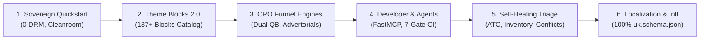

> [!metadata]- ⚙️ Системні метадані та інваріанти (MRH Header)
> ```yaml
> # --- DNK-MRH-HEADER ---
> mrh_id: "docs/projects/dnk_ecom/theme_dev_workflow/11_DNK_ECOM_DOCUMENTATION_ARCHITECTURE_AND_AGENT_HARNESS.md"
> purpose: "Головна специфікація архітектури документації DNK Ecom, стандарту Agent-Native (llms.txt, skill.md) та інженерного хайвею онбордингу."
> canonical_source: true
> alters_files: []
> triggers_tasks: []
> status: "Active"
> version: "2.0.0"
> updated_at: "2026-11-18"
> author: "DNK-e.com Maksym & Antigravity"
> # --- END DNK-MRH-HEADER ---
> ```

<!-- --- DNK-MRH-HEADER ---
mrh_id: "docs/projects/dnk_ecom/theme_dev_workflow/11_DNK_ECOM_DOCUMENTATION_ARCHITECTURE_AND_AGENT_HARNESS.md"
purpose: "Головна специфікація архітектури документації DNK Ecom, стандарту Agent-Native (llms.txt, skill.md) та інженерного хайвею онбордингу."
canonical_source: true
alters_files: []
triggers_tasks: []
status: "Active"
version: "1.0.0"
updated_at: "2026-11-14"
author: "DNK-e.com Maksym & Antigravity"
--- END DNK-MRH-HEADER --- -->

# 🏛️ Специфікація архітектури документації DNK Ecom Theme та стандарту Agent-Native

> **Концепція:** Документація теми **DNK Ecom** створюється за принципом **Dual-Target Audience (Подвійна Цільова Аудиторія)**: вона одночасно оптимізована для візуального сприйняття підприємцем-мерчантом (No-Code, зрозумілі скріншоти, готові шаблони) та для миттєвого машинного споживання автономними AI-агентами (**Agent-Native LLM Endpoints**: `llms.txt`, `llms-full.txt`, `skill.md`).

---

## ⚡ 1. Порівняльний аналіз: Elixir Docs проти DNK Ecom Docs

| Критерій | Elixir Docs (`docs.ecomelixir.com`) | DNK Ecom Sovereign Docs (Цільовий стандарт) |
| :--- | :--- | :--- |
| **Ліцензійна модель** | Жорсткий DRM, прив'язка до одного `.myshopify.com`, платна оренда $79/міс. | **100% Sovereign Cleanroom**: 0 DRM, 0 блокувань, необмежене використання в магазинах бренду. |
| **Quantity Breaks & Кошик** | ⚠️ Ціна в блоці змінюється лише візуально; чекаут бере базову ціну, якщо мерчант вручну не налаштував знижку в Admin. | **✅ Нативний Cart Transform**: 100% узгодженість ціни між PDP, Cart Drawer та Checkout через Shopify Functions. |
| **Free Gifts** | ⚠️ Товар додається, але списується як платний без додаткових знижок або нульової ціни. | **✅ Zero-Dollar & Automatic Thresholds**: Вбудований контроль безкоштовного подарунка з авто-валідацією. |
| **Theme Blocks 2.0** | 40 блоків (із них 35 чистих, 5 із залежностями від застарілих скриптів). | **✅ 137+ чистих блоків Theme Blocks 2.0**: найповніша бібліотека на ринку, 0 колізій імен. |
| **Оновлення теми** | Ручний перенос файлів (`settings_data.json`, `templates/*.json`) при збоях хмарного мерджера. | **✅ Детермінований Git-контур**: оновлення через Pull Request зі `staging` у `main` з перевіркою 7-Gate Integrity. |
| **Локалізація** | Англомовний інтерфейс з базовими перекладами через Google Translate. | **✅ 100% Рідна локалізація**: повна відповідність `uk.json` та `uk.schema.json` (4 400+ ключів). |
| **Підтримка AI-агентів** | Базовий `skill.md` у Mintlify. | **✅ FastMCP Code Mode + Повний W3C Agentic Protocol + CLI-інструменти валідації**. |

---

## 🏗️ 2. Інформаційна архітектура: 6 Стовпів документації DNK Ecom

Документація структурується за 6 ієрархічними стовпами:



### Стовп 1: Sovereign Quickstart & Cleanroom Setup
- Встановлення без ліцензійних серверів та сторонніх ключів.
- 100% автономність: нуль залежностей від зовнішніх CDN чи SaaS-дашбордів.
- Налаштування глобальної дизайн-системи токенів `--dnk-*` (кольори, радіуси, fluid typography через `clamp()`).

### Стовп 2: Horizon Core 2.0 & Molecular Theme Blocks
- Анатомія 137+ блоків: вкладеність, контекст рендерингу `content_for 'blocks'`.
- 12-колонковий універсальний Grid Canvas для побудови будь-якої секції без написання коду.
- Семантичні HTML5 контейнери з нульовим Cumulative Layout Shift (CLS = 0.00).

### Стовп 3: Conversion & CRO Funnel Engines
- **Dual-Level Quantity Breaks**:
  * Рівень 1: Вбудований у селектор кількості (Inline Multipliers).
  * Рівень 2: Модульний V2 Block з таймерами, бейджами та динамічними знижками.
- **Advertorial & Listicle Engines**:
  * Редакційні шаблони лонгрідів для рекламних кампаній Meta/TikTok.
  * Sticky Add to Cart Sidebar з динамічним вибором варіантів.
- **Modular Cart Drawer**:
  * Прогрес-бар безкоштовної доставки та багаторівневих подарунків.
  * Карусель апсейлів у кошику з миттєвим AJAX додаванням.
  * Express Checkout кнопки та захист від колізій додатків.

### Стовп 4: Developer & Agent Harness
- Робота AI-агентів з темою через **FastMCP Code Mode**.
- Командний рядок перевірки якості:
  ```bash
  PATH="/opt/homebrew/opt/ruby/bin:$PATH" shopify theme check --fail-level error
  python3 tools/verify_theme_integrity.py .
  ```
- 7-Gate Integrity Barrier (захист критичних органів теми від випадкового видалення чи пошкодження).

### Стовп 5: Self-Healing Diagnostics & Troubleshooting
- Інтерактивні дерева усунення несправностей:
  * *Кнопка кошика не реагує*: діагностика AJAX, зниклих `variant_id`, перевірка статусів Shopify Markets.
  * *Товар показує Sold Out*: перевірка політик інвентарю та мультиканальної доступності.
  * *Колір або стиль не змінюється*: аналіз специфічності CSS та локальних оверрайдів.
  * *Конфлікт зі стороннім додатком*: 5-кроковий безпечний протокол ізоляції ін'єкцій скриптів у дублікаті теми.

### Стовп 6: Ukrainian Localization & Global Commerce
- 100% покриття `locales/uk.json` та `locales/uk.schema.json`.
- Форматування цін відповідно до міжнародного стандарту `Intl.NumberFormat`.
- Адаптація під мобільні мережі з повільним 3G/4G з'єднанням (Instant LCP < 1.2s).

---

## 🤖 3. Стандарт Agent-Native Endpoints

Кожен реліз теми DNK Ecom та її портал документації повинні генерувати наступні машинні ендпоінти:

### 1. `/llms.txt` (Машинний навігатор)
Стислий опис кожного розділу в один рядок із прямим посиланням на `.md`:
```markdown
# DNK Ecom Theme Docs
- [Quickstart](https://docs.dnk-e.com/quickstart.md): Cleanroom Sovereign Shopify theme setup with zero DRM
- [Theme Blocks 2.0](https://docs.dnk-e.com/blocks.md): Catalog of 137+ Theme Blocks 2.0 and 12-column grid canvas
- [Quantity Breaks](https://docs.dnk-e.com/quantity-breaks.md): Volume pricing engine with native Cart Transform integration
- [Advertorials](https://docs.dnk-e.com/advertorials.md): Long-form advertorial and listicle funnel templates
- [Cart Drawer](https://docs.dnk-e.com/cart-drawer.md): Modular high-CRO cart drawer with tiered rewards and upsells
- [Developer Harness](https://docs.dnk-e.com/developer-harness.md): FastMCP, Shopify CLI, and 7-Gate Integrity validation
- [Troubleshooting](https://docs.dnk-e.com/troubleshooting.md): Self-healing triage trees for ATC, inventory, and app conflicts
```

### 2. `/llms-full.txt` (Повний концентрований контекст)
Автоматично скомпільований єдиний файл, що містить весь корпус документації, оптимізований для завантаження у велике контекстне вікно Gemini 4 Carbon, Claude Opus чи GPT-4.

### 3. `/.well-known/agent-skills/dnk-ecom/skill.md` (Офіційний скіл теми)
Готовий скіл для імпорту в будь-яку агентивну систему:

```markdown
---
name: dnk-ecom
description: Official agent skill for developing, configuring, auditing, and troubleshooting storefronts powered by the sovereign DNK Ecom Shopify theme (Theme Blocks 2.0, 137+ blocks, 0 DRM, Horizon Core).
metadata:
  version: "1.0.0"
  author: "DNK-e.com Maksym & Antigravity"
---

# DNK Ecom Shopify Theme Agent Skill

## Role & Capabilities
Agents use this skill to configure Theme Blocks 2.0, build high-converting advertorial and PDP templates, customize brand tokens (--dnk-*), and diagnose storefront issues without code breakage.

## Rules of Engagement for AI Agents
1. Whitelist files for editing: `templates/*.json`, `config/settings_data.json`, `locales/uk.json`, `locales/en.default.json`.
2. Protected Organs Whitelist (NEVER modify or delete without 7-Gate verification):
   - `snippets/quantity-breaks.liquid`
   - `snippets/qb-v2-migration.liquid`
   - `sections/cart-drawer.liquid`
   - `blocks/product_quantity-breaks-v2.liquid`
3. Verification Gate:
   Before declaring completion, run:
   `PATH="/opt/homebrew/opt/ruby/bin:$PATH" shopify theme check --fail-level error`
   Ensure exit code is 0 with 0 errors.
```

---

## 🚀 4. План розгортання документації

1. **Репозиторій документації**:
   - Розміщується в гілці `docs-portal` (або в підкаталозі `docs/` гілки `main` репозиторію `DNKShopify/DNK-e.com`).
2. **Платформа генерації**:
   - **VitePress / Starlight (Astro)** або **Mintlify** — статична генерація з підтримкою Markdown-callouts, темної теми, інтерактивних схем та миттєвого пошуку.
3. **CI/CD Автоматизація**:
   - При кожному мерджі в `main` GitHub Action компілює статичний сайт, перевіряє цілісність посилань, збирає свіжі `llms.txt` та `llms-full.txt`, і пушить оновлення в хостинг (Cloudflare Pages / Vercel).
