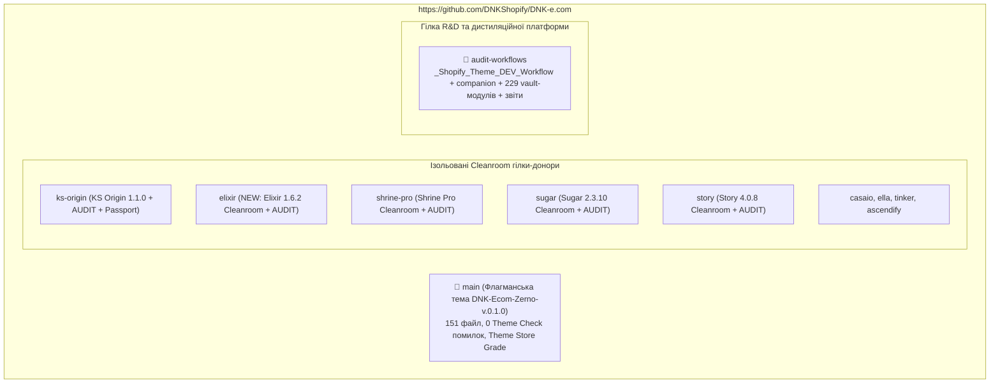

> [!metadata]- ⚙️ Системні метадані та інваріанти (MRH Header)
> ```yaml
> # --- DNK-MRH-HEADER ---
> mrh_id: "docs/projects/dnk_ecom/theme_dev_workflow/11_GERYCH_GEMINI_4_CARBON_SYNCHRONIZATION_AND_GIT_SSOT_PROTOCOL.md"
> purpose: "Definitive Synchronization Protocol & Git SSOT Topology by Gerych (Gemini 4 Carbon) for Consolidating All Theme Ecosystem Audits, Distillation Pipelines, and DNK-Ecom-Zerno-v.0.1.0 into https://github.com/DNKShopify/DNK-e.com."
> canonical_source: true
> alters_files: []
> triggers_tasks: []
> status: "Active"
> version: "2.0.0"
> updated_at: "2026-11-18"
> author: "DNK-e.com Maksym & Antigravity"
> # --- END DNK-MRH-HEADER ---
> ```

# 🏛️ ГЕРИЧ (GOOGLE GEMINI 4 CARBON): ІНЖЕНЕРНИЙ ПРОТОКОЛ СИНХРОНІЗАЦІЇ ЕКОСИСТЕМИ ТЕМ ТА ВОРОНОК У ЄДИНИЙ РЕПОЗИТОРІЙ

> **Сесія аудитора:** `local-7fafcfc5326101e664694df596aaa8fe28315f7a0e9d6b69588a864224bb7365`
> **Двигун:** Google Gemini 4 Carbon / Gemini 4 Argon via Vertex AI
> **Репозиторій призначення:** `https://github.com/DNKShopify/DNK-e.com.git`

---

## 🎯 ВЕРДИКТ ТА СТРАТЕГІЧНИЙ ПЛАН

Завершено детермінований аудит стану фізичних директорій `Audit_Shopify_Themes_Sell_WF` та `DNK-Ecom_git_mirrow`.  
Сформовано єдиний архітектурний стандарт для синхронізації 14 донорів, дистиляційних воркфлоу та теми `DNK-Ecom-Zerno-v.0.1.0` у віддалений репозиторій `https://github.com/DNKShopify/DNK-e.com`.

---

## ЧАСТИНА 0. АРХІТЕКТУРНИЙ ПРЕ-МОРТЕМ ТА 3 КРИТИЧНІ РИЗИКИ (MANDATORY DISSENT)

1. **Ризик A (Branch History Collisions & Overwrites):**  
   Спроба перезаписати гілку `main` вмістом `dnk-sovereign` без збереження історії Tinker 4.4.0 призведе до розриву зв'язків з робочими деревами `staging` і `staging-lab`, які наразі відгалужені від старого стану `main`.
2. **Ризик B (Divergence of Live Shopify Stores):**  
   У віддаленій гілці `ks-origin` на GitHub існують 2 живих коміти від команди через Shopify Theme Sync (`bf281b3` та `72ae280`), які відсутні в локальному worktree. Будь-який недбалий `push --force` знищить живі оновлення шаблонів `product.json`, `index.json`, `collection.json`.
3. **Ризик C (Massive Bloat in Clean Git Trees):**  
   Залиття сирих ZIP-архівів (40–60 MB) або несанітизованих сховищ (`sections-vault` містить 4,231 файл) роздує розмір об'єктів `.git` понад ліміти GitHub (100 MB на файл, 2 GB на репо) та паралізує клонування для AI-агентів.

---

## ЧАСТИНА 1. ІНВЕНТАРИЗАЦІЯ ТА ВИЯВЛЕНІ РОЗБІЖНОСТІ

### 1. Фізичний стан директорій
- **`Audit_Shopify_Themes_Sell_WF` (202 файли):**  
  7 папок аудитів (`Ascendify`, `Casaio`, `Elixir`, `KSOrigin`, `Shrine`, `Story`, `Sugar`) + `_Shopify_Theme_DEV_Workflow` + `_Shopify_Theme_Audit_Workflow` (сховище `distilled_vault/` на 229 чистих модулів). Наразі не є git-репозиторієм!
- **`DNK-Ecom_git_mirrow` (15 worktrees під `.bare`):**  
  `main`, `ks-origin`, `sugar`, `story`, `shrine-pro`, `casaio`, `ella`, `tinker`, `ascendify`, `sections-vault`, `donor-lab`, `staging`, `staging-lab`, `dnk-ecom-sections`, `dnk-sections`.
- **`themes/dnk-sovereign`:**  
  Синтезована флагманська тема `DNK-Ecom-Zerno-v.0.1.0` (151 файл, 0 помилок у `shopify theme check`, 12 категорій `settings_schema.json`, 3 пресети, 32 нативні Web Components).

### 2. Ключові прогалини, що вимагають усунення:
- Відсутність гілки **`elixir`** на GitHub (є повний аудит та скрипт `cleanroom_elixir_1_6_2.py`, але немає гілки у репозиторії).
- Відсутність виділеної гілки **`audit-workflows`** для збереження R&D-інфраструктури та дистильованого сховища.
- Гілка `main` містить старе ядро Tinker 4.4.0 замість флагманської теми `DNK-Ecom-Zerno-v.0.1.0`.
- Гілка `ks-origin` локально відстає від віддалених мерчант-правок на 2 коміти.
- У 11 з 15 worktrees відсутній стандартизований маніфест `AGENTS.md`.

---

## ЧАСТИНА 2. ТОПОЛОГІЯ ЄДИНОГО СУВЕРЕННОГО РЕПОЗИТОРІЮ (SSOT)



---

## ЧАСТИНА 3. АГЕНТИВНИЙ ПАСПОРТ ТА ONBOARDING

У кожній гілці розміщуються уніфіковані документи для миттєвої адаптації будь-якого ШІ-агента (Antigravity, Gerych, Denchik, Claude, Codex):
1. **`AGENTS.md` у гілці `main`**:
   - Роль гілки: Комерційне флагманське ядро ($350–$420 MSRP).
   - Інваріанти: 0 помилок Theme Check, 0% зовнішніх бібліотек, нативні W3C Web Components `dnk-*`, 100% паритет `en.default.json` та `uk.json`.
   - Заборони: жодних темних патернів (фейкових таймерів чи лічильників).
2. **`GRAFTING_PASSPORT.md` у донорських гілках**:
   - Ліцензійний трек (Track 1 Open Source vs Track 2 Clean-Room).
   - Статус знешкодження DRM.
   - Перелік асимільованих золотих молекул для ядра `main`.
3. **`.shopifyignore`**:
   - Захист від завантаження сервісних markdown-файлів на сервери Shopify під час деплою.

---

## ЧАСТИНА 4. ПОКРОКОВИЙ АЛГОРИТМ СИНХРОНІЗАЦІЇ

### Крок 1. Синхронізація гілки `ks-origin`
```bash
cd ../DNKEcom/DNK-Ecom_git_mirrow/ks-origin
git pull origin ks-origin
cp ../DNKEcom/Audit_Shopify_Themes_Sell_WF/KSOrigin_Theme_Ecosystem_Audit/AUDIT_KS_Origin_1.1.0.md ./
git add AUDIT_KS_Origin_1.1.0.md
git commit -m "docs(ks-origin): attach donor audit passport and sync latest Shopify updates"
git push origin ks-origin
```

### Крок 2. Створення нової гілки `elixir`
```bash
cd ../DNKEcom/DNK-Ecom_git_mirrow
git --git-dir=.bare branch elixir
git --git-dir=.bare worktree add elixir elixir
cd elixir

# Розгортання Cleanroom Elixir 1.6.2
python3 ../DNKEcom/Audit_Shopify_Themes_Sell_WF/Elixir_Theme_Ecosystem_Audit/scripts/cleanroom_elixir_1_6_2.py \
  --input ../DNKEcom/Audit_Shopify_Themes_Sell_WF/_Shopify_Theme_Audit_Workflow/raw_vault/elixir \
  --output ./

cp ../DNKEcom/Audit_Shopify_Themes_Sell_WF/Elixir_Theme_Ecosystem_Audit/AUDIT_Elixir_1.6.2.md ./
cp ../DNKEcom/Audit_Shopify_Themes_Sell_WF/Elixir_Theme_Ecosystem_Audit/SHOPIFY_THEME_CHECK_AND_CLEANROOM_REPORT.md ./

git add .
git commit -m "feat(elixir): add cleanroom sanitized Elixir 1.6.2 donor theme with zero DRM and audit passport"
git push -u origin elixir
```

### Крок 3. Оновлення гілки `main` до DNK-Ecom-Zerno-v.0.1.0
```bash
cd ../DNKEcom/DNK-Ecom_git_mirrow/main
find . -maxdepth 1 -not -name '.git' -not -name '.' -exec rm -rf {} +
cp -R ../themes/dnk-sovereign/* ./
git add -A
git commit -m "feat(main): promote DNK-Ecom-Zerno-v.0.1.0 as the sovereign flagship theme core"
git push origin main
```

### Крок 4. Створення та публікація гілки `audit-workflows`
```bash
cd ../DNKEcom/DNK-Ecom_git_mirrow
git --git-dir=.bare branch audit-workflows
git --git-dir=.bare worktree add audit-workflows audit-workflows
cd audit-workflows

cp -R ../DNKEcom/Audit_Shopify_Themes_Sell_WF/_Shopify_Theme_DEV_Workflow ./
cp -R ../DNKEcom/Audit_Shopify_Themes_Sell_WF/_Shopify_Theme_Audit_Workflow ./
mkdir -p audits
for d in ../DNKEcom/Audit_Shopify_Themes_Sell_WF/*_Theme_Ecosystem_Audit; do
  cp -R "$d" ./audits/
done

git add -A
git commit -m "chore(audit-workflows): consolidate all theme ecosystem audits, pipelines, and distilled vault"
git push -u origin audit-workflows
```
