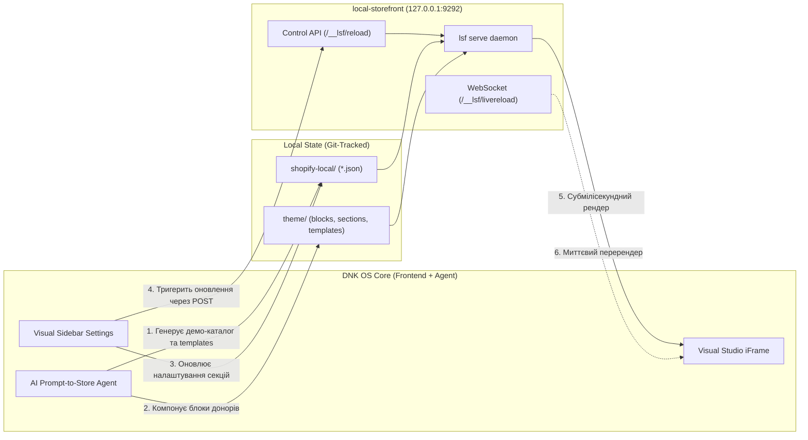

> [!metadata]- ⚙️ Системні метадані та інваріанти (MRH Header)
> ```yaml
> # --- DNK-MRH-HEADER ---
> mrh_id: "docs/projects/dnk_ecom/theme_dev_workflow/12_LOCAL_STOREFRONT_OFFLINE_PROTOTYPING_AND_RUNTIME_ENGINE.md"
> purpose: "Інженерна специфікація офлайн-рантайму local-storefront (lsf) для генерації інтерактивних прототипів магазинів за 30 секунд у DNK Agentic Store OS."
> canonical_source: true
> alters_files: []
> triggers_tasks: []
> status: "Active"
> version: "2.0.0"
> updated_at: "2026-11-18"
> author: "DNK-e.com Maksym & Antigravity"
> # --- END DNK-MRH-HEADER ---
> ```

# ⚡ МОДУЛЬ 12: LOCAL-STOREFRONT ОФЛАЙН-РАНТАЙМ ТА АГЕНТСЬКЕ ПРОТОТИПУВАННЯ

> **Сесія-джерело:** [Shopify Local Theme DEV](conversation://f7b3cd8d-fc69-4a4f-bb8a-c21c9d7cec31) (`f7b3cd8d-fc69-4a4f-bb8a-c21c9d7cec31`)  
> **Повний майстер-аудит:** [`Audit_Shopify_Themes_Sell_WF/Local_Storefront_DEV_Audit/SESSION_AUDIT_SHOPIFY_LOCAL_THEME_DEV.md`](../DNKEcom/Audit_Shopify_Themes_Sell_WF/Local_Storefront_DEV_Audit/SESSION_AUDIT_SHOPIFY_LOCAL_THEME_DEV.md)  
> **Локальний репозиторій ядра:** [`../DNK_Vibe/local-storefront`](../DNK_Vibe/local-storefront)

---

## 🎯 1. ПРИЗНАЧЕННЯ МОДУЛЯ

Модуль надає суверенне, автономне середовище виконання Shopify Liquid вітрини на чистому Rust (**`0xtlt/local-storefront`**), яке забезпечує:
1. **Субмілісекундний рендеринг (170–300 мкс)** замість 800–2500 мс у хмарному `shopify theme dev`.
2. **0% залежності від хмари Shopify:** Можливість створювати, редагувати та демонструвати повнофункціональні магазини клієнтам без створення партнерських Development Stores.
3. **Миттєве зворотне оновлення (10 ms WebSocket Live-Reload)** для Visual Studio кастомайзера DNK OS.
4. **Повна підтримка Theme Blocks 2.0 та об'єкта `closest`**, що дозволяє рендерити будь-яку з наших донорських тем (Sugar v2.3.10, Story v4.0.8, Horizon CRO, Elixir).

---

## 🏗️ 2. АРХІТЕКТУРА ДЕМОНА ТА ВЗАЄМОДІЯ З DNK OS



---

## ⚙️ 3. АГЕНТСЬКИЙ ІНТЕРФЕЙС ТА КОМАНДИ

Автономні агенти розробки (Gerych-root, Denchik, Antigravity) керують рантаймом за допомогою неінтерактивних CLI команд:

```bash
# 1. Ініціалізація структури локального магазину
npx local-storefront init --theme <THEME_DIR> --data <DATA_DIR>

# 2. Сувора перевірка на сумісність зі Strict Liquid
npx local-storefront check --fix --format json

# 3. Валідація зв'язності товарів і колекцій
npx local-storefront validate --format json

# 4. Запуск фонового сервера для візуального інтерфейсу
npx local-storefront serve --port 9292 --theme ./theme --data ./shopify-local
```

---

## 📊 4. СТРУКТУРА ФАЙЛІВ ДЕМО-МАГАЗИНУ (`shopify-local/`)

Генератор каталогу DNK OS формує наступні детерміновані файли:
- `store.json`: Назва, валюта, схема оподаткування, локалі (`uk`, `en`).
- `collections.json`: Списки категорій із правилами фільтрації (`rules: [{ "type": "equals", ... }]`).
- `customers.json`: Тестові профілі покупців для перевірки B2B/аккаунтів.
- `products/*.json`: Окремі JSON-файли для кожного товару з варіантами, цінами та зображеннями.

---

## 🚀 5. ПЛАН ВПРОВАДЖЕННЯ У ВИРОБНИЧИЙ КОНВЕЄР

1. **Крок 1 (Ізольований карантин):** Репозиторій `local-storefront` розміщено у `DNK_Vibe/local-storefront` з повним доступом до крейтів Rust.
2. **Крок 2 (Service Wrapper):** Створити сервісний демон у `apps/api/` або `services/dnk_shopify/`, який керує життєвим циклом `lsf serve`.
3. **Крок 3 (Iframe Bridge):** Вбудувати попередній перегляд `http://127.0.0.1:9292` у візуальну оболонку DNK OS з панеллю налаштувань.
4. **Крок 4 (One-Click Deploy):** Підключити конвертер `shopify-local/` -> Shopify Admin GraphQL API для автоматичного створення товарів у живому магазині після узгодження з клієнтом.
