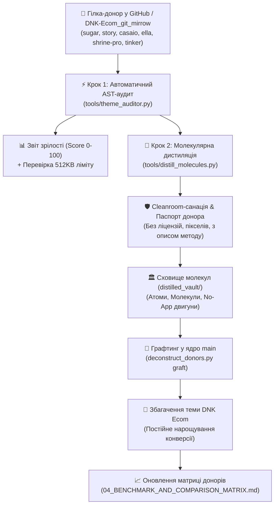

<!--
# --- DNK-MRH-HEADER ---
# mrh_id: "docs/projects/dnk_ecom/theme_dev_workflow/README.md"
# purpose: "Master Engine & Self-Improving Recursive Molecular Theme Audit & Distillation Framework"
# canonical_source: true
# alters_files: []
# triggers_tasks: []
# status: "Active"
# version: "2.1.0"
# updated_at: "2026-11-10"
# author: "DNK-e.com Maksym & Antigravity"
# --- END DNK-MRH-HEADER ---
-->

# 🧬 Самопокращуваний воркфлоу молекулярного аудиту та дистиляції тем Shopify (Shopify Theme DEV Workflow)

Цей сервіс є **універсальним самопокращуваним двигуном реверс-інжинірингу, молекулярної дистиляції та графтингу** для екосистеми тем Shopify.

Він створений як єдине робоче місце для агентів **Gerych23 (DNK OS Core v0.23.0 на Python 3.14, модель `gemini-4-argon`)** та **Денчіка (Chief Autonomous Builder)**, а також для інженерів агенції DNK Ecom.

---

## 🏛️ Єдине канонічне джерело донорів: `DNK-Ecom_git_mirrow` та гілки GitHub

> [!IMPORTANT]
> **Єдиною офіційною бібліотекою тем-донорів (Single Source of Truth — SSOT) є:**
> - Віддалений репозиторій: **[`https://github.com/DNKShopify/DNK-e.com`](https://github.com/DNKShopify/DNK-e.com)**
> - Локальне дзеркало Git Worktrees: **`DNK-Ecom_git_mirrow/`** (`../SHOPIFY/DNKShopify/DNKEcom/DNK-Ecom_git_mirrow`)

Усі теми в цьому репозиторії зберігаються як ізольовані гілки (`sugar`, `story`, `casaio`, `ella`, `shrine-pro`, `tinker` тощо) і **вже пройшли або проходять Cleanroom-санацію**:
1. Повністю знешкоджено ліцензійні замки, ECDSA-блокування та запити до віддалених серверів перевірки.
2. Вирізано сторонні трекінг-пікселі (FB, TikTok, GA) та локалізовано CDN-залежності.
3. Кожна гілка містить **Паспорт дистиляції (Architectural Passport & Grafting Card)** з переліком Топ-молекул для перенесення в ядро `main` (`DNK Ecom Theme`).

---

## 🔄 Принцип самопокращуваного циклу (Recursive Distillation Loop)

Головна перевага сервісу — **рекурсивне навчання**: кожна нова тема з `DNK-Ecom_git_mirrow` не просто аналізується, а автоматично віддає свої найкращі молекули в загальний реєстр, поповнюючи можливості **DNK Ecom Theme**.



---

## 🗂️ Архітектура та структура модулів сервісу

| Модуль | Файл | Призначення |
| :--- | :--- | :--- |
| **01** | [`01_AUTONOMOUS_HERYCH_TASK_TEMPLATE.md`](./01_AUTONOMOUS_HERYCH_TASK_TEMPLATE.md) | **Бойовий шаблон завдання для Герича (Hermes Task Spec)**: готовий промпт-шаблон у 1 клік для запуску аудиту будь-якої гілки з `DNK-Ecom_git_mirrow`. |
| **02** | [`02_MOLECULAR_DISTILLATION_ENGINE.md`](./02_MOLECULAR_DISTILLATION_ENGINE.md) | **Методологія молекулярної дистиляції та Cleanroom-санації**: знешкодження ліцензій, вирізання пікселів, токенізація `--dnk-*`. |
| **03** | [`03_SELF_IMPROVING_GENOME_REGISTRY.md`](./03_SELF_IMPROVING_GENOME_REGISTRY.md) | **Центральний Геном-Реєстр інновацій тем**: жива база знань із прямими посиланнями на гілки в `https://github.com/DNKShopify/DNK-e.com`. |
| **04** | [`04_BENCHMARK_AND_COMPARISON_MATRIX.md`](./04_BENCHMARK_AND_COMPARISON_MATRIX.md) | **Зведена матриця бенчмаркінгу тем**: актуальні дані сканування всіх 14 воркплейсів `DNK-Ecom_git_mirrow`. |
| **05** | [`05_CANONICAL_GIT_MIRROR_AND_DONOR_BRANCHES.md`](./05_CANONICAL_GIT_MIRROR_AND_DONOR_BRANCHES.md) | **Канонічний гід по репозиторію `DNK-Ecom_git_mirrow` та гілках GitHub**: повний опис кожної гілки, Cleanroom статусу та команд графтингу. |
| **06** | [`06_SHOPIFY_THEME_STORE_COMMERCIAL_SPECIFICATION.md`](./06_SHOPIFY_THEME_STORE_COMMERCIAL_SPECIFICATION.md) | **Офіційна технічна специфікація теми для Shopify Theme Store**: жорсткі інваріанти, Theme Blocks 2.0, Web Components, zero-DRM, Core Web Vitals ($350–$420 MSRP). |
| **07** | [`07_DISTILLATION_FACTORY_AND_GRAFTING_PIPELINE.md`](./07_DISTILLATION_FACTORY_AND_GRAFTING_PIPELINE.md) | **Пайплайн фабрики дистиляції та складання теми**: протокол роботи в тандемі з Gerych-root (Gemini 4 Carbon), синтез органів Sugar, Shrine, Story, Elixir. |
| **08** | [`08_UNIVERSAL_THEME_ELEMENTS_ARCHITECTURE_AND_SPECIFICATION.md`](./08_UNIVERSAL_THEME_ELEMENTS_ARCHITECTURE_AND_SPECIFICATION.md) | **Повний технічний опис усіх елементів теми та система дистиляції**: вичерпна декомпозиція файлової ієрархії, Theme Blocks 2.0, токенів, Custom Elements та i18n для проходження модерації. |
| **09** | [`09_SHOPIFY_THEME_DISTILLATION_SYSTEM_AND_ELEMENTS_BLUEPRINT.md`](./09_SHOPIFY_THEME_DISTILLATION_SYSTEM_AND_ELEMENTS_BLUEPRINT.md) | **Генеральний інженерний стандарт: Система дистиляції знань та повний технічний опис усіх елементів теми**: архітектура 12 категорій `settings_schema.json`, шаблонів, 32 Web Components та покроковий синтез `DNK Sovereign 1.0.0` ($350–$420 MSRP). |
| **10** | [`10_GERYCH_GEMINI_4_CARBON_THEME_DISTILLATION_VERDICT.md`](./10_GERYCH_GEMINI_4_CARBON_THEME_DISTILLATION_VERDICT.md) | **Вердикт аудитора Герича (Google Gemini 4 Carbon via Vertex AI)**: системний протокол дистиляції знань, 3 критичні ризики (Mandatory Dissent), 5 етапів Clean-Room деконструкції та сертифікаційні гейти Theme Store. |
| **11** | [`11_GERYCH_GEMINI_4_CARBON_SYNCHRONIZATION_AND_GIT_SSOT_PROTOCOL.md`](./11_GERYCH_GEMINI_4_CARBON_SYNCHRONIZATION_AND_GIT_SSOT_PROTOCOL.md) | **Інженерний протокол синхронізації та топологія Git SSOT (Gerych Gemini 4 Carbon)**: консолідація 14 донорів, створення гілки `elixir`, переведення `main` на `DNK Sovereign 1.0.0 Apex` та виділення гілки `audit-workflows`. |
| **Synthesis** | [`scripts/synthesize_dnk_sovereign_1_0_0.py`](../../../DNK_HUB/scripts/synthesize_dnk_sovereign_1_0_0.py) | **Автоматизований синтезатор теми DNK Sovereign 1.0.0**: 151 файл, 0 offenses у `shopify theme check`, генерація пресетів та збірка релізного ZIP. |
| **Tools** | [`tools/dnk_theme_distillation_factory.py`](./tools/dnk_theme_distillation_factory.py) | **Автоматизована фабрика дистиляції**: вилучення, неймспейсінг `dnk-`, валідація схем RFC 8259 та збірка комерційної теми. |
| **Tools** | [`tools/theme_auditor.py`](./tools/theme_auditor.py) | **Універсальний CLI-сканер**: проводить глибокий аудит теми, будує графи вкладеності, оцінює ризики блокування лімітів Shopify. |
| **Tools** | [`tools/distill_molecules.py`](./tools/distill_molecules.py) | **Автоматичний екстрактор компонентів**: витягує чисті блоки в `distilled_vault/`. |
| **Tools** | [`tools/benchmark_matrix.py`](./tools/benchmark_matrix.py) | **Генератор зведеної матриці**: миттєво сканує всі гілки `DNK-Ecom_git_mirrow`. |
| **Vault** | [`distilled_vault/`](./distilled_vault/) | **Фізичне сховище дистильованих компонентів**: бібліотека очищених атомів та двигунів, готових для інтеграції в DNK Ecom. |

---

## 🚀 Швидкий запуск аудиту та графтингу

### 1. Сканування гілки-донора з `DNK-Ecom_git_mirrow`:
```bash
python3 tools/theme_auditor.py \
  --theme-path "../../../DNK-Ecom_git_mirrow/story" \
  --output "reports/AUDIT_story.json" \
  --markdown "reports/AUDIT_story.md"
```

### 2. Дистиляція унікальних компонентів:
```bash
python3 tools/distill_molecules.py \
  --theme-path "../../../DNK-Ecom_git_mirrow/casaio" \
  --vault-path "distilled_vault/casaio"
```

### 3. Прямий графтинг компонента в ядро `DNK Ecom`:
```bash
python3 ../../../DNK_HUB/scripts/shopify/deconstruct_donors.py graft \
  --donor donor/sugar \
  --file blocks/bundle-builder.liquid
```
