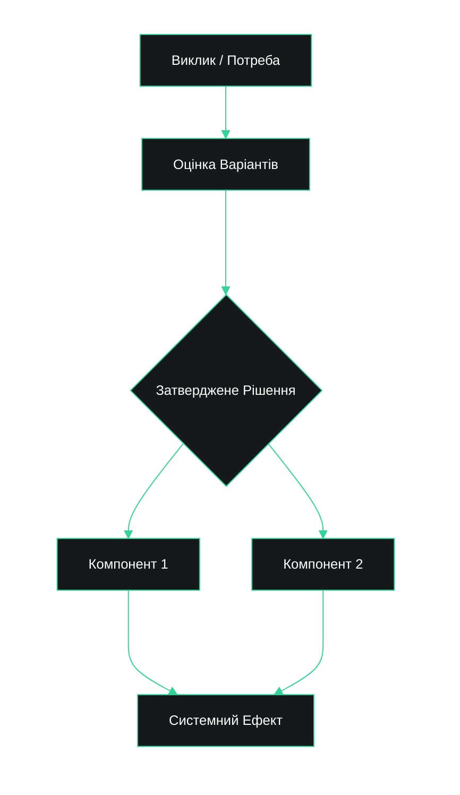

> [!metadata]- ⚙️ Системні метадані та інваріанти (MRH Header)
> ```yaml
> # --- DNK-MRH-HEADER ---
> mrh_id: "docs/templates/ADR_TEMPLATE.md"
> purpose: "Canonical Dual-Optics Template for Architecture Decision Records (ADRs) in DNK OS."
> canonical_source: true
> alters_files: []
> triggers_tasks: []
> status: "Active"
> version: "2.0.0"
> updated_at: "2026-11-18"
> author: "DNK-e.com Maksym & Antigravity"
> # --- END DNK-MRH-HEADER ---
> ```

> ```

> [!abstract] 🏛️ КАНОНІЧНИЙ ШАБЛОН АРХІТЕКТУРНОГО РІШЕННЯ (ADR)
> **Призначення**: Цей документ встановлює обов'язкову структуру для запису будь-яких архітектурних рішень у репозиторії DNK OS з підтримкою подвійної оптики (Dual-Optics) для Людини та ШІ-Агентів.

`Навігація`: [[00_MOC_DNK_OS|🗺️ Головний MOC DNK OS]] ➔ [[docs/architecture/ARCHITECTURE_MAP|🏛️ Архітектура]] ➔ **ADR Template**

---

# 🏛️ ADR-[NUM]: [Коротка Назва Рішення]

## 📋 1. Статус та Метадані
- **Поточний Статус**: `[Draft | Proposed | Accepted | Deprecated | Superseded]`
- **Дата Прийняття**: `YYYY-MM-DD`
- **Ініціатор / Автор**: `DNK-e.com Maksym & Gerych Prime`
- **Пов'язані Специфікації**: `[[specs/...]]`

---

## 🎯 2. Контекст та Проблематика
> [!info] Контекст виклику
> Опишіть ситуацію, технічний або бізнесовий виклик, який вимагає прийняття цього архітектурного рішення. Чому статус-кво не працює?

---

## ⚖️ 3. Розглянуті Альтернативи

| Варіант | Архітектурна Суть | Переваги | Недоліки / Ризики |
| :--- | :--- | :--- | :--- |
| **Варіант A** | *[Опис підходу]* | • Перевага 1<br>• Перевага 2 | • Недолік 1<br>• Ризик 2 |
| **Варіант B** | *[Опис підходу]* | • Перевага 1<br>• Перевага 2 | • Недолік 1<br>• Ризик 2 |
| **Варіант C** | *[Мінімалістична альтернатива]* | • Простота впровадження | • Обмежена масштабованість |

---

## 🏆 4. Прийняте Рішення та Обґрунтування
> [!success] Затверджений підхід
> Чітке формулювання обраного архітектурного варіанту із детальним обґрунтуванням чому саме цей варіант переміг інші.

### 📐 Топологічна Схема Рішення


---

## 🔮 5. Наслідки та Компроміси (Trade-offs)
- **✅ Позитивні наслідки**:
  - [Що покращиться в системі: швидкість, стабільність, простота]
- **⚠️ Прийняті компроміси та обмеження**:
  - [Які мінуси свідомо прийнято та як вони контролюються]
- **🛡️ План мітигації ризиків**:
  - [Які запобіжники або тести впроваджено для контролю ризиків]

---

`Див. також`: [[docs/guides/DOCUMENTATION_AND_CANVAS_STANDARD|Стандарт Документування]] | [[00_MOC_DNK_OS|Головна Карта]]
