> [!metadata]- ⚙️ Системні метадані та інваріанти (MRH Header)
> ```yaml
> # --- DNK-MRH-HEADER ---
> mrh_id: "docs/templates/Do not Delete - Example.md"
> purpose: "Canonical Master Documentation & Architecture Template for DNK OS (4-Level Architecture & Mermaid-First SSOT)."
> canonical_source: true
> alters_files: []
> triggers_tasks: []
> status: "Active"
> version: "2.0.0"
> updated_at: "2026-11-18"
> author: "DNK-e.com Maksym & Antigravity"
> # --- END DNK-MRH-HEADER ---
> ```

> <!-- AGENT_INGESTION_DIRECTIVE: schema_version="2.3" parse_mode="dual_optics" task_extractor="auto" dag_sync="enabled" archetype="DEV_SPEC" -->

> [!abstract] 🧭 ЕТАЛОННИЙ МАЙСТЕР-ШАБЛОН СТИЛЮ, ВІЗУАЛІЗАЦІЇ ТА АРХІТЕКТУРИ ДОКУМЕНТІВ DNK OS
> **Призначення**: Затверджений єдиний канонічний еталон (Golden SSOT) для створення та модифікації будь-яких специфікацій (`specs/`), архітектурних рішень (ADR) та контрактів DNK OS. Об'єднує 4 рівні: (1) Людиноорієнтований UX, (2) Машинний контракт із Whitelist та Anti-Scope, (3) MASE-зрізи з матрицею CHECK/EXPECT, (4) Task Forest DAG та 100% монолітний Mermaid SSOT без сателітів.
> **Подвійна Оптика (Dual-Optics)**: Надати 100% легкість, естетику та швидкість сканування для **Людини** (Максима) і водночас гарантувати строгий машинно-валідований контракт, детерміновані межі та вичерпний Definition of Done для **ШІ-Агентів** (Герича Prime та рою Swarm).

`Навігація`: [[00_MOC_DNK_OS|🗺️ Головний MOC DNK OS]] ➔ [[specs/|📁 Специфікації]] ➔ **[[Do not Delete - Example|Еталонний Майстер-Шаблон]]**

---

## 🎨 1. Візуальна Топологія (Mermaid Architecture SSOT)

### 🔀 Чотирирівневий Життєвий Цикл Документації (Канонічний Mermaid SSOT)
> [!info] Нативна топологія для Людини та ШІ-Агентів
> Ця схема є єдиним візуальним джерелом істини. Вона демонструє перехід від абстрактного наміру до машинного контракту, розробки та детермінованої CI-верифікації. Нуль бінарних сателітів, 100% інтеграція в Markdown.

```mermaid
%%{init: {
  'theme': 'base',
  'themeVariables': {
    'primaryColor': '#16191c',
    'primaryTextColor': '#ffffff',
    'primaryBorderColor': '#34d399',
    'lineColor': '#34d399',
    'secondaryColor': '#102219',
    'tertiaryColor': '#16191c',
    'tertiaryTextColor': '#ffffff',
    'titleColor': '#ffffff',
    'textColor': '#ffffff',
    'mainBkg': '#16191c',
    'nodeBorder': '#34d399',
    'clusterBkg': 'transparent',
    'clusterBorder': 'rgba(255, 255, 255, 0.16)',
    'edgeLabelBackground': '#102219',
    'fontSize': '13px'
  }
}}%%
flowchart LR
    P1["⚙️ <b>1. Метадані & MRH</b><br/><small>• YAML Frontmatter<br/>• MRH Header SSOT</small>"]
    P2["🎯 <b>2. Подвійна Оптика</b><br/><small>• UX для Людини<br/>• Агентські контракти</small>"]
    P3["⚡ <b>3. MASE Розробка</b><br/><small>• Атомарні зрізи ≤ 25<br/>• Матриця CHECK/EXPECT</small>"]
    P4["🛡️ <b>4. Верифікація & CI</b><br/><small>• Quality Gate Exit 0<br/>• SCONES Ingestion</small>"]

    U1["👤 <b>Людина (Максим)</b><br/><small>3-панельний скан • Outline</small>"]
    U2["🧠 <b>Векторна Пам'ять</b><br/><small>SCONES Long-Term Storage</small>"]

    %% Головна горизонтальна магістраль (Primary Core Flow):
    P1 ===>|"AST Валідація"| P2
    P2 ===>|"MASE Декомпозиція"| P3
    P3 ===>|"Exit Code 0"| P4

    %% Прямий зв'язок читання для людини (Secondary Flow):
    P2 -->|"UX Читання"| U1

    %% Фонова телеметрія та інжекція пам'яті (Tertiary Flow):
    P4 -.->|"Індексація знань"| U2
```



---

## 🎯 2. Смисловий Контекст та UX (Рівень 1: Людина)

Цей розділ призначений для швидкого людського сприйняття засновником (Максимом) у 3-панельному інтерфейсі Obsidian (Провідник ліворуч, Чистий Вміст по центру, Карта Змісту Outline праворуч).

### 2.1. Цільові Сценарії (User Stories)
- **Як Засновник / Lead Architect (Максим)**, я хочу відкривати будь-яку специфікацію та за 15 секунд розуміти стратегічний сенс, архітектурні межі та статус готовності без синтаксичного шуму.
- **Як Builder Agent (Герич Prime)**, я хочу мати однозначний білий список файлів і негативний скоуп, щоб не галюцинувати й не чіпати чужі підсистеми під час розробки.
- **Як Swarm Auditor**, я хочу бачити детерміновану таблицю верифікації, щоб перевіряти роботу коду машиною через `exit code 0`, а не вірити звітам на словах.

### 2.2. Архітектурні Принципи та Обмеження
1. **SSOT і Нуль Сателітів**: Будь-яка інформація зберігається в єдиному екземплярі без дублювання у зовнішні бінарні файли (`.excalidraw.md` ліквідовані).
2. **Незмінність Пермалінків**: Назва файлу — це вічний ідентифікатор функціональної сутності (`specs/01_CORE_ARCHITECTURE_SPEC.md`). Номер версії інкапсульовано виключно всередині метаданих.
3. **Ергономіка Кольору**: Використовуються лише затверджені палітри: Dark Slate (`#16191c`), Emerald Mint (`#34d399`), Sky Blue (`#38bdf8`), Dark Pill (`#102219`).

### 2.3. Ключові Архітектурні Рішення (ADR Context)
- **[[180926 ADR-007 JIT Tooling та Zero Bloat|ADR-007]]**: Ліміт стоячого контексту агента ≤ 6,000 токенів.
- **[[docs/notes/MY TASKS/1. АРХІТЕКТУРА/03. Технічні рішення/CONTRACTS/CONTRACT-021 Machine Documentation Contract and Tri-Archetype Schema|CONTRACT-021]]**: Тріада машинних архетипів (Dev, User, Agent).
- **[[DNK-STD-0075 Machine Readable Headers|DNK-STD-0075]]**: Обов'язковість MRH-заголовків для валідації через `markdown_schema_gate.py`.

---

## 🤖 3. Машинний Контракт, Системні Інваріанти та Межі (Рівень 2: Агент)

> [!agent] 🤖 ПРАВИЛО ДЛЯ АГЕНТА: Суворий Контракт Виконання (No Whitelist = No Code)
> Будь-який агент, який виконує роботу над цією специфікацією, зобов'язаний діяти **строго в межах оголошеного білого списку (Whitelist)**. Модифікація будь-яких файлів поза цим списком розцінюється як критичне порушення інваріантів безпеки DNK OS.

### 3.1. Білий Список Цільових Файлів (Target File Whitelist)
| Шлях до файлу (Тільки відносні шляхи) | Операція | Відповідальний агент | Призначення та Bounded Context |
| :--- | :---: | :--- | :--- |
| `specs/01_CORE_ARCHITECTURE_SPEC.md` | `Mutate` | `gerych_builder` | Специфікація мікроядра та FastMCP фабрики |
| `core/orchestrator/kernel.py` | `Create / Mutate` | `dnk_dev_fullstack` | Реалізація базового циклу подій мікроядра |
| `apps/api/routers/system_status.py` | `Mutate` | `dnk_dev_fullstack` | Ендпоінт статусу та системної телеметрії |
| `tests/unit/test_kernel_runtime.py` | `Create` | `gerych_auditor` | Модульні тести валідації стану ядра |

### 3.2. Негативний Скоуп та Заборони (Negative Scope / Anti-Scope)
- ❌ **Категорично заборонено**: Створювати нові директорії верхнього рівня в корені `DNK_OS_APP` (дозволено лише 8 канонічних: `apps/`, `core/`, `services/`, `packages/`, `infra/`, `docs/`, `tests/`, `scripts/`).
- ❌ **Категорично заборонено**: Створювати нові автономні папки мікросервісів у `services/` (усі модулі спрямовуються у 3 робочі конячки: `dnk_shopify`, `dnk_media`, `dnk_distribution` або `core/`).
- ❌ **Категорично заборонено**: Використовувати абсолютні шляхи (`/Users/...`). Лише відносні (`./`, `../`).
- ❌ **Категорично заборонено**: Створювати сателітні файли `.excalidraw.md` поруч зі специфікаціями.
- ❌ **Категорично заборонено**: Використовувати некритичний сикофантичний лексикон вихваляння (per AGENTS.md Section 6).

### 3.3. Бюджет Інструментів та JIT Tooling (Sanctioned Tools Whitelist)
- **Дозволені інструменти**: `view_file`, `replace_file_content`, `multi_replace_file_content`, `run_command`, `grep_search`.
- **Заборонені важкі MCP**: Notion MCP (~37k токенів), Chrome DevTools (якщо не тестується UI).
- **Ліміт контексту сесії**: Standing context ≤ 6,000 токенів; робоче вікно ≤ 40,000 токенів. При перевищенні — обов'язковий чекпоінт і перезапуск.

### 3.4. Машинні Директиви (Invisible Agent Directives)
```markdown
<!-- AGENT_DIRECTIVE: action="validate_syntax" schema="docs/schemas/documentation_contract.schema.yaml" -->
<!-- DAG_NODE: id="DAG-SPEC-01-CORE" type="spec" agent="gerych_prime" depends_on=[] -->
<!-- TASK_SPEC: id="TASK-CORE-001" timeout_s=300 retry_limit=2 max_tool_calls=25 -->
<!-- SCONES_INGEST: topic="DNK OS Master Architecture Standard" importance=1.0 -->
```

---

## ⚡ 4. MASE Розробка та Верифікація (Рівень 3: Розробка)

### 4.1. Атомарні Зрізи (Atomic Slices ≤ 25 дій per Slice)
Згідно з протоколом MASE (`AGENTS.md` п. 4), робота над цією специфікацією розбивається на 3 ізольовані ітерації:
- **Slice 1 (Специфікація & Контракти)**: Формалізація Pydantic-моделей DTO, узгодження інтерфейсів, перевірка схем через лінтер (`markdown_schema_gate.py`).
- **Slice 2 (Реалізація Ядра)**: Написання коду компонентів виключно за файлами з Whitelist, прив'язка FastMCP методів, нуль сміттєвих файлів.
- **Slice 3 (Верифікація & Тести)**: Написання unit-тестів, запуск `verify_all.sh`, отримання детермінованого доказу `exit code 0`.

### 4.2. Детермінована Матриця Приймання (Deterministic Acceptance Matrix)
> [!important] Інваріант Машинного Доказу (No-Interrogation Rule)
> Статус `Completed` зараховується виключно за наявності машинного свідчення (Exit Code 0). Вербальні твердження агента без коду виходу вважаються невалідними.

| ID | Крок / Дія (CHECK) | Очікуваний результат (EXPECT) | Доказ виконання (EVIDENCE) |
| :---: | :--- | :--- | :--- |
| **GATE-01** | `python3 scripts/system/markdown_schema_gate.py --file "specs/..."` | Усі схеми валідні, MRH перевірено, 0 заборонених токенів | `exit code 0` у консолі |
| **GATE-02** | `pytest tests/unit/test_kernel_runtime.py -v` | 100% проходження тестів ядра без моків | `X passed, 0 failed, exit code 0` |
| **GATE-03** | `bash scripts/verify_all.sh --affected` | TypeScript type-check, AST-лінтинг, анти-сикофантія | `ALL GATES PASSED (exit 0)` |
| **GATE-04** | Headless curl перевірка ендпоінту `/status` | HTTP 200 OK з валідним JSON схеми | `{"status": "active", "version": "..."}` |

---

## 🌳 5. Граф Задач Task Forest & Diátaxis (Рівень 4: Система)

Будь-який список задач у цьому розділі автоматично зчитується Swarm-роботами та синхронізується з `task_forest/00_MASTER_TASK_FOREST_TREE.md`.

### 5.1. Символьна Матриця Статусів Obsidian (11 канонічних станів)
- [ ] `[ ]` **Не розпочато (Todo)**: завдання очікує взяття в роботу в беклозі
- [/] `[/]` **В процесі (In Progress)**: активна розробка агентом прямо зараз
- [x] `[x]` **Виконано (Done)**: успішно перевірено детермінованим тестом (`exit code 0`)
- [-] `[-]` **Скасовано (Cancelled / Dropped)**: завдання визнано неактуальним
- [!] `[!]` **Блокер / Увага (Urgent Blocker)**: критична проблема, що зупиняє конвеєр
- [?] `[?]` **Дослідження / Спайк (Question / Spike)**: вимагає аналізу або рішення засновника
- [>] `[>]` **Делеговано (Delegated / Swarm)**: передано доменному робітнику (`dnk_shopify`, `dnk_dev_fullstack`)
- [*] `[*]` **Ключова Віха (Milestone)**: стратегічний релізний майлстоун DNK OS
- [i] `[i]` **Інформація (Observation)**: замітка або спостереження аудитора
- [b] `[b]` **Закладка (Bookmark)**: посилання для глибокого вивчення
- [k] `[k]` **Ключовий Інваріант (Key Invariant)**: обов'язкове системне правило

### 5.2. Виконувана Черга Задач (Executable Task Queue)
- [x] (TASK-DNK-DOC-001) [P0] @agent:gerych_builder | Scope: `Do not Delete - Example.md` | Criteria: 4-рівневий монолітний стандарт повністю зафіксовано як Golden SSOT
- [x] (TASK-DNK-DOC-002) [P0] @agent:antigravity_mentor | Scope: `DNK_OS_APP/` | Criteria: Створено ізольовану директорію `whiteboards/` та винесено скетчі полотен
- [ ] (TASK-DNK-DOC-003) [P1] @agent:gerych_prime | Scope: `specs/` | Criteria: Канонізація робочих специфікацій `01..11` за затвердженим шаблоном
- [ ] (TASK-DNK-DOC-004) [P1] @agent:gerych_auditor | Scope: `scripts/system/markdown_schema_gate.py` | Criteria: 100% проходження перевірки всіх документів екосистеми

### 5.3. Квадранти Diátaxis та Життєвий Цикл Документа (OpenSpec Lifecycle)
1. **Tutorials (Навчання)**: Практичні покрокові сценарії першого запуску (`docs/tutorials/`).
2. **How-To Guides (Гайди)**: Розв'язання конкретних виробничих задач (`docs/guides/`).
3. **Reference (Довідники)**: Точні API-контракти, специфікації та схеми DTO (`specs/`).
4. **Explanation (Пояснення)**: Архітектурні трактати, консиліуми та ADR (`docs/architecture/`, `Draft.md`).

---

## 🔗 6. Зв'язки, MOC та Контекстна Мережа ([[Wikilinks]])

Кожен документ системи обов'язково інтегрується в глобальну мережу знань через двосторонні посилання:

- **Батьківський Кабінет (Master MOC)**: [[00_MOC_DNK_OS|🗺️ Головний Кабінет Навігації DNK OS]]
- **Робоча Чернетка-Трактат**: [[Do not Delete - Draft|Do not Delete - Draft.md (Архітектурний Консиліум)]]
- **Ізольоване Whiteboard-Полотно**: [[whiteboards/Do not Delete - Example.excalidraw|Історичний скетч первинної сесії]] (поза системним SSOT, 0 залежностей)
- **Архітектурний Журнал Рішень**: [[docs/notes/013 New Feature|Журнал Рішень та Нотатки Obsidian]]
- **Стандарт MRH Метаданих**: [[DNK-STD-0075 Machine Readable Headers]]
- **Контракт Машинної Документації**: [[docs/notes/MY TASKS/1. АРХІТЕКТУРА/03. Технічні рішення/CONTRACTS/CONTRACT-021 Machine Documentation Contract and Tri-Archetype Schema|CONTRACT-021]]

---

<details>
<summary><b>🗂️ Додаток: Довідник Компонентів та Стилів (Styleguide Cheat Sheet — Розгорнути)</b></summary>

Цей розділ слугує шпаргалкою для людини та агентів щодо правил оформлення окремих візуальних елементів. Він **не є** обов'язковою частиною специфікації, але завжди доступний для довідки:

### А.1. Бібліотека Стилізованих Pill-Бейджів (Linear / Shadcn Style)
| Бейдж | Колірний Токен | HTML-Код для вставки | Призначення |
| :--- | :--- | :--- | :--- |
| <span style="background-color: #16181b; color: #38bdf8; padding: 2px 8px; border-radius: 9999px; font-size: 11px; font-weight: 600; border: 1px solid #38bdf8;">P0 Critical</span> | Sky Blue / `#38bdf8` | `<span style="background-color: #16181b; color: #38bdf8; padding: 2px 8px; border-radius: 9999px; font-size: 11px; font-weight: 600; border: 1px solid #38bdf8;">P0 Critical</span>` | Блокуючий релізний пріоритет |
| <span style="background-color: #16181b; color: #30cd90; padding: 2px 8px; border-radius: 9999px; font-size: 11px; font-weight: 600; border: 1px solid #30cd90;">Verified Active</span> | Emerald / `#30cd90` | `<span style="background-color: #16181b; color: #30cd90; padding: 2px 8px; border-radius: 9999px; font-size: 11px; font-weight: 600; border: 1px solid #30cd90;">Verified Active</span>` | Пройдений тест, робочий стан |
| <span style="background-color: #16181b; color: #f59e0b; padding: 2px 8px; border-radius: 9999px; font-size: 11px; font-weight: 600; border: 1px solid #f59e0b;">Pending Review</span> | Amber / `#f59e0b` | `<span style="background-color: #16181b; color: #f59e0b; padding: 2px 8px; border-radius: 9999px; font-size: 11px; font-weight: 600; border: 1px solid #f59e0b;">Pending Review</span>` | Очікує верифікації Максимом |
| <span style="background-color: #16181b; color: #f87171; padding: 2px 8px; border-radius: 9999px; font-size: 11px; font-weight: 600; border: 1px solid #f87171;">Blocked / Risk</span> | Rose / `#f87171` | `<span style="background-color: #16181b; color: #f87171; padding: 2px 8px; border-radius: 9999px; font-size: 11px; font-weight: 600; border: 1px solid #f87171;">Blocked / Risk</span>` | Ризик порушення інваріантів |
| <span style="background-color: #16181b; color: #b388ff; padding: 2px 8px; border-radius: 9999px; font-size: 11px; font-weight: 600; border: 1px solid #b388ff;">Sidekick AI</span> | Violet / `#b388ff` | `<span style="background-color: #16181b; color: #b388ff; padding: 2px 8px; border-radius: 9999px; font-size: 11px; font-weight: 600; border: 1px solid #b388ff;">Sidekick AI</span>` | AI асистент та TaskDNA |

### А.2. Бібліотека Семантичних Кол-аутів
- `> [!note] 📝 Звичайна Нотатка`: загальний контекст або примітка.
- `> [!tip] 💡 Найкраща Практика`: інженерна порада щодо оптимізації.
- `> [!info] ℹ️ Важлива Інформація`: параметри або посилання на конвенції.
- `> [!warning] ⚠️ Застереження`: потенційні граничні конфлікти.
- `> [!danger] 🛑 Критичний Інваріант`: заборонені дії та порушення меж.
- `> [!example] 🧪 Практичний Приклад`: фрагмент коду чи CLI-команда.
- `> [!agent] 🤖 Машинний Контракт`: непорушні межі для ШІ-агентів.

### А.3. Розширена Типографіка
- **Жирний** (`**текст**`) — ключові сутності.
- *Курсив* (`*текст*`) — підказки та другорядний контекст.
- ==Маркер== (`==текст==`) — акцент на числах чи параметрах.
- Клавіші: `<kbd>Cmd</kbd> + <kbd>P</kbd>` або `<kbd>Ctrl</kbd> + <kbd>K</kbd>`.
- Математика: $O(1)$ складність, $X_{t+1} = f(X_t, U_t)$.

</details>

---

<div align="center" style="color: #64748b; font-size: 12px; margin-top: 32px;">
  DNK OS Golden Master Architecture Specification Standard • Затверджено для Агентів та Людини • 2026
</div>
