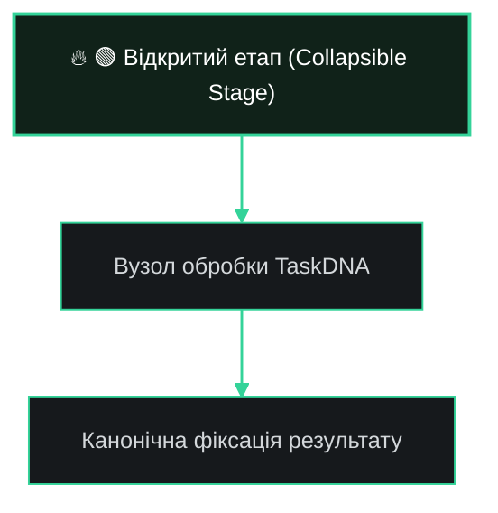

> [!metadata]- ⚙️ Системні метадані та інваріанти (MRH Header)
> ```yaml
> # --- DNK-MRH-HEADER ---
> mrh_id: "docs/templates/EXCALIDRAW_TASK_TEMPLATE.md"
> purpose: "Canonical Markdown Specification and Companion for SOTA Excalidraw Task Template."
> canonical_source: true
> alters_files: []
> triggers_tasks: []
> status: "Active"
> version: "2.0.0"
> updated_at: "2026-11-18"
> author: "DNK-e.com Maksym & Antigravity"
> # --- END DNK-MRH-HEADER ---
> ```

> [!abstract] 🌲 СТАНДАРТ ТА СПЕЦИФІКАЦІЯ ШАБЛОНУ EXCALIDRAW (TASK FOREST)
> **Призначення**: Канонічна документація та правила візуалізації задач у системі Task Forest DNK OS: строгий темний стиль (Flat Green), палітра статусів, 1:1 паритет із Mermaid, клікабельні wikilinks та машинна валідація.

# 🌲 Excalidraw Task Template: Канонічний Стандарт

## 1. Концепція Подвійної Оптики (Dual-Optics)

У системі **DNK OS** кожне складне завдання або архітектурний модуль має два нероздільні представлення:
1. **Людино-орієнтоване (UX):** [[docs/templates/EXCALIDRAW_TASK_TEMPLATE.excalidraw|Візуальне полотно Excalidraw]] — просторове розміщення, статуси життєвого циклу, плашки, клікабельні зв'язки.
2. **Агентно-орієнтоване (Machine AST):** Markdown-нотатка з валідним Frontmatter, MRH-заголовком та детермінованими чеклістами.

---

## 2. Стримана Палітра Статусів та Схем (SOTA Flat Green Design Tokens)

Для усунення візуального шуму ("кислотних" райдужних кольорів та дитячого тремтіння ліній) затверджено єдиний суворий темний стиль (Flat Green: `#16191c`, `#34d399`, `#102219`) відповідно до візуального еталону системи (див. банер-колаут зі смарагдовими акцентами та індикатором `🟢`):

| Статус Завдання | Frontmatter `status` | Фон Картки / Вузла | Обводка (1px subtle) | Шапка Картки / Cluster | Акцентний Текст / Бейдж |
| :--- | :--- | :--- | :--- | :--- | :--- |
| **📋 Backlog / Planned** | `Planned` / `Pending` | `#141a16` | `#28362d` | `#1a241d` | `#94a3b8` (Slate-400) |
| **🟡 In Progress** | `In_Progress` | `#1a2014` | `#3a4420` | `#242c16` | `#fde047` (Warm Amber) |
| **🟣 Audit Gate / Review** | `Review` / `Testing` | `#131f24` | `#224350` | `#182b33` | `#38bdf8` (Muted Cyan) |
| **🟢 Completed / SSOT** | `Completed` / `Active` | `#102219` | `#34d399` | `#102219` | `#34d399` (Emerald Mint) |
| **🔴 Blocked** | `Blocked` | `#201416` | `#422024` | `#32181c` | `#f87171` (Muted Rose) |

### Базові інваріанти оформлення Excalidraw та Mermaid на темному фоні:
- **Фон полотна / Canvas:** `#16191c` (Deep Dark Slate).
- **Фон карток / контейнерів:** `#16191c` (або `#102219` для підкладок та шапок).
- **Рамка карток / Stroke:** `#34d399` (Emerald Mint 1-1.5px border, `rx: 8px, ry: 8px`).
- **Шапка / Підкладка заголовків:** `#102219` (Forest Dark Pill).
- **Головний акцентний колір:** `#34d399` (Emerald Mint) з індикатором `🟢` (`#22c55e`) та UX-акцентом `#38bdf8`.
- **Основний текст:** `#ffffff` (Заголовки), `#d4d8db` (Опис/тіло).
- **З'єднувальні лінії та стрілки:** `#34d399` (Clean Emerald Mint vector lines).
- **Шрифт:** Суворо `fontFamily: 2` (`Clean Sans-Serif` / `Inter` / `Helvetica`). Забезпечує 100% однаковий вигляд українських і латинських літер без артефактів налізання.
- **Шорсткість:** Суворо `roughness: 0` (Vector Clean). Ніяких кривих ліній від руки для архітектурних схем.
- **Розміри Excalidraw:** Ширина картки `375px`, міжколонковий відступ `46px`, висота рядка `1.35`.

### Канонічний шаблон Mermaid у цьому стилі:


---

## 3. Правило Клікабельних Посилань (Embedded Live Wikilinks)

Кожен структурний блок діаграми Excalidraw повинен бути **клікабельним**:
- Поле `link: "[[назва_файлу]]"` прописується як для прямокутного контейнера (`rectangle`), так і для тексту заголовка (`text`).
- В Obsidian клік або `Cmd/Ctrl + Click` на будь-яку картку миттєво відкриває пов'язаний Markdown-документ або вузол Task Forest.

---

## 4. Як Створити Нову Схему Завдання на Базі Шаблону

1. Скопіюйте файл `docs/templates/EXCALIDRAW_TASK_TEMPLATE.excalidraw.md` у робочу директорію під назвою вашої задачі (наприклад, `task_forest/my_module/01_CANVAS.excalidraw.md`).
2. Оновіть `mrh_id` у MRH-заголовку та назву в `# Text Elements`.
3. Заповніть карточки задач реальними назвами з відповідними статусами та зашийте посилання `link: "[[task_forest/...]]"`.
4. Створіть двійник `.md` для повнотекстового опису, коду та аналітики.

---

## 5. Пов'язані Ресурси
- 🌲 Головне дерево завдань: [[task_forest/obsidian_engineering/00_OBSIDIAN_TASK_FOREST_TREE]]
- 🎨 Вузол дизайн-системи: [[task_forest/obsidian_engineering/06_NODE_DESIGN_SYSTEM_AND_SNIPPETS]]
- 💎 Еталон документації: [[Do not Delete - Example]] та [[whiteboards/Do not Delete - Example.excalidraw]]
