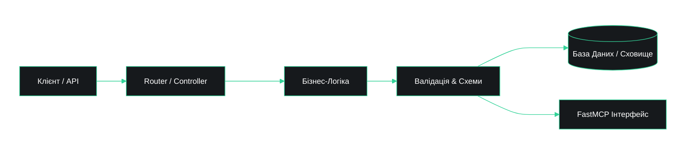

> [!metadata]- ⚙️ Системні метадані та інваріанти (MRH Header)
> ```yaml
> # --- DNK-MRH-HEADER ---
> mrh_id: "docs/templates/SPEC_TEMPLATE.md"
> purpose: "Canonical Dual-Optics Template for System & Module Specifications in DNK OS."
> canonical_source: true
> alters_files: []
> triggers_tasks: []
> status: "Active"
> version: "2.0.0"
> updated_at: "2026-11-18"
> author: "DNK-e.com Maksym & Antigravity"
> # --- END DNK-MRH-HEADER ---
> ```

> ```

> [!abstract] 📐 КАНОНІЧНИЙ ШАБЛОН МОДУЛЬНОЇ СПЕЦИФІКАЦІЇ
> **Призначення**: Цей документ визначає еталонний формат для технічних специфікацій модулів, сервісів, контрактів API та інтерфейсів DNK OS.

`Навігація`: [[00_MOC_DNK_OS|🗺️ Головний MOC DNK OS]] ➔ [[specs/01_CORE_AND_ACTION_BUS_SPEC|📐 Специфікації]] ➔ **SPEC Template**

---

# 📐 [Номер Специфікації]. [Повна Назва Підсистеми]

## 🎯 1. Призначення та Межі (Scope)
> [!info] Системне Призначення
> Короткий виклад задачі, яку вирішує модуль, та його місце у загальній архітектурі DNK OS.

- **Цільовий домен**: `[core | services | apps | plugins]`
- **Вхідні артефакти**: `[API запити, контекст проекту, DAG вузли]`
- **Вихідні артефакти**: `[JSON схеми, медіа-активи, стан бази]`

---

## 🏛️ 2. Архітектура та Моделі Даних (Architecture & Models)


---

## 📋 3. Структури Даних та Контракти (Schemas)

```json
{
  "entity_id": "ent_example_01",
  "workspace_id": "ws-alpha-001",
  "schema_version": "1.0.0",
  "attributes": {
    "key": "value"
  }
}
```

---

## 🔒 4. Інваріанти та Обмеження Безпеки
1. **Ізоляція робочого простору**: Будь-який запит повинен містити валідний `workspace_id`.
2. **Токенний бюджет**: Контекстні зрізи не повинні перевищувати встановлений ліміт.
3. **Обробка помилок**: Повернення чітких кодів помилок без витоку внутрішніх стек-трейсів.

---

## 🧪 5. План Детермінованої Верифікації (Verification Plan)

### Автоматизовані тести
```bash
# 1. Запуск контрактних тестів модуля
./.venv/bin/pytest tests/{path_to_test_file}.py -v

# 2. Канонічний детермінований контроль якості
bash scripts/verify_all.sh
```

### Критерії приймання (Definition of Done)
- [ ] Схеми валідуються проти Pydantic v2 контрактів без помилок.
- [ ] Регресійний набір повертає `exit code 0`.
- [ ] Відсутні абсолютні шляхи та сторонні незадекларовані залежності.

---

`Див. також`: [[docs/guides/DOCUMENTATION_AND_CANVAS_STANDARD|Стандарт Документування]] | [[00_MOC_DNK_OS|Головна Карта]]

