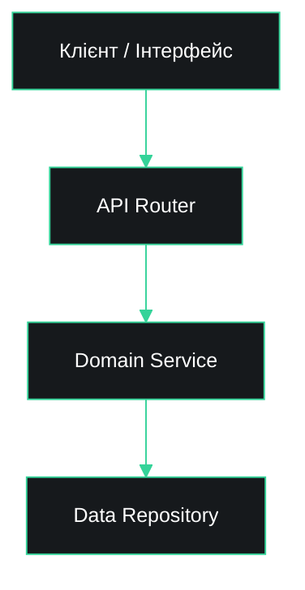

> [!metadata]- ⚙️ Системні метадані та інваріанти (MRH Header)
> ```yaml
> # --- DNK-MRH-HEADER ---
> mrh_id: "docs/templates/dev/DEV_SPEC_TEMPLATE.md"
> purpose: "Canonical Development Specification Template (DEV_SPEC) for feature modules, services, and core packages in DNK OS."
> canonical_source: true
> alters_files: []
> triggers_tasks: []
> status: "Active"
> version: "2.0.0"
> updated_at: "2026-11-18"
> author: "DNK-e.com Maksym & Antigravity"
> # --- END DNK-MRH-HEADER ---
> ```

> ```

# 📐 DEV_SPEC: {MODULE_OR_FEATURE_NAME}

> [!abstract] **Технічний Огляд (Technical Overview)**
> **Домен / Сервіс**: `{apps/api | services/dnk_* | core/* | packages/*}`  
> **Автор / Архітектор**: `{Architect or Engineer Name}`  
> **Статус**: `{Draft | Active | Approved}`  
> **Цільова аудиторія**: Розробники, Архітектори, AI Swarm Workers.

---

## 🎯 1. Призначення та Bounded Context (Purpose & Scope)

### Контекст проблеми
Опишіть технічну проблему або бізнес-вимогу, яку вирішує цей модуль чи фіча. Чому існуючих рішень недостатньо?

### Межі відповідальності (Bounded Scope)
- **У зоні відповідальності**: Які саме функції, розрахунки чи збереження стану виконує цей компонент.
- **Поза зоною відповідальності**: Що делегується сусіднім сервісам або зовнішнім API.

---

## 🏛️ 2. Архітектура та Моделі Даних (Architecture & Models)

### Діаграма взаємодії компонентів


### Моделі Даних (Pydantic / TypeScript DTO)
Вкажіть суворі структури даних:

```python
from pydantic import BaseModel, Field

class ModuleConfig(BaseModel):
    module_id: str = Field(..., description="Unique module identifier")
    is_active: bool = Field(default=True, description="Status of the module")
    max_retries: int = Field(default=3, ge=1, le=10)
```

---

## 🛡️ 3. Системні Інваріанти та Граничні Умови (Invariants & Limits)

### Непорушні інваріанти
1. **SSOT Data Source**: Дані зберігаються виключно в одному авторитетному джерелі.
2. **Ідемпотентність**: Повторний виклик операцій не створює дублікатів і не змінює кінцевий стан.
3. **Чистота шляхів**: Тільки відносні шляхи (`./`, `../`), жодних системних абсолютних префіксів.

### Граничні умови (Boundary Conditions)
- Максимальний розмір вхідного payload: `{e.g. 5 MB}`.
- Поведінка при відмові мережі або зовнішнього сервісу: `{e.g. Exponential backoff retry with dead-letter queue}`.

---

## 🧪 4. План Детермінованої Верифікації (Verification Plan)

### Автоматизовані тести
```bash
# 1. Запуск юніт-тестів модуля
./.venv/bin/pytest tests/{path_to_test_file}.py -v

# 2. Контроль чистоти архітектури та типів
bash scripts/verify_all.sh --affected
```

### Ручна перевірка (Manual Smoke Test)
- Крок 1: Запуск локального сервісу в режимі розробки.
- Крок 2: Перевірка ендпоінта через HTTP GET/POST запит і валідація статус-коду 200 OK.
